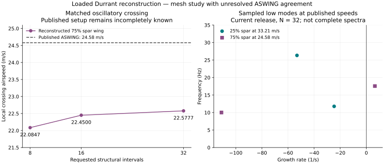
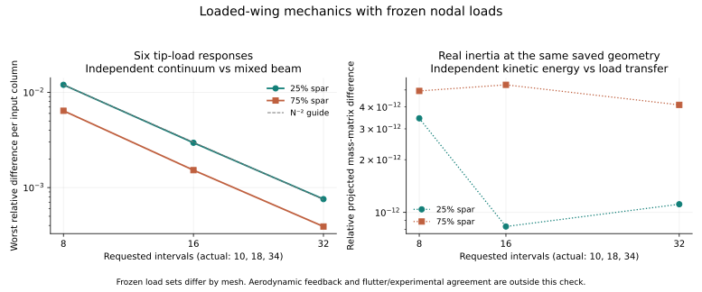
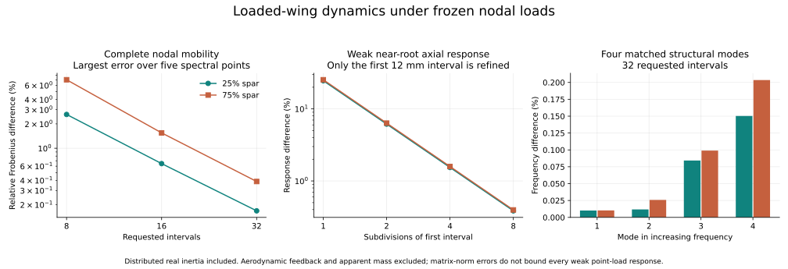
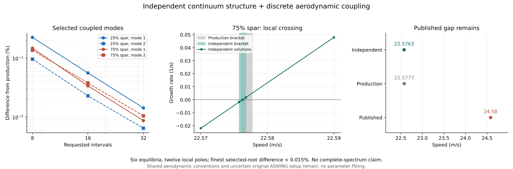
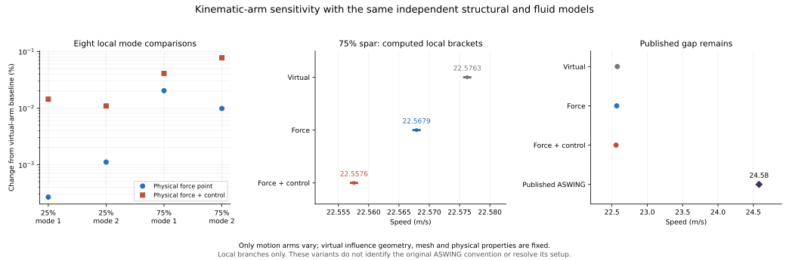

# Numerical formulation and current limits

## Explicit source vacuum dynamics

`drela-fixed-vacuum-v1`, paired with `drela-segspl-v1`, extends the source
section law with completed endpoint inertial-load averages and symmetric
interval wrench transfer. It includes independent normal/additional mass
families, centroid arms, section rotary inertia, the transverse Eq.80 segment
correction and point-object inertia. This finite-difference mass operator is
distinct from the default Gauss/virtual-power operator. Variable properties
need not give a symmetric mass matrix; no general discrete kinetic-energy
claim or aggregate symmetric dynamic tensor is made. The inherited unloaded
length convention remains explicit. See the
[derivation, checks and scope](validation/source-vacuum-modes.md).

The vacuum source modal route supports finite nonnegative
material damping times. Unsupported airflow, quiescent fluid, moving frames, controllers,
struts, engines and signed masses are rejected. Source modal states carry a
new numerical identity; old source static states cannot silently acquire a
dynamic launch. Existing default/static policies are unchanged.

Material damping uses local unsteady Eqs.57/58/60 and the full Eq.62 Euler
curvature derivative. The anisotropic law is transformed through the averaged
section axes; literal Eq.61's bare body diagonal is inconsistent with the
local law under rotation. Damping times average inward endpoint values.
Complete scalar spectra retain rigid-strain relaxation poles. Damped endpoint
mechanical strain is unavailable; sensor strain is a labeled sided interval
estimate. See the [equations, ambiguity and checks](validation/source-material-damping.md).

The separate `drela-fixed-still-air-v1` policy uses the same interpolation and
structural law with explicit positive fluid density. It adds the stationary
acceleration terms from unsteady Eqs.41–44 at each physical endpoint, averaging
completed products before symmetric nodal transfer. Midchord normal/pitch
coupling is retained; real-mass Eq.80 is not applied to fluid. Only the descriptor
mass changes at this zero-flow, zero-rate base. There is no fluid stiffness,
damping, gravity or circulation, and no general symmetric aggregate apparent
tensor is asserted. Modes only: source time, Bode, ROM and moving frames remain
unsupported. Policy and density are part of the saved identity. See the
[equations and independent/native/browser checks](validation/source-still-air-modes.md).

## Axes and dimensions

ASWING uses body x aft, y right, z up. The relative freestream is
`V (cos(alpha) cos(beta), -sin(beta), sin(alpha) cos(beta))`. Local section axes
are c aft, s along increasing beam parameter, and n completing the right-handed
triad. Positive twist is a right-handed rotation about s; it increases effective
incidence for a conventional horizontal wing. Reported roll/yaw coefficients use
the opposite signs to body Mx/Mz, following conventional forward/down stability
axes. Raw force/moment exports explicitly remain in ASWING body axes.
Lifting surfaces and fuselages use their respective Euler sequences from steady
equations 6 and 10; the distinction affects inclined-body centroid and inertia axes.

Aircraft geometry, loads and motion use the consistent input units. Atmospheric
altitude and reference thermodynamic reports have explicit SI units, described
below. Point weight and
weight inertia need division by the input gravity when they are converted to
mass/inertia; do not treat `mg` as mass per length. Unit magnitudes multiply the
named units. Unit labels alone do not define the input unit.

## ASW input and interpolation

The parser retains the exact source text for unedited saves. It builds structured
distributions and global records for calculation; data modifiers are applied
in multiplier-then-adder order. Integer object/type columns are not scaled. Optional
trailing fields default to zero. These semantics need further upstream parity
testing in rare combinations of omitted fields and active adders.

Each doubled station splits a distribution into separate cubic splines. Left and
right values are explicit; reflecting a distribution also swaps the jump side.
Each variable starting at t=0 on a lifting beam is mirrored separately; y reflects
around its t=0 value. The domain is determined by the chord distribution. Zero
diagonal stiffness means exact rigidity, not a singular zero-stiffness material.

The public guide specifies cubic splines but not endpoint conditions. Natural
boundary conditions are provisional. Exact interpolation parity is an open item.
Reference-file compatibility currently proves that the files load and retain their
data, not that every field has been connected to a solver.

## Material arc and saved meshes

New meshes use `accurate-arc-v2`: integrate the norm of the cubic axis derivative,
splitting integration cells at every axis spline knot, reflected knot and position
jump. Vectorized 8/16-point Gauss rules refine cells as needed. A bracketed inverse
maps uniform or cosine material coordinates back to the input parameter. Ordinary
spline knots are integration boundaries, not extra mandatory computational nodes.
Position jumps contribute no material length. Short interval lengths are integrated
directly to avoid subtracting almost equal cumulative lengths.

The map is cached per beam with a signature of its actual axis coefficients,
knots, domain and reflection inputs. A changed axis invalidates it. Historical
`physical-breaks-v1` and `all-breaks-v0` packets retain their original 2049-point
polygonal arc construction when restoring an equilibrium or accepted time step.
Warm starts retain either historical recipe only with matching mesh settings.
This change corrects arc integration accuracy; it does not establish parity with
ASWING's undocumented spline endpoint or discrete node conventions.

## Custom steady equations

ASWING v5.86 describes user equations inserted in GCON, with sensor targets as
examples. OpenSwing expresses these as named `user.<name>` operating constraints.
A bounded syntax-tree evaluator supplies scalar math and literal references to
current sensors, operating variables, net externally applied wrenches and the
six aerodynamic coefficients. It does not execute a language runtime or import
custom Fortran. The expression, target and residual scale use consistent raw file
units chosen by the caller; the unit label is metadata, not a conversion factor.

For custom expression h(q,u) and specified target b, the additional residual is
`[h(q,u) - b]/s`, with s > 0. Sensor geometry, current internal loads, adjacent
material strain, atmospheric/gust/induced flow, and actual controller settings
are evaluated at the same nonlinear trial as the physical equations. There is
no outer sensor-target search around a frozen deformation. Sensor structural
sampling and trace limitations remain those of the sensor module; in particular
material midpoint strain is not extrapolated to an exact anchor station.

Load continuation from zero can make displacement-target actuator columns
vanish. Custom trim therefore first solves the full-load prescribed-operating
state, then continues custom and ordinary operating targets together while
retaining full physical loads. This requires a solvable prescribed-state seed;
a compatible saved physical equilibrium can supply the starting branch. The
usual implicit Newton solve and bounded continuation subdivision apply. A
controller-owned actuator keeps its controller equation; a selected command or
uncontrolled actuator can satisfy the custom target. Weighted allocation treats
custom rows as hard equalities, with its existing feasible-optimum checks.

The final full column-scaled physical tangent must be nonsingular for square
trim. Allocation uses its equality-rank and feasible-curvature checks. All
custom row slopes additionally undergo centered and second-order one-sided
comparisons at dimensionless step `1e-6 * max(1, abs(coordinate))`. A relative
`2e-3` slope tolerance plus `1e-7` absolute and a `32*eps*signal_scale/step`
roundoff allowance guards discontinuities without misclassifying cancellation
of a large target as a switching boundary. This is a local finite-difference
check, not a smoothness proof or an error estimate. Reported angle branches
remain literal in arbitrary expressions, with no implicit periodic residual.
Unavailable sensor values fail only when the expression branch reads them.

Saved equilibrium packets retain definitions and their solved physical state.
Subsequent modal, harmonic, derivative and time problems release steady target
equations. Otherwise a displacement-target row would artificially suppress the
very compliance or dynamic response being measured. Ordinary steady reuse
instead applies current equations/targets to the saved physical guess.

The custom-trim study compares engine settings with axial compliance and strain,
independent vector gust angles, closed-loop proportional equilibrium and weighted
projection. Large-rotation displacement trim is checked against constant-curvature
geometry integrated independently over the material intervals, and against the
continuum circular-arc limit on two meshes. It also checks centimetre units and
saved-state spring transfer `1/[500 + 10 i omega - 2 omega²]`. Exact ASWING sensor
trace/interpolation and arbitrary custom-routine parity remain unverified.

## Weighted control allocation

ASWING's [v5.86 version notes](https://web.mit.edu/drela/Public/web/aswing/version_notes.txt)
document least-squares constraints for redundant controls and individual flap/
engine weights. They do not specify the objective's exact weight convention.
OpenSwing defines the objective explicitly as
`J = 1/2 sum(weight_i * (setting_i - preferred_i)^2)` over every flap/engine
selected as an operating unknown. The weights are positive and multiply
squared file control settings. Their relative magnitudes set the tradeoff;
a common positive multiplier does not change the solution. Preferred values
default to zero. Prescribed actuators and controller-owned actuators are not
added to this objective. A controller's other equations remain coupled.

An operating row with `quantity: "minimum_control"` contributes a free actuator
unknown instead of a hard target. Any number of distinct flap/engine variables
can use this option. The other operating rows and all beam, aerodynamic,
reaction and controller equations are equality constraints; no residual penalty
is exchanged for lower actuator effort. Nonzero physical targets on a minimum
slot are rejected; use its `preferred` setting instead. Hard target rows also
accept `weight` and `preferred` when their solved variable is an actuator.

`control_allocation.py` starts from a loaded prescribed-control equilibrium
(or saved physical state) and uses sequential quadratic programming with exact
objective gradients and centered differences of the full physical residual.
Hard targets continue from their initial measured values. The optimization
coordinates give a unit objective Hessian on the weighted control variables;
this is numerical scaling, not a change of objective. Successful termination
also requires physical residual tolerance, full equality-row rank, stationary
cost in the feasible tangent and positive reduced Lagrangian curvature.
The latter includes the nonlinear physical-constraint curvature, so the test
does not confuse a positive quadratic objective with a constrained minimum.
Directions are normalized by weighted actuator motion, and numerical curvature
uses analytic objective terms to avoid subtracting large equal cost values.

The result reports the objective, each weight/preferred/actual setting,
stationarity, equality residual/conditioning and reduced curvatures. These are
local numerical checks on the selected branch, not a global optimality or
aircraft stability proof. Actuator bounds/saturation are not imposed. Exact
ASWING weight normalization and allocation branch parity remain unverified.
Saved equilibria retain all solved controls and cost metadata; modal, harmonic,
time-launch and derivative calculations release the steady trim equations
according to their existing response conventions.

Independent validation uses weighted linear control projections, simultaneous
force/moment constraints, an actuator-disk problem reparameterized analytically
by thrust, an elastic wing with proportional flap influences, a fixed controlled
actuator, and a saved spring's analytical transfer function. Millisecond units
and common weight scaling leave proportional-engine settings unchanged.
The loaded wing's allocation ratios have an independent reference; its complete
aircraft deformation does not. The native and packaged-WASM studies are
`docs/validation/control-allocation*.json`.

## Atmosphere, gravity magnitude and airspeed constraints

The `reference.*` operating targets implement the local reference-airflow
constraints of the [steady formulation](https://web.mit.edu/drela/Public/web/aswing/asw_theory.pdf),
equations 181–184. At the fixed body velocity reference `rv = Reference[3]`,
the relative velocity is `vref = -Uorigin - Omega × rv + Rᵀ gust(X + R rv, t)`.
The existing speed/alpha/beta parameterization already specifies the still-air
velocity at `rv`, so its vector is `-Uorigin - Omega × rv`. Adding rotation
again would double count it. The Earth gust is evaluated at the actual posed
reference location and field time; induced flow and local elastic velocity do
not enter this reference definition. Sensor airflow retains its separate law.

Targets `reference.speed`, `reference.alpha` and `reference.beta` use the
vector magnitude, `atan2(w,u)` and `atan2(-v,hypot(u,w))`, respectively. Angles
are degrees. Alpha uses a wrapped residual and shortest angular continuation,
including across ±180 degrees. Zero speed has undefined alpha and beta; purely
transverse flow has undefined alpha. Reports preserve these as JSON nulls;
selecting an undefined angle as an active target produces an explicit error.
Direction components within 32 machine epsilons of the larger still-air/gust
speed are treated as unresolved, so rotated cancellation and trigonometric
roundoff at 90 degrees do not manufacture an angle. The raw vector and its
computed magnitude remain in the report.
Positive speed and pressure targets, alpha within ±180 degrees and beta within
±90 degrees are validated before solving. Singular or unattainable combinations
can still fail the coupled solve; the positive still-air speed parameterization
cannot represent a zero still-air velocity.

`reference.equivalent_airspeed` uses `|vref| sqrt(rho/rho0)` and
`reference.dynamic_pressure` uses `rho |vref|²/2`, in consistent file units.
These are ideal equivalent airspeed and local dynamic pressure; they do not
establish compressible pitot-indicated VIAS parity. The existing unprefixed
speed, alpha, beta, equivalent-air-speed and pressure inputs/targets, PG
reference and aerodynamic coefficient normalization retain their still-air
meaning. The `reference_flow` result reports both velocity components and local
air data, alongside the original `atmosphere` report. Dynamic response releases
steady air-data constraints after computing its loaded base, as with other
steady trim constraints.

`scripts/verify-reference-flow.py` checks independently constructed posed and
spatial velocity vectors, point drag and moments, density conversions,
feet/millisecond units, the angle branch, an elastic inverse equilibrium and a
saved spring equilibrium's analytical frequency response. Elastic-target and
solver-residual checks are distinguished from aircraft-level validation.
Native and packaged-WASM results carry their source hashes in
`docs/validation/reference-flow*.json`.

The ASWING guide lists atmospheric altitude as an **explicit operating parameter**,
separately from the Earth position used for gust interrogation and ground images.
OpenSwing follows that distinction. `FlightCondition.altitude_m` is geometric
altitude in metres; the UI converts km or thousand ft. It is not inferred from
`position_earth.z`. Altitude is independent of the file's length-unit declarations,
matching ASWING's separate UALT convention, and defaults to sea level.

`atmosphere.py` implements the lower portion of the
[U.S. Standard Atmosphere 1976, NASA-TM-X-74335](https://ntrs.nasa.gov/citations/19770009539):
tables 2/4/8, hydrostatic equilibrium and ideal-gas density. The supported geometric
range is −5 to 86 km. With `r0=6,356,766 m`, geopotential altitude is
`H=r0 Z/(r0+Z)`. Molecular-scale temperature uses the seven specified linear
layers; pressure is integrated analytically in each layer (power law for a
nonzero lapse rate, exponential for an isothermal layer). Density and sound speed
use molecular-scale temperature. The table-8 molecular-weight ratios correct
reported kinetic temperature between 80 and 86 km. The upper-atmosphere
diffusion/composition model above 86 km is not implemented.

The file's `Constant` density and sound speed are sea-level **input-unit**
references: `rho=rho0 (p/p0)/(T_M/T0)` and `a=a0 sqrt(T_M/T0)`. This preserves
arbitrary consistent file units without guessing SI scales from unit labels.
An explicit `density` takes precedence over standard density; sound speed still
follows atmospheric altitude. `mach=None` computes the PG Mach from true speed
and this sound speed. An explicit `mach` remains independent, as allowed by
ASWING. The section-normal Mach used for the local moment correction also uses
the altitude-dependent sound speed; changing the PG Mach does not override it.
Reported `standard_pressure_Pa` is the reference Earth atmosphere pressure,
not a pressure recomputed from a custom density override.

The `gravity_magnitude` operating input is a nonnegative value in input L/T²;
the file's Constant gravity is its default. Earth gravity is rotated with the
current attitude. This does **not** alter `mg/gunit` or point weight/inertia
conversion: `gunit` stays the original Constant value, so mass remains fixed.
The explicit `solve_static(..., gravity=body_vector)` override still takes
precedence and is identified by `gravity_source`. Altitude does not automatically
change the specified gravity magnitude or the standard atmosphere's defining
gravity constant.

`equivalent_airspeed` targets use `V sqrt(rho/rho0)` and `dynamic_pressure`
targets use `rho V²/2`. Both participate in the common Newton residual and can
solve true airspeed while other constraints determine alpha, controls or motion.
The guide calls its airspeed constraint `VIAS`, but the inspected documents do
not specify its density/compressibility conversion. **Exact ASWING VIAS parity
remains unverified.** OpenSwing explicitly labels the implemented quantity
equivalent airspeed; it does not present it as a calibrated pitot indication.

`load_factor` is ASWING's prescribed lift multiplier N (default 1). A `lift`
constraint solves `L=N L_spec` from steady equation 185; its result reports both
`specified_target=L_spec` and `target=N L_spec`. It does not multiply any other
target, applied mass, gravity, or prescribed aerodynamic force.

Verification includes values transcribed from COESA Table I (printed pages
54/58/60/62/66), independent numerical integration of hydrostatic pressure in
geometric height, continuity at every layer boundary, mass preservation under
gravity changes, and density/added-mass/local-Mach scaling. Coupled constraints
recover equal dynamic pressure at altitude and enforce scaled lift targets.
`scripts/verify-atmosphere.py` records three altitude cases with the same
equivalent-speed and lift targets. ASWING's actual table interpolation, altitude
range and VIAS convention still require executable or further published evidence.

## Steady lifting line

The K/W wake-core control is `FlightCondition.wake_core_ratio`, default 0.25.
Each source radius is the larger of this ratio times local chord and the
influence-geometry interval length (current by default, undeformed under K/F).
The common influence calculation uses it for distinct physical
lifting beams and external probes/objects; the same physical lifting beam uses
zero core even across logical beam boundaries. Images inherit the selected
source/target core. The width floor remains at ratio zero. Source radii and the
number limited by spacing are reported. See the independent
[two-surface line-integral study](validation/wake-core.md), including PG, parallel
ground images and consistent input units. This setting does not change the ideal
far-wake Trefftz kernel or add resolved shed-wake history.

The K/F option is `FlightCondition.freeze_influences`, default false for backward
compatibility with OpenSwing cases. Enabling it precomputes vortex and volume
coefficients on the jig geometry at zero wind angles, as described in steady
§4.6. Current normals, lengths, motion, circulation, gusts, jets and loads remain
active. PG Mach, core ratio and physical image-plane changes rebuild the
coefficients. Attached receivers use jig positions; external surveys sample the
frozen field at the requested spatial positions. The Trefftz diagnostic then
uses the jig wake and its zero-angle axes. See the
[implementation and verification notes](validation/frozen-influences.md).

`aero.py` implements pointwise circulation (steady equation 62) and a truncated
Fourier sine series (equation 63). The latter uses independently selected
per-beam mode counts, described under [Fourier circulation](#fourier-circulation-coordinates).
Cosine panels are generated in physical arc length, mapped back to arbitrary t.
Physical-property discontinuities are inserted as panel boundaries; shell-only
display tables do not change fresh meshes. Geometric midpoint
interpolation uses the midpoint in Glauert angle (equations 150–154). This geometry
sampling is a discretization; it is not a claim of matching ASWING's default grid.

Bound vortex and flow-tangency point locations follow equations 155–157 and move
with the wind. The section slope controls the CP offset, `h = dCLda/(4 pi)`.
The section aerodynamic zero-lift angle and mixed flap inputs rotate the CP
quasi-normal per equations 158–159.

Finite and semi-infinite vortex integrals are analytic, with the regularized
`(r² + core²)^(-3/2)` kernel of equation 161. Physical beams that share an index
have zero mutual core radius. Distinct physical beams use `max(chord/4, ds)`.
The self bound contribution is removed at the section force evaluation point;
the wake contributions remain. The [swept-line field diagnosis](validation/swept-lifting-line-limit.md)
finds a logarithmically divergent same-line wake contribution at interior points
with nonzero circulation gradient and sweep. Prescribed elliptic circulation
already reproduces this mechanism, independently of a circulation solve.
Independent integration matches the tested SA-14 field to 1.26e-11 m/s, so
correct evaluation of the discrete integrals does not establish a convergent
physical force velocity. A justified treatment, reference-ASWING comparison,
and consistent load/derivative updates remain required. Local validity guards
remain active; Fourier truncation alone is not a general remedy.

The PG transformation stretches coordinates by `1/sqrt(1-M²)` along the wind.
Using that symmetric transform in body coordinates is algebraically equivalent
to first rotating to wind axes. The chain rule transforms induced velocity with
the **transpose**, not the inverse (equation 149).

The nonlinear residual is the CP normal velocity minus the stall leakage from
equations 203–204, normalized by freestream speed. It uses section-normal speed
from the force point and stable `logaddexp` evaluation. SciPy's hybrid Newton
method solves the system. Success requires a finite solution and max normalized
residual <= 1e-8, independently of the optimizer status flag.

Forces follow Kutta–Joukowsky and profile drag equations 67 and 70. Moments use
the section c-axis quarter-chord lever arm and the section pitching moment from
equations 72–73. `CDi_near` is the wind projection of the circulation force.
`CDi` is the separate far-wake diagnostic described under
[Trefftz-plane forces](#trefftz-plane-forces-and-span-efficiency).

Slender-body and point-object volume effects are described below. Rigid analysis
does not include gravity/structural reactions or deformation, and is labeled as
such. It is not a trimmed aircraft operating point.

## Nonlinear beam

`structure.py` independently implements the compliance form of steady equations
18–20. A symmetric bending/torsion matrix includes all three cross-stiffnesses;
axis offsets introduce the corresponding force/moment coupling. Infinite diagonal
stiffnesses are eliminated exactly rather than approximated by large constants.
The finite submatrix must be positive definite.

The spatial state is reference-axis position r, material-to-body rotation R,
internal force N and moment M. In undeformed arc coordinate s:

```
r' = R ([0,1,0] + strain)
R' = R skew(kappa0 + delta_kappa)
N' = -f
M' = -r' cross N - m
```

Local force/moment components for the constitutive law are `R.T N`, `R.T M`.
Clamped/free boundary conditions fix root position/frame and prescribe global
tip loads. SciPy adaptive collocation solves the BVP using load continuation.
Length and load normalization are used, and rotation orthogonality is checked
after convergence. This representation avoids an Euler-angle singularity, but
currently uses nine rotation entries rather than a minimal Lie-group discretization.

Tests include exact pure-moment circular arcs through 180 degrees, linear bending,
uniform loading, finite extension/shear, torsion, constitutive reciprocity/energy,
rigid limits, and invariance under arbitrary rotation and translation. General
multi-beam behavior is checked separately with the network solver below. Dynamic
nodal dynamic mass matrices are not yet connected; the integrated rigid-motion
spatial mass matrices described below are available.

## Mounted beam network and aerodynamic coupling

`network.py` assembles connected beams with nodal position/displacement and a
proper deformation rotation `Q = Exp(rotation_vector)`. Each element adds a
spatial internal force N and midpoint moment M. A joint or ground adds as many
reaction unknowns as kinematic constraints. Circulation on every aerodynamic
panel is an independent unknown of the same system; no frozen-load or loose
partitioned aeroelastic iteration is used.

At the ends of each element, the material frames are `Ra = Qa R0a` and
`Rb = Qb R0b`. The reference frames can differ across a kink; the nodal Q
is shared. Define `k = Log(Ra.T Rb)` and `Rbar = Ra Exp(k/2)`. The mixed
compatibility equations are

```
Rbar.T (rb-ra) - Rbar0.T (r0b-r0a) = strain * ds0
k - k0 = delta_curvature * ds0
[strain, delta_curvature] = Section.compliance() [Rbar.T N, Rbar.T M]
```

This objective midpoint discretization converges to the spatial continuum
equations. It differs from ASWING's documented Euler-angle averaging. It preserves
the supplied stress-free jig geometry exactly and uses the exact rigid compliance
limit. It is not a claim of matching ASWING's discrete grid or Jacobian. Individual
element rotation increments must remain below the logarithm's 180-degree branch;
refine the mesh for highly curved geometry or sharp deformation.

Each element applies `+N` at its first node and `-N` at its second. Its end moments
are `+M + (rb-ra) cross N / 2` and `-M + (rb-ra) cross N / 2`. These wrenches
conserve global force and moment exactly. A doubled station's reference-axis
position jump is carried as a rigid offset, including offset-cross-force moments;
it contributes no material arc length. This is an independently tested representation
of a rigid jump, not yet comprehensive parity for ASWING's zero-length intervals.

Rigid, pinned and roller ground constraints respectively restrain translation plus
rotation, translation only, or rotation only. For joint endpoints i and j, the
translation constraint is `rj-ri = Qi (r0j-r0i)` and the rotation constraint is
`Log(Qi.T Qj)=0`. Types 0, 1 and 2 impose both, translation only, or rotation only.
The pylon belongs to point i; a pinned joint releases its free-end couple. Opposite
wrenches and pylon lever arms conserve force and moment. Exported joint moments
are the actual moments at each attachment, including the offset lever arm.
Type 3 adds a sprung hinge. `Jangle` identifies a Joint row (one-based across
Joint blocks), a nonzero jig-body axis, and an angle-versus-structural-moment
table. Axes are normalized. Moment abscissae must increase except for doubled
points; doubled points have equal angles and split the natural cubic spline to
permit slope breaks. A two-point segment is linear. Outside the table the end
spline is extrapolated, as specified by the guide; the report flags extrapolation.
Angles may have either slope sign. The sign must follow beam orientation and the
guide's restoring-moment rule; convergence alone does not establish stability.

The implementation follows steady theory equations 194–199 literally:
`h = Qi h0`, `Mh = M1 dot h`, and `Qj = Qi Exp(alpha(Mh) h0)`. In particular,
equation 195 prints the **beam-1 structural moment**, not the joint reaction
couple. The orientation residual is
`Log(Exp(-alpha(Mh) h0) Qi.T Qj)`. This enforces both transverse rotations and
the axial spring law within the same Newton system as the beams and circulation.
The pylon position equation and conservative paired wrenches are unchanged.
An unloaded angle `alpha(0)` is continued from zero along with external loads;
the moment-dependent part and its tangent remain active even at zero load.

Structural moment is reconstructed from the adjacent midpoint element and its
end force lever arm. The element's distributed-load half-wrench is removed from
the inward endpoint trace, so the numerical lump at a beam end cannot create an
artificial hinge torque. The inward trace is used at either beam endpoint; at
an interior attachment the left trace (in increasing parameter order) is used
and reported. The published description does not resolve interior jump-side
selection, and **ASWING interior-joint trace parity remains unverified**.
Reversing beam 1 reverses its structural moment sign at the same attachment;
the spring-law slope must then reverse to preserve the same restoring response.

At an offset or interior joint, `M1 dot h` can include a pylon-force moment or
other loads carried along beam 1. It is not generally the work-conjugate
free-end reaction torque. The implementation retains the printed ASWING law;
passivity for these configurations needs further reference evidence. Independent
passive torsion-spring checks use coincident, serial beam endpoints. Full turns
cannot be tracked as separate history states by this static SO(3) solve, and
discontinuous/multivalued angle jumps (ideal zero-torque freeplay) are explicitly
rejected. Continuous nonlinear slop/failure approximations can be tabulated;
natural spline endpoint parity and post-instability branch tracking remain open.

`tests/test_joints.py` checks exact rigid links through 150-degree deflection,
both beam orientations, an independently solved pendulum/spring equation,
the printed offset-pylon moment law, moving oblique axes, global rotation
covariance, finite beam deformation, distributed-load endpoint recovery,
nonzero unloaded angles, cubic interpolation, breaks/extrapolation and the rigid
limit. `scripts/verify-hinges.py` records an articulated-wing mesh study; it is
internal convergence evidence, not an ASWING or experimental comparison.

Profile drag retains its Glauert-sampled force density, treated as constant on
each straight interval. Its first moment is integrated at the physical interval
centroid: the reported strip couple about `rm` includes
`((r0+r1)/2-rm) cross F_profile`. This is the exact uniform-load integral with
zero intrinsic drag couple (steady equations 70/74), consistent with the
arithmetic structural averages in equations 49–56. Lift, apparent mass and their
velocity/application locations are unchanged. The same couple and its derivative
enter structural transfer and total aerodynamic moments. The source-box transfer
reduces to equal endpoint profile forces with zero profile couples.

This establishes the constant-profile-force first moment, not historical ASWING
quadrature for varying loads. Moving `NetworkMotion` transfer still uses its
existing Glauert-point virtual-work map with the equivalent couple; it conserves
the resultant wrench but is not exact distributed-load work for arbitrary
strain/shear. The [SA-5 source review](../artifacts/isae/sa5-profile-moment-review-20261028/summary.json)
records that distinction. Independent synthetic tests cover uniform friction and
pressure drag, reference translations, fresh zero-circulation residuals and both
structural transfer paths.

Every residual evaluation reconstructs the current aerodynamic reference axis,
section frames, force/control points and wake filaments. The lifting-line residual
and integrated section force/moment enter the common system. Loads split between
adjacent structural nodes include lever-arm corrections, preserving the integrated
force and moment. Aerodynamic and structural intervals share boundaries. This follows steady
formulation §3.1, equations 62–63: pointwise circulation uses structural
intervals, while a Fourier representation independently sets the number of
circulation unknowns. Separate sampling meshes were previously listed here as
a requirement without a supporting public specification; they would be an
extension, not an established ASWING parity gate.

Structural constitutive properties and distributed masses are sampled at the
midpoint in undeformed material arc length, separately from the aerodynamic
theta midpoint. Distributed `mg` and `Dmg` use undeformed material length and
their independent centroid offsets. Point-object pylons move and rotate with
their attachment node; inertial and CDA loads act at the current pylon end.
For a mechanical Weight whose anchor lies outside a wholly rigid, undamped
beam, analysis uses the nearest endpoint and retains the original physical
point position, tensor inertia and spin. Every stored diagonal stiffness
must encode infinity exactly (zero or an absent table); cross stiffnesses and
material damping must be exactly zero throughout their complete tables.
Point CDA and volume must be zero for this reduction. Finite stiffness,
partially rigid beams and stale edited interpolants do not qualify.
This `whole-rigid-beam-endpoint-pylon-v1` policy is separate from exact-decimal
station aliases. It changes only analysis copies, records original/effective
anchors in outputs and saved-state identity, and leaves source serialization
intact. Missing or altered policy metadata prevents checkpoint reuse.
The [production attachment study](validation/isae-rigid-attachment-production-20261106.md)
records its equation, source and browser checks. Continuous rigid equivalence
does not establish native ASWING out-of-range input semantics or exact
finite-BDF equivalence; time-step refinement remains necessary.
Default Earth gravity is `(0,0,-g)` and rotates into body axes with the aircraft
attitude; an explicit body-axis override is supported in the API.
Rotating/accelerating-frame loads are described below. Bodies and point-object
flow use the deformed geometry. Struts and engines use current pylon positions and rotations.

Positions, forces, moments and circulation are nondimensionalized for the solve.
Finite differences retain dimensionless perturbations of at least `1e-6`, avoiding
cancellation when tiny rigid-limit displacements are added to finite jig coordinates.

Prescribed-condition and free/mixed acceleration equilibria use `structured_static.py`, following the
geometry-lagged Newton linearization in [Drela's steady theory, section 4.6](https://web.mit.edu/drela/Public/web/aswing/asw_theory.pdf#page=36).
Current-iteration vortex, volume and jet fields are held fixed for geometry
perturbations. Circulation perturbations retain the full circulation dependence,
including nonlinear engine jets. These temporary fields are discarded after
each tangent, including on exceptions. Every nonlinear trial and reported result
uses the complete residual on its current deformed geometry. This does not enable
the separate frozen-jig `K/F` physical option.

The approximate Newton matrix is assembled directly as four blocks: sparse
mechanics `A`, force/circulation coupling `B`, sparse flow/geometry coupling `C`,
and the small global block `D`. For free/mixed acceleration constraints, the
border also contains the selected frame accelerations and net-load rows.
Disjoint local row supports share finite
difference evaluations. Sparse LU handles the beam and attachment graph, including
joints that prevent a single literal tridiagonal ordering. The circulation step
solves `D - C A^-1 B`; the mechanical step is recovered with the same sparse
factorization. No dense global matrix is formed on this path. A failed sparse
direction retries the full physical Jacobian before the load increment is reduced.

Within one load increment, the solver now reuses the assembled matrix, sparse LU,
`A^-1 B` and dense Schur LU while full physical residuals contract sufficiently.
A factorization is kept only after an undamped accepted step with squared
residual norm at most 0.49 of its preceding value. It is discarded after six
uses, any damped or weakly contracting step, and every load-level change.
A failed reused direction first gets a fresh structured matrix at the same
state and iteration, then the established full-Jacobian fallback. Each linear
solution is checked against its original matrix. Nonlinear acceptance still
recomputes every physical equation at the current geometry; reuse changes
neither the continuation limits nor convergence tolerances. The initial rank
gate and full-SVD fallback retain their thresholds. Internal
`reuse_matrices=False` provides a control that rebuilds every iteration.
Native and WebAssembly comparisons, failure recovery and complete Daedalus
time-response observations are retained in
`docs/validation/static-matrix-reuse.json`.

The circulation columns in `B` and `D` use direct derivatives at the captured
geometry. Section lift/drag/pitching moments, body loads, point drag, nodal wrench
transfer and load-dependent hinge constraints are differentiated together.
Fourier coordinates use the same sampling and testing matrices as the residual.
Engine axial-inflow loads and jets use centered derivatives at two step sizes
with a refinement check; their circulation feedback remains active. Nonsmooth
engine or hinge branches, unresolved derivatives and a 128 MiB storage budget
retain the original forward-difference circulation columns. Mechanical and
flow/geometry columns keep their existing grouped differences on this path.
The complete fallback also uses the exact source load/reaction and circulation
blocks when their derivative helpers support the current equations. For the
source coupled and moving-airflow operators, its geometry decomposition includes
the moving induced field; source beam compatibility stays in grouped physical
residual probes, without substituting midpoint beam derivatives. Unknown source
constitutive laws and unavailable helpers retain full residual differences.

Selected net-force/moment rows sum derivatives of the original external nodal
wrenches over each local column's disjoint support, including the moment-reference
arms. Those global derivatives are not multiplied by the structural load fraction;
the operating target follows its original continuation path. Direct circulation
columns include the corresponding total load derivatives. Acceleration columns
recompute the full physical fields. The original geometry/resultant/circulation
step cap remains, while acceleration variables use the full physical merit line
search without an artificial unit-increment cap. This preserves rapid Newton
solution of otherwise linear rigid-body acceleration equations.

At zero external load, `B` is exactly zero and geometry lagging changes only `C`.
The exact mechanical and global diagonal blocks therefore suffice to check
rank. The mechanical check bounds the condition number using a computed inverse
in 64-column sparse-solve batches, including the inverse's backward error. The
small global block uses a column-scaled singular-value check. Structurally
singular mechanical patterns skip sparse LU. An inconclusive inverse-norm
certificate first tests the existing, invertibly equilibrated mechanical block
by SVD, with the same `1e-10` smallest/largest singular-value gate. This bounded
check accepts at most 2,048 mechanical rows (32 MiB of float64 matrix input),
requires exactly zero `B` and a nonsingular circulation block, and avoids a
full physical rebuild when those diagonal blocks already establish rank.
Unavailable or inconclusive certificates retain the full-Jacobian SVD;
mechanisms and redundant
reactions remain errors. This check does not support load-stabilized mechanisms
or continuation through bifurcations.

Grounded source-beam forests have an additional algebraic cold-start
certificate in `source_initial_rank.py`. At exactly zero load and zero
mechanical state, conservative nodal balance eliminates every internal and
reaction wrench by peeling leaves toward the single full Ground per tree.
Finite source compliance then contributes zero strain/curvature increments;
compatibility, full joints and Ground eliminate all pose increments. This
extends the earlier rigid-tree argument to finite source flexibility without
identifying the source equations with an energy Hessian. The scope requires
identity section frames, zero jig curvature, positive material lengths,
finite compliance maps and no frame motion, struts or operating unknowns.
Compliant joints retain the isolated-terminal, coincident-point, zero-intercept
and positive finite effective-stiffness checks. Small finite hinge stiffness
is retained exactly as supplied.

The result is explicitly an **algebraic rank proof, not a numerical condition
bound**. Its report is `source flexible-tree rank certificate`, with
`physical_certificate.numerical_condition_bound=false`. The actual circulation
block must still pass the column-scaled 1e-10 singular-value gate, and the
force/circulation block must be exactly zero. Cases outside this proof retain
the numerical checks above, including their thresholds. Actual Newton
matrices, physical residual tolerances, finite-rotation limits and checkpoint
verification are unchanged; the proof does not accept a nonzero rest residual
as equilibrium or assert stability at nonzero load. See the
[source-tree proof](validation/source-flexible-tree-rank-20261107.md) and
[production verification](validation/isae-source-tree-production-20261107.md).

Load continuation scales applied structural loads while retaining the full
circulation equations. The structured path starts with four default load
increments, except for the safeguarded finite-hinge estimate described below.
It subdivides failed increments and checks every physical residual
against `min(requested_tolerance, 1e-12)`. This tighter target resolves recovered
loads and stresses more closely than accepting the default `1e-8` residual alone.
The original full-Jacobian solver remains the path for other released operating
variables, controllers, saved equilibrium correction and general unsteady residual
options. Stationary time initialization uses the equivalent steady view below;
eligible BDF steps use their sparse time matrix. Derivatives and eigenmodes keep
full physical linearizations. Broader direct derivative assembly and structured
inverse/controller/Radau solves remain future work.

Within a tangent, unchanged actual nodal positions and rotations reuse structural
geometry and zero-relative-motion sampling. Each geometry state and aerodynamic
setup cache has a separate 16 MiB storage budget; transfer and body-sampling maps
have a 16 MiB budget per motion object. State/fraction bytes invalidate the relevant
maps, applied loads are always recomputed, and exceeding a budget recomputes the
original expressions. Base aerodynamic setup is reused only in circulation columns;
geometry columns rebuild it. These caches expire with the tangent. Dynamic residuals
retain their elastic-motion geometry path. The [geometry reuse validation](validation/mounted-geometry-reuse.json)
records exact matrix comparisons, complete physical output comparisons and native,
WASM and actual-browser evidence without relaxing acceptance bounds.

The exact vortex/volume pair cache now remains alive through the steady and
BDF frame-variable columns. Their `full_fields` context removes all captured
geometry-lagged fields, so each column evaluates its current geometry, motion,
wind, PG transform, ground images and loads. Actual pair inputs still determine
whether each influence is reusable. The existing 64 MiB pair/material budget
and exception cleanup remain; caches expire at the end of matrix assembly.
Full-size frame columns are checked against uncached physical equations for
no ground, solid ground and constant-pressure images, including changed flow,
frame position and attitude.

The finite-vortex, semi-infinite-vortex and source/doublet kernels use an ordered
three-component dot product for float32/float64 coordinates. This avoids the
temporary three-component product and reduction array for large influence
tensors. Other dtypes retain NumPy's accumulation rules. Source/receiver pairs,
cores, self exclusions, images, quadrature and the ordered source summation
are unchanged. Independent Biot-Savart quadrature and potential-gradient checks,
complete response comparisons and native/WASM/browser observations are recorded
in `docs/validation/frame-influence-reuse.json`.

Steady residuals that need only applied loads omit unused real-mass integration
records. Detailed output has a separate cache key and recomputes the complete
records. With zero elastic motion, frame angular velocity and angular
acceleration, distributed mass force is exactly `mass * (gravity - acceleration)`
and its centroidal couple is zero. The same eight Gauss points, centroid offsets
and SO(3) virtual-power load transfer remain in use. Rotating and moving states
retain the general inertial expressions. An entirely zero distributed
mass/inertia entry can skip load transfer; zero mass with nonzero rotational
inertia cannot. The [steady mass validation](validation/steady-mass-performance.json)
checks these boundaries, restored diagnostics, all 34 Daedalus tangents and complete
native/browser outputs without changing any physical setting.

The [direct circulation validation](validation/mounted-direct-circulation.json)
adds complete refined circulation-column comparisons at three full-size Daedalus
states, native/WASM regressions, physical-output comparisons and browser progress
checks. Its block assembly reduces Daedalus residual calls per tangent from 260
to 43 without changing the mesh or acceptance threshold.

The [structured mounted validation record](validation/structured-mounted.json)
includes complete default Daedalus native/browser comparisons against a refined
full-Jacobian reference. The old default result has 257 load/stress differences
outside the comparison bounds; full-Jacobian correction removes these differences
and agrees with the new solver. The arbitrary `1e-14` refinement target reaches a
floating-point floor, so that failed check is retained separately. Successive
refinements from both initial results agree across all physical outputs without
relaxing the `1e-8` absolute-plus-relative comparison bounds.

Validation includes 90/180-degree exact arcs with second-order refinement,
combined spatial loading against the independent collocation BVP, finite shear
and extension, joined beams against a continuous cantilever, offset-joint
conservation, distinct pinned/roller behavior, gravity centroid/pylon reactions,
and rejection of mechanisms and redundant constraints. Coupled checks include
the exact rigid aerodynamic limit, finite-deformation feedback, bilateral
symmetry, global load balance and mesh refinement. These are component and
invariant checks; published ASWING aeroelastic benchmarks remain required.

## Accelerating-frame inertia, angular momentum and apparent mass

`inertia.py` implements steady equations 75–96 and integrated properties from
237–256. Given absolute acceleration `a_ref` at the file's acceleration-reference
point, angular velocity `Omega` and angular acceleration `alpha`, the acceleration
at any body-fixed point p is

```
d = p - acceleration_reference
a(p) = a_ref + alpha cross d + Omega cross (Omega cross d)
```

For mass m, centroidal body-axis inertia I and intrinsic spin momentum H, its
force and centroid couple on the supporting structure are

```
F = m (g - a(p))
M_centroid = -I alpha - Omega cross (I Omega + H)
```

The pylon/section-centroid lever arm contributes `offset cross F` at the beam.
Point inertias and spin vectors rotate with the attachment: `I=Q I0 Q.T` and
`H=Q H0`. All ASW weights, weight inertias and weight angular momenta are divided
by the input gravitational acceleration. The products `Ixy,Ixz,Iyz` have negative
signs in the tensor, per equation 29 of
[Drela's CG calculation note](https://web.mit.edu/drela/Public/web/aswing/CG_Calc.pdf).

Distributed section inertia has local diagonal `(icc, icc+inn, inn)`. The standalone
rigid mass summary uses the finite segment correction in steady equation 80;
in that midpoint representation the additional body-axis tensor is
`m/12 * (|dr|² identity - dr dr.T)`. It accounts for the actual element chord even
when extension/shear changes it. With a straight uniform beam, midpoint placement
plus this correction gives the exact integrated mass, CG and inertia on any mesh.
The coupled steady and time residuals instead integrate section positions and
orientations with eight Gauss points per segment and virtual-power-consistent
nodal transfer, using midpoint material properties. They include the finite
segment contribution by integration, without adding it twice. Varying material
properties retain midpoint quadrature error; refine the mesh. Additional mass
retains its own centroid and inertia contribution.

The rigid-motion real-mass summary includes total mass, CG, first moment, inertia
about the moment reference and CG, spin momentum, and a symmetric 6×6 spatial
matrix relating translational/angular velocity to momentum. The apparent-mass
summary uses a 6×6 matrix with normal-only section mass `rho*pi*c²*ds/4` at
midchord and span-axis added inertia `rho*pi*c⁴*ds/128`. Its translation block
can be rank deficient; no fictitious scalar apparent mass or apparent CG is
invented. Both matrices retain translation/rotation coupling and satisfy kinetic
energy and coordinate-transformation checks. They are integrated rigid-motion
properties, not the full nodal mass matrix required for aeroelastic eigenmodes.

For a lifting section, steady equations 84–85 are evaluated as

```
offset = (0.5-Xax) chord c_hat
m_added = rho*pi*chord²*ds/4
q_rate = (V_axis cross Omega) dot n_hat
F_added = m_added * (q_rate - a(r+offset) dot n_hat) * n_hat
M_added = offset cross F_added
          - m_added*(chord*q_rate/4 + chord²*(alpha dot s_hat)/32)*s_hat
```

The velocity in the rate term is evaluated at the current beam axis with the
lifting-line induced field. These instantaneous noncirculatory loads enter both
the reported total aerodynamic force/moment and the common structural residual.
`CDam` reports their wind-axis projection; with propulsion,
`CD=CDi_near+CDbody+CDp+CDam+CDeng`. This term is not
dissipative profile drag. Section `cl` remains the circulation-derived coefficient;
it does not include apparent-mass lift. The experimental instantaneous unsteady
residual below adds local elastic motion and circulation-rate terms; their time
integration is described in the implicit-time section below.

Checks include coordinate/reference-point invariance, kinetic energy, analytic
uniform-rod inertia and root torque, centrifugal force, gyroscopic torque, pure
structural free fall, flat-plate added mass/inertia, and the full spatial added-mass
load relation. The 5.99 cloud-of-masses equivalence is tested through a nonlinear
deformed solution, using nonzero products of inertia and arbitrary body motion.

## Indirect operating constraints and free-flight loads

`operating.py` adds one unknown and one equation per `OperatingConstraint` to
the common nonlinear system. Available variables are speed, alpha, beta, each
body rate, each absolute-reference/angular acceleration, declared flap controls,
declared engine settings (`power.K`), `position_earth.x/y/z`, and
`attitude.bank/elevation/heading` in degrees.
Targets are net force/moment components, specified aerodynamic lift, or reported
force/moment coefficients. Force/moment targets include gravity, all implemented
fluid loads and inertial reaction. The specified `lift` target follows steady
equation 185 (distributed lifting-surface circulation and profile loads only);
it excludes direct engine, point-object and apparent-mass loads. Engines still
affect this lift indirectly through their wakes. Reported `CL` includes all
fluid loads. Moments use the file's moment-reference point. Additional targets
are `flight_path` in degrees and the x/y/z components of `velocity_earth`,
`rates_earth`, `acceleration_earth`, and `angular_acceleration_earth`. Their units
are input L/T, radians/T, L/T², and radians/T² respectively. Positions locate the
body origin, velocity uses the velocity reference, and acceleration uses the
acceleration reference. These reference points need not coincide.

The six constraints returned by `free_flight_constraints()` solve the three linear
and three angular accelerations for zero net force and moment. Ground constraints
then define the body frame, with zero net support load at convergence. With no
operating constraints the original mounted calculation is recovered. Specifying
only some targets leaves the other operating variables prescribed and may leave
nonzero support reactions; it must not be presented as complete flight trim.

Speed uses a logarithmic unknown to retain positivity. Other variables use scaled
increments. The circulation cache includes the operating unknowns, and the full
numerical Jacobian differentiates geometry, wake position, circulation, fluid and
inertial loads, reactions and operating constraints together. Repeated variables,
unsupported targets and dependent initial constraint systems are rejected.
Targets are reached by continuation from the initial operating point; this does
not guarantee uniqueness or convergence through bifurcations.

Verification includes analytic rigid-body Newton–Euler motion with a full inertia
tensor and spin, a wing whose free-flight accelerations match the independent
real-plus-apparent spatial mass equation, inverse alpha/flap and speed solutions,
and recovery of a finite-deformation operating state from lift/moment targets.
Earth-component targets recover independently transformed motion inputs, and
height/elevation targets recover a coupled wing/body state near a ground plane.
Atmosphere and steady-turn relations are included below and above; exact VIAS
and atmosphere-table parity, inverse structural quantities and the remaining
documented constraints are still required. These quasi-steady accelerating
states are not time trajectories.

### Flight-reference kinematics and steady-turn trim

`kinematics.py` explicitly distinguishes the velocity reference `r_v`, acceleration
reference `r_a`, moment reference, and body origin. This matters for nonzero rates
and angular acceleration. The physical aircraft velocity at the velocity
reference in stationary air is `U_v = -V e`, opposite the aerodynamic freestream.
Using the same acceleration field as steady theory eq. 178 gives

```
U_origin = U_v - Omega × r_v
a_v = a_ref + angular_acceleration × (r_v-r_a)
            + Omega × [Omega × (r_v-r_a)]
dU_v/dt|body = a_v - Omega × U_v
```

The three `velocity_derivative_body.x/y/z` targets enforce this last vector
equation in the common residual. `speed_rate` is `U_v dot dU_v/dt / V`.
The [user guide's radial-acceleration constraint](https://web.mit.edu/drela/Public/web/aswing/aswing_doc.txt)
is exposed as `radial_acceleration = a_v,Earth.y - U_v,Earth.x * Omega_Earth.z`.
It is the guide's single Earth-component relation; it does not by itself impose
general steady flight. Its ASWING reference convention for noncoincident points
still needs executable evidence. The vector relation above uses one physical
point consistently and is tested with distinct velocity/acceleration references.

All prescribed operating variables can also be used as direct target quantities,
with their existing units; e.g. `angular_acceleration.x` or `control.2`. Selecting
the same target twice is rejected before Newton iteration. Earth acceleration
in the pre-existing `acceleration_earth` field remains at `r_a`, while the new
`acceleration_velocity_reference_earth` is at `r_v`. Both reference coordinates
and body-origin velocity/acceleration are exported. Earth velocity and flight
path remain at `r_v`. The air is stationary here; gust-relative kinematics remain
part of the unsteady implementation work.

`steady_turn_constraints(heading_rate, flight_path)` adds ten equations:
three Earth angular-rate targets `(0,0,-heading_rate)`, three zero body-velocity
derivatives, three zero angular accelerations, and the specified flight path.
They solve body rates, reference accelerations, angular accelerations, and
elevation. Positive heading rate follows `Rz(-heading)` in the ASW rotation
sequence and has units radians/input T. Flight path uses degrees. No small-angle
or `elevation=alpha` approximation is used. Constant bank/elevation follows from
the vertical Earth rotation vector. Euler bank/elevation/heading rates are also
reported in rad/T; they are `null` at the Euler elevation pole, where those
coordinates are nonunique, without suppressing the valid vector kinematics.

When `trim_controls=[roll_ID,pitch_ID,yaw_ID]` and `engine_control=ID` are supplied,
six more equations set the three net forces and moments to zero. Alpha, bank,
engine setting and three flap settings become additional unknowns. Speed and
sideslip stay prescribed; beta=0 describes coordinated flight. The existing
Newton residual simultaneously solves structural deformation, circulation,
control settings, gravity, gyroscopic and apparent-mass loads, and these sixteen
constraints. The motion-only preset may leave support loads and is labeled
accordingly. Controls require independent authority; no actuator travel or power
limits are inferred from `.asw`. Singular or nonconvergent trim is an error.

These are local steady-flight states at prescribed air properties, not nonlinear
time integration, proof of stability, or ASWING numerical parity. A climb at a
prescribed atmosphere does not automatically update atmospheric altitude or
ground-plane clearance along a trajectory. The wake remains the implemented
steady lifting-line model; no trajectory-following free wake is introduced.

Validation differentiates independent rigid transformations at offset reference
points, differentiates analytic circular/helical paths for both turn signs and
arbitrary headings, and checks Euler rates against a rotation-matrix derivative.
The original three-surface elastic example trims straight, left/right turning
and climbing flight. Its aerodynamic wrench independently satisfies global
Newton–Euler balance about the deformed CG, including gyroscopic torque.
`scripts/verify-flight-trim.py` records a mesh study in
`docs/validation/steady-flight-trim.json`; it is internal validation, not a
published ASWING or experimental comparison.

## Axial struts and wires

`struts.py` uses the file's unloaded length `L0=|anchor-pylon_jig|+dLo` and
extensional stiffness `EAw`. For current length `L`, tension is
`T=EAw*(L/L0-1)` and the pylon force is `T*(anchor-pylon)/L`; the moment at the
beam is the pylon offset crossed with that force. This is the conservative axial
spring law, with energy `EAw*(L-L0)^2/(2*L0)`. The optional `wire` mode replaces
extension by its positive part in tension and energy. The default `bilateral`
mode permits compression; neither mode invents a buckling strength absent from
the input format. These choices and each brace's tension, strain, unloaded/current
length, energy, and slack state are exported.

The vector expression printed in steady eq. 141 has a scalar final factor and
cannot specify force direction as written. The implemented law follows the
documented `load/strain` definition and axial direction, and is checked against
energy gradients, rotations/translations and exact parallel-spring solutions.
Exact undocumented ASWING compression/large-strain behavior remains unverified.

Brace stiffness remains active throughout continuation; only the added slack
length `dLo` is ramped. Thus an axial brace can remove a translational mechanism
at the unloaded rank check. Ground-fixed anchors contribute support loads,
excluded from the physical net-force operating targets. Their exported support
force is the force exerted on the modeled beams; the force on the fixed anchor
is its opposite. The collinear force may be transferred to the anchor without
changing its moment about the reference. Independent pylon and global balance
checks exercise finite rotations, preload and superimposed braces.

Source static, fixed/moving vacuum, fixed still-air and moving airflow operators
share this concentrated-load assembly. Strut/wire selection is preserved by
browser and JSON requests, modal/frequency base construction, and saved time
setup. Modal/frequency tangents reject wire equilibria or difference stencils
at a slack/taut transition; nonlinear time integration permits branch changes.
The [source extension](validation/source-struts.md) records exact stiffness,
poles, force response, free-frame balance and piecewise-exact transition checks.

## Propulsion and propulsive jets

`propulsion.py` implements engine type 0 proportional thrust/torque, type 1
extended actuator disk, and type 2 with the unsteady document's P-factor
derivatives. Engines have no implicit mass or spin inertia; colocated Weight
records provide those properties. Their axes and positions follow the attachment
rotation, including pylon offsets. A zero thrust-axis vector defaults to `(-1,0,0)`.

Type 1/2 solve steady eq. 113 on its physical monotone branch, with profile-power
loss (109), swirl loss (114) and torque `-Peng/Omega` about the thrust axis. Hover
is included; reverse axial inflow is explicitly rejected. The ideal Betz limit
in (115) applies when the swirl factor equals one. With finite swirl the cubic
has a different minimum, found analytically from its derivative; requested power
below that minimum is clipped and reported. The reported requested shaft power
and torque retain their inputs, while `inviscid_power` identifies the admissible
clipped aerodynamic power. A clipped result is a model limit, not an energy-
balanced operating solution for the impossible requested power.

Type 2 uses blade integrals S0..C3 from the file and equations 231/234/241/244.
Input prop rotation is positive about the thrust axis; the sign in (253) is
defined about the opposite engine x-axis. Tests integrate actual blade-element
forces over radius and azimuth and recover both transverse-velocity and mount-
rate derivatives for either spin direction. Full local elastic velocities and
whirl eigenmodes await the unsteady solver; these loads alone are not a flutter
prediction.

Positive Rdisk enables the jet; a negative radius disables the jet while leaving
the disk model active. The wake centerline follows the trailing-vortex direction,
with the axial/swirl velocity vectors defined by (139). Jet contraction, shear-
layer growth and profile shape follow (126)–(133). Zero upstream velocity is the
documented idealization, not a resolved rotor near-field flow. Engines see the
lifting-line velocity but deliberately do not see other engine jets. Surface
control/force points, apparent-mass rate points and point-object drag do see jets.
The nonlinear circulation residual includes these mutually dependent disk/wake
loads; mounted analysis adds structural feedback in the common Newton system.

The profile amplitudes satisfy the momentum integrals (134), (137). Direct
integration of the stated profile gives `18/35*c*(b-c)^2` in k3 and
`243/910*c*(b-c)^2` in k4, twice the printed coefficients in (138). Those evaluated
integrals are used, with independent polar quadrature of the velocity field
checking thrust and torque for powered and windmilling aligned wakes at several
downstream stations. Oblique jets retain the documented approximate construction;
these aligned conservation checks do not establish arbitrary oblique-wake parity.

`CDeng` is the wind projection of direct engine force, so total `CD` can be
negative. All total force/moment coefficients include engines; surface strip `cl`
remains circulatory. Engine settings share their declared Keng indices and can be
unknowns in force/moment/coefficient constraints. The powered, braced example
exercises deformation, wakes, attachment geometry and support balance in Python,
WebAssembly and the browser. Published ASWING propulsion benchmarks, broad mesh
refinement and unsteady propeller dynamics remain open. Sensor jet sampling is
now exposed through the shared local airflow field.

## Slender bodies and point-object volume

`volume.py` implements steady equations 68–71 and 162–164 on the current beam
geometry. Only nonlifting beams use `radius`; the user guide explicitly ignores
it on lifting beams. No undocumented airfoil area is inferred from chord/radius.
For unit freestream speed, transformed wind vector xi and transformed body
tangent ell, the distributed singularity strengths are

```
sigma = d(pi R²)/d(s_pg) * (xi dot ell)
nu    = 2 pi R² [xi - (xi dot ell) ell]
```

Eight-point Gauss quadrature on each current straight interval integrates those
strengths in PG arc length. The source/doublet kernel follows equation 164, with
body core R/2. Its doublet numerator retains unregularized |delta|², as printed;
only the denominator includes the core. The zero-core kernel is the gradient of
`[-sigma/r + (nu dot delta)/r³]/(4 pi)`. Finite-core smoothing is the documented
approximation, not an exactly harmonic potential within the core. Velocities
return to physical axes with the transpose PG transform. Point objects use
source `CDA`, doublet `Vol*xi`, and core
`max(sqrt(CDA/pi), cbrt(Vol/pi))`. `Vol` is the input aerodynamic parameter;
it is not assumed to equal the geometrical volume of an exact potential-flow sphere.

Volume strengths use the specified freestream as in the documented formula.
The resulting field feeds lifting-line control points, section force points,
engine onset flow, other bodies and point drag. The slender body's incident
velocity includes vortices, jets and other volumes, excluding its own distributed
source/doublet field. That exclusion recovers the cylinder and slender-body
invariants below; exact ASWING self-interaction treatment remains unverified.
Point objects similarly exclude their own singularity.

With actual local velocity V, material tangent s, Vp=V-(V dot s)s, the forces per
current body length are

```
F_lift    = rho Vp (V dot s) d(pi R²)/ds
F_profile = rho R [Cdf |V| V + Cdp |Vp| Vp]
F_added   = -k rho pi R² [a - (a dot s)s]
```

Loads use the same eight-point rule in physical arc length. Their integrated
couples about the aerodynamic application point are retained for conservative
transfer to structural nodes. Acceleration includes the prescribed translation,
angular acceleration and centripetal terms. Body spatial added inertia integrates
the transverse tensor `k rho pi R² (I - s s.T)` with its position-dependent
translation/rotation coupling. A circular body has no added inertia about its
own axis in this inviscid cross-flow model.

**The coefficient convention is explicit.** Steady equation 86 and unsteady
equation 45 print k=2. The independent accelerating-cylinder pressure solution
gives k=1, also derived in
[MIT's added-mass handout](https://web.mit.edu/2.016/www/handouts/Added_Mass_Derivation_050916.pdf).
The default `body_added_mass_factor=1` uses that classical potential-flow result;
`2` reproduces the printed ASWING coefficient. The browser offers both, and the
result exports the selected factor. Force and spatial-matrix tests use independent
circumference pressure quadrature for k=1 and explicitly check the doubled
convention as well. This identifies a discrepancy in the documents; it does not
establish the coefficient used by an ASWING executable.

Tests also cover the singularity potential gradient, zero-core divergence/curl,
PG chain rule, independent adaptive volume integration, parameter invariance,
rigid rotation/translation, cylinder profile drag, and zero resultant/Munk
pitching moment of a closed slender body. A mirrored pod reverses its induced
wing lift. Mixed wing/body equilibrium checks load balance, point-field movement
with the deformed pylon, and circular geometry at actual node positions. Native,
WASM and browser paths exercise the same mixed example.

Body strips export `lifting=false`, null `cl`/`circulation`, force and length;
the workbench plots their body-axis force per length. `panels` counts all beam
segments and `lifting_panels` counts circulation unknowns. `CDbody` is the
projection of potential body force; `CDp` includes body/section profile and point
drag. Total drag is `CDi_near + CDbody + CDp + CDam + CDeng`. The specified surface
lift target continues to exclude direct body/point/engine/apparent-mass forces.

Concentric radius jumps at doubled stations now carry their concentrated source
and shoulder force; the derivation and checks are below. Combined radius and
axis-position/tangent breaks still require a resolved transition. The model adds
no invented end-cap source at nonzero endpoint radius. Thick lifting-surface volume,
general body/wing benchmark parity, and integrated unsteady body
response remain open. The approximation needs slender bodies and mesh refinement;
a converged residual alone does not verify the physical modeling error.

## Earth pose and ground images

`ground.py` implements the physical reflection in steady equations 165–175 and
the Earth rotation/gravity convention of equations 205–206 in the
[ASWING steady formulation](https://web.mit.edu/drela/Public/web/aswing/asw_theory.pdf).
For bank Phi, elevation Theta and heading Psi, `T_E` is
`Rz(-Psi) Ry(Theta) Rx(-Phi)`. It maps body vectors to Earth axes. For a
normalized Earth ground normal nE, body-origin Earth position RE, and body
geometry point r,

```
n = T_E.T nE;      h = RE dot nE
distance(r) = r dot n + h
H = I - 2 n n.T
r_image = H r - 2 h n
g_body = T_E.T (0, 0, -g)
```

The plane contains the Earth origin; height is derived from position rather
than added as an unrelated geometry shift. Non-unit normals are normalized,
while zero/nonfinite normals or invalid flags are rejected. `ground_effect=0`
adds no images; +1 is solid ground and -1 is the constant-pressure free-surface
approximation specified by the
[user guide](https://web.mit.edu/drela/Public/web/aswing/aswing_doc.txt).
For flag k, image circulation is `-k Gamma`, image source is `k sigma`, and
image doublet is `k H nu`. The reflected wake direction is `H e`; the wake is
not left pointing in the original direction when the plane is oblique.

Reflection is defined in physical coordinates before the PG transformation.
For singularities already represented in PG space, vectors are transformed
back, reflected, and transformed forward. Physical velocity still uses the
transpose PG map. Each real/image vortex pair has the same regularization
core for a given receiver. The bound vortex's own principal-value contribution
is removed only for the real filament; its ground image remains. Likewise,
excluding a body's or point object's real self-volume field does not exclude
its image. Images feed all existing incident-flow evaluations: surface control
and force points, body quadrature, point drag and engine onset flow. They are
not extra physical beams, masses, aerodynamic unknowns or mechanical supports.

On the plane, a solid image pair has zero normal perturbation velocity. A
free-surface pair has zero tangential perturbation velocity (and an antisymmetric
potential), supplying the linearized constant-pressure condition when the
freestream is parallel to the plane. Tests directly enforce these properties
for vortex, body-volume and point-volume fields, including a Mach 0.65 PG
transform with wind parallel to the plane. Independent numerical line integrals
check reflected finite/semi-infinite vortices at an arbitrary plane incidence.
For elliptic circulation `Gamma=Gamma0 sqrt(1-y²/a²)`, integrating the trailing
sheet gives center downwash above solid ground

```
w(0) = -Gamma0/(4a) * k/sqrt(1+k²),     k = 2h/a.
```

Two cosine meshes verify first-order convergence of the piecewise-constant
sheet, and their Richardson estimate agrees with that independent integral.
Height sweeps recover the free-air limit and the opposing solid/free-surface
trends. These component checks do not establish general aircraft-level parity.

**Oblique compressibility remains approximate.** A Euclidean physical reflection
commutes with the wind-aligned PG transform when the wind is parallel to the
plane. It generally does not when the wind has a normal component. The brief
transformed-normal recipe in the ASWING document does not establish an exact
physical impermeability condition for that case. Results set
`ground_plane.oblique_compressible` and explain this limit when it applies.
The implementation does not claim an exact compressible oblique-wall solution
or verified ASWING executable parity for it. Unsteady wall effects, ground
modifications to local section apparent mass, propulsive-jet deflection and
free-surface waves/interface deformation are also not modeled by these images.

Clearance checks cover represented wing edges, body rings and quadrature,
point coordinates, and propeller disks at current pylon positions. Their minimum
sampled clearance is exported. Touching/crossing configurations are rejected;
if a Newton trial crosses the plane, load/target continuation backs off and
retries from the last admissible state. There is no ground-contact mechanics.

Earth position/attitude can be prescribed or operating unknowns. Gravity is
recomputed from the current attitude in every residual evaluation unless the
caller supplies an explicit body-axis override. Earth velocity is
`U_E=-speed*T_E*e`, and flight path is `atan2(U_E.z,hypot(U_E.x,U_E.y))` in
degrees. Level flight with zero bank is recovered at elevation=alpha, including
nonzero sideslip. Rotation sequences, gravity wrenches, overrides, Earth-motion
targets and coupled height/attitude recovery have independent checks.

The browser exposes these inputs/targets and renders the physical image-plane
grid in the aircraft body coordinates after a solve. Stale results clear that
plane and return to the jig view. `.asw` records retain their documented meaning;
these are operating settings, separate from structural `Ground` attachments.

## Section strain and torsional stress recovery

`recovery.py` evaluates steady eqs. 18–20, 28–29 and the structural outputs in
§8.2 after equilibrium. The same section compliance used by the residual acts
on the current local resultants. For each element, the constitutive frame is
`Rbar = Ra exp(log(Ra^T Rb)/2)`, including the jig frame and finite deformation.
Internal body-axis force and moment are projected with `Rbar^T`. Structural
properties and shell dimensions are evaluated at the undeformed material arc
midpoint `mesh.ts`, independently of the Glauert aerodynamic collocation
point `mesh.tm`. `elements[].t` and derivative `element_order[].t` now identify
that material midpoint; earlier exports labeled element loads with the aero
collocation parameter. Nodal and circulation row maps are unchanged.

The translated moments are

```
Mc_prime = Mc + Nta Fs
Ms_prime = Ms - Nea Fc + Cea Fn
Mn_prime = Mn - Cta Fs
```

They are the bending moments about the tension axis and torque about the
elastic axis. The complete compliance supplies `(gamma_c, epsilon_s, gamma_n)`
and **changes** `(delta_kappa_c, delta_kappa_s, delta_kappa_n)`. All bending,
torsion and axis-offset couplings participate. At the tension axis the axial
strain is `epsilon_ta = Fs/EA`; at the supplied shell point it is

```
epsilon_shell = epsilon_ta + Cshell delta_kappa_n - Nshell delta_kappa_c
epsilon_bound = abs(epsilon_ta) + abs(Cshell delta_kappa_n)
                + abs(Nshell delta_kappa_c)
tau_shell = Ms_prime / (2 Atshell)
```

Positive axial strain means tension. The signed shell point and the bound are
distinct outputs. The bound is the largest absolute strain over the rectangular
extents `|c| <= |Cshell|, |n| <= |Nshell|` relative to the tension axis. Without
a complete cross-section shape it is not a maximum over every material point.
The printed §8.2 expression omits the jig-curvature subtraction; recovery uses
load-induced curvature so an unloaded curved/twisted beam has zero strain.
Likewise the second jig-curvature subscript in printed eqs. 15 and 28 repeats
`kappa_n0`; the constitutive relation (20) establishes the physically necessary
`delta_kappa_c = kappa_c - kappa_c0` in that term.

The theory defines Cshell/Nshell relative to Cta/Nta (tension axis), whereas
the user-guide distribution table says Cea/Nea (elastic axis). This
implementation follows the theory and records the convention explicitly;
executable parity is unresolved when those axes differ. If one shell coordinate
is declared, the other defaults to zero. If neither is declared, signed shell
strain and its bound are null, even when axial strain at the tension axis is
known. An explicitly declared zero shell point is valid. Atshell must be
positive to compute stress: zero means missing, negative means invalid, and
both produce null stress with a status flag. Invalid display-only shell data
do not alter or prevent the mechanical equilibrium calculation.

`tau_shell` is signed in the positive local-s torque convention; its absolute
value is also exported. This is the Bredt thin-walled closed-shell relation for
uniform thickness. Transverse-shear flow, warping, buckling, material strength
and general normal stress cannot be inferred from Atshell and the beam
stiffnesses alone. An infinite-stiffness beam has zero strain but can carry
nonzero stress when loaded and given finite shell geometry. No Young's modulus
or allowable stress is invented from EA/EI.

The enriched `elements` array exports current frames and positions, local and
body resultants, translated moments, mechanical strain, curvature change and
shell results. `structure` holds units, availability counts, signed sampled
extrema and limitations. All primary values remain in file input units; the
reported SI stress factor is `F_to_N / L_to_m**2`, or null for unknown unit
labels. Browser plots can display Pa/MPa and microstrain; CSV keeps raw units.

Element data are **midpoint** values. They are not extrapolated to supports,
endpoints or across point loads, hinges, doubled-station stiffness jumps or
shell discontinuities. Shell-only breaks need not coincide with element
boundaries: recovery uses the shell properties at the actual material sample,
and a reported element value does not resolve every shell-table interval.
Horizontal plot segments identify their element spans,
with dots at the actual sample parameters; no smoothed curve is substituted.
Reported extrema can miss a true endpoint maximum. The mesh study therefore
records peak locations as well as magnitudes and retains full element fields.
Exact ASWING nodal and mode-display parity remains unverified. Local linear
modal and quasi-steady derivative strain/stress plots are available.

Verification integrates the recovered strain times a spatially varying Young's
modulus over a rotated rectangular cross section and independently recovers
its force and both bending moments, including a nonzero product of inertia
and shifted tension axis. Closed-shell torque and wall shear energy check the
stress sign, shear-center translation and twist work. Other tests exercise all
stiffness couplings, unloaded curved jigs, a 180-degree bend, rigid covariance,
zero stiffness-compliance limits, load jumps, doubled shell/stiffness stations,
missing/invalid data and unit conversion. Mixed spatial-load strain approaches
an independent adaptive beam-collocation solution under mesh refinement.
`scripts/verify-sections.py` retains the coupled shell-demonstrator mesh study
in `docs/validation/section-recovery.json`; it is internal verification, not an
ASWING executable or experimental comparison.

## Coupled stability, control and structural derivatives

`derivatives.py` implements the implicit response in steady theory eqs. 212–213
using the **complete implemented** network residual. If `R(x,p)=0`, the response
satisfies `J dx/dp = -R_p`. Both `J` and `R_p` use centered numerical partial
derivatives. The column-scaled Jacobian is checked by SVD, then factored once for
all requested columns. Each solution must satisfy a normalized linear residual
below 1e-8. Reciprocal condition below 1e-10 is rejected; the reported condition
is for the column-scaled system and is not a unit-independent physical stability
margin. The finite-difference step defaults to 1e-5 in scaled coordinates and is
explicitly reported for state, parameter and directional output perturbations.

The physical state from `solve_static()` is retained for the linearization.
Original operating unknowns are first resolved to their converged values. Their
inverse/trim equations are then **released**, rather than silently adjusting
alpha, controls or engine power to keep the original flight-trim targets met.
Two response systems are available:

- `fixed_acceleration`: accelerations and all unperturbed prescribed inputs
  are prescribed. Structural loads, deformation, circulation and support
  reactions respond. This is appropriate for a mounted quasi-static sensitivity.
- `free_flight`: the six linear/angular accelerations respond to the six zero
  net-force/moment equations in eq. 213. All other unperturbed inputs stay fixed
  at their converged values. A nonzero-net-load base state is rejected; use
  the free-flight or full-flight-trim preset first. Apparent mass remains inside
  this same residual and therefore contributes to acceleration response.

The directional output stencil also recovers signed material-midpoint section
forces, local and translated moments, mechanical strain, curvature change,
axial tension-axis strain, shell-point strain and closed-shell torsional shear
stress. It differentiates the current local axes and their couplings. Metadata
identifies units, components, sample location and per-element availability;
missing shell dimensions remain null in both the base and every derivative
column. Absolute strain bounds and stress magnitudes are not differentiated
at their cusps, and no normal stress or material strength is inferred.

The browser selects node or section distributions, preserves element spans and
missing-data gaps, and exports every input column in Distribution CSV. Original
axial/torsional beam formulas, unit rescaling, missing/discontinuous shell data
and independently re-solved flexible-wing perturbations check these fields.

### Closed-loop equilibrium derivatives

When a controller is active, the response also includes the control equations
and zero-rate error-integral/custom-state equations. This follows the common
residual linearization in unsteady equations 117–122 with local and controller
rates held at zero. For structural/circulation/acceleration coordinates `x`,
physical controller coordinates `c`, and selected external input `p`,

```
R_network(x,c,p) = 0
R_control(x,c,p) = 0
d[x,c]/dp = - inverse(dR/d[x,c]) dR/dp
```

The implementation factors the full scaled Jacobian once and solves all right
hand sides; it does not explicitly form that inverse. The same rank and linear
residual criteria apply. A shallow network copy and separate controller command
maps preserve the computed base, solved commands, network caches and caller
inputs. Measurements are evaluated at each perturbed physical trial, including
local pylon motion, flow, structural loads and acceleration feedback. The
original `TimeState` is reconstructed with zero local rates for these trial
measurements; no time integration or new controller initialization is performed.

The state includes actual actuator settings, integrated errors and custom
controller states. Their rates are zero; integral values are free equilibrium
unknowns. All solved commands and biases remain fixed except the selected
input column. `command.F#`/`command.E#` perturb a controlled actuator command;
`command.<measurement>` perturbs a selected measurement command. Direct
`control.#`/`power.#` inputs are available only for uncontrolled actuators.
This prevents an apparent zero column caused by overwriting a prescribed
setting with a controller's actual output. The command's effect follows the
declared law; an unused command can legitimately have zero derivative.
Default columns use flight-state inputs plus uncontrolled settings and all
selected controller commands. A released trim may leave a free integral state
or incompatible fixed measurement. The resulting singular steady tangent is
rejected, rather than inventing a frozen-integral sensitivity.

Parameters retain physical units and explicit scales. Flight alpha/beta use
radians; named controller angle/rate commands use degrees and degrees/input T.
The returned `controller` metadata preserves solved command values and scales.
`matrices.feedback`, `base_outputs.feedback` and `feedback_rows` expose actual
actuators, commands, errors, measurements, integrated errors, custom states and
state rates. Every row has its physical unit, so derivatives have row units per
column unit. The browser displays and exports this matrix alongside the load,
acceleration and structural matrices. Full output differentiation includes both
implicit state response and direct command/input feedthrough.

Angle branch and gain-schedule checks use the existing controller guard. For
nonsmooth expressions and scheduled custom parameters, second-order one-sided
slopes of the complete controller residual are compared for every state and
input column. This permits smooth cancellations such as `abs(error)**2` but
rejects a cusp in `abs(error)`. Existing engine clipping, wire and hinge checks
remain. These are local step-dependent safeguards, not global smoothness or
stability proofs. Time, frame pose and the other prescribed inputs stay frozen;
these derivatives are not generally the zero-frequency limit of a moving-frame
dynamic model.

Independent spring verification uses `500*y = bias - Kp*(y-yc) - Ki*I` and
`I_dot=y-yc`. For Kp=200 without integral control,
`dy/dbias=1/700`, `dy/dyc=200/700`. With Ki=100 and zero integral rate,
`dy/dbias=0`, `dy/dyc=1`, `dI/dbias=.01`, `dI/dyc=-5`.
A declared actuator-lag state has the same equilibrium response, separately
checked against the complete dynamic descriptor at zero frequency. A cubic
actuator residual gives the independently computed incremental stiffness
`Kp+3*K3*(y-yc)^2`; speed-scheduled proportional feedback retains the gain-slope
term multiplying the nonzero error. A one-kilogram free-flight body with
`thrust=3*(V-Vc)+bias-2*ax` gives
`dax/d[V,Vc,bias]=[1,-1,1/3]`, demonstrating implicit acceleration feedback.

`tests/test_feedback_derivatives.py` also checks fresh nonlinear elastic-wing
solutions with Fourier circulation, released command trim, immutable physical
base states, singular released integral systems and incompatible tangent
branches. `scripts/verify-feedback-derivatives.py` retains twelve analytical,
mesh/mode and step-refinement cases with full results and all kernel hashes;
`scripts/test-feedback-derivatives-wasm.mjs` checks the independent formulas and
all physical derivative matrices in the packaged runtime. The numerical study
does not establish aircraft control accuracy or ASWING executable parity.

The native/WASM comparison scales dimensional wrench rows by their base force
or moment reference divided by the input scale (`q*S` and `q*S*[b,c,b]`), or
the native derivative magnitude if larger. Other matrices use the explicitly
reported `max(1,abs(native))` comparison in their file units. It retains both
the original per-entry metric and absolute wrench differences. In the symmetric
wing, centered output differences leave roll derivatives of a few `1e-6`
input force-length per radian, although the coefficient derivatives are near
`1e-11`. Native step refinement has the same cancellation sensitivity. The
validator separately checks symmetric roll/yaw coefficient derivatives against
zero at `1e-9`; physical outputs are not snapped to zero or altered to match.

The result retains body-axis dimensional derivative matrices for distributed
aerodynamic wrench, total-fluid wrench, physical net wrench, reference and
body-origin accelerations, and the body-frame velocity derivative. Distributed
aerodynamic wrench means beam lift/profile loads, matching eqs. 220–223. It
excludes direct point-object drag, engine and apparent-mass loads. They are
included in total-fluid wrench, and affect the distributed-aero response
indirectly through changes in geometry, flow and acceleration. Net wrench also
includes real-mass inertia, gravity and explicitly applied nodal loads; it
excludes the structurally paired brace reactions as in the operating targets.

The structural response includes nodal position, incremental rotation, internal
element forces/moments and circulation. Arrays store the parameter column as
their last dimension; explicit node/element/circulation row maps accompany them.
Nodal rotation response is the body-frame infinitesimal vector obtained from
the antisymmetric part of `dQ Q^T`, **not** a derivative of Euler coordinates or
the solver's finite rotation-vector parameterization. Its units are radians per
input-column unit. Joint/hinge/reaction unknowns participate in the full Jacobian
even though a separate per-joint response table is not yet exported.

### Input bases and fixed output normalization

The standard input columns are fractional speed `u=delta V/V0`, alpha/beta in
radians, and `p b/(2 V0)`, `q c/(2 V0)`, `r b/(2 V0)` in the base stability axes.
Flap/engine columns retain `.asw` setting units. Perturbed p/q/r are mapped back
to body rates with the transpose of the **base** stability rotation (eq. 219).
In these rate columns, velocity at the file's velocity reference stays fixed.

`basis='body'` instead uses `velocity.x/y/z` at that reference and `rates.x/y/z`
in body axes. `basis='body_origin'` uses `origin_velocity.x/y/z` and
`origin_rates.x/y/z`, matching the origin-based state of eq. 213. For an origin
rate perturbation `delta Omega`, reference velocity changes by
`delta Omega cross r_velocity`, so that `U_origin = U_ref - Omega cross r_velocity`
stays fixed. A velocity perturbation has the same vector increment at both
points when rates are held fixed. Both reference and origin acceleration
responses are exported; reference accelerations generally differ by angular
and centrifugal terms. Tests use deliberately separated reference locations.

For stability output, the body-to-stability rotation is steady eq. 218:

```
S = [[-cos(alpha0), 0, -sin(alpha0)],
     [          0, 1,            0],
     [ sin(alpha0), 0, -cos(alpha0)]]
```

Coefficient rows are `(CX,CY,CL,Cl,Cm,Cn)`, using force signs `(1,1,-1)` and
moment lengths `(b,c,b)`. Body axes use `(CX,CY,CZ,Cl,Cm,Cn)` with positive
body components; reverse stability uses x aft/z up. All output axes and
`q0 Sref` denominators are **held at the base state**, as in eqs. 226–229. Thus
the speed derivative of lift is `CL_u = 2 CL` in a rigid incompressible model
with speed-independent section properties; it is not the zero derivative of
the repeatedly renormalized `CL(V)`. Alpha derivatives likewise do not include
rotation of the reporting axes. Moment reference is the file's moment reference.
The ASWING menu's wind-axis presentation remains to be resolved and implemented.

Atmosphere, attitude, position and gravity are fixed during these responses.
Automatic global PG Mach follows perturbed speed; a specified PG Mach remains
fixed. Actual local section Mach still follows velocity, as it does in the
nonlinear equations. This choice is retained explicitly, not silently frozen.

### Smoothness and verification

The implementation rejects states near nonmatching Jangle slope breaks or wire
slack/taut transitions, and rejects a stencil crossing a wire or engine clipping
branch. These guards do not prove global smoothness. In particular, convergence
of a numerical tangent does not prove stability, uniqueness, or accuracy of the
underlying mesh/physical model. Branch-specific one-sided derivatives and
continuation through static instabilities remain pending. The instantaneous
unsteady residual below supplies local elastic-motion and circulation-rate terms;
complete state evolution and dynamic solvers are still required for
modes, time histories and flutter. Quasi-steady derivative matrices must not be
used as a substitute for those full-system dynamics.

Independent checks include rigid lifting-line perturbations, exact dynamic-
pressure scaling, rigid structural limits, separately converged large-deflection
states and incremental rotation extraction. Analytic point-drag/thrust and
gyroscopic Jacobians verify free-flight derivatives, including the origin-basis
transformation with separated reference points. A rigid wing's acceleration
derivative matches an independently assembled real-plus-apparent mass equation.
A trimmed elastic aircraft's elevator response agrees with separately solved
free-flight perturbations with the other controls held fixed.

`scripts/verify-derivatives.py` records global and structural matrices, file
hashes, library versions, conditioning and linear residuals in
`docs/validation/coupled-derivatives.json`. Its mesh/step studies are internal
verification, not ASWING executable or experimental benchmarks.

## Instantaneous unsteady residual

`StaticNetwork.residual` now accepts `elastic_motion=(u, w, udot, wdot)` and
`circulation_rate=gamma_dot`. Each elastic field has shape `(structural_nodes,3)`;
components are in body axes, with velocities relative to the aircraft frame.
These arguments evaluate the common equations at an instant. These residual arguments alone do not integrate time or solve modes. The
implicit time solver described below supplies flight-state propagation and gust
histories through these same equations. The later coupled-eigenmode section adds a frozen modal solver; automated flutter tracking remains open.
The browser workbench exposes steady, quasi-steady derivative and time analyses
through the same browser-local WebAssembly runtime.

### Local kinematics and transport

The velocity multiplying the apparent pitch-rate term is sampled at the beam
axis (steady equation 84 and unsteady equations 43–44). Its vortex contribution
excludes only the receiver's own physical bound segment, retaining both own
wake legs, every other physical segment and complete ground images. The same
diagonal exclusion passes through current and frozen influence evaluation.
Including the own bound segment gives a reciprocal-distance pole as the axis
approaches quarter chord at finite circulation, despite its value being zero
at exact coincidence. Independent line quadrature and two-sided approach tests
verify the continuous finite-mesh loads after exclusion. This is an explicit
self-field convention justified by that limit; the documents do not explicitly
specify this exclusion, and exact original-executable parity remains unproven.

`local_motion.py` differentiates the existing centerline and SO(3) geometry.
Rigid offsets at doubled stations move with their attached node. Physical
element endpoints are interpolated linearly; rotations use the shortest SO(3)
arc, with analytic left-Jacobian derivatives for angular velocity and acceleration.
Material/mass sections interpolate the full section frames. Aerodynamic sections
use the same displacement-rotation interpolation as `deformed_meshes`, followed
by the fixed jig section frame. Relative rotations approaching pi are rejected
with a mesh-refinement diagnostic because the principal arc becomes ambiguous.

At a section origin r and rigid offset d, the absolute acceleration is

```
a(r+d) = a_frame(r+d) + udot + wdot cross d + w cross (w cross d)
         + 2 Omega cross (u + w cross d)
alpha_section = alpha_frame + wdot + Omega cross w
omega_section = Omega + w
```

Here `wdot` is the derivative of the body components of relative angular
velocity. The `Omega cross w` transport term in absolute angular acceleration
is necessary with this definition. The printed unsteady equations 40/44/47
show `alpha_frame+wdot`; the implementation retains transport because direct
Earth-frame differentiation and repartitioning the same motion between aircraft
and beam frames both require it. This is an explicit physical interpretation,
not a claim of exact executable parity. The offset acceleration already includes
the appropriate mixed terms through Coriolis transport; no extra angular term
is added there.

Inertial couples use the absolute section angular rate and acceleration,
including the rotated point object's intrinsic spin. Local motion changes the
relative airflow at lifting-line control/force points, section axes, body
quadrature points, point-object pylons and engines. P-factor uses the actual
engine mount rate. Volume fields and propulsion wakes remain quasi-steady in
the instantaneous configuration, as in the published approximation.

### Distributed mass and load transfer

`dynamic_inertia.py` integrates each
element's primary/additional mass at eight Gauss points. Densities, centroid
offsets and sectional inertias retain the material-midpoint sampling convention;
the centroid position and section frame vary with the interpolated geometry.
Sectional inertia excludes the steady finite-segment correction: distributed
translation already integrates that contribution, and adding it would count it
twice. A straight uniform rigid element recovers the existing total mass, CG,
inertia and Newton–Euler wrench exactly to quadrature roundoff.

Sampled loads transfer to nodal forces/couples using the transpose of their
velocity interpolation. This preserves virtual power and integrated force and
moment. Surface forces use their aerodynamic fraction and rotation arc; body
forces transfer at their quadrature locations; centroidal real-mass forces and
couples use the material arc. Attachment-offset torque is included explicitly.
The complete instantaneous real-plus-apparent acceleration operator is checked
for symmetry, positive semidefiniteness and reduction to the independently
reported six-DOF rigid spatial tensors, including deformed wing/body geometry.
The real-mass operator also passes an independent kinetic-energy derivative
check under general nodal motion.

Steady and unsteady residuals now use this same mass quadrature and load
transfer. Steady calls supply zero local motion internally. Earlier kernel
revisions used a midpoint/finite-segment representation and equal-wrench split
for steady analysis; their finite-mesh results can differ. A saved steady launch
still requires a full zero-rate residual check, including controller rates and
free-flight constraints. Mesh convergence remains necessary.
The finite-rotation internal beam equations remain a strong-form midpoint
discretization: mass power consistency alone does not establish energy
conservation or stability of the complete nonlinear aeroelastic system.

### Circulation lag and rate lift

Following the [unsteady extension](https://web.mit.edu/drela/Public/web/aswing/asw_uns_theory.pdf),
equations 33–36 and 49–56, flow tangency contains
`-(2/pi) gamma_dot / Vperp`. The additional circulatory force is
`rho chord gamma_dot (V cross s_hat) ds / Vperp`, acting at quarter chord.
Profile pressure drag uses the lag-adjusted tangency defect. Without that
adjustment, attached unsteady flow would acquire artificial stall-pressure drag.
Section `cl` and stall leakage still use `2 gamma/(chord Vperp)`.

Exports separate `circulation_rate_force`, `circulation_rate_moment` and its
drag projection `CDrate`. `CDi_near` and `efficiency_near` use the steady
circulation force alone. `CDi` and `efficiency` use a frozen straight Trefftz
wake evaluated from the instantaneous geometry and circulation. In these results,
`CD=CDi_near+CDbody+CDp+CDam+CDeng+CDrate`. A supplied circulation value need not
satisfy the lag residual; the returned residual must be included in the coupled
dynamic equations rather than treated as a solved time history.

For a two-dimensional harmonic section, this approximation implies
`C(k)=(1+2 i k)/(1+4 i k)`, with `k=omega chord/(2 V)`. Tests differentiate
the actual three-dimensional residual and lift at aspect ratio 200,000, then
recover this complex transfer from k=0.001 to 100. This checks the documented
empirical model, not exact Theodorsen response or a free-wake model.

The documented K-menu L option is `FlightCondition.aero_lag`, a boolean which
defaults to true. Disabling it removes the circulation-rate downwash, the rate
lift and its quarter-chord moment, and the associated pressure-drag correction.
The shared residual and its tangents then enforce algebraic circulation.
Apparent mass, elastic inertia and material damping remain active. An exported
physical `circulation_rate` can still be nonzero as instantaneous circulation
changes with the forcing; its disabled force contribution is exactly zero.
The uniform section gust transfer becomes `CL_hat/w_hat=2*pi/V`.

The browser control, report, named cases, equilibrium packets and time
checkpoints record the same setting. Older saved cases without the field use
the previously enabled model. A saved equilibrium owns its time-launch setting
even when the live checkbox differs. Independent frequency, ramp, finite-wing
heave/pitch and reduced-model checks are described in the
[lag-option study](validation/aero-lag.md). Switching off lag does not bypass
the descriptor's weak-inertia or constraint-rank diagnostics.

### Material damping and mechanical strain

The generalized constitutive law is `e + D edot = S load`, with
`D=diag(tdgam,tdeps,tdgam,tdeps,tdgam,tdeps)` in local c/s/n strain and curvature
order. `edot` is the analytic derivative of the current midpoint geometry.
Negative or nonfinite damping times are rejected when unsteady fields are used.
Mechanical strain recovery uses current geometry, including the offset
translation to the tension axis; total viscoelastic section loads alone do not
determine that strain. Closed-shell torsional stress still follows total torque.

Different positive damping times can be nonpassive when the compliance couples
those components. `damping.py` tests the symmetric viscous-work form on the
finite-stiffness strain subspace in material energy coordinates, and checks
coupling to rigid directions. Curvature is first scaled by element length;
the compliance eigenspace uses a documented relative rank tolerance of 1e-12.
The diagnostic reports rather than silently alters the specified material law.
Uniform damping recovers passive Kelvin–Voigt behavior; a deliberately coupled
bending/torsion case verifies detection of negative viscous work. This is a
constitutive diagnostic, not an aircraft stability determination.

`scripts/verify-unsteady.py` records source hashes, versions, the lag transfer
and a verification-only linear descriptor pencil assembled from this residual.
For a straight clamped Euler–Bernoulli beam of L=2 m, EI=100 N m² and mass per
length 2 kg/m, the analytic first frequency is 6.215495598 rad/s. The 4/8/16-panel
values are 6.271931838, 6.232384971 and 6.219900693 rad/s; the last error is
0.07087%. With `tdeps=0.02 s`, the first root converges to the analytic
`-0.386323855 + 6.203478009 i` per second with 0.07101% relative error at 16
panels. Generalized eigenpair residuals are below 4e-17 in this study.
These are small-amplitude structural checks. General aeroelastic eigenmodes,
time-step convergence, finite-amplitude dynamics, free-flight trajectories,
flutter and ASWING/experimental comparisons remain required.

## Validation interpretation

The high-aspect-ratio elliptic-wing check compares to classical lifting-line theory
in the small-angle limit and allows the finite-chord discretization error. Its
passing does not prove high-incidence, swept or multi-surface ASWING parity.
Similarly, analytical single-beam checks prove useful invariants, not general
aeroelastic behavior. The experimental time-history kernel described below does
not establish flutter, general frequency response or ASWING numerical parity.


## Implicit time integration

`openswing.time_integration.solve_time` is an experimental kernel API. The
worker JSON boundary accepts `action: "time"` with `time: {duration, dt, order,
frame, forcing, accuracy}`; the workbench exposes this as Nonlinear time response. `frame` is
`prescribed`, `free` or `mixed`. `dt` is the maximum time step in the file's time units.
Controls, powers and prescribed body acceleration components are constant unless
overridden by a forcing table. Wind is stationary and atmospheric altitude
remains prescribed.

The BDF options use the first- and second-order backward differences in
[ASWING unsteady theory §12](https://web.mit.edu/drela/Public/web/aswing/asw_uns_theory.pdf).
For new step h and previous step hp, BDF2 coefficients are
`k0 = 1/h + 1/(h+hp)`, `k2 = h/((h+hp) hp)`, `k1 = -k0-k2`.
BDF1 starts the history; selecting order 1 uses it throughout. Order 5 selects
three-stage Radau IIA, described below. Every accepted
step solves compatibility, nodal force/moment balance, constraints, circulation
lag and frame kinematics together. Local velocities are independent unknowns,
and their selected method derivatives supply real/apparent inertia. The initial equilibrium
uses zero-rate mass and load transfer shared with the steady residual.

For prescribed aerodynamic or free/mixed-frame startup without inverse actuators or feedback,
exactly zero local velocities, accelerations and circulation rate allow the
existing sparse mechanical/global-Schur equilibrium solver to supply the
initial state. A separate network view holds the actual t=0 forcing, posed flow,
prescribed motion and gravity fixed. Selected acceleration coordinates retain
their original bases and scales; active net-load targets use their actual t=0
values. Vacuum free/mixed bodies use the same path. The accepted state must then satisfy the original
unsteady residual at the requested tolerance. Damping validity is still checked;
no time step, constitutive law, inertia term or acceptance tolerance is relaxed.
Nonzero local motion, inverse actuator equations, feedback and history
contexts retain their general initialization paths.

Prescribed, free-flight and mixed-frame BDF1/BDF2 steps use sparse local mechanics
when there are no inverse actuator targets or feedback controllers. The local
block contains node positions/rotations, resultants, reactions and elastic
velocities/rates; circulation, solved frame accelerations and the twelve moving-frame variables form a
small dense border. Sparse LU and its Schur complement solve the coupled
correction. Disjoint local supports share finite-difference evaluations, with
nonlocal geometry and jet fields lagged only in this Newton matrix. Circulation
columns include their BDF rate contribution, and frame columns recompute the
full fields. Zero-rate bases explicitly capture the beam-axis induced velocity
needed by apparent-mass terms when a rate perturbation opens that branch.

BDF circulation columns now reuse the direct fixed-geometry load derivatives.
For the current BDF coefficient `k0`, a circulation perturbation changes its
time derivative by `delta Gamma_dot = k0 delta Gamma`. Both dependencies enter
the shed-vorticity tangency term, rate lift and its moment arm, and tangency-based
profile drag. The existing derivatives retain changing induced velocity, stall
leakage, section pitching moment, local/frame rotation in apparent-mass loads,
body and shoulder loads, point drag, engines/jets and load-dependent hinges.
Fourier coordinates retain their original sample/test projections. Disabling
aerodynamic lag removes both rate-lift and shed-vorticity derivative terms while
retaining apparent mass. Selected frame-load rows receive the same nodal wrench
derivatives. Other time-kinematic rows have zero circulation derivatives.

The time step passes its actual BDF coefficient explicitly. Missing coefficients,
unresolved engine/hinge branches or the existing derivative storage limit retain
the original individual circulation columns. Frame and local columns, sparse
factorization, full residual acceptance and time-step selection are unchanged.
The formula follows the coupled derivative in
[unsteady theory section 12](https://web.mit.edu/drela/Public/web/aswing/asw_uns_theory.pdf#page=25).

For residual-only calls with prescribed or canonical frame-load constraints,
wake diagnostics, sensor output and mass integration reports are deferred.
Aerodynamic and inertial loads, load transfer, damping, circulation and selected
net-load equations are still evaluated. Detailed accepted-state output and
general operating/controller equations retain their complete reports. The
retained profile, full-equation equality checks, refined circulation derivatives
and native/WASM/browser responses are in
`docs/validation/direct-time-circulation.json`.

Free/mixed net-load rows are assembled from the same external nodal forces and
moments used by the full operating equations, before structural, joint and
strut loads enter nodal balance. For each colored column, sum the load changes
only over its nodal balance support; those supports are disjoint within a group.
Moments include the current node's arm about the model moment reference.
Force and moment scaling is identical to the operating residual. Global rows
therefore do not force every local column into a separate evaluation. Solved
acceleration columns, including their trajectory coupling, use the full residual.

Full nonlinear residuals retain all current fields at every acceptance check.
Unavailable assembly, singular local blocks, failed linear residual checks and
failed new sparse directions fall back to the original full tangent before
rejecting a time step. Modified-Newton reuse, BDF coefficients, line-search
acceptance and time tolerances are unchanged. Inverse actuator systems,
feedback and Radau retain the dense solver and their original uniqueness checks.
This follows the coupled BDF Newton equation in unsteady theory §12; it is not
an ASWING executable or discrete-parity claim.

Both mounted and BDF sparse factors use bounded augmenting-path matching to
screen structurally singular blocks. Each search visits a column at most once.
The native SciPy structural-rank and maximum-matching calls stalled on the
retained 48-panel transient-wing pattern in this runtime. The replacement is
checked against exhaustive small-graph matching and a complete nonzero matching
witness for that beam matrix. Matching only screens the pattern: the existing
scaled inverse-norm numerical certificate and full-SVD fallback remain intact.

The retained comparison is `docs/validation/structured-time.json`. To reproduce
the 48-panel flap transient from the repository root:

```sh
OPENBLAS_NUM_THREADS=1 OMP_NUM_THREADS=1 .venv/bin/python scripts/benchmark-time-startup.py \
  --model examples/transient-wing.asw --panels 48 --duration .04 --dt .01 \
  --speed 20 --alpha 3 --mach .1 --forcing tests/fixtures/transient-flap-step.txt \
  --output /tmp/openswing-transient-measurement
```

Use a new output directory; `--kernel-root` selects a separately reconstructed
control kernel. Timings are observations, not portable performance guarantees.
The free/mixed followup is retained in `docs/validation/structured-time-frames.json`.
Sparse frame initialization and its retained performance controls are in
`docs/validation/structured-frame-startup.json`.
Add `--frame free --duration .2` for a twenty-step free-flight run; mixed motion
uses `--frame mixed --load-targets '{"force.x":0}'` (or other selected load targets).

Progress callbacks retain `(accepted_time, accepted_steps)` events and also
report `(stage, current, total)` phase events. The browser distinguishes starting
equilibrium, trial target time, matrix updates, local independence checks,
nonlinear residuals and smaller-step retries. Trial progress does not advance
the accepted time. Startup matrix percentages restart for each Newton update.

Rotations are matrices updated by exponential increments. For BDF, nodal angular velocity
uses `sum(kj log(Qj Qnew.T))`, while the frame body rate uses
`sum(kj log(Tnew.T Tj))`, over the previous states. Both use a tangent at the
new time. Relative increments approaching pi trigger step reduction, including
a bound on the combined two-step arc. The matrix integration crosses global
rotation-vector branches and Euler elevation poles without integrating singular
Euler coordinates. The displayed Euler angles may change representation there.

With origin velocity U in body components and body angular rate Omega, the frame
satisfies `Rdot = T U`, `Udot + Omega cross U = a_origin`, and
`Omegadot = angular_acceleration`. Acceleration at the origin is transported from
the file's acceleration reference. Flow speed, alpha and beta are reconstructed
from `-(U + Omega cross velocity_reference)` at each trial. Free flight determines
six acceleration components from zero net force/moment; Ground records supply
the local structural gauge. Default gravity remains fixed in Earth axes. An
explicit gravity vector retains the existing body-axis-override convention.

Optional `initial_loads` and `loads` specify a sudden nodal wrench release. The
first snapshot is explicitly the equilibrium **before** that switch. It is not
claimed as the post-switch acceleration. Subsequent snapshots contain actual
states, rates, accelerations, circulation rates, residuals and frame matrices.
A snapshot owns its aerodynamic data rather than aliasing the residual cache.

Damped modified Newton reuses a tangent while it reduces the residual. Failure
retries at half the step; BDF2 step growth is capped at 1.5. At a forcing
discontinuity the history is discarded and BDF1 can restart at the requested
maximum step. This is a convergence recovery
mechanism, **not a temporal error estimator**. This describes the default
`accuracy=None` path. The optional refinement check below additionally compares
coarse and refined endpoints. Users must refine dt and spatial
mesh. Every accepted step satisfies the requested normalized residual tolerance.
The solver stops with an error on unresolved failure or the accepted-step limit.

Native tests compare a released mass on an axial bar with its exact damped and
undamped oscillator response: BDF1 errors halve and BDF2 errors quarter under
step refinement. Rotated free fall has exact velocity and second-order position
convergence. A torque-free asymmetric rigid body approaches constant Earth
angular momentum and energy at second order. Prescribed rotation crosses pi and
a deliberately oversized full-turn step is subdivided rather than aliased.
Independent rigid Newton/Euler balances check aerodynamic free flight, and
separate acceleration/velocity references converge to the prescribed straight
Earth path. A loaded aeroelastic equilibrium remains stationary in local axes.

Full gust-catalog parity, remaining inverse-target histories, arbitrary
constrained initial-state construction, legacy companion-file restart,
dense-output interpolation and ASWING executable comparisons remain open.
OpenSwing physical checkpoints, compatible initial disturbances and coupled
controllers are described in their later sections. These checks
do not establish conservation or accuracy for every finite-rotation flexible
configuration or time step.

### Open-loop time forcing

`forcing.py` reads the public guide's [open-loop time-table format](https://web.mit.edu/drela/Public/web/aswing/aswing_doc.txt).
`time` is the first column; supported channels are declared flap `F#`, engine
`E#`, prescribed `Ax/Ay/Az/Gx/Gy/Gz`, and active net-load targets
`Fx/Fy/Fz/Mx/My/Mz`. Active actuator constraints also accept acceleration,
lift `L` and radial acceleration `Ar` histories. Each channel may occur once.
`+` before a header name adds that channel's supplied initial setting. It does
not implicitly trim or re-trim the aircraft. Whole-line/inline `#`, `!` and `%`
comments are ignored. Multipliers and adders act on the following numeric rows,
including time. Fortran D exponents are accepted. Angular-acceleration table
values use degrees/input T² and are converted to the kernel's radians/input T².

Every continuous segment uses a natural cubic spline (two-point segments are
linear). Doubled times split the curve, allowing independent left/right values
and slopes. The public guide does not specify the spline endpoint convention;
ASWING parity remains unverified. Each segment needs two distinct times; triple
duplicates, decreasing scaled times, nonfinite data and missing/excess columns
are rejected. The first sample must be at or before the initial absolute time;
before-first evaluation is rejected. After the final sample, every specified
value is zero (also for relative channels). The final sample retains its table
value. No spline extrapolation is used outside the table. Unknown channels,
nonexistent actuators and unsupported inverse histories are rejected. Selected
controller measurements act as commands. Acceleration histories require a
prescribed component or an active inverse actuator target; load-target histories
require the corresponding active frame or actuator constraint. An inverse target
and a controller command cannot share the same forcing label.

The forcing is sampled inside every nonlinear residual evaluation at the trial
time. It therefore participates in the same circulation, elastic-inertial and
frame solve, including actual engine loads and propulsive inflow. Initial
equilibrium uses the table's right-hand value at t=0. Integration lands exactly
on table knots. At a doubled time or final table time it reaches the **left-hand** value, records
that convention in the snapshot, discards the multistep history and resumes
with BDF1 and right-hand forcing. This prevents an endpoint quadrature from
applying a step force before its stated time. The physical differential states
are continuous across the switch; post-switch accelerations are obtained by
the following implicit solve. Time convergence across discontinuities still
requires refinement. The first post-switch state is not an exact dense output
at the switch.

Native checks include analytic natural cubic segments; scaling/offsets; unit
conversion; explicit errors for unsupported channels; independently integrated
cubic translation under `a=3t`; free one-kilogram motion under proportional
engine thrust `F=-2t`; and a jump at t=0.113 not aligned to the nominal grid.
A rigid-wing flap ramp checks actual pitching loads, including the local section
Mach correction which remains distinct from global PG Mach. The reproducible
`scripts/verify-time.py` study saves state histories, analytic errors and source
hashes in `docs/validation/time-forcing.json`.

At t=0.4 s, the prescribed ramp `a=3t` has maximum velocity errors
0.003599939, 0.000900000 and 0.000225000 m/s for steps of 0.04, 0.02 and 0.01 s.
The free-thrust case `F=-2t` on one kilogram gives 0.002399959, 0.000600000 and
0.000150000 m/s. The non-grid-aligned acceleration step has maximum velocity
error 4.76e-13 m/s; its pre-jump states remain at rest.

For the high-aspect-ratio rigid-wing flap ramp, `c=1 m`, `V=10 m/s` and commanded
`CL=.01t`, the independent empirical-lag solution is
`CL=.01*(t-.1*(1-exp(-t/.2)))`. The maximum lift-coefficient errors over 0.2 s
are 5.133e-6, 1.489e-6 and 4.098e-7 for steps 0.02, 0.01 and 0.005 s. This checks
the integrated circulation and its rate lift together; it is not exact
Theodorsen theory or experimental validation. An angular-acceleration ramp also
checks degree conversion and second-order convergence of the frame matrix.

Browser time plots use actual accepted times, including retry/event steps.
Playback selects snapshots without interpolating geometry. Earth geometry is
`position_earth + body_to_earth @ local_position`, applied to every beam and pylon
vertex; the physical image plane stays at the Earth origin. The camera is held
fixed during playback in both renderers. Every snapshot selection updates loads,
section recovery, metrics and the solver report. Full-history JSON includes the
solve request and physical snapshots; internal-state restart is not implemented.
History CSV includes forcing-side and step/order labels; span/section CSV exports
label their selected time. Cancellation terminates the worker and initializes
a fresh runtime rather than leaving an abandoned calculation in its queue.

### Earth-coordinate gust fields

The [unsteady formulation](https://web.mit.edu/drela/Public/web/aswing/asw_uns_theory.pdf),
equations 66–68, specifies a general Earth-coordinate velocity field. This
implementation evaluates

```
r_E = position_earth + body_to_earth @ r_body
v_gust_body = body_to_earth.T @ field(r_E, t)
```

at every current wing control point, bound-vortex force point, beam-axis
apparent-mass point, fuselage quadrature point, engine mount and point-object
pylon. Local elastic velocities and body rotation still subtract from the flow
separately. Finite differences of the common residual therefore include the
field's position dependence through deformation, pose and operating variables.
The implicit time residual evaluates the field at each trial time and current
geometry, including free-flight motion. The frame velocity itself remains the
aircraft velocity relative to still atmosphere; adding a gust does not directly
add aircraft acceleration or alter real mass.

`FlightCondition.gust` accepts `None` or the following JSON objects. Lengths,
time and velocities use the `.asw` input units; phases use radians. Unrecognized
keys/types and nonfinite data or evaluated velocities fail explicitly.
`FlightCondition.time` selects a steady field time. `solve_time` starts at zero
and rejects a nonzero initial condition time; shift the field phase/origin instead.

| Type | Parameters and field |
| --- | --- |
| `none` | Zero field. |
| `uniform` | `velocity: [u,v,w]`. Constant Earth vector. |
| `cosine` | `amplitude: [u,v,w]`, positive `length: H`, optional `origin` (default zero), nonzero `normal` (default [-1,0,0], normalized), and `speed` (default zero). With `s = normal·(r-origin) - speed*t`, the field is `amplitude*(1-cos(pi*s/H))/2` for `0<s<2H` and zero otherwise. Peak at H; the onset plane advances along normal at speed. |
| `sinusoid` | `amplitude`, `wavevector: [kx,ky,kz]` in rad/L, optional `mean` (zero), `omega` in rad/T (zero) and `phase` (zero). Field is `mean + amplitude*sin(wavevector·r - omega*t + phase)`. |
| `expression` | `components: ["expression_x", "expression_y", "expression_z"]`, evaluated in Earth coordinates. |
| `sum` | `fields: [specification, ...]`, summed vectorially; 1–16 children per sum, at most four levels of nested sums. |

Expressions support finite numeric constants, `x,y,z,t,pi,e`, unary ±,
`+,-,*,/,**`, one comparison at a time, and `sin`, `cos`, `exp`, `tanh`, `sqrt`,
`abs`, `minimum`, `maximum`, `clip`, `where`. For example,
`["0", "0", "exp(-((x+6)/2)**2)"]` defines a frozen vertical Gaussian.
The AST is validated and interpreted with numeric operations; imports, attribute
access, indexing, comprehensions, lambdas and arbitrary function calls are not
executed. Expressions are capped at 2048 characters/256 AST nodes; complete
specifications at 32768 JSON characters. `where` evaluates both branches with
NumPy semantics; the returned field must be finite at all requested locations.
It does not imply event handling at a discontinuity. Users must resolve narrow
or nonsmooth expression features with the spatial mesh and time steps.

The `gust_sample` JSON boundary evaluates this exact same field for browser
profile previews. Samples at 201 points illustrate the chosen Earth-X line;
they do not prove a narrow feature has been resolved. JSON exports preserve the
field specification, reference-point Earth/body velocities and every aerodynamic
sample's Earth position. History CSV includes reference-point body gust velocity.

For cosine and sinusoidal fields, including those inside sums, accepted time
steps limit the largest sample phase change to π/8. The check uses displacement
between the actual previous and new aerodynamic sampling locations plus explicit
field propagation/frequency. It is applied outside a cosine's support as well,
so a large monotonic step cannot silently pass entirely through the pulse.
Excess phase travel causes a retry at half-step; subsequent step growth is capped
using the observed travel. `gust_resolution_retries` distinguishes these retries
from nonlinear failures. A prescribed straight path therefore takes at least
16 intervals through a full 1−cosine pulse. This is a sampling guard, not an
error estimate: unresolved between-endpoint reversals, spatial variations along
a coarse mesh and arbitrary expressions still require refinement.

The [steady formulation](https://web.mit.edu/drela/Public/web/aswing/asw_theory.pdf),
equations 162–164, bases body/point source and doublet strengths on the reference
freestream. Those strengths and the wind-aligned wake geometry retain that
convention here. Gust scattering by bodies and changes in wake convection are
not resolved. Ground images act on the existing induced fields, not on the
prescribed gust itself; a supplied gust need not satisfy wall impermeability.
Coefficients, atmosphere and current operating speed/angle targets retain the
still-atmosphere reference. Exact gust-relative sensor/operating-target parity remains
open. A uniform axial gust with unchanged wake direction recovers the expected
profile-force speed-squared scaling while the reported reference dynamic pressure
stays fixed. General cross-flow gusts are not asserted to be exactly equivalent
to regenerating all wake/source geometry with different speed/angles.

Unsteady equations 43–45 supply the local surface/body apparent-mass model.
Gust velocity enters its existing velocity-cross-angular-rate term; no additional
ambient-pressure-gradient or partial-time-derivative force is introduced. For
zero aircraft acceleration/rotation, time-varying gust velocity alone does not
create an apparent-mass force in this model. The circulation state and rate lift
still evolve. This is a reproduction of the documented empirical approximation,
not exact Sears/Theodorsen gust aerodynamics or a general accelerating-fluid
pressure solution. Small gust length relative to chord needs particular care.

The generic JSON fields implement documented spatial/time-field functionality,
including sinusoidal Fourier terms. `gust_file.py` additionally converts the
public straight type-5 numeric layout into the same cosine field. The public
guide delegates the remaining parameter catalog to `VGINIT/VGUSTE`; version notes
describe several types but do not specify all parameter/sign conventions. Other
numeric types, nonzero type-5 y slopes and nonzero trailing parameters are
explicitly rejected. No ASWING solver source has been used. Complete catalog
compatibility remains a requirement; see the legacy gust-file section below.

`tests/test_gust.py` checks compact/slanted/propagating fields, Earth/body
transforms, safe expression validation, exact axial force scaling, independently
integrated body drag, current engine/pylon samples, distinct lifting control and
force samples, pose-dependent point loads and elastic position feedback. The
elastic check uses a massless L=2, EA=1000 rod with tip drag area 2 and Earth gust
[-10, 5y, 0] at reference speed 10. Its exact equilibrium satisfies
`y=2+(.5*rho*2*25)*(2/1000)*y²`; the stable smaller root verifies that load changes
feed back through the *deformed* tip coordinate.

`scripts/verify-gust.py` records independent formulas, inputs, state histories,
errors, software versions and all numerical source hashes in
`docs/validation/gust-response.json`. Its pulse case requests one step across a
narrow frozen gust and checks every accepted point-drag force against the analytic
formula. Its high-AR temporal ramp uses `w=.002t`, `c=1`, `V=10` and the independent
small-disturbance lag solution
`CL=2*pi*.002/10*(t-.1*(1-exp(-t/.2)))`. Refinement checks the combined circulation
and circulation-rate lift against that approximate model, not ASWING executable
or measured-aircraft data. Earlier validation artifacts retain the source hashes
of their own generation runs.

For dt=.02/.01/.005, the temporal-gust study gives maximum CL errors
6.449702e-7, 1.871077e-7 and 5.149653e-8. The analytic elastic-feedback tip is
2.333527813434408 input L and agrees to the reported double precision. The
narrow frozen pulse takes 65 accepted steps despite a single-step request; its
maximum point-force error is 1.31e-14 input F. A separate free-flight test checks
one kilogram with CDA=.2, initial body velocity U=−10 and uniform Earth gust
u=5: `U(t)=5−15/(1+15Kt)`, `K=.5*rho*CDA`, with second-order time convergence.

## Coupled continuous-time eigenmodes

`linear_dynamics.py` uses the common instantaneous residual and the linearization
in [the unsteady theory, §§11.3 and 13.3](https://web.mit.edu/drela/Public/web/aswing/asw_uns_theory.pdf):

```
R(z, zdot) = 0
M dz/dt = A z,   M = -R_zdot,   A = R_z
A v = lambda M v,   w^H A = lambda w^H M
```

The base is a converged loaded equilibrium with zero local elastic rates and
circulation rate. Operating targets establish that base; their solved flow and
controls are then held or governed by the declared feedback law. Fixed-frame
modes hold frame motion prescribed.
Free-flight modes retain the six acceleration unknowns and net-load equations,
plus body-origin velocity, angular velocity, Earth position and ASWING Euler
angles. The dynamic tangent includes current real and apparent inertia,
gyroscopic loads, strain-rate damping, empirical circulation lag, circulation-rate
lift, local fluid velocities, engine/point pylons and existing fluid/ground/gust
couplings through the same residual. It makes no quasi-steady replacement for
circulation. Sensor measurements use the same physical output linearization;
selected error-integral and algebraic controller states are included as described
below.

The local chart uses displacement about the **loaded** nodes and spatial rotation
increments `Q = exp(delta_theta) Q_base`. Position kinematics enforce `rdot=u`;
rotation kinematics use the SO(3) left Jacobian. Aircraft Euler rates satisfy
`Omega = E(bank,elevation) angle_dot`, where columns of E are the body axes of the
ASWING angle derivatives. Earth translation satisfies `position_dot=R U`.
Velocity kinematics use the acceleration **at the body origin**, converted from
the file's acceleration reference, and include `Omega cross U`. Nonzero base
velocity/angle derivatives are retained. The chart rejects free-flight elevation
poles. Angles in modal vectors are radians; eigenvalues are per input time unit.
The exported layout specifies all state offsets and scales. Internal loads and
reactions remain algebraic; only geometry, circulation and velocity/frame states
have derivative columns.

A is formed with fourth-order centered differences of the nonlinear state. M
uses physical load-coefficient extraction and the chain rule, described below.
The default dimensionless difference step is 1e-5. Applied state
steps are scaled by the base state; local controller differences use physical
measurement scales, or V/L for a piecewise composite derivative path.
Wire slack/taut boundaries, nonsmooth Jangle slopes and changes of the engine
power-clipping branch reject a unique modal tangent. Refining the step is still
necessary, particularly for short attachments on large aircraft.

### Derivative matrix from physical load coefficients

`openswing/descriptor_mass.py` assembles `M=-R_zdot` without differencing the
complete loaded residual at a tiny rate step. At fixed geometry, circulation,
elastic velocity, frame motion and actuator settings, the external load
evaluator is linear in local acceleration and angular acceleration. Its
circulation-rate terms have degree at most two: rate lift is linear, whereas
the section tangency-drag term is quadratic. A centered probe at `zdot_j=±W`,
`W=V/L`, extracts the linear coefficient of either polynomial. The quadratic
part cancels exactly in arithmetic; finite precision still applies. The
implementation differences physical loads before assembling internal-force
and support-reaction balances, avoiding subtraction of their large loaded
values. No matrix entry or singular value is rounded to zero.

The probes use the same distributed/point inertia, apparent mass, body,
propulsion, panel-load transfer and circulation residual as the nonlinear
solver. Fixed-state strut/ground/ordinary-joint and material compatibility
equations have zero derivative columns. Nodal and flight-frame kinematic rate
identities are assembled directly with the original signs and input-time
scales. Dynamic net-force/moment targets use the same differentiated loads,
including their moment-reference lever arms.

A sprung-hinge residual composes its structural end-moment trace with a
nonlinear Jangle spline and a rotation logarithm. Large probes do not pass
through that composition. The trace derivative is extracted from the common
element end moments; the chain rule uses the exact local spline slope and
`-J_left(log(R_residual))^-1 axis` for the rotation derivative. This retains
offset mounts, either endpoint trace, moving hinge axes and nonzero loaded
angles. Existing slope-break rejection remains in the state-tangent checks.

Smooth controller laws similarly compose physical measurement derivatives
with fourth-order local derivatives of their measured arguments, at each
signal's physical scale. Direct integral/custom-state rate coefficients are
retained. For piecewise expressions or scheduled expression parameters, the
controller rows instead retain fourth-order differences along the complete
physical derivative path and the existing one-sided checks. This is essential:
perturbing coincident sensor arguments independently could reject a valid
smooth cancellation, and a switch can be reached through a quadratic load.
These composite controller rows remain subject to finite-difference noise.
No unit-rate load probe is fed through a controller expression or Jangle law.

The motivating original swept/twisted flexible wing had a spurious discarded
derivative singular value near 9.9e-14 when full loaded residuals were
differenced at a 1e-5 rate step. The weak-inertia guard correctly rejected that
ambiguous matrix. With coefficient extraction, its discarded values are near
1e-18 and the default 4-interval/3-Fourier-mode case resolves 35 finite states.
The guard itself is unchanged, including rejection of a true 1e-10 inertia at
a 1e-9 rank cutoff. This improvement does not justify dropping weak physical
inertias or assuming that every aircraft pencil is resolved.

`tests/test_descriptor_mass.py` checks the full residual's odd part at multiple
finite rate amplitudes, the original wing's finite spectrum across rank
settings, a nonlinear loaded hinge in both endpoint orientations, a smooth
accelerometer law with independently known added inertia, and cancellation
between coincident sensors in a piecewise controller. Separate powered and
wing/body/point-object cases exercise the same load extraction. Existing modal,
initial-spectrum, controller, Bode, mixed-frame and ROM tests cover shared paths.
`scripts/verify-descriptor-mass.py` records eight original cases and 46 source
hashes (43 kernel modules, its runner and two example files). Its companion
WASM runner checks the packaged sources, finite dimensions, roots, mass
coefficients and physical initial-spectrum outputs. Each initial disturbance
uses an explicit state-coordinate phase anchor, recorded with its complex
mode and reused by WASM. Symmetric wings can have tied largest components;
choosing those pivots independently can reverse the mode sign and define a
different physical initial disturbance, despite identical roots.

The study includes 4/8 structural intervals, three Fourier circulation unknowns,
pointwise circulation, two difference/rank settings and seconds/milliseconds.
Maximum matched-root differences normalized by `max(1,abs(lambda))` are
1.2009444e-10 and 1.5875300e-10 for the two step/rank comparisons, and
2.3312400e-11 for time-unit covariance. The odd-part residual identity differs
by at most 4.4408921e-16. Initial-mode transforms agree with their full-pencil
resolvent identity to 3.7641294e-16 on the stated scale. These are internal
numerical checks. The wing's maximum deflection changes from 1.9868254 to
1.8947103 input L with mesh refinement; neither mesh is asserted converged.
The independent controller reference changes the oscillator's effective mass
from 2 to 8 through the local slope of `-3*tanh(2*acceleration_error)`.

### Finite descriptor reduction and left vectors

The code does **not** invert the singular full M. It equilibrates rows of the
pencil and scales time by V/L. Starting with Z=I, each SVD finds the left null
space U0 of M Z. Algebraic consistency requires `U0^T A Z q=0`. Z is restricted to
that null space, repeatedly, to enforce hidden differentiated constraints. The
reported reduction history contains the dimension, derivative rank and singular
threshold at every step. A retained weak derivative amplifies SVD error in U0;
its inverse singular-value scale is propagated to the constraint threshold.
Near-cutoff discarded singular values in the original derivative matrix cause
an explicit ambiguous-rank error. Projected matrices additionally contain
constraint-basis roundoff; their discarded values remain in the report. These numerical checks are useful diagnostics, not a proof of spectral
completeness: both rank and step studies are required.

Once M Z has full column rank and the constraint remainder vanishes, a QR basis
of its range projects the pencil to finite dynamics. A finite-mass reciprocal
condition below 1e-12 is rejected. A dense generalized solve selects the roots
nearest the requested complex shift. The optional Arnoldi operator is
`(Ar - mu Mr)^-1 Mr`; its eigenvalues nu map to `lambda=mu+1/nu`. LU supplies the
operator; a shift on a pole is rejected. When too many roots are requested for
Arnoldi, the report records the dense fallback.

A second generalized Schur solve supplies candidate left vectors of the **full**
equilibrated pencil, matched to the already selected finite roots. It is not used
to classify finite roots. The candidates must pass a full-pencil residual check;
a complex null-space SVD is the fallback. Repeated-pole left combinations are
chosen to pair with M v where possible. Finally row/time scaling is undone so
`left^H M_original right=1` for normalizable pairs. The right vector's largest
scaled-state component is made real and one. Defective zero modes may have zero
pairing; their normalization flag is false. Both left and right normwise backward
errors and relative residuals are exported. Near-zero roots can have large
relative residuals even with tiny normwise backward errors.

### Outputs, interpretation and validation limits

Complex physical outputs differentiate the same geometry/load/recovery functions
with `delta_zdot=lambda*delta_z`. This retains the derivative-dependent part of
loads and strains. Body and Earth geometry, nodal displacement/rotation/rates,
frame states, strip loads/circulation, section resultants, mechanical strain,
curvature, signed shell strain and shear stress are exported. Missing shell data
remain unavailable. The browser plots real and imaginary parts and uses
`Re(v exp(i phase))` for display-only phase playback. Display amplitude is
arbitrary and fixed; ordinary load/structure panes describe the loaded base.

The literal componentwise constitutive law `epsilon + D epsilon_dot = S load`
can retain formal finite `-1/td` relaxation poles, including zero-compliance or
massless-element directions. Such poles are retained and flagged by rate
proximity. That flag is a heuristic, not a participation-based identification.
The material damping passivity diagnostic is also exported; growth from a
nonpassive constitutive choice must not be automatically called aerodynamic
flutter. Vacuum retains real mass, spin and gravity; Engine blocks in vacuum
are explicitly unsupported. Frozen coefficients at accelerating, spatial-gust
or varying-ground bases require a separate timescale check.

`tests/test_modes.py` verifies constrained descriptor reduction, physical left
normalization, exact damped/undamped/overdamped axial oscillators, time-unit
covariance, cantilever mesh convergence, twelve rigid vacuum states, stable and
unstable torque-free principal-axis spin, the infinite-AR circulation-decay limit,
complex constitutive recovery and ambiguity/branch guards. The independent
heave/pitch benchmark uses state `[h, theta, hdot, thetadot, Gamma]`, c=1,
`m=20*rho*pi/4`, pitch inertia about the elastic axis `J=.06m`, CG eccentricity
`e=.1`, elastic axis Xax=.4, `kh=400m`, and `kt=2500J`. With a=.25-Xax,
d=.5-Xax and ma=rho*pi/4, its equations per unit span are

```
(m+ma) hddot - (m e+ma d) thetaddot - rho Gamma_dot
  = -kh h + ma V thetadot + rho V Gamma
-(m e+ma d) hddot + [J+ma(d^2+1/32)] thetaddot + a rho Gamma_dot
  = -kt theta - ma(d+1/4) V thetadot - a rho V Gamma
(2/V) Gamma_dot + Gamma = pi [V theta - hdot + (a+1/2) thetadot]
```

A massless vertical axial spring, sprung y hinge, rigid symmetric wing and
point Weight realize these two mechanical coordinates in an ordinary `.asw`
file. The point CG inertia is `J-m e^2`. The benchmark compares complete spectra
at V=40/50 and increasing aspect ratio, retaining additional spanwise lag poles.
`scripts/verify-modes.py` writes all inputs, roots, source hashes and step/rank
checks to `docs/validation/coupled-modes.json`. Its 2D equations use the implemented
empirical lag, **not** exact Theodorsen aerodynamics or measured flutter data.
Automated root tracking, full-model flutter-onset searches, arbitrary legacy
controller routines, ROMs and ASWING/external experimental modal comparisons
remain open.

The recorded modal study finds the 2D reference's onset at 48.62879488998448 m/s.
This is **the independent 5-state model's** onset, not a computed finite-wing
flutter speed. At V=50, aspect ratios 40/80/160 with four aerodynamic panels give
maximum matched-root differences of 2.0232495, .98255970 and .48309649 /s from
that 2D model. At AR=160, changing h=1e-6 to 2e-6 and rank tolerance 1e-11 to
3e-12 changes the roots by at most 3.73425e-11 /s. Maximum right/left backward
errors across the study are 8.08e-15 and 9.24e-16.

Spatial refinement must be assessed separately: at AR=40, V=50, the growing
pair changes from `.77290818 ± 32.44995145 i /s` with four panels to
`.45778510 ± 32.56908461 i /s` with eight. Thus even this simple model's growth
rate is not spatially converged. The growing-pair sign and approach to the 2D
limit validate a coupling mechanism; they do not establish a finite-wing flutter
boundary or ASWING numerical parity.


## Forced harmonic frequency response

`openswing/frequency_response.py` follows §§9.4 and 13.2 of the
[published unsteady formulation](https://web.mit.edu/drela/Public/web/aswing/asw_uns_theory.pdf).
It reuses `DynamicSystem` and the modal loaded base, scaled state chart and
continuous residual derivatives. With `M=-R_zdot`, `A=R_z` and `B=R_u`,

```
(i ω M - A) zhat = B uhat
physical perturbation = Re(zhat exp(i ω t))
yhat = (C + i ω Q) zhat + D uhat
```

State and input partials use fourth-order centered differences, with the shared
direct circulation blocks described below on the sparse harmonic path; the derivative
matrix uses the physical load and chain-rule construction above. Each forcing column has its
own physical input scale; returned responses are per unit setting for a flap
or engine, and per unit input L/T for a gust. The frequency list is strictly
increasing and nonnegative in rad/input T. Fixed/free-flight base and dynamic
constraint choices match the modal workflow; base trim controls are released
and subsequently held or governed by feedback, with the selected commanded input.
Sensor outputs include state, derivative and direct-input partials. Declared
controllers add actuator equations and integrated-error states to the full pencil.

The **full square descriptor pencil** is row/column equilibrated and solved with
complex LU. No eigenmode truncation is used; algebraic constraint motion and
quasi-static response remain. Small systems use dense LAPACK LU/GECON. Harmonic
systems larger than 256 unknowns store the exact nonzeros in CSC matrices and
use pivoted sparse LU. A deterministic inverse one-norm estimate uses factor
solves and conjugate-transpose solves (`onenormest`, one probing column).
Both paths estimate reciprocal condition after equilibration; values below
1e-12 and singular factors produce explicit missing samples. These are condition
estimates, not singular-value certificates. Original full-equation normwise backward error and scaled residual are
checked for every input (limits 1e-9 and 1e-7). These errors test numerical
solution, not physical convergence. Free-flight position/attitude integrators
commonly make ω=0 singular. No pseudoinverse silently supplies a nonunique
position or a false finite resonance response.

Eligible sparse harmonic models additionally retain a factorization of the
frequency-independent beam equations. For selected equation rows with exactly
zero M and matched beam columns, write their A blocks as D and C. Factor D once
and retain T = D⁻¹ C, Aᵣ = Aₖₖ − Aₖₑ T and Mᵣ = Mₖₖ − Mₖₑ T. At each frequency,
solve the smaller pencil with the corresponding transformed forcing, then
recover xₑ = −D⁻¹ bₑ − T xₖ. Nonzero forcing in eliminated equations is retained.
If the remaining velocity-definition block is exactly diagonal and invertible,
eliminate it as well before factorization. Every original state is recovered;
this is an algebraic substitution, with no modal truncation or entry cutoff.

Sparse matching uses large-entry preferences to choose pivots; it never removes
entries from the physical matrices. The fixed beam block is independently
balanced, requires estimated reciprocal condition at least 1e-9, and checks each
substitution batch with balanced normwise backward error at most 1e-12. Cached
sparse matrices/factors have a 128 MiB storage budget; this is not a limit on
total or temporary process memory. Unsuitable blocks retain the full solver.
Factors belong to the same immutable A/M objects and are shared with matching
repeated runs and frequency extensions. A changed loaded model builds new factors.

The frequency solve still scales the **original full pencil**, estimates its
inverse norm using the recovered full inverse and conjugate-transpose actions,
and refines the solution once against the original equations. The original
condition and residual acceptance limits above are unchanged. A reduced-factor
failure, failed full residual, or estimated reciprocal condition below 1e-10
uses the full factorization, preserving the existing near-pole decision. Exported
diagnostics report actual factor dimensions and eliminated beam equations for
each input; a prepared reduction can therefore be distinguished from a fallback.
The workbench identifies preparation of reusable beam factors during loading.

Harmonic base initialization reuses the stationary nonlinear startup path,
including a check against the original zero-local-rate equations. General trim,
controllers and saved-state correction retain their existing base solvers.
The response tangent always differentiates the full current aerodynamic fields;
the geometry lag used inside nonlinear Newton updates is never used here.
An exact bounded pair cache lasts only for the tangent and restores its previous
state on failure. Numerically differentiated sparse columns preserve the
fourth-order stencil, and all nonzero values are stored without a magnitude cutoff.

Circulation columns reuse `circulation_tangent.circulation_columns`, also used by
the nonlinear steady and time solvers. The dynamic path captures the unperturbed
physical fields once, differentiates section/body/point loads and conservative
nodal transfers, and retains refined engine-inflow and jet chain rules. The
capture context is removed before any geometry or frame perturbation; no lagged
fields enter those columns. Dynamic frame kinematics have zero direct dependence
on circulation, while frame force/moment constraints retain their load terms.
Controller cases and unavailable derivative branches retain the full numerical
stencil. Diagnostics report the method, number of direct columns and fallback
reason. This shares one physical derivative block; it does not yet reuse the
entire converged Newton Jacobian as described in ASWING's unsteady theory.

Frequency-independent input columns are retained by the owned linearization,
including when a sweep also includes traveling gusts. Gust columns keep their
frequency-dependent spatial phase and original stencils. A failed solve does not
commit newly computed input columns. Physical output snapshots recover loads,
strains and sensor/controller quantities from one explicit residual evaluation
instead of evaluating the same state twice. The original positive/negative real
and imaginary output stencils and their input/rate feedthrough remain unchanged.

The frequency path also reuses nodal rotations, element frames, rotation interpolation and wrench-transfer
maps whose complete rotation, rate, acceleration and sample inputs are exactly
unchanged. Changed rows use the original SO(3) functions; applied loads and their
assembly are always evaluated afresh. The global zero-rate branch has a separate
cache key. The maps share the 64 MiB tangent storage budget and expire with it;
small arrays, incompatible shapes and extensive changes use the original full
evaluation. This reuse also applies to full Newton corrections during harmonic
base initialization. It does not freeze geometry or change the difference stencil.

Internal-resultant columns with disjoint element/balance supports share stencil
evaluations when hinges, custom targets and feedback do not read them elsewhere.
Local elastic velocity columns can also share stencils when there is no feedback
or active frame-load equation. The six local velocity/rate columns at every
engine mount remain individual, retaining its nonlocal jet derivatives. Induced vortex/volume coefficients then
depend on unchanged geometry and aircraft wind; motion changes only local
sections and attached objects. Each column retains its kinematic identity rows.
Geometry and circulation columns retain all nonlocal feedback. Mass extraction
groups fixed-geometry acceleration probes with disjoint incident-element endpoint
supports, then reconstructs global frame loads from the individual nodal forces.
Hinge rate terms retain their analytic chain rule; feedback keeps individual
load/measurement probes. Identical mesh, full equations, physical quadrature,
remaining state/input stencils and residual acceptance limits are retained.

Initial-disturbance spectra still use the dense finite-subspace reduction, so
the sparse storage/factorization path applies to ordinary harmonic Bode sweeps.
Full A/M JSON exports deliberately materialize dense portable arrays and can
be large. Live frequency refinement keeps the same owned, immutable pencil.
The workbench distinguishes base equilibrium, state derivatives, inertia,
completed frequency samples and output transfer. See the scoped
[performance and accuracy record](validation/bode-assembly.json).

Complex physical outputs are directional differences of the common loaded
output map using both `zhat` and `iω zhat`, **and the real/imaginary input field
itself**. Thus direct engine/flap/gust loads and circulation-rate/material-rate
terms survive. Differencing only displaced geometry would omit these terms.
For a homogeneous direction (mode or initial spectrum), the output stencil
uses `step / max(norm_inf(z),min(norm_inf(zdot)/W,1))`, with a nominal step for a
zero direction. Thus tiny spectra use a resolvable increment. Enlargement stops
when the rate perturbation reaches the nominal scale; ordinary normalized modes
retain the established state stencil, avoiding lost strains from excessively
small position increments at high modal rates. Returned units/amplitudes are unchanged.
Actual forced channels retain their physical input-scale cap. It is second-order for output recovery;
small mechanical strains recovered by subtracting nearby positions have a
roundoff floor distinct from the full-equation solve. Outputs include nodal
motion/rates, body/Earth geometry, section force/moment/strain/shell stress,
strip loading and circulation, fluid/support wrenches and coefficients, operating
settings/reference accelerations and free-flight frame coordinates. Unavailable
shell properties remain null. Shared state-layout/scaling metadata describes
all complex vectors.

For a convected harmonic gust, let `U_E=R0 U0`, `k=ω U_E/|U_E|²`, and `s` be
the normalized selected transverse direction projected perpendicular to U_E.
With reference span b and integer n, `ell=2πn s/b`. A channel's complex Earth
velocity field per unit input is

```
d exp(i k·(r_E-p0)) cos(ell·(r_E-p0))   or
d exp(i k·(r_E-p0)) sin(ell·(r_E-p0))
```

where d is a normalized Earth direction. The origin p0 is the loaded body
origin. Real and imaginary spatial fields are differentiated independently
inside the existing gust evaluator, so deformed control/force/axis locations,
body quadrature and actual offset engine/point-object mounts sample the field.
`ω=k·U_E` determines the sign, including for the aft-positive body x convention.
Uniform streamwise temporal forcing sets k=0; span parity is retained. Sine n=0
is rejected. Direction setup copies arrays before projection/normalization and
cannot alter the aircraft orientation or caller-owned input vectors.

The previous base gust, when present, is superposed through the same bounded
JSON field evaluator. Its depth/size limits still apply. The diagnostic maximum
of `|k·delta_r|` and `|ell·delta_r|` over structural edges warns above π/4. It is a
sampling indicator, not an error estimate or a guarantee of chordwise/wake
resolution. Spatially varying/rotating/accelerating bases still require a
frozen-coefficient timescale check. The ambient-gust convention does not add a
separate atmospheric pressure-gradient acceleration term. Circulation relaxation
is the published empirical model; its high-AR uniform vertical-gust limit is

```
CLhat / what = (2π/V) (1+iω c/V) / (1+iω 2c/V).
```

This has finite high-frequency rate lift and is **not** the exact Sears function.
The coupled benchmark adds a unit per-span force at the elastic axis and/or
`π what` to the independent five-state model's circulation equation, retaining
heave/pitch inertia, CG eccentricity, apparent mass and rate lift. Increasing
span approaches that 2D reference while keeping the full finite-wing residual.
Separate spatial and difference-step checks remain necessary.

`tests/test_frequency_response.py` checks algebraic/DC feedthrough, row/column
and time-unit covariance, poles, exact forced spring–mass displacement/load/strain,
free-body thrust, the gust rational limit, complex phase at an offset drag object,
Earth-pose covariance, input immutability/schema and the loaded steady flap limit.
`scripts/verify-frequency.py` writes a resumable source-hashed oscillator and
coupled study to `docs/validation/frequency-response.json`. Browser tests exercise
actual WebAssembly solutions, offline execution, gust parity, explicit DC gaps,
unit-amplitude body/Earth geometry, phase and immutable CSV/JSON export.

The harmonic solution is a particular solution. A finite Bode curve does not
imply that homogeneous transients decay or that a base is stable. Inspect modes,
material-damping passivity and base drift separately. Consistent initial-state
spectra are described below. Arbitrary legacy control routines, general inverse dynamic constraints,
two-dimensional contour rendering,
companion-format parity and external reference/experimental validation remain.

### Consistent initial-state spectra

The ASWING homepage lists frequency response from initial conditions. The
unsteady formulation §13.3.3 gives `M δxdot=A δx` with a specified initial state,
and §13.3.4 includes the derivative term in its output map. OpenSwing applies
the one-sided Laplace transform to those equations:

```
s = σ + iω
X(s) = integral from 0 to infinity of δx(t) exp(-s t) dt
(s M - A) X = M x0
Y = C X + Q (s X - x0)
```

This is a full descriptor solve for each initial profile. It does not select
or truncate eigenmodes, and it does not add a forcing impulse to the physical
load records. The derivative transform is `s X-x0`, not `s X`; the boundary
term is required for correct material damping, apparent mass, accelerometers,
kinematic rates and custom controller state-rate outputs. The same common
directional output derivative used by forced response receives `X` and that
derivative transform. Initial spectra carry an extra input time unit, including
dimensionless coefficient outputs. Profile amplitude itself is dimensionless.

`openswing/initial_response.py` accepts real physical perturbations from the
loaded base. Nodal fields are body-axis displacement, spatial incremental
rotation, elastic velocity and angular rate, either at exact current material
stations or interpolated linearly in arbitrary beam parameter t. Full-domain
tables must include both exact endpoints; duplicate assignments and implicit
symmetry are not accepted. The physical panel-circulation array is encoded
through the selected circulation basis with its ordinary representability check.
Moving-frame fields include body-origin velocity/rates, Earth position and
Euler bank/elevation/heading increments. Rotation and attitude are radians;
all other fields use the input units. Controller integrals and custom states
are physical increments, not changes to their configured initial defaults.
Omitted dynamic fields are zero, including unsupplied circulation and controller
states. Actual actuators, load resultants, reactions and solved accelerations
are completed from the constraints.

For that completion the solver row-equilibrates the full pencil using
`max(norm(Arow),norm(Mrow*W))` and uses the existing constraint staircase to
obtain the complete finite invariant space `Z`. It includes constitutive
relaxation and neutral integrator/Jordan chains. No modal integrator deflation,
left/right eigenvector projection or root snapping is used. A full-rank least
squares solve obtains `G` with `M Z G = A Z`; its full-equation backward error
must be at most 1e-9. Let `D` select the physical dynamic entries of `Z`.
Its reciprocal condition must be at least 1e-10. The supplied dynamic entries
are normalized by their largest amplitude before solving `D a=x0_dynamic`,
so even a tiny incompatible displacement is rejected. A mismatch above 1e-7
rejects the input; accepted values are recovered to that numerical tolerance.
The completed state `Z a` and rate `Z G a` must also satisfy the original
equations to 1e-7 in the reported scaling. Both vectors, their diagnostics and
the physical instantaneous output are exported for inspection.

`initial_rank_tolerance` defaults to 1e-9 and accepts 1e-12 through 1e-5.
The pre-existing weak-inertia guard remains active: lowering a rank cutoff
must not silently discard finite modes. Some loaded aircraft pencils remain
unresolved across this range and are rejected. A local shift-and-invert mode
search does not certify a complete finite subspace, so it cannot replace this
initial-condition consistency and convergence check. Refine model scaling,
mesh, rank tolerance and differentiation step before interpreting a spectrum.

The full finite generator supplies a numerical spectral abscissa `a_max`.
`initial_shift=σ` must be nonnegative and greater than
`a_max + 1e-8*max(W,abs(a_max))`. This is a conservative region-of-convergence
check for the whole system, not a proof based on one profile's modal support.
Stable decaying systems may use σ=0. Neutral/free-flight or unstable systems
need positive σ; the result then transforms the exponentially weighted
response. This spectral check is only as reliable as the resolved tangent and
finite-space rank. It does not establish aircraft stability beyond that model.

Initial and periodic channels can share a request. They are grouped by their
Laplace shift, with one full complex LU factorization per shift and frequency.
Periodic forcing remains at σ=0. Thus a free-flight periodic DC pole can be a
gap while a damped initial spectrum at the same ω remains available. Per-input
residuals, conditions and availability are retained. The browser's counts and
plots use the selected channel's availability. All-failed samples retain the
existing empty-response representation. Initial profiles have no matched
broken-loop command and no periodic phase animation; geometry shows the base.

The initial-profile JSON is an OpenSwing interface. It is not a claim of legacy
ASWING serialized-format compatibility. It initializes frozen
linear frequency analysis and the selected-mode ROM free-response workflow
described below. Nonlinear time launch separately completes compatible physical profiles from a saved equilibrium. Spatial/temporal
variation of the base still requires the usual frozen-coefficient check.

`tests/test_initial_response.py` checks constrained two-mass mechanics, even
at 1e-12 profile amplitude, hidden reaction completion, Jordan integrator
chains, physical units, initial damping/acceleration and force balance,
free-frame motion, PI integrals, actuator lag, Fourier circulation decay and
invalid/incompatible profiles. A loaded bending cantilever with three Fourier
circulation unknowns also checks the transform of a real oscillatory modal
disturbance. For a complex eigenvector v and root λ, its independent resolvent
identity is `X=(v/(s-λ)+conj(v)/(s-conj(λ)))/2`. That check uses the full returned
descriptor vector at difference steps 1e-5/1e-4 and rank tolerances 1e-9/1e-12.
It verifies consistency between two calculations of the same discrete model;
it is not external aircraft validation. The original swept/twisted flexible
wing fixture initially remained unresolved by the weak-inertia guard at steps
1e-5/3e-6 and rank tolerances 1e-10 through 1e-12; no smaller spectrum was accepted.
The subsequent physical coefficient extraction described above resolves that
fixture without changing the guard. This earlier failed probe remains part of
the validation history.

`scripts/verify-initial-response.py` records nine source-hashed original cases.
For the loaded spring, `m=2`, `c=10`, `k=500`, the independent reference is
`Q=((m s+c) q0+m v0)/(m s²+c s+k)`. The cases cover 4/8/custom intervals,
difference steps 1e-5/3e-6, seconds/milliseconds, σ=0/0.7, PI and lag states,
an unstable position-feedback system with roots +10 and -15 per second,
free-flight initial velocity and the infinite-aspect-ratio circulation limit.
The unstable case uses σ=12; its growing root is retained. The circulation
case has a finite-span correction: the computed rate is approximately
-15.000150/T against the -15/T infinite-span reference. The full generator
dimension ranges from 1 to 25, and the free-flight case retains all 12 states.
The [SVG](validation/initial-response.svg) and
[PDF](validation/initial-response.pdf) figures compare physical oscillator
outputs and show the incorrect acceleration obtained if the initial-value
term were omitted. `scripts/test-initial-response-wasm.mjs` repeats every case
against the independent formulas and native physical outputs, with strict
kernel/source hashes. These studies do not compare against an ASWING executable.

### Matched broken-loop gain and phase

The [user guide's BODE section](https://web.mit.edu/drela/Public/web/aswing/aswing_doc.txt)
and unsteady formulation §13.2 define the alternative display as
`L = 1 - u/x = 1 - 1/H`, where `H=x/u`. They restrict its meaning to corresponding
response and forcing variables. The full descriptor calculation is unchanged:
one command has unit amplitude, all other command increments are zero, and all
declared controller equations still participate.

Each harmonic input now supplies a `broken_loop_output` descriptor naming its
matching output group, key, optional vector component, physical name and unit.
Flap/engine commands use actual operating settings, including implicit and
dynamic actuator laws. Measurement commands use that controller measurement's
output; angle channels therefore use the same degrees as their commands.
Frame targets use the actual net force/moment component, including inertial
reaction. Prescribed acceleration inputs use the corresponding acceleration,
with angular accelerations in radians per input T². Gust fields have no unique
matching aircraft state for this scalar definition and are unavailable.

Each solved physical response includes `broken_loop` with its availability,
original dimensionless `response_gain` H and transformed complex `value` L.
An exact zero H or an overflowing reciprocal yields an explicit error/gap.
Small nonzero H is not silently replaced by zero. To avoid intermediate overflow
or underflow, the reciprocal uses H divided by its largest component before
forming squared magnitudes. Near H=1, the equivalent `(H-1)/H` form avoids
subtracting two nearly equal unit numbers. The transformed value can still be
sensitive: `dL/dH = 1/H²`. A small full-equation backward error does not bound
this displayed forward error. Refine frequency, finite differences and mesh.

Physical-response convergence remains independent of whether this display exists.
A zero response to a command can be a valid solution while its broken-loop ratio
is undefined. The browser preserves this distinction, does not join undefined
frequency points, resets phase unwrapping across gaps, and leaves physical
geometry/playback and stored response arrays unchanged. CSV includes display,
formula, matched output, dimensionless units and per-row availability. Zero L
retains magnitude zero, with undefined dB and phase.

This is not a general loop-removal or stability-margin algorithm. In a coupled
controller, the other closed equations affect H. In a scalar spring-mass system
with `P(s)=2s²+10s+500` and actuator law `e=u-C(s)y`, `H_e=P/(P+C)` gives
`L_e=-C/P`. If the actuator instead has lag `tau*edot+e=u-C(s)y`, the same
display becomes `-tau*s-C/P`; dropping that term would incorrectly move the
injection location. For a position command, `H_y` has a different numerator,
and its display is correspondingly different. No reciprocal/sign reinterpretation
as a universal open-loop gain is applied.

`tests/test_broken_loop.py` checks these separately derived mechanical transfers
for proportional/derivative/integral and acceleration feedback, actuator lag,
two mutually coupled implicit actuators, unchanged input-time physics, unresponsive
commands, prescribed/load-determined motion, unsupported gust pairing, and
high-precision complex reciprocal edge cases. The source-hashed study
`docs/validation/broken-loop.json` retains full matrices and physical responses
for eight native cases; the packaged WASM runner compares the same cases.
These checks do not establish ASWING executable or experimental parity.

## Moving sensor measurements

`openswing/sensors.py` implements the geometric measurements in §10 of the
[unsteady theory](https://web.mit.edu/drela/Public/web/aswing/asw_uns_theory.pdf),
using the original `Sensor` records. See also the
[user guide](https://web.mit.edu/drela/Public/web/aswing/aswing_doc.txt) and
[version notes](https://web.mit.edu/drela/Public/web/aswing/version_notes.txt):
5.77 describes leaned-axis orthogonalization and kinematic/full-flow selection,
and 5.84 changes force/moment outputs from xyz to csn axes. This is an independent
implementation; executable agreement has not been established.

The network includes each sensor anchor as a mesh station. With undeformed
anchor `ri0`, current anchor `ri`, rotation `Q` and undeformed pylon tip `rp0`,

```
rp = ri + Q (rp0 - ri0)
V0 = normalize(Vspec)
beta0 = normalize(Aspec cross V0)
alpha0 = V0 cross beta0
S = Q [V0, beta0, alpha0]
```

S has sensor basis vectors as columns in body coordinates; measurements transform
with `S^T`. Both omitted vectors give the identity reference triad. Otherwise
zero/parallel vectors are rejected; Aspec need not be perpendicular to Vspec.
Adding an anchor can refine the shared structural/aerodynamic mesh, so results
on coarse meshes should not be compared as if discretizations were unchanged.

For body-origin velocity U, angular velocity Omega, local anchor translation u
and local section rate omega, the same `LocalMotion` used by inertial loads gives
the absolute pylon velocity and acceleration:

```
vp = U + Omega cross rp + u + omega cross (rp-ri)
gyro = S^T (Omega + omega)
accelerometer = S^T (ap - g)
angular accelerometer = S^T (alpha0 + omegadot + Omega cross omega)
GPS position = position_E + R rp
GPS velocity = R vp
```

`ap` retains frame translation, centripetal/Euler terms, local acceleration and
Coriolis transport, including the rotated pylon offset. Here `omegadot` is the
time derivative of omega's **body-coordinate components**. Equation 110 in the
printed theory writes `alpha0 + dot(omega)`; our derivative convention therefore
requires the additional `Omega cross omega` transport term. Tests independently
differentiate composed, noncommuting Earth rotations to verify this choice.
Specific force is zero in free fall and upward g in level unaccelerated flight.
In vacuum, explicit frame data preserve GPS/inertial measurements even though
there is no flight-condition object and airflow is unavailable.

Full relative airflow at the actual pylon tip is `-vp + Vind + Vgust`, including
the implemented vortex, volume and engine-jet fields. Kinematic selection uses
`-vp` only. It changes the measured flow without changing circulation or loads.
The field shares current ground images, PG/volume transformations, engine states
and Earth gust sampling with the aerodynamic residual. Arbitrary-point vortex
sampling currently uses the existing regularized engine/point-object field;
near-filament/core conventions still require refinement and ASWING comparison.
It does not add a separately resolved unsteady shed-vorticity sheet.

For `(u,v,w)=S^T Vair`, airspeed is its norm, alpha is `atan2(w,u)`, and beta is
`atan2(-v,hypot(u,w))`. Angles are reported in degrees. The atan2 reverse-flow
branch has not been checked against ASWING. Zero airspeed returns unavailable
angles. The Earth sensor triad `R S` supplies bank/elevation/heading; bank and
heading are unavailable when its V axis is vertical. Complex modal/harmonic
output derivatives wrap each real directional angle difference over 360 degrees
before combining directions. This avoids a false derivative at a branch cut;
it does not regularize Euler singularities or an undefined flow angle.
The base measurement's availability is retained when forming perturbations:
a finite angle at perturbed stencil points cannot define a derivative at a
singular base. Airspeed magnitude also has no linear derivative at zero flow,
and all three Euler-angle derivatives are unavailable at the attitude pole;
their underlying vector measurements remain available.

Anchor position and velocity are body-relative. Force/moment traces use anchor
csn axes and the adjacent element's recovered midpoint resultants, translated
to the endpoint. Distributed nodal forces and moments, including moving real
and apparent inertia, are retained separately for each element end. For the
right-side element at its start, add its start nodal force/moment; for the
left-side element at its end, subtract its end nodal force/moment. The moment
translation also retains the offset between the endpoint and anchor. Thus
distributed loading produces the appropriate section-force gradient and point
loads can produce a jump between traces. At an interior station the default is
the left trace; the first endpoint uses the right trace. Both traces and their
common axes are exported. Exact ASWING trace selection at discontinuities remains
unverified.

Mechanical strain, curvature change and shell strain/stress currently come from
the selected adjacent element's **material midpoint**, not an exact nodal
evaluation. `strain_sample_t` and `strain_axes_body` identify that sample.
Circulation identifies its adjacent strip with `circulation_sample_t`.
Rigid-only aerodynamic solves report no structural force/strain values.

Steady, time, modal and harmonic reports share this measurement implementation.
The complex output linearization includes state, state-rate and direct-input
terms, so accelerometers retain second-time-derivative response and a gust can
affect a vane directly. Browser tables and plots report base values, computed
time states, eigenvector-normalized perturbations or transfers per unit forcing,
as appropriate. Geometry playback scale/phase does not alter saved measurements.
Selected sensor-command histories, integrated errors and scheduled gain laws now
participate in the implicit residual. `.con` tables use explicit channel/unit
bindings. Integral states are not postprocessed from output snapshots.

`tests/test_sensors.py` covers axes, parser rejection, independent Earth-frame
trajectory differentiation, zero-flow and attitude singularities, vortex-line
quadrature, volume/gust/jet sampling, finite beam rotations, section-load jumps,
free fall, modal velocity, harmonic acceleration and direct gust response.
`scripts/verify-sensors.py` records small-load Euler–Bernoulli deflection and
free-fall GPS refinement in `docs/validation/sensors.json`, with inputs, physical
samples and hashes of the script and kernel. Strain comparisons use the stated
midpoint; GPS position retains the BDF1 startup error. Browser tests run actual
WebAssembly steady/time/modal/Bode analyses, including offline execution, sensor
selection, CSV export, result invalidation and narrow-screen layout.

The recorded 4/8/16-panel cantilever study gives maximum anchor-deflection errors
of `4.15232e-6`, `1.44296e-6` and `3.85625e-7` input L against the small-load
reference. The 0.05/0.025/0.0125-step free-fall study gives maximum GPS-position
errors of `0.0181605`, `0.00459617` and `0.00114922` input L, approaching quadratic
refinement despite BDF1 startup. Maximum free-fall specific force is
`3.61e-15` input L/T². These are original independent checks, not measured-aircraft
or ASWING executable comparisons.

## Coupled feedback and integrated errors

The controller implementation follows equations 117–122 in the
[unsteady theory, section 11](https://web.mit.edu/drela/Public/web/aswing/asw_uns_theory.pdf).
`feedback.py` supplies a declarative scheduled gain law in place of the original
user-supplied CONTROL subroutine. This is a supported family of control laws,
not general Fortran routine compatibility. For selected measurements y, commands
yc, error integrals I, actual actuator settings d and commanded settings dc:

```text
Idot - error(y,yc) = 0
d - dc - sum(Kp(V,rho) * error(y,yc)
             + Ki(V,rho) * I + Kv(V,rho) * y) = 0
```

Each term selects error, integral or raw value independently; multiple terms and
outputs can share a measurement. Only used integral channels become states.
The angular error convention is the shortest signed degree difference. Named
angle/rate channels are degree-based, while the existing sensor report retains
radians for rates/accelerations. The conversion is explicit at the measurement
boundary. Global Ax/Ay/Az measure absolute acceleration at the file acceleration
reference; sensor Ax/Ay/Az measure specific force. Reference/local speed is true
airspeed here; exact ASWING indicated-speed channel conventions remain unverified.

Actuators are independent algebraic unknowns appended to the dynamic state.
Their current trial settings enter the same aerodynamic/engine/load residual
that supplies trial measurements. Thus acceleration feedback is an implicit
algebraic loop, with no prior-step measurement delay. A gain acting on an
accelerometer contributes to the derivative matrix M; it cannot be represented
by postprocessing output samples. Integrated errors use the same variable-step
BDF1/BDF2 derivative or continuous Radau stage residual as the other time states.
At command discontinuities the left state is retained and the right command
starts the following step; BDF restarts with BDF1.

Time startup first establishes the existing open-loop equilibrium. Defaults for
measurement commands and actuator biases come from that solved state; explicit
commands override the defaults. It then equilibrates structure and actual
actuators while holding the requested integral initial conditions, zero by
default. Initial error derivatives can be nonzero. The first implicit step
advances them with the rest of the system. Steady, modal and harmonic bases instead
solve the controller/network/operating targets with zero error derivatives. A constant command
can therefore require a nonzero integral state and actuator bias correction.
Commands that cannot be satisfied at the selected frame/operating point, or
redundant integral equations, cause a failed equilibrium rather than an invented
least-squares base.

`steady_feedback.py` solves the loaded structure with prescribed operating
settings to establish default commands and actuator biases. It then appends
actual actuator settings and integral states to the structural/operating
unknowns. Selected `command.NAME` variables have physical command scales;
their values feed the same trial measurement and control residual. The existing
force, moment, aerodynamic and kinematic target equations remain active.
Operating targets continue from their values at the loaded seed while full
physical loads and full controller gains remain active. Each intermediate solve
uses a damped Newton step; failed steps reduce the target increment. No open-loop
trim is required, though an open-loop structural seed still is.

Controlled actuators cannot also be ordinary operating unknowns: that would
let the operating override silently replace the feedback setting. Users instead
select an explicit command variable or another independent operating variable.
Commands and actual settings are reported separately. `initial_integrals` are
steady guesses, not additional equations. After convergence, a centered full
tangent with column normalization must have reciprocal singular-value ratio
at least 1e-10, even if the initial residual was zero. This catches redundant PI
command/target choices that leave a free integral or command. It does not prove
global uniqueness or stability.

Modal/harmonic bases now retain the simultaneous closed-loop trim before
switching to fixed/free-flight dynamic constraints. Solved commands become
prescribed constants, while actual actuator and integral states remain in the
descriptor. The target and solved-variable reports survive in `base.steady_trim`.
Time response supports direct saved-trim launch with its prescribed/free-flight
initialization. Closed-loop quasi-steady derivative matrices retain the
controller equilibrium equations as described above.
The additional coordinates are scaled with existing actuator scales and
measurement-scale times L/V for integrals. Reports and CSV use physical units;
`state_layout.feedback` records the numerical scales and order.
Measurement scales use aircraft dimensions and flow scales, independently of
absolute GPS coordinates. A translated-origin test at one million input L
checks that scaling and the closed-loop poles are retained; finite-difference
roundoff still requires a suitable perturbation size at large absolute positions.

The full continuous descriptor is linearized with these additional rows and
columns. Actuator columns are algebraic; only integrals acquire their own
derivative columns. Measurement dependence on geometry, local/frame velocities,
accelerations, circulation, induced/gust fields and section loads remains in
the common residual. Scheduled gain depends on current true airspeed and
density, so speed-dependent gain derivatives are included in free-flight modes.
Atmospheric density follows the existing prescribed-altitude model. A
nonzero feedback term at a speed-table slope break has no unique tangent and is
rejected; when the multiplied error is zero, the product can remain
differentiable. Controller angle branch crossings are checked during the
finite-difference stencil. Wrapped angle outputs use local differences rather
than producing spurious full-turn derivatives.

Controlled actuator forcing in Bode changes the commanded setting dc; other
actuators retain direct open-loop forcing. `command.NAME` selects a commanded
measurement already used by the controller. Gusts perturb both the aerodynamic
equations and controller measurements, including direct vane feedthrough.
Algebraic controls and integral response remain in the full forced solve.
Controller output normalization is per physical input or saved eigenvector,
independent of visualization amplitude/phase. A stable-looking Bode curve does
not establish closed-loop stability; inspect the roots separately.

`control_tables.py` reads the original table-block syntax documented in the
[extended manual, section 2.7.1](https://web.mit.edu/drela/Public/web/aswing/ASWING_Extended_User_Manual.pdf):
output/input/sensor indices and gfac, two grid sizes, two parameter grids, and
one gain row per second-grid point. Blank lines, !/#/$ comments and standalone
Fortran-style C comment lines are accepted. Scale factors multiply all table
entries. Bilinear interpolation handles singleton axes explicitly. The runtime
binding schedules those grids on true airspeed and density and requires named
input/output bindings with unit factors. Extrapolation is explicitly error,
linear or endpoint hold; no unverified ASWING extrapolation rule is assumed.

The manual identifies global j=6 as yaw rate and j=8 as pitch. The
[public pitch-controller example](https://github.com/LeonardoAVONI/WingLoop/blob/main/WingLoop_Library/wingloop_testrun/aswing_geometry/00_Pitch_PID.con)
also identifies j=5 as pitch rate and j=14 as integrated pitch error. Those
examples do not establish a complete version-specific INDEXC/KD map or every
actuator-unit convention. Imports retain source text and explicit bindings;
unknown indices are not guessed. Runtime saturation, arbitrary nonlinear
user routines, actuator dynamics and anti-windup are not added implicitly.

Independent checks use the instrumented spring–mass model:

```text
2 yddot + 10 ydot + 500 y = d
d = dc - 200 (y-yc) - 20 ydot - Ki I - Ka yddot
Idot = y-yc
```

Without integral feedback the poles solve
`(2+Ka) s² + 30 s + 700 = 0`. With integral feedback they solve
`(2+Ka) s³ + 30 s² + 700 s + Ki = 0`. Transfers are independently evaluated
for both actuator commands and reference commands, including zero frequency.
The acceleration case tests the effective mass directly. A separate free body
with `F=(2+.1 V)(V-8)` checks the scheduled gain derivative: at V=10 with unit
mass, the speed root is -3.2/input T. A gust-vane case tests direct input feedback.
PI load-release trajectories are compared with a matrix exponential, including
the integral state, at three time steps.

`scripts/verify-feedback.py` writes six cases, physical outputs, references and
31 generating-source hashes to `docs/validation/feedback.json`. The recorded
maximum pole discrepancy is `2.02e-11`/input T; maximum displacement-transfer
discrepancy is `4.01e-11` in its stated output/input units. Weighted PI time
errors are `1.19521e-4`, `3.62064e-5` and `1.00301e-5` for steps
0.02/0.01/0.005, approaching second-order refinement. The error weights are
reported explicitly and are not an adaptive solver tolerance. These mechanical
and free-body checks do not establish flexible-aircraft or experimental
closed-loop accuracy; broader ASWING comparisons remain required.


## Simultaneous controller/trim verification

`scripts/verify-control-trim.py` records seven cases and 33 generating-source
hashes in `docs/validation/control-trim.json`. At 4 and 8 panels, a 500-force/length
spring with tip mass 2, damping 10, proportional gain 200, rate gain 20 and
integral gain 0 or 100 solves a force target of 5 by varying the position
command. The independent equilibrium is displacement .01 and actuator 5;
the command is 2.035 without the integral, or 2.01 with integral -.05.
The released dynamics match the quadratic `2s²+30s+700` or cubic
`2s³+30s²+700s+100`. Maximum pole error is 1.03e-10 and maximum complex transfer
error is 4.04e-11 over the recorded 0/3/10/30-rad/T forcing points. These are
errors against the independent linear mechanical model, not ASWING parity.

The aerodynamic cases solve lift 2000 and zero pitch moment at 4/8/12 panels,
while a flap law also depends on the solved angle of attack. Zero section
pitch moment independently gives actual flap `-.04/.012`; the solved flap
command includes the angle-feedback correction. Angles of attack are
3.456171941, 3.463483876 and 3.459905331 degrees. Each matches the corresponding
open-loop trim using the same lifting-line kernel, with normalized final
residual below 7.57e-11. The mesh changes are recorded without assuming monotonic
convergence or an external reference value.

Additional tests cover a controller that removes an open-loop speed-trim rank
deficiency, Earth-position unknowns entering pylon measurements, redundant PI
bias/force constraints at zero residual, and actuator ownership. A four-output
controller also preserves all 16 operating targets in the elastic aircraft's
3-deg/T climbing turn at 2-degree flight path. Actual settings and deformed
geometry match an independently trimmed operating point; the commands differ
by the evaluated feedback corrections. Absolute force and speed comparisons
use 1e-11 normalized solve tolerance to account for the physical residual scales.
Broader
closed-loop aircraft, ASWING executable and experimental validation remain.

## Nonlinear control expressions and custom differential states

`control_expressions.py` implements a bounded scalar syntax tree for the
control residual in unsteady theory equation 118. It does not execute Python or
Fortran code. Each output chooses the existing scheduled gain terms, an explicit
actuator target expression, or a general implicit scalar residual. Expressions
read named measurements/errors/integrals, commanded settings, actual actuators,
internal states, constants and scheduled parameters. All outputs see the current
trial actual settings, so cross-actuator and acceleration loops remain coupled.
Conditional branches and scheduled parameter lookup are lazy; an inactive
branch need not have a valid mathematical domain at the current state.

Custom state z has an explicit rate function f. Its residual is
`(zdot-f)/rate_scale`, where `rate_scale=state_scale/(L/Vcharacteristic)`.
State scales and units are supplied explicitly; unit labels do not convert
values. Coordinates follow actual actuators and built-in error integrals in
the feedback state vector. BDF1/BDF2 or Radau advances these states with the same implicit
Newton system. Startup holds their initial values while solving algebraic
equations. Steady/trim bases instead solve f=0 with all physical and operating
constraints. The continuous descriptor includes the state derivative columns;
modal/Bode state and rate outputs are read directly from the solved descriptor
coordinates, avoiding finite-difference cancellation in a zero-frequency rate.

The common modified Newton solver now refreshes a factorization after at most
six accepted corrections within one solve, as well as when convergence slows. This prevents a
stale pre-saturation tangent from consuming the iteration limit while merely
contracting on the new branch. It also accepts a converged final allowed
correction. Residual tolerances and the full-equation acceptance checks are
unchanged; no least-squares equilibrium or response is substituted.

For piecewise expressions and scheduled expression parameters, modal/harmonic
linearization compares second-order one-sided slopes of the complete control
residual, using the same physical state, rate and input directions as its
Jacobian. A slope mismatch above `1e-7 + .002*max(abs(left),abs(right))` is
rejected. This permits cancellations such as abs(x)^2 while rejecting absolute
value, clipping and conditional branch boundaries with incompatible tangents.
The diagnostic is local and step-dependent, not proof that the law is globally
smooth; rapid smooth variation can require a smaller difference step. Existing
angle branch, table, engine, wire and joint guards still apply. Time-dependent
laws are frozen at the selected base time, as are other time-varying inputs.

The original actuator-lag example obeys

```text
2 yddot + 10 ydot + 500 y = a
.05 adot = u - 200 (y-yc) - 20 ydot - a
```

Its characteristic polynomial is `.1s³+2.5s²+55s+700`; the commanded-setting
transfer to y is its reciprocal and the reference-command numerator is 200.
The independently assembled three-state matrix supplies the transient reference.
A nonlinear implicit actuator equation is checked against the same lag physics,
and two cross-coupled actuator residuals are checked against a separately reduced
two-equation mechanical transfer.

The original anti-windup example has desired setting
`d=u-200*error-100*I`, actual setting `a=clip(d,-5,5)`, and
`Idot=error-.1*(a-d)`. At position command 2.02, static displacement is .01,
actual setting 5 and I=-.031. On that saturated branch the mechanical roots are
those of `2s²+10s+500`, the anti-windup pole is -10, and reference-command to I
transfer is `19/(s+10)`. A separate high-accuracy RK45 solution supplies the
piecewise command/release time reference. This verifies these original examples,
not arbitrary controller designs or ASWING executable parity.

The current interface exposes named global/sensor channels and custom scalar
states, with bounded arithmetic and functions. It is not arbitrary procedural
CONTROL-subroutine compatibility, does not expose every legacy internal array,
and does not establish aircraft/experimental closed-loop validity.

The eight-case `custom-control.json` study records 35 generating-source hashes.
Maximum lag pole error is 1.64e-11 and maximum displacement/state/rate transfer
error is 9.66e-9. For the saturated anti-windup branch they are 8.02e-11 and
1.81e-10. Lag load-release weighted errors at dt=.02/.01/.005 are
1.62157e-4, 4.70991e-5 and 1.33195e-5; saturation/anti-windup command-release
errors are 2.21426e-3, 6.44094e-4 and 1.70735e-4. The weights and full histories
are stored alongside their independent matrix-exponential or piecewise RK45
references. These results concern the original mechanical demonstrator and do
not replace aircraft-level or ASWING/experimental validation.

## Selected-mode ROM and direct algebraic input response

`openswing/reduced_model.py` implements the selected-mode construction in
unsteady theory §13.3.4, equations 177–189, with an explicit algebraic input
lift for the implemented descriptor. Write the full linear residual as
`M*xdot=A*x+B*u`. Returned right/left eigenvectors form V and W. The selected
mass Gram matrix `G=Wᴴ*M*V` must be nonsingular; the dual is
`L=G⁻¹*Wᴴ`, so `L*M*V=I`. This group normalization permits repeated semisimple
poles; it does not construct Jordan chains for defective poles. A poorly
conditioned pairing is rejected instead of inverted approximately.

Each nonreal vector is paired with its exact conjugate for the real pencil.
The transformation columns `(v+conj(v))/2` and `(v-conj(v))/(2i)` give real
coordinates. The corresponding real block has `[sigma, omega; -omega, sigma]`.
Real/complex classification uses a tolerance relative to the pole magnitude,
so changing the file time unit cannot turn a slow complex pole into a real one.
Direct regressions rescale time by factors 1e-10 and 1e10. Pair matching checks
right-vector collinearity as well as eigenvalues, so
independent repeated conjugate pairs are not collapsed. Missing partners at a
mode-count/shift boundary are completed. Real-pole bases with unresolved complex
content are rejected. After conversion, the code checks `L*M*V=I` and
`A*V=M*V*Ar` in the original descriptor. Here and below V/L denote the real
converted maps, and `Ar=L*A*V`, `Br=L*B`.

The homogeneous expansion alone misses some forced algebraic coordinates.
For example, constrained masses have a direct reaction-force response, and
free-flight acceleration is an algebraic coordinate. Let Z span *all* finite
homogeneous dynamics, obtained by the same hidden-constraint staircase used in
`linear_dynamics.py`. Let N span the null space of the equilibrated M.
Exact singleton equations first prove zero coordinates in that null space;
repeated elimination can expose further singleton equations. Exact zero columns
use canonical unit vectors. Only the remaining coupled columns use numerical
SVD, with the original threshold and a dimension check against the full M rank.
This preserves exact kinematic/circulation zeros in R, rather than allowing
roundoff to create derivative-input terms in an identically unresponsive output.
The full-pencil weak-inertia guard remains active; no small entry is snapped to
zero and the export tolerance is unchanged.
The input lift R=N*Y is found from

```
[-A*N, M*Z] [Y; F] = B,
M*R = 0,
A*R + B = M*Z*F.
```

Rows use the existing physical-time equilibration. The rectangular system is
column-scaled and solved with a rank-revealing least-squares factorization;
full column rank and residual checks are mandatory. This solves a consistency
condition, not a least-squares replacement for inconsistent dynamics. The
normalized full-row residual must be below 1e-7, and the zero-mass check below
10 times the requested rank tolerance. An input requiring nonzero derivative
terms in the descriptor state, such as prescribed displacement `q=u` together
with `qdot=v`, cannot fit this form and is rejected. The test suite includes
that rejection and an index-three constrained two-mass problem with an exact
nonzero reaction lift. Row/column rescaling leaves its physical response intact.

Since a selected left mode satisfies `L*A=Ar*L*M`, the lift has no finite
projection (`L*M*R=0`) and contributes no additional selected dynamic forcing.
The reconstructed state is `x=V*z+R*u`, with `zdot=Ar*z+Br*u`.
For physical outputs `y=C*x+Q*xdot+D*u`, differentiation gives

```
Cr = C*V + Q*V*Ar
Dr = C*R + Q*V*Br + D
D_rate = Q*R
```

These coefficients are evaluated by centered directional differences of the
actual named global/Sensor functions and explicitly selected node, structural,
aerodynamic and global report quantities. Sample index, logical beam and material
t must agree with the solved base; unavailable base quantities have no tangent.
Structural vectors use c/s/n axes, node/aerodynamic vectors use body axes, and
explicit rotation/incidence outputs use radians. The directions include the direct
input and the correct state/rate perturbations; derivative-dependent
accelerometers therefore retain their force-to-acceleration feedthrough.
For forced directions the input step and scaled state/rate norms bound the
stencil. Homogeneous directions are normalized so tiny initial-spectrum outputs
remain above subtractive cancellation, using the same capped rate normalization
as the full dynamic output recovery. Named angular differences wrap consistently
in degrees. Undefined
selected flow/attitude measurements are errors. The JSON state maps retain the
full scaled descriptor ordering, physical scale factors and output biases.
Matrix text is a precision-preserving OpenSwing companion. The separate
annotated ASWING .rom exchange path is described below; use the JSON for full
base/layout metadata.

Only real constant spatial forcing is exported: settings, selected feedback
commands, and uniform-in-streamwise-direction gusts with optional sine/cosine
span variation. The latter may still vary across the aircraft. A convected gust
has an omega-dependent spatial phase and thus needs omega-dependent input
matrices; passing it to this constant real model is rejected. In this increment
the browser offers uniform Earth-axis gusts. More general fixed spatial gust
families are accessible through the existing harmonic input specification.

For each requested omega the code evaluates
`Cr*(i*omega*I-Ar)^(-1)*Br + Dr + i*omega*D_rate` and independently solves the
full descriptor with the same base and input columns. Outputs are evaluated
using the full state and `i*omega*x`. The result stores complex matrices,
absolute error per output/input, and maximum absolute error normalized by the
maximum full-response magnitude *on that grid*. Near-zero reference channels
get a null normalized error. A singular reduced or full pencil creates an
explicit comparison gap. No interpolation or pseudoinverse fills that gap.
An exported ROM remains an approximation when modes are omitted, even if all
reported modal residuals are small; sampled transfer agreement establishes
neither global accuracy nor stability outside the selected modes.

The original six-case `scripts/verify-rom.py` study stores all inputs, matrices,
references, histories and 35 generating-source hashes. Two spring–mass cases
use different mesh/tangent steps and compare all three displacement/velocity/
acceleration transfers with `1/(2*s²+10*s+500)`, its first derivative, and its
second derivative. Independent two-state matrix exponentials also check a
unit force step, including initial acceleration 1/2. Maximum normalized
harmonic/step errors are below 4.37e-10 / 3.00e-10. Separate tests verify that a
two-second input time unit doubles raw velocities/frequencies and quadruples
raw accelerations while preserving the same physical response.

Four coupled heave/pitch/circulation cases compare engine and uniform-gust
responses with both the full 3D descriptor and an independent five-state
2D force/moment model. Spans 80, 160 and 2000 give maximum full-versus-2D
normalized errors 0.056004, 0.028220 and 0.002272. The complete eight-state
finite mode set matches the full 184-coordinate descriptor within 1.21e-5
for position and 3.53e-13 for velocity/acceleration/pitch. Position outputs use centered differences and show larger discrepancies at
the long-span scale; these errors are retained in the artifact. Rank tolerances 1e-10, 1e-11 and 1e-12 are explicit. The
span-2000 default 1e-9 tolerance first rejected a weak derivative rank; no such
failed pencil was accepted as a ROM.

The deliberately truncated long-span case returns six real states: the count
ends at one member of a conjugate pair, which is completed automatically. It
omits the fast pitch pair and produces 0.803/0.920 normalized pitch-response
errors for force/gust inputs. Keeping the full finite set removes that
truncation error. This recorded counterexample is part of validation, not a
successful low-order control-design claim. Generalized eigenvector models,
convected-gust matrix families, ASWING executable interoperation and published
ASWING/experimental aircraft comparisons remain required for full parity.

## Initial conditions in reduced models

`openswing/rom_initial.py` implements the mass-dual initial projection and
free evolution described in [unsteady theory §13.3.3, equations 174–176](https://web.mit.edu/drela/Public/web/aswing/asw_uns_theory.pdf).
It accepts the same physical `kind: initial` profiles as full frequency response.
The loaded base, input units and local rotation chart are unchanged. Omitted
physical dynamic fields are zero; actual actuators, loads, reactions and other
algebraic coordinates are completed by `ConsistentSubspace` before truncation.
A profile violating ordinary or hidden constraints is rejected individually.
The complete finite reduction retains its existing rank, weak-inertia,
observability and original-equation checks.

Let Z be the orthonormal full finite basis and G its physical-time generator;
let V, L and Ar be the real selected right basis, left dual and ROM generator.
For a completed x0, the two initial states and free histories are

```
full_a0 = Z.T x0
rom_q0 = L M x0 = state_projection x0
full_x(t) = Z exp(G t) full_a0
rom_x(t) = V exp(Ar t) rom_q0
omitted_x0 = x0 - V rom_q0
```

This is an oblique spectral projection, not a least-squares fit to the selected
right modes. The complete physical initial state is never silently replaced
by its truncated reconstruction. Both states and their difference are exported.
The omitted dynamic-coordinate norm is divided by the original dynamic norm;
both are scaled by the largest initial component before the norm calculation,
preventing underflow for tiny profiles. This diagnostic depends on the stated
state scaling and is not a physical energy fraction. It need not lie in [0,1].

For a measured perturbation `dy=C dx+Q dxdot`, the full finite output matrix is
`Cf=C Z+Q Z G`, while the ROM already has `Cr=C V+Q V Ar`. Both use the same
physical sensor functions and angular wrapping. Building Cf on finite-basis
directions also avoids differencing an arbitrarily tiny physical profile
against the loaded base. Histories use `Cf exp(G t) full_a0` and
`Cr exp(Ar t) rom_q0`; matrices are frozen at the modal operating point.
A finite-time overflow is an explicit sample gap. Times must be real, finite,
nonnegative and strictly increasing in input T.

Initial spectra are `Cf (s I-G)^-1 full_a0` and
`Cr (s I-Ar)^-1 rom_q0`, with `s=initial_shift+i omega`. Since
`G (s I-G)^-1 full_a0 = s (s I-G)^-1 full_a0-full_a0`, derivative-dependent
outputs include the initial-value subtraction automatically. Each full
transform is checked against the original equations
`M (s X-x0)-A X=0`, using the existing row and amplitude scaling. The spectrum
has one additional input time unit. No initial profile becomes a periodic
input column of B or a direct forcing term.

The shared transform-convergence check uses the spectral abscissa of G,
including modes omitted from Ar, and the same nonnegative damping/numerical
margin as the full initial-response analysis. A stable ROM cannot certify a
Fourier transform of an unstable full system. Such a profile retains its valid
finite-time comparison while reporting a spectrum error. This remains a
conservative full-system convergence test, even if a particular profile has
zero theoretical amplitude in the unstable subspace.

The API accepts `initial_inputs`, `initial_times` and `initial_shift` alongside
the usual ROM settings. An empty periodic `inputs` list is allowed when initial
profiles are supplied; B/D/derivative-feedthrough then have zero columns. JSON
retains all profiles, projection diagnostics and samples. Original matrix text
adds an `initial_conditions` metadata record; legacy `.rom` matrix export does
not serialize the physical profiles. Browser imports/exports, output/profile
selection, time/spectrum tables, plots and CSV use the saved result and do not
modify the modal base. The browser still requires an aerodynamic modal base.

Verification includes independently constrained two-mass dynamics and reaction
forces under row/column rescaling, amplitudes down to 1e-180, output acceleration
boundary terms, omitted unstable modes, explicit overflow gaps, incompatible
profiles, PI/custom-state controllers, and input-time covariance. The original
eight-case `scripts/verify-rom-initial.py` study compares spring and controller
histories/transforms with separate two/three-state ODEs, including deliberate
mode truncation, 4/8 intervals, a refined difference step and millisecond units.
Its loaded-wing case is an internal modal identity, not an external aircraft
reference. The native and packaged WASM artifacts retain generating-source
hashes. Generalized/Jordan ROM bases,
broader aircraft convergence and ASWING/experimental parity remain open.

## Annotated ROM file exchange

`rom_file.py` reads and writes the annotated one-file layout observed in nine
public ASWING `.rom` files from the MIT-linked ISAE validation repository. The
manifest pins their repository commit, paths, sizes and SHA256 hashes. Each
stored mode contains an eigenvalue, optional selected eigenvector rows, an
input-coupling row and an output-coupling column; the final section contains
the direct matrix by input column. Labels are opaque on import. The parser
checks indices, complete matching channel sets, coefficient units and finite
values; it accepts Fortran D and compact exponents. Exact original text is
retained separately from the precision-preserving normalized serialization.

For a complex representative with pole `lambda`, input row `b` and output
column `c`, the transfer contribution is

```
c*b/(s-lambda) + conj(c*b)/(s-conj(lambda)).
```

Both denominators use the same complex Laplace frequency `s=i*omega`; replacing
this expression with twice its real part would destroy the response phase.
Real poles contribute once. A real realization uses
`A=[[sigma,omega],[-omega,sigma]]`, `B=[2*Re(b);-2*Im(b)]`, and
`C=[Re(c),Im(c)]`. Real poles may be rephased if both input and output/state
vectors admit consistent real normalization. Explicitly stored opposite
conjugate signs are rejected because the intended pair count is ambiguous;
repeated independent representatives with the same sign remain distinct.
Complex direct matrices cannot currently be realized as a real constant-input
model and are rejected. Exact retained poles produce explicit response gaps.

Raw printed matrices are never rescaled in the imported data. For response and
real realization, each B row coefficient's inverse-time unit is converted to
the eigenvalue time unit. Identical unknown time labels need no conversion;
differing unknown labels produce an error. Physical input units absent from
the original layout remain unspecified. Optional OpenSwing comment metadata
records these units for generated files without replacing the printed labels.

Generated ROM export uses SI time, length and force, with angular measurements
in degrees. If the source time scale is T seconds, output conversion is S_y
and physical input conversion is S_u, then `lambda_si=lambda/T`,
`B_si=B/(T*S_u)`, `C_si=S_y*C` and `D_si=S_y*D/S_u`.
Flap/engine setting units are retained. Physical command and gust units convert
to SI, with explicitly extended input labels. Global Earth-velocity outputs
also use extension labels rather than the legacy body-velocity labels. The
modal blocks must be invariant within relative tolerance 1e-8. A material
`D_rate` cannot be represented by the observed layout, so that export is
disabled while native JSON/text stay available. The check scales `D_rate`
by the reduced dynamics norm and compares it with direct/modal output scales.
The selected full-state eigenvector section is empty on generated exports;
full state maps and baseline data remain in the native JSON. An empty selected
eigenvector section also occurs in the public Pazy samples.

The response here is the literal printed matrix model. ASWING version notes
5.80/5.82 describe additional acceleration, Earth-position and heading Bode
reconstruction using forced/zero-mode contributions; a `.rom` alone lacks the
complete data needed to reproduce those corrections. File compatibility does
not establish that reconstructed output or full-aircraft physical parity.

`scripts/verify-rom-file.py` records 13 cases and 38 generating-source hashes
in `docs/validation/rom-file.json`. All numeric columns in nine pinned public
files survive normalized export unchanged. Those files have zero B and D,
so they do not verify nonzero-input transfer physics. An independent check of
the LCO sensor velocity/position identity gives a maximum relative discrepancy
3.34e-5 at the printed precision. An original two-input spring–mass/filter
file checks nonzero complex transfer and feedthrough against analytical
equations, with maximum absolute error 1.67e-16. Fresh generated SI and scaled
unit oscillators and a scaled actuator-lag controller compare with separately
assembled physical equations; maximum normalized error is 2.02e-9, and
export/import changes stay below 2.36e-14 on the sampled grids. Separate native
tests cover mixed time units, malformed files, unknown labels and pole gaps.

## Operating-point root progression

`stability.py` implements the operating-point sequence described in the ASWING
user guide's MODE / Flutter Analysis section. `solve_stability` recomputes the
same loaded nonlinear equilibrium and continuous descriptor pencil used by
`solve_modes` at every prescribed parameter value. The source, mesh, trim,
controller and modal search are fixed by the saved request. Speed, incidence,
sideslip, atmospheric altitude/density, declared actuator settings and explicit
operating-target values can be swept. Prescribed sweep variables cannot also
be unknown trim variables. Feedback is retained across speed/target sweeps;
direct actuator sweeps with feedback require an explicit command/bias treatment
and are rejected. These are independent equilibrations, not continuation of a
specific nonlinear equilibrium branch through folds or multiple solutions.

Mode matching must account for numerical coordinate scales that change with
the operating condition. Let S(p) convert the solver's right vector to the
physical coordinates listed in `state_layout`, and S(0) denote the first
successful point's scales. The comparison vector is
`v_compare = S(p)*v_solver/S(0)`, normalized to unit Euclidean norm. This uses
one fixed reference metric; comparing raw solver vectors would spuriously
change shape as velocity, circulation and force scales change. Nodal spatial
rotation increments use the common body axes. Reaction force/moment scales
use the force-scale ratio because the mesh length scales remain constant.
The metric includes algebraic loads, circulation, motion and controller states;
it is a matching metric, not mechanical energy or a physical mass inner product.

Real roots and one representative per complex conjugate pair are retained for
progression. When both signs are present, their shape selects the conjugate
partner near repeated roots. Negative-only representatives are conjugated;
independent repeated pairs are not collapsed. For candidate vectors a,b, the
modal assurance is `|a^H b|^2/[(a^H a)(b^H b)]`. Eigenvalue distance uses a
secant prediction after two accepted points, divided by the larger root
magnitude or reference inverse-time scale. The assignment cost is
`0.8*(1-assurance) + 0.2*min(distance,4)`. Default admissibility requires
assurance at least .6, distance at most 1, and unchanged real/complex type.

A Hungarian assignment finds the minimum total one-to-one cost, with dummy
columns allowing unmatched roots. For each proposed pair, a second assignment
forbids it; the resulting increase in total cost measures ambiguity. The
reported margin is `gap/(gap+2*pair_cost)` and must be at least .05 by default.
This global check matters for nonnormal coupled modes, where one previous
vector may have greater affinity to both current vectors. Requiring each pair
to be the separate row and column minimum would reject a unique joint match.
Repeated shapes with indistinguishable assignments remain ambiguous. Missing,
ambiguous, real/complex-splitting and failed points start new branches; no
instability bracket crosses those gaps. The exported results retain assignment
assurance, distance, margin and alternative total-cost gap.

A branch whose nonneutral real part changes sign supplies an instability
bracket. Intermediate neutral samples do not by themselves prove a crossing.
Optional refinement solves fresh equilibria and eigenmodes at a secant estimate
clipped to the interior 10–90% of the bracket. Its candidate must match both
endpoint shapes and the interpolated root, with separation from competing
candidates. Failed or ambiguous refinement is retained as unresolved. The
reported value is a computed point in the final bracket, selected by its
smallest absolute growth rate; it is never an unsolved interpolated root.

Resolved refinement requires both
`width <= parameter_atol + parameter_rtol*max(abs(endpoints))` and
`abs(sigma) <= growth_tolerance*max(abs(lambda),reference_rate)`.
An exactly zero computed growth rate supplies a zero-width bracket. The
default relative parameter and normalized growth tolerances are 1e-4 and
1e-6; the iteration limit is 24. Use a nonzero absolute parameter tolerance
near a zero-valued boundary. A discontinuous sign jump without small growth
cannot pass this convergence gate. Oscillatory/aperiodic and
stabilizing/destabilizing classifications are distinct. Neither an oscillatory
crossing nor a small eigenpair residual identifies the physical instability
as structural flutter; inspect the mode, material damping passivity, base
drift and independent reference data.

Every grid/refinement result contains its base, full returned eigenvectors,
outputs, numerical diagnostics and original condition/targets. Finite-spectrum
coverage is true only when all finite roots were returned at every point.
Complete sampled spectra still cannot exclude two crossings inside a grid
interval. Adaptive parameter subdivision and local warm correction are described
below. Adaptive search windows, fold/bifurcation tracking,
generalized invariant-subspace continuation and experimental flutter validation
remain required for full ASWING parity.

The five-case `scripts/verify-stability.py` study records every computed point
and 37 generating-source hashes in `docs/validation/stability.json`. This is the
historical pre-continuation artifact; its hashes identify that generating kernel,
not later revisions.
Its independent two-dimensional heave/pitch/circulation reference gives a
critical speed 48.62879489 and frequency 31.82605228 rad/T. Full finite-span
results are:

| Span / chord | Panels per beam | Critical speed [L/T] | Frequency [rad/T] | Final speed bracket |
|---|---|---|---|---|
| 40 | 4 | 49.36180444 | 32.66154313 | 49.35866485–49.36180444 |
| 80 | 4 | 48.98857855 | 32.23839189 | 48.98848781–48.98857855 |
| 40 | 8 | 49.63168981 | 32.69921155 | 49.63092917–49.63168981 |

Doubling span at four panels reduces the difference from the independent 2D
critical speed from .73301 to .35978. Spatial refinement at fixed span changes
the critical speed by .26989 (about .55%); these two meshes do not establish
mesh convergence. The span-80 grid has one explicitly unresolved assignment
on the other, decaying complex branch between 45 and 50. The instability branch
remains tracked, and no boundary is inferred across that separate gap.

A physically equivalent model with a two-second input time unit uses doubled
raw speeds, four times raw g and one quarter raw density. Its physical roots
match the original three grid points exactly at the recorded precision. A
separate scheduled velocity-feedback oscillator has the independently derived
equation `2*y'' + (30-V)*y' + 500*y = 0`. Its computed crossing is
30.000000000000004, versus the analytical 30, and its maximum root discrepancy
over seven computed points is 1.59e-11. That example is a control instability,
not aerodynamic flutter. The aeroelastic reference uses the published empirical
circulation lag; it is not Theodorsen flow or measured flutter. Broader mesh,
tangent, rank, aircraft and experimental validation remains necessary.


## Physical equilibrium continuation

`equilibrium_state.py` serializes a version-1 OpenSwing steady-state guess.
Translations and physical internal forces/moments are recovered before export;
reaction scaling follows each constraint's force/moment type. Circulation is
physical. Rotation vectors retain their original chart instead of being reduced
to a principal logarithm. The packet includes the source SHA-256, jig nodes,
element incidence, station mapping and constraint layout. Exact equality is
required on reuse. This intentionally rejects textual source edits and mesh
changes; the hash is a compatibility check, not authentication.

A new network restores these quantities using its own length, force and
circulation scales. Existing trim unknowns receive saved physical values;
logarithmic speed and affine operating coordinates are re-encoded. Newly
selected unknowns retain their prescribed initial value. Prescribed conditions
are not overwritten by a saved trim value when that variable is no longer an
unknown. The full-load damped Newton corrector never unloads the saved structure.
A column-normalized final tangent must have reciprocal condition at least 1e-10;
nonconvergence and singular tangents are explicit errors.

Controller packets carry physical actuator, integrated-error and custom-state
values, names/order/units, solved measurement commands, solved actuator biases
and the original prescribed bias settings. A new definition must have the same
state/channel layout. Gains and equations may change; all controller equations
are solved again. Explicit measurement commands override saved defaults. A
changed prescribed actuator setting overrides a saved bias; an unchanged setting
retains its previously solved bias. Controller/operating unknowns are corrected
together. A static seed can initialize a modal/harmonic base before trim unknowns
are released into the dynamic formulation. No derivative/history state is saved,
so this does not implement time-response restart.

`solve_stability(..., warm_start=True)` uses the nearest successful
lower-parameter seed, or its supplied initial seed for the first point. Without
an initial seed, the first solve uses cold load continuation. Optional adaptive
tracking inserts midpoints after uncertain assignments or failures, bounded by
`max_subdivisions` (default 4) and `max_extra_points` (default 16). The previously
attempted warm right endpoint is solved again after the intermediate point.
The cache records the new final attempt and the older packet's `superseded_by`;
old errors remain available for audit but do not invalidate a recovered final
solve. `tracking_points` identifies accepted grid/adaptive points. Matching gaps
retain a budget-exhaustion flag; unresolved gaps are never bridged by a path or
an instability bracket. Exactly tied assignments are rejected independently of
the requested ambiguity margin. Boundary refinement retains its separate
iteration and convergence criteria.

These are local corrections, not pseudo-arclength continuation. They cannot
prove a unique branch, cross a fold reliably, identify a defective eigenspace,
or guarantee that every instability is sampled. The controller test cases use
independent spring/PI/lag formulas; circular-arc checks use exact finite-rotation
geometry. A cold-versus-warm flutter comparison is regression evidence and is
not a substitute for independent aircraft or experimental validation.


`scripts/verify-continuation.py` records two cases in
`docs/validation/continuation.json`, with 38 generating/reference hashes for that historical kernel.
The inextensible cantilever uses EI=100, length 2 and successive end moments
50, 75 and 100, corresponding to exact circular-arc angles 1, 1.5 and 2 rad.
Its largest tip-position norm error falls from 0.0034144184 at 12 panels to
0.0008584588 at 24; individual error ratios are 0.2514–0.2516. Every load level
satisfies the residual and support-moment checks. The saved 2-rad native state
also restores unchanged in the packaged WebAssembly runtime.

For the span/chord-80 aeroelastic model, adaptive warm tracking inserts speeds
46.25 and 47.5 between requested 45 and 50. The previously recorded decaying-mode
assignment gap is resolved, with no remaining gaps. Two earlier successful
attempts are superseded after intermediate states are inserted. The artifact
contains 14 modal attempts (12 final computed values), five accepted tracking
points, and a resolved instability bracket 48.9884942614–48.9885844852. The
reported computed speed is 48.9885844852, growth 7.88428e-6 per input T and
frequency 32.2383905061 rad/T. Original-grid poles differ from the historical
cold-solve baseline by at most 8.17923e-12 per input T; the critical-speed
change is 5.93842e-6. This is reproducibility and tracking evidence. The
independent two-dimensional reference remains 48.62879489, so finite-span/model
differences and the lack of ASWING/experimental validation remain explicit.


## Physical time checkpoints and BDF continuation

The [public ASWING user guide](https://web.mit.edu/drela/Public/web/aswing/aswing_doc.txt)'s Time-Marching Calculation section starts from the
selected target point and supports appending steps. OpenSwing now supports that
continuation operation for computed time snapshots. Direct launch from a saved
steady trim remains a separate gap. `time_state.py` encodes physical nodal
positions/rotation vectors, resultants/reactions, circulation, local velocities
and rates, frame velocity/rates/position/orientation, controller states and
applied forcing commands. Its setup carries the source/mesh identity, frame,
initial/active load attachment union, input condition/motion, controller
runtime scales/defaults and original relative-forcing offsets.

The saved predecessor and next step preserve the variable-step BDF formula.
After a forcing break, the predecessor is absent and the next solve starts at
first order. The LU factorization is deliberately rebuilt. Restart does not
reload the structure, set local velocities to zero, rebind commands to current
measurements, or change the absolute time used by gust/control expressions.
Physical data are re-encoded using the reconstructed network scales. Keeping the
initial/active load union preserves the original attachment mesh and numerical
scale after a load release. Shape/finite-value/layout/proper-rotation checks and
a physical/algebraic residual check reject incompatible or inconsistent states.
This residual gate does not certify arbitrary edited multistep histories.

The shared `integrate` routine advances both new and resumed trajectories.
A resumed duration is additional time; results explicitly report start/end time.
The next step is bounded by its saved proposal and a newly requested maximum;
subsequent growth remains at most 1.5 except after a forcing break, when BDF1
restarts. Failed nonlinear steps and known-gust phase travel retain the existing
step-reduction rules. This is not a local truncation-error estimator.

Changing the forcing text is an explicit input switch and discards BDF history.
Its first time cannot be later than the checkpoint's absolute time; a table
already past its last sample supplies zero. Existing relative channel offsets
remain tied to the original trajectory within the table; new channels use saved
setup defaults. The initial output retains the pre-switch physical/applied state.
Internal result snapshots carry their physical restart data, while shared setup
is stored in `restart_context`. `checkpoint(result, index)` makes an owned,
standalone `openswing-time-checkpoint` version-1 object. The browser preserves
context on retained prefix snapshots when appending a branch, so exporting an
older checkpoint does not acquire the newer forcing table or time settings.

Tests compare restarted elastic, rotating free-frame, gust/circulation, PI and
custom-state histories with uninterrupted runs. A separate two-state linear
oscillator matrix recurrence checks variable-step BDF2 after reducing the step.
Future-table replacement preserves the actual switching state and zeroes only
the multistep history, while doubled-time restart selects the required forcing
side. Physical step/order convergence and ASWING/experimental validation remain
necessary independently of restart equivalence.


`scripts/verify-time-checkpoints.py` recorded four cases and 38 generating-source hashes
for the preceding kernel revision (historical evidence) in `docs/validation/time-checkpoints.json`. For the
independent released oscillator `2*y'' + 10*y' + 500*y = 0`, with y(0)=.002 and
zero initial velocity, maximum displacement errors at steps .02, .01 and .005
are 1.2428821e-4, 3.3970481e-5 and 8.6353308e-6 input L. Error ratios .2733 and
.2542 approach the expected second-order rate. Corresponding maximum velocity
errors are .00184715, .000514933 and .000132183 input L/T. Restarted versus
uninterrupted displacement/velocity components differ by at most 1.07e-13 in
their respective input units.

The custom actuator-lag case restarts at .04 (a forcing discontinuity) and .08
(an ordinary BDF2 point). First resumed orders are respectively 1 and 2; the
original commanded-position reference remains 2 input L. The largest actuator
state difference is 1.06e-11 in file engine-setting units. Packaged WebAssembly
also resumes these native-generated elastic and controller checkpoints, including
physical states, frame position and the required first-step orders. These are
restart and component-physics checks, not ASWING or experimental equivalence.


## Time launch from a saved steady operating point

`openswing.time_initialization.launch_time` restores the physical equilibrium
packet using its saved setup. New equilibrium exports include the solved
condition and motion, panel count, loads, gravity definition, strut mode,
controller definition and structural-only frame pose/velocity/gravity magnitude.
The aerodynamic body-origin velocity is reconstructed as
`U = -V*wind_direction - Omega cross velocity_reference`. Earth gravity continues
to rotate with the frame; an explicit body-vector override retains its meaning.

Actuator outputs, integrated errors and custom states are restored exactly.
Controller normalization is initialized from the saved physical measurements,
then solved commands and actuator biases replace the original definition's
pre-trim values. A relative engine/flap column owned by a controller offsets its
bias, which can differ from the actual actuator output. Original command offsets
are also retained through subsequent time checkpoints.

By default, all local velocities, local rotation rates and circulation derivatives start at
zero. An optional physical disturbance uses the nonlinear initializer described below. Prescribed launch removes steady operating unknowns; free launch replaces
them with the six net-load acceleration equations (zero targets by default).
Mixed motion selects a subset, while the remaining components stay prescribed. Structural, circulation,
actuator, integral-rate and custom-state-rate residuals must satisfy the requested
time tolerance. No equilibrium correction is performed. Free-flight release of
an incompatible supported base is rejected before any disturbance is applied. The
new initializer requires a compatible saved base and does not change its support topology.

The initial output is before the new table or load switch, including its recorded
controller commands. Integration starts with BDF1; forcing uses absolute saved
time and relative offsets from solved settings. The default holds saved loads.
An explicit replacement list switches loads after that initial state, subject to
identical attachment mesh. The original union mesh and setup accompany checkpoints.

This work also removes a discretization mismatch in the earlier steady residual:
steady panel wrenches were split equally between endpoints while the time residual
used virtual-power transfer at the actual interpolation fraction. Both now use
the latter transfer, and the same distributed-mass quadrature, at zero local rates.
This changes some finite-mesh steady shapes and internal loads; a prior saved
state may need steady correction before export and time launch. Older studies
retain their generating hashes and are historical unless explicitly rerun.

The public ASWING guide describes using the current target operating point as the
initial condition of a time-marching calculation. This OpenSwing launch API follows
that workflow while retaining its own state format and supported forcing subset.
See the [ASWING user guide](https://web.mit.edu/drela/Public/web/aswing/aswing_doc.txt).


`scripts/verify-steady-launch.py` records seven cases and 40 generating hashes in
`docs/validation/steady-launch.json`. The actuator-lag example starts at a nonzero
steady command and switches the command after the initial snapshot. Its independent
three-state matrix represents `2*y'' + 10*y' + 500*y = a` and
`.05*a' = 200*(command-y) - 20*y' - a`. The position command steps .01 to .02;
the saved actuator state starts at 10/7, not its configured initial guess of zero.

| Maximum step | Max displacement error [L] | Max velocity error [L/T] | Max actuator-state error |
| --- | --- | --- | --- |
| .02 | 1.13853e-4 | .00309319 | .109911 |
| .01 | 3.74790e-5 | .000929356 | .0397486 |
| .005 | 1.03249e-5 | .000242819 | .0117458 |

Errors approach second order under refinement. Mid-trajectory checkpoint
continuation changes the actuator-state history by at most 3.73e-12 in its input
units. The independent flight case trims all six loads and steady-turn kinematics
for the elastic aircraft at 3 degrees/T heading rate and 2 degrees climb, with
noncoincident moment, velocity and acceleration references. Its exact reference
trajectory is the matrix exponential of the constant body twist. Over .2 input T,
maximum body-origin position errors fall from .00290724 to .000735781 input L
when the maximum step halves .05 to .025, a ratio .2531. Body velocity drift is
below 1e-14 input L/T and rotation-matrix error below 1.3e-15. These checks establish
component and trajectory consistency, not ASWING or experimental equivalence.

## Edited-model ASW serialization and distribution preview

`Model.dumps()` compares a parsed semantic signature with the current model. An
unchanged model returns the exact original source (including CRLF and comments).
An edited model, or `dumps(canonical=True)`, writes explicit Unit, Constant and all
four Reference rows, supported global records, Jangle laws and Beam blocks.
Floating values use 17 significant digits. Integer record columns are unscaled
integers; previously applied multiplier/adder directives are not applied again.
Optional columns are explicitly padded with their parsed values. Beam and physical
beam indices remain distinct. Each property keeps its own normalized station grid,
including doubled stations and the direction reversal already applied by parsing.

Unknown source blocks retain their entire original text and header arguments.
Comments from recognized blocks move to a labeled leading section; canonical
serialization is idempotent. Unknown content still produces diagnostics and blocks
physical analysis. Serialization reparses the result before returning it, checking
units, references, records, hinge laws, sensor definitions and splines. This checks
supported input semantics; it does not establish all ASWING field semantics or
admissibility for every possible physical load case.

`edit_distribution` constructs an independent model, applies supplied station pairs
or value scale/offset, constructs a new Distribution and returns a validated reparse.
Failures cannot mutate the original. Omission uses the existing default semantics;
chord presence determines lifting-surface status. Direct edits to distribution arrays
must rebuild their interpolation (`__post_init__`) or replace the Distribution.
Export checks compiled station/value copies even on the unchanged-source path,
avoiding a file/model mismatch after reverting arrays without recompiling.
Model-dependent equilibrium/checkpoint identities use `dumps()`, so programmatic
property and reference changes can no longer inherit the old source identity.

The preview samples the actual piecewise natural cubic over the beam domain,
including reflected halves, distinct sides of doubled stations and extrapolation.
The raw stiffness value zero is plotted as zero while the mechanics interprets it
as the rigid limit. This plot does not imply spline positivity between all samples
or provide a mesh convergence result. Natural endpoint conditions remain unverified
against ASWING. Cursor grafts, endpoint slope constraints and explicit symmetry
editing commands are still absent.

The browser commits only after both serialization and geometry/mass inspection
succeed. Preview keeps the loaded source and its results intact. Applying resets
results and increments the model revision; revision guards reject stale previews
and asynchronous replies. Undo re-inspects the previous source using the current
mesh. Raw-text drafts disable property editing. The source editor continues to
provide access to global records and all other text fields.

`verify-asw-edit.py` records independent axial compliance and damped spring roots
for EA scale factors 1, 2 and 4. With length 2, mass 2, EA = 1000 times the scale,
and damping time .02, the spring is k = 500 times the scale, c = .02 k. A force of
10 gives displacement 10/k and the characteristic equation is 2s² + cs + k = 0.
A separate asymmetric-wing check doubles both flap lift and moment derivatives
while halving the flap input, preserving the aerodynamic wrench. That is a
consistency check rather than independent aerodynamic validation. The four cases
and exact source hashes are in `docs/validation/asw-edit.json`; the packaged WASM
check repeats edits and analyses against this artifact.

## Mixed frame constraints and finite forcing support

The time system keeps all twelve frame kinematic equations. `time_load_constraints`
selects a subset of the six absolute acceleration components as additional
unknowns, with corresponding net force/moment target equations. Unselected
components remain prescribed. `frame='free'` selects all six (zero targets unless
specified); `frame='prescribed'` selects none; `frame='mixed'` takes a nonempty
`load_targets` map of `force.x/y/z` and/or `moment.x/y/z`. This preserves the common
elastic, aerodynamic, inertial and controller residual rather than imposing
velocities after a time step. Body rotations continue to use SO(3) increments.

Time tables can override selected load targets at each implicit trial through
`operating_targets`; the shared OperatingSystem validates keys and finite values.
These targets retain the ASWING net-load convention: gravity and inertial reaction
participate, while Ground reactions are separate. For a rigid point mass, with
body-fixed principal inertia I and distinct acceleration and moment references,

```
a_CG = a_ref + alpha × (r_CG-r_a) + Omega × [Omega × (r_CG-r_a)]
F_net = F_external - m a_CG
M_ref = torque_CG - I alpha - Omega × (I Omega) + (r_CG-r_m) × F_net.
```

The tests independently solve selected rows of these Newton-Euler equations for
mixed acceleration components. The full implementation retains distributed mass,
elastic motion, point offsets and aerodynamic loads in its existing residual.
Prescribed acceleration and load-target columns cannot both replace the same
component. A selected controller measurement still acts as a command rather than
an explicit acceleration history. The actuator-target extension below adds
implicit control equations while retaining the frame kinematics.

The [extended manual, §1.3.7](https://web.mit.edu/drela/Public/web/aswing/ASWING_Extended_User_Manual.pdf)
states that a specified parameter becomes zero after its last tabulated time.
The final point is retained, and no spline extrapolation is used afterward.
OpenSwing applies this to the complete specified value, including a relative
column's initial offset. The manual does not separately explain that interaction;
relative-column executable parity remains unverified and the convention is exposed
in the UI and exported metadata. Before-first behavior is unspecified and rejected.
Every final table time is an event: the integrator approaches from the left,
saves that state, clears the predecessor, then starts the next step with BDF1.
This also works when continuing a trajectory whose original table has already
ended. Old checkpoint options without target overrides remain readable; the
original setup supplies their default load targets.

Checkpoint options include applied target overrides separately from the constant
frame target selection. Consequently a checkpoint at a cutoff can validate its
last nonzero target and then advance with zero. Saved-steady launch reconstructs
the requested mixed layout and validates the original state before switching inputs.
The browser edits each frame component's choice and target, shows the net-load
sign convention, and exports the selected constraints and actual forcing values.

`scripts/verify-time-targets.py` records linear net-force and net-moment pulses
with independently integrated rates/poses, a commanded engine load release against
a two-state matrix exponential, and Newton-Euler mixed motion with three distinct
reference points. Refinement, discontinuity sides and native checkpoint continuation
are recorded in `docs/validation/time-targets.json`; the packaged WASM check repeats
selected trajectories and imports a native checkpoint. These checks establish the
implemented mechanics and event handling, not full ASWING or aircraft validation.

## Mixed frame constraints in continuous dynamics

The continuous descriptor now shares the time solver's component selection:
`frame='mixed'` uses one active net force/moment row per selected acceleration.
A constant `load_targets` map supplies the base targets. Unselected accelerations
retain their prescribed values. Free motion selects all six rows, zero by default;
prescribed motion has no net-load rows; fixed frame has no frame kinematic coordinates. This follows the guide's
acceleration/force and angular-acceleration/moment alternatives in its
[time-marching procedure](https://web.mit.edu/drela/Public/web/aswing/aswing_doc.txt).
General inverse constraints are still outside this selection.

Prescribed, free and mixed motion retain the full twelve body-velocity, angular-rate,
Earth-position and Euler-angle coordinates. Prescribed acceleration does not
freeze its associated velocity or pose. The original transport equations,
Euler-chart derivative, gravity rotation, local inertia and controller state
coupling are differentiated. The nonzero base trajectory derivatives remain in
all residual rows; the resulting matrices are a frozen local linearization when
the base accelerates or turns. Existing trim constraints establish the base;
the selected dynamic constraints replace them only after convergence. The base
must still satisfy every selected dynamic target. A saved equilibrium undergoes
the same physical consistency checks.

Harmonic `target.force.*` and `target.moment.*` inputs override only their active
constraint target. Harmonic `acceleration.*` and `angular_acceleration.*` inputs
change only prescribed components, in both the instantaneous motion and flight
condition. The identical transformed residual options reach force/moment balance,
kinematics, sensors and output differentiation. The input partials therefore
include direct inertial/reaction output as well as the dynamic state response.
Target inputs are in input F or F L; acceleration inputs are in input L/T² or
rad/T². These angular units differ from the degree-based ASW time-table columns.
Selected controller command inputs remain separate. Inactive or conflicting
inputs are errors.

An independent twelve-state rigid-body model in
`tests/rigid_frame_reference.py` solves selected Newton-Euler rows for a mass of
one and principal inertia (2,3,4), including moment/acceleration offsets and
nonzero rotation. Complex-step derivatives of that separate ODE provide a
12×12 harmonic reference, compared with the much larger constrained beam
pencil at two difference steps. Other checks cover all six input alternatives,
force and reaction feedthrough, kinematic neutral states, nutation and
intermediate-axis growth, scheduled-feedback transfer, retained-mode response,
and SI conversion of angular-acceleration ROM inputs. These are component
verification checks; they do not establish ASWING aircraft or experimental parity.

In the preceding study of the rotating rigid reference, eight defective kinematic zero roots split
into small real/complex values under numerical perturbations. The WASM check
therefore compares the complete A/M matrices, isolated gyroscopic/rotation roots,
zero-cluster size and full-pencil backward errors. A native-to-WASM forward root
comparison at 3e-6 was too strict for the approximately 2e-5 split cluster despite
backward errors near 1e-16. This is a sensitivity limit, not evidence of a weak
physical instability. General invariant-subspace tracking remains required.

That historical source-hash record is `docs/validation/dynamic-targets.json`, generated
by `scripts/verify-dynamic-targets.py`. It contains eight cases and 42 hashes.
The packaged WASM runner repeats six cases, including all-prescribed acceleration
response and the selected speed-mode ROM. Earlier modal/frequency/ROM studies
retain their historical hashes; they are not relabeled as current runs.

## Exact coordinate integrators in the descriptor spectrum

The [ASWING guide's MODE section](https://web.mit.edu/drela/Public/web/aswing/aswing_doc.txt)
describes rigid-aircraft zero modes associated with position and heading when
those coordinates do not affect the motion. Additional prescribed accelerations
and kinematic chains can increase zero-root multiplicity. Orthogonal constraint
reduction previously mixed those exact coordinate zeros with floating-point
perturbations. Defective zeros then split into small apparent growth/decay roots,
including a roughly 2e-5/s WASM cluster in the preceding rigid-body study.

Before the numerical constraint staircase, the row-equilibrated pencil now
extracts provable factors. If column j of A is exactly zero and column j of M
contains a single nonzero entry M_ij, Laplace expansion gives

```
det(A - lambda M) = (-1)^(i+j) (-lambda M_ij) det(A' - lambda M')
```

where A' and M' delete row i and column j. The analogous zero-row rule follows
by transposition. Repeating either operation reveals successive integrator
chains. Entry comparisons use exact zero, with no tolerance or small-root
replacement. The remaining pencil undergoes the existing hidden-constraint
staircase and dense or shift-and-invert solve. Its finite dimension plus the
number of extracted factors determines the full finite dimension. Candidate
roots, including exact zeros with algebraic multiplicity, are selected by
distance to the requested shift. Shift-and-invert acts on the remaining pencil;
an extracted zero need not make that shifted matrix singular.

For a nonzero root, reverse column removal recovers the omitted coordinate from
the saved equation; reverse row removal sets its coordinate to zero. Zero-root
vectors instead come from the original A kernel. Complete-pivot elimination
retains every nonzero pivot, avoiding an SVD rank threshold that would mix a
weak physical pole into the zero kernel. Left zero vectors use the original
transpose kernel. Every resulting vector still undergoes the full original-pencil
left/right backward-error checks. The all-zero A case reports zero backward
error without dividing by zero. An empty remaining finite pencil has no mass
condition number, reported as null.

This identifies determinant factors, not a generalized eigenvector basis.
When algebraic multiplicity exceeds kernel dimension, returned zero vectors
repeat; they must not be treated as independent modal coordinates. Semisimple
independent integrators retain their distinct vectors and can form a checked
real ROM. Defective selections continue to fail mass pairing or rank checks.
An unresolved singular quotient remains an error, rather than being hidden by
the extracted roots. A dense similarity transform can hide the exact row/column
pattern, in which case the existing numerical solve applies. General Schur
invariant-subspace tracking and Jordan-chain ROMs remain unimplemented. Stability
sweeps still report repeated-root ambiguity and do not discard a zero merely
because it is exact at one operating point: a physical divergence can pass
through zero too.

Mode JSON includes `exact_integrator`, `stability_tolerance` and the complete
deflation operation report with original row/column indices, remaining indices,
factor count, original-kernel dimension estimate and remaining finite dimension.
The UI and CSV identify the certified roots. Nonzero computed roots whose real
part is within `1e-7 * max(time_scale, abs(lambda))` are labeled **near neutral**;
their values are unchanged and the threshold is explicitly a display choice,
not an eigenvalue error bound. An exactly computed zero is labeled neutral;
only the separate flag identifies the determinant-factor certificate.

`scripts/verify-integrators.py` produces `docs/validation/integrators.json` with
full matrices, modes, inputs, analytical expectations and source hashes. It
checks an independently scaled/permuted Jordan chain beside a 1e-10/s positive
pole and a damped oscillator in seconds/minutes/milliseconds; independent
semisimple zeros; twelve prescribed-frame zero roots; intermediate-axis growth
and stable-axis nutation at inertia (2,3,4); two differentiation steps; and the
scheduled-feedback pole -3.2/s. The packaged WASM runner repeats all nine cases,
compares full matrices and verifies original-pencil vectors and exact zero
multiplicities. These are component verification cases, not ASWING executable,
trajectory-stability or aircraft/experimental validation.

## Published flying-wing comparison and local descriptor search

MIT's [flying-wing root map](https://web.mit.edu/drela/Public/web/aswing/root_map_fw.pdf)
contains twelve trim points from 38 to 70 ft/s and selected roots, with body-freedom
flutter annotated near 64 ft/s. `scripts/extract-fw-reference.py` checks the PDF's
SHA-256, extracts marker centers from its vector paths and calibrates against the
axis/grid geometry. Its table is visually transcribed because the PDF's lettering
is vector paths too. `docs/validation/fw-reference.json` contains numerical facts,
source hashes and an estimated 0.01/s graphical root uncertainty. It does not
contain the publication or the original aircraft source. Mesh, interpolation,
Mach setting and executable version are absent from the figure; graphical
precision cannot account for those setup differences.

The relation between elevation minus alpha and -atan(CD/CL) indicates an
unpowered straight glide. The comparison therefore solves alpha, elevation and
symmetric flap F2 for zero Fx, Fz and My, with zero rates/accelerations and other
controls zero. This is an inference from the table. The root mount is relative
to the aircraft frame; the modal system retains free aircraft motion. File
units are ft, s and lb. The default file atmosphere at altitude zero, ambient
Mach and published gravity are used. Requested meshes insert all required
property breaks, so actual lifting-panel counts are also recorded.

The study records raw trim and root differences without fitting stiffness,
mass, damping, controls or aerodynamic constants. A unique local candidate in
sigma > -3/s and 15 < omega < 24 rad/s is compared to the plotted flutter branch;
two shifts and a smaller differentiation step check numerical sensitivity.
The sampled sign brackets and their linear interpolants are not converged
flutter boundaries. Published span efficiency is based on Trefftz-plane lift,
side force and induced drag (steady theory, equations 207–211). The archived
`flying-wing.json` predates that diagnostic and uses near-field efficiency;
its raw efficiency difference is not a direct accuracy error. The separate
`trefftz.json` study recomputes the equilibria and reports the current far-wake
definition. The historical root study and its hashes remain unchanged.

This comparison exposed cancellation in the force-point velocity. A theta
midpoint can approach its own straight bound filament very closely. Previously,
the code summed the complete horseshoe and separately subtracted the physical
self-bound segment. Slightly different rounding in broadcast and vector PG
transforms produced a large spurious remainder. Physical self-bound contributions
are now masked before summing the wake legs. Other bound segments, both wake
legs and all ground-image segments remain present. Independent line integrals
and near-filament load-continuity tests cover the change.

The reduced modal method also exposed weak derivative singular values that were
below its rank cutoff but above roundoff. The initial rank guard now rejects
any discarded singular value above 100 machine eps times max(1, largest
singular value), rather than guarding only the two decades immediately below
the chosen cutoff. This is a conservative numerical diagnostic, not a physical
mass threshold. Some strongly constrained models therefore require a different
method instead of yielding a misleading incomplete spectrum.

`method="full_shift_invert"` uses the row-equilibrated original descriptor
pencil after exact coordinate-integrator factorization. For a nonsingular
shifted pencil K=A-mu M, it applies B=K^-1 M by LU solves, without inverting M.
Finite eigenvalues transform as nu=1/(lambda-mu); infinite eigenvalues map to
zero. Complex Arnoldi searches the largest |nu|. A singular or ill-conditioned
shift, failed convergence or unresolved inverse root is an error. Known exact
integrators are added back and candidates are selected by distance to the
physical input-time shift. Original-pencil left/right vectors and backward
errors use the existing recovery checks. No weak inertia is truncated.

This method deliberately reports `finite_dimension`, `eliminated_dimension`
and `rank_tolerance` as null and an empty numerical reduction history. It does
not classify the full spectrum or certify coverage of every root near the
shift, especially for repeated/defective roots or ill-conditioned infinite
chains. Count must be below the remaining pencil dimension minus one. A sweep
using it remains an incomplete-spectrum sweep. ROMs still require their separate
full finite-subspace/algebraic-input-lift check; this search does not bypass it.
The browser and JSON explicitly identify the local-search scope. Analytical
constrained masses with a remote weak-inertia pole, exact zeros, varying time
units and singular-shift rejection check the method independently of the MIT
figure. The [SciPy Arnoldi interface](https://docs.scipy.org/doc/scipy/reference/generated/scipy.sparse.linalg.eigs.html)
is applied to B as an ordinary linear operator, avoiding its generalized-M
symmetry/definiteness assumptions.

## Trefftz-plane forces and span efficiency

`openswing/trefftz.py` evaluates the lifting-surface far wake independently of
near-field section forces. The current physical beam endpoints and Glauert-angle
midpoints are projected normal to the unit freestream direction **e**. The
quarter-chord displacements are parallel to **e**, so they have the same
projection. For fixed circulation, PG stretching also leaves these transverse
distances unchanged. Compressibility still changes the solved circulation.

Each panel contributes trailing filaments of strengths −Γ at its start a and
+Γ at its end b. The infinite-filament velocity at a trace point p is

```
vT(p) = sum_j Γj/(2π) [e × (p−bj)/|p−bj|² − e × (p−aj)/|p−aj|²]
dAj   = e × (bj−aj)
F⊥    = ρ V sum_j Γj dAj
Di    = −ρ/2 sum_j Γj vT(pj) · dAj
```

All distances in the velocity formula are transverse projections. The sign and
one-half factor follow Drela's [JVL formulation, equations 124–127](https://web.mit.edu/drela/Public/web/jvl/jvl.pdf).
The [MIT Trefftz lecture](https://ocw.mit.edu/courses/16-100-aerodynamics-fall-2005/a50f5b9f91c0ad125d141e041e086167_16100lectre19_cg.pdf)
also derives drag from transverse wake kinetic energy. The displayed induced-drag
expression in the [ASWING steady theory, §8.1](https://web.mit.edu/drela/Public/web/aswing/asw_theory.pdf)
does not explicitly supply this sign and half factor for a physical infinite-wake
velocity. They are established here by the independent continuum checks below,
without adjusting the result to an aircraft comparison. Geometry follows
ASWING's wind-aligned wake; no JVL jet-sheet model is added.

Circulation is piecewise constant on each current trace segment. Drag uses its
theta midpoint, not a claim of exact continuous energy integration at finite
panel count. The transverse-force impulse uses the full segment vector. Its
moment about the wind direction uses the physical segment centroid (a+b)/2 and
the file moment reference. `trefftz.Cl` applies the ASWING negative wind-axis roll
sign; `rolling_moment_wind` retains the physical signed moment. No far-wake pitch
or yaw moment is inferred. No empirical core radius enters this diagnostic.
Near-field interobject cores and all physical force residuals remain unchanged.

Lift and side force are projections of F⊥ onto the wind lift and side axes.
With qS = ρV²Sref/2, the top-level coefficients are

```
CLi = Li/qS; CYi = Yi/qS; CDi = Di/qS
efficiency = (CLi² + CYi²) / (π (Bref²/Sref) CDi)
CD = CDi_near + CDp + CDbody + CDam + CDeng + CDrate
```

`CDi_near` and `efficiency_near` preserve the previous circulation-force drag
and lift-only near-field efficiency estimate. Older archived studies keep their
original field definitions and source hashes. `CDi` and `efficiency` in new
results use the far wake. `coefficient_definitions` identifies the distinction.
The far-wake operator neither changes total CD nor enters operating/load targets.
It excludes body/profile/engine/apparent-mass drag and direct circulation-rate
loads. It does not model body or propulsive jet wakes. For unsteady states it is
a frozen current-circulation diagnostic, without a shed-wake history. Harmonic
and modal outputs differentiate that diagnostic and also expose `CDi_near`,
`CLi` and `CYi`; they do not alter the dynamic pencil.

Parallel solid/free-surface images add filaments of strength −flag Γ at the
reflected endpoints. Only the physical traces receive force. For nonzero
circulation and wind oblique to the plane, the physical and reflected wakes
have no common stationary trace, so this diagnostic returns unavailable drag
and efficiency with a reason. The ordinary near-field image solve continues.
A sampling point coincident with a nonzero net filament also returns unavailable;
equal/opposite coincident filaments cancel. Negative total quadrature drag beyond
100 machine eps times the sum of absolute strip drags is retained as a raw
unavailable diagnostic, rather than clipped or fitted. Zero drag has no defined
efficiency. These cases need different geometry, refinement or a more complete
wake model; a converged near-field Newton residual does not resolve them.

`tests/test_trefftz.py` checks elliptical and general Fourier circulation against
independent continuum lift, drag and rolling moment, plus zero-lift antisymmetric
loading, spatial rotation/translation, side force, streamwise stagger, ground
images, singular cancellation, unavailable oblique images and the separate drag
ledger. For Γ = sum Γn sin(nθ), y = −b cosθ/2, the exact values are
L = ρVπbΓ1/4, D = ρπ sum(n Γn²)/8 and Mwind = −ρVπb²Γ2/16.
The elliptic drag error reduces by four when the panel count doubles. Elliptic
e = 1 follows already in this theta quadrature; that alone would not verify
the separate lift, downwash and drag magnitudes. At the center of an elliptic
sheet over a solid plane, downwash relative to free air is κ/sqrt(1+κ²),
κ = 4h/b; the opposite image sign gives 2 minus that factor.

`scripts/verify-trefftz.py` records those checks, all kernel hashes, and four
fresh flying-wing glide equilibria at 64 ft/s in `docs/validation/trefftz.json`.
The earlier study supplies checked warm states where meshes match; the new
74-panel state starts from the published trim guess. At 18, 26, 42 and 74 actual
panels, e is respectively 0.916779, 0.937556, 0.916420 and 0.920593; the printed
ASWING value is 0.913. Refinement is nonmonotonic, and the finest discrepancy
exceeds printed rounding. Unknown original mesh/settings, wake discretization
and structural/aerodynamic differences remain. This is partial comparison,
not proof of converged accuracy or executable parity. One fresh full-descriptor
modal check also compares the physical root with the earlier study.

After building, `node scripts/test-trefftz-wasm.mjs` checks the packaged module
bytes, repeats seven Fourier/elliptic and six image downwash cases, solves all
four aircraft equilibria, and independently recomputes the 18-panel modal root.
Its provenance and numerical differences are saved in `trefftz-wasm.json`.
`scripts/plot-trefftz.py` produces the standalone SVG/PDF comparison figures
with the optional `plots` dependencies.

The 74-panel portability check exposed native/WASM cosine-mesh differences up
to 7.1e-15 in physical node coordinates and 1.8e-15 in station parameters.
Saved equilibrium and time-checkpoint identities now permit coordinate differences
up to eight machine eps times the largest absolute coordinate in the respective
node/station array. Shapes and finite values are required. Canonical aircraft
hash, connectivity, constraint layout, circulation count, beam keys and station
node indices still match exactly. This accommodates roundoff without remeshing
a saved state; all equilibrium and checkpoint residual checks still apply.
Tests reject changed coordinates beyond roundoff, nonfinite values and changed
topology while retaining exact physical-state recovery for a roundoff-only edit.

## Fourier circulation coordinates

The [steady theory](https://web.mit.edu/drela/Public/web/aswing/asw_theory.pdf)
allows either pointwise circulation (equation 62) or a sine series (63).
Equations 150–151 still sample that series into piecewise constant horseshoes;
equation 201 tests the complete local flow residual against the sine functions.
`circulation.py` implements this reduced coordinate space, shared by rigid and
elastic steady solves, controllers, the time integrator, derivatives, descriptor
modes, harmonic response and modal reduction.

Set `condition.circulation_modes` to a mapping of logical lifting-beam indices
to counts; for example `{"1": 7, "2": 0}` gives beam 1 seven sine coefficients
and beam 2 its usual pointwise unknowns. An omitted beam or zero count selects
pointwise circulation. The setting is an analysis option, not a new `.asw`
property. The browser exposes the mapping under **Circulation representation**.
This is an OpenSwing setting, not an import of an ASWING NODE companion file.

For each beam, undeformed arc distance `a` runs from zero to `L`, and
`theta=acos(2a/L-1)` decreases from pi to zero. Existing Glauert midpoint angles
and positive interval angle widths define the sample and test matrices:

```
C[i,k] = sin(k theta_mid[i]),       k = 1,...,K
W[k,i] = (2/pi) C[i,k] delta_theta[i]
Gamma = C A,       Gamma_dot = C A_dot
R_fourier(A) = W R_local(C A)
```

`A` has physical circulation units, input `L²/T`. The factor `2/pi` normalizes
the test functions without changing their roots. Modes on different beams form
separate blocks; all beams retain their common vortex and volume interactions.
The material basis remains fixed during deformation and stretching. Horseshoe
strengths, forces, moments, empirical circulation-rate leakage and rate lift
remain sampled on every physical interval. The stall leakage, gust and jet
terms enter the local residual before projection. All descriptor derivatives
therefore include the same sample and test transformations. Fewer circulation
unknowns do not imply fewer structural states or fewer vortex samples.

Counts must be finite nonnegative integers and cannot exceed the actual number
of intervals, including inserted attachment/property-break nodes. Missing and
nonlifting beam indices are rejected. A weighted SVD rejects a sampling matrix
with smallest singular value at most `1e-10` times its largest. The rigid initial
guess solves `W AIC C`; the nonlinear solve then retains the full projected
stall residual. A complete, well-conditioned basis recovers the pointwise
equations, including stalled loads.

Reports include `circulation_discretization` with per-beam panel/mode counts,
theta samples, conditioning, conventions and dimensional coefficients.
`circulation_residual` has one entry per independent circulation unknown;
`circulation_local_residual` has one per lifting interval. Both use the existing
freestream-velocity normalization. A truncated basis generally leaves a local
defect even when its weighted equations converge. The UI shows its maximum.
Pressure forces still use the physical sampled flow; unresolved tangency can
affect near-field drag. Refine both K and the structural mesh, and compare local
defects and outputs. Neither a small Newton residual nor a chosen mode count
establishes physical accuracy.

Physical saved equilibria and BDF checkpoints retain one circulation and rate
value per lifting interval. Their identity additionally binds each positive
Fourier count. Restoration uses weighted least squares and rejects physical
circulation outside the selected basis at relative error above `1e-9`.
Changing the representation requires a new solve; no hidden projection of
old physical states is allowed. The default pointwise identity is unchanged.
Mode/ROM state layouts explicitly identify the reduced coefficient block.

`tests/test_circulation.py` checks full-basis equivalence through positive and
negative stall, material-angle orientation under stretch, mixed representations,
an independently known elliptic lift slope, the section circulation-lag poles
and harmonic gust transfer, controller equilibrium, physical checkpoint
continuation, mode-count mismatch rejection and complete-mode ROM recovery of
wing-root sensor motion. `scripts/verify-circulation.py` records independent
elliptic panel refinement, rectangular-wing mode refinement, three coupled
heave/pitch spectra and six flying-wing trims. It binds the current kernel and
inputs by hashes; the official file is fetched separately. The previous
Trefftz study supplies checked pointwise warm starts only. Fourier cases use
new cold equilibria from the previous operating guesses.

`scripts/test-circulation-wasm.mjs` checks current packaged bytes, repeats the
eight rigid cases and three coupled spectra, and restores all six native
aircraft states in WebAssembly. `scripts/plot-circulation.py` produces the SVG
and PDF. The published aircraft's original mesh and circulation-mode settings
are unknown. These are separate discretization and portability checks, not a
calibration or a claim of ASWING numerical parity. Earlier source-hashed studies
remain historical records rather than being relabeled as current runs.

For the high-aspect-ratio elliptic example, the one-mode lift-slope difference
from classical Prandtl theory is -0.82%, -0.86% and -0.86% at 32, 64 and 96
panels. It is within the stated 1% comparison tolerance but does not converge
to zero in that sweep; finite-chord modeling and the fixed interpolated chord
distribution still differ from the classical continuum idealization. Unit
span efficiency in this one-mode planar case alone cannot establish lift
accuracy. At 26/42 actual aircraft intervals, respectively, e is
0.939563/0.941063 with seven modes and 0.931767/0.929294 with fifteen modes,
versus the published 0.913. The retained pointwise values are
0.937556/0.916420. None of these comparisons proves converged aircraft parity.
For fifteen modes the maximum local flow defect is still 1.64%/2.15% of
airspeed on those two aircraft meshes, despite converged weighted equations.


## User-controlled material nodes

The documented NODE functionality includes editable node placement and the
locations of joints, grounds, masses, engines, sensors and station breaks
([ASWING guide](https://web.mit.edu/drela/Public/web/aswing/aswing_doc.txt),
station-discontinuity discussion and main menu; extended manual §1.3.5).
`discretization.py` defines OpenSwing’s portable analysis settings. It does not
add fields to `.asw` or claim legacy `.set` compatibility.

`panels` remains a scalar integer for cosine spacing on every beam, or accepts
`{"default": N, "beams": {"1": {"count": M, "spacing": "uniform"}}}`.
Per-beam settings can instead contain only `nodes: [t0, …, tN]`. Indices refer
to parsed logical beams. Counts lie in 4–1,024; custom lists have 5–1,025 finite,
strictly increasing stations including both exact domain endpoints. Missing
beams, unknown fields, nonintegers, mixed count/node forms and invalid endpoints
are rejected. Settings are copied and normalized before use. No implicit
interpolation or projection of an old physical state onto a new mesh occurs.

Generated nodes are uniform or cosine spaced in **undeformed material arc
length**, independent of arbitrary parameter `t`. The existing 2049-point arc
map includes physical-property breaks, integrates each one-sided smooth interval,
and excludes rigid position jumps. `Cshell`, `Nshell` and `Atshell` retain their
own spline breaks for output recovery but do not alter this map or add nodes.
All beam endpoints, physical-property/mirror breaks,
Ground, Joint, Weight, Strut, Engine and Sensor stations and applied nodal loads
are mandatory. Required stations are inserted in rigid inspection and rigid
solves as well as structural networks. This resolves an earlier preview/rigid
versus network discrepancy for interior attachments; previous rigid results
with such attachments can therefore change. A generated/custom station within
`1e-11` of the parameter span from a mandatory station snaps to that station.
Distinct remaining spacings at or below `1e-12` of parameter or material span
are rejected. Near-coincident required attachments are not silently merged.

After insertion, `theta = acos(2*s/L - 1)` decreases from pi at the first node
to zero at the last. Aerodynamic samples stay at interval mid-angle, structural
constitutive samples at material mid-arc, and existing conservative nodal load
transfer and rigid-offset mechanics apply. Neither pointwise nor truncated
Fourier equations assume a constant angle increment: each positive actual
angle interval retains its quadrature weight. More required nodes can increase
the final interval count beyond the requested one. Explicit asymmetric node
placement does not receive an implicit mirrored copy.

`mesh_discretization` reports the normalized input and actual nodes, including
`t`, material `s`, `s/L`, `theta` and all required-node reasons. Network reports
use the undeformed mesh even at large elastic displacement. Equilibrium launch
and time checkpoints store the normalized settings; physical identity checks
compare the actual node stations/topology and mesh recipe. New physical states
identify `physical-breaks-v1`; older states without recipe metadata retain the
original `all-breaks-v0` construction, including shell breaks in both required
nodes and arc quadrature. The recipe survives deformation, jig reconstruction,
warm starts and independent accepted-step replay. Old warm starts require the
same effective per-beam settings; integer counts and empty override maps are
equivalent, while changed count/spacing or explicit-node requests remain checked.
No state interpolation or relaxed identity/residual gate is used. See the
[correction and verification](validation/daedalus-shell-mesh.md).
The browser validates a candidate mesh
before applying it, preserves the previous result on validation failure, and
invalidates results after a successful change. Exported steady results now
include their complete analysis request, as modal/time/frequency exports do.
The static JSON boundary also forwards applied nodal loads consistently with
its inspection and the native static API.

`scripts/verify-discretization.py` records continuum and independent mechanical
checks for original examples, and `scripts/test-discretization-wasm.mjs`
repeats them with the packaged runtime. Portable native equilibrium and BDF
states are loaded directly into WASM. The checks include a nonuniform rigid
wing’s complete Fourier/pointwise equivalence, large-rotation circular-arc
refinement, exact nonuniform axial extension and load conservation, position
jumps, arbitrary parameter grids, required attachments, damped oscillator
transfer functions and poles. Constitutive strain-rate relaxation poles at
`-1/tdeps` remain in the descriptor; they are distinct from the oscillatory
spring–mass pair. Broader ASWING grid and physical-aircraft validation, legacy
mesh settings and zero-length-interval parity remain.


## Nonlinear consistent initial disturbances

`time_initialization.launch_time(..., disturbance=physical_state)` preserves the
saved steady setup and completes compatible nonlinear physical disturbances.
`nonlinear_initial.InitialSystem` expresses the common continuous time residual
in the time integrator's finite-rotation charts. Nodal rotations are spatial
left increments; the flight-frame rotation is a body right increment. Their
rates use the corresponding SO(3) left Jacobians. The internal chart therefore
remains usable at an Euler display pole. The profile's `attitude_rad` remains
an Euler-angle increment for compatibility with the physical linear-profile
schema, converted to a rotation matrix and then a local rotation vector.
Increments approaching pi remain rejected by the existing time-chart guard.

The saved equilibrium is first restored and validated with zero local rates,
including its controller commands, bias and internal states. New forcing and
replacement loads still begin after snapshot zero. A profile adds nodal
position/rotation, local velocity/rate, circulation, frame motion/pose and
controller integral/custom-state increments. Every omitted dynamic increment
is zero. All these dynamic coordinates are held fixed in scaled coordinates;
internal loads, reactions, operating accelerations and actual actuator outputs
are algebraic unknowns. A finite disturbance from a linear mode need not satisfy
the nonlinear constraints. No modal projection repairs an incompatible profile.

For the scaled continuous residual `R(z, zdot, t)=0`, let `W=V/L` be the existing
inverse input-time scale and `tau=W*(t-t0)`. The trial trajectory is

```text
z(tau) = z0 + tau*z1 + tau²*z2/2 + tau³*z3/6
zdot   = W*(z1 + tau*z2 + tau²*z3/2)
```

`z0` has fixed dynamic coordinates and unknown algebraic coordinates. All `z1`
and `z2` components and the dynamic `z3` components are auxiliary solve unknowns;
algebraic third derivatives do not occur in the exact second derivative array.
This gives 3n unknowns for the stacked array `(R, R_tau, R_tautau)`. Sixth-order
centered differences sample `0, ±h, ±2h, ±3h`. The outer Jacobian uses centered
steps `1e-4*max(1,abs(parameter))`. A truncated-SVD Gauss–Newton method with
backtracking permits null directions confined to unused higher derivatives.

Newton row/column equilibration is iterated six times; column multipliers stay
between 1e-4 and 1e4. This bound prevents numerical noise in nearly zero
auxiliary columns from producing enormous higher-derivative guesses. It does
not change any physical equation or snap small mass coefficients to zero.
The acceptance residual combines the unmodified original normalized residual
and tangent-row-scaled differentiated residuals. Both must meet the requested
time tolerance (1e-10 through 1e-6 for this initializer). The maximum unbalanced
differentiated residual is reported separately.

At the accepted solution, a fresh Jacobian is certified independently of the
Newton column scaling. Its rows are divided by `max(row_norm,1)`. Singular
values below `initial_rank_tolerance*largest` are discarded, with default 1e-7.
The spectral norm of the discarded right-nullspace restricted to the required
initial algebraic variables and dynamic first derivatives must be at most 1e-6.
A resolved/discarded singular-value gap must be at least 100. Thus an auxiliary
third derivative may remain nonunique, while a required acceleration may not.

The entire nonlinear array is completed again at half spacing. Required initial
state/rate components must change by at most `max(20*tolerance,2e-6)` relative to
`max(1,abs(component))`. Seven-point one-sided stencils along the same composite
trajectory compare both first and second derivatives against the centered array;
their tangent-scaled defect must not exceed `max(50*tolerance,1e-6)`. This catches
examples such as a prescribed position `t*abs(t)`, whose left and right initial
accelerations disagree although its centered second derivative vanishes.
These finite-step checks provide local numerical evidence. They do not prove
smoothness or regularity for arbitrary user expressions, weak inertia or
higher-index DAEs, nor detect every branch below the sampling scale.

The derivative-array approach follows the consistency/required-variable
uniqueness principle discussed by Campbell, Kelley and Yeomans in
[Consistent Initial Conditions for Unstructured Higher Index DAEs: A Computational Study](https://slc.math.ncsu.edu/PAPERS/CESA9Init.pdf).
That paper assumes derivatives exact to roundoff in its numerical discussion;
OpenSwing's finite-difference implementation and numerical guards are an
independent adaptation, not a reproduction or validation by that paper. Through
second residual derivatives is sufficient for the demonstrated index-three
mechanics examples. Unresolved higher-index states remain rejected. The public
[ASWING guide](https://web.mit.edu/drela/Public/web/aswing/aswing_doc.txt) supplies
the current-operating-point time-launch workflow, not this initialization algorithm.

The verified state supplies the first physical snapshot and checkpoint, including
local accelerations and circulation rate. Auxiliary Taylor coefficients are
then discarded; they are not invented BDF history. BDF1 starts BDF trajectories,
while Radau collocation uses no predecessor. Cold zero-rate solves and existing checkpoints
retain their established behavior. Initial profiles require saved-equilibrium
launch; arbitrary support topology changes and cold nonsmooth construction are
not implemented. Floating-point absolute geometry limits extremely small
physical increments even when their scaled profile coordinates are retained.

The original mechanics study compares a finite axial displacement/velocity with
`2*qdd + 10*qd + 500*q = -20*tanh(5*q)`, a controller with an integral and a lag
state, a pinned finite-angle rigid pendulum, and a torque-free asymmetric body
at a 90-degree pitch display pole. The pendulum has length 2, mass 2 and isotropic
point inertia .3, so `(8+.3)*theta_dd = -2*9.80665*2*sin(theta)`. Its neutral
steady spin is a static mechanism; the study supplies its known hanging state
by solving only linear internal-load/reaction balance. This does not bypass the
nonlinear initial-rate checks. The study records seconds/milliseconds and 4/8
spring meshes, independent DOP853 reference histories, Radau time-step refinement
and checkpoint continuation. Generating hashes distinguish current evidence
from older numerical studies.


## Radau collocation for constrained time motion

`order=5` selects the three-stage Radau IIA tableau. Its coefficients and regular
ODE order follow [Hairer's numerical differential equation notes](https://www.unige.ch/~hairer/poly-sde-mani.pdf)
(printed page 44). The ODE order is five and stage order three; these are not
claims of fifth-order accuracy for every variable in a constrained DAE.

For stage increments `Z_i` in one SO(3) chart, the physical derivatives are
`K_i = sum_j(A_inverse[i,j]*Z_j)/h`. The solver requires
`R(z0+Z_i, K_i, t0+c_i*h)=0` at all three stages simultaneously. The last stage
is the accepted endpoint. Nodal spatial rotations and flight-frame body
rotations use the exact chart Jacobians already shared with nonlinear initial
completion. No mass inversion, constraint projection or artificial damping is
introduced. Algebraic internal loads, reactions and actuator settings participate
in each stage. Dense modified Newton solves the resulting 3n system.

Each step ends at the exact requested forcing knot, including when subtracting
and readding floating-point times would move the last stage across a jump.
The endpoint uses left-hand forcing at a break; interior stages and the following
step use their right-hand values. Saved physical checkpoints need no predecessor
for Radau. BDF options retain their existing history and startup behavior.

Higher-index reactions amplify geometric solve errors by inverse powers of the
step. Radau uses stage tolerance
`min(tolerance, max(1e-12, tolerance*min(1,h*W)**2))`, where `W=V/L`.
Every snapshot records this tolerance and the largest residual over all stages.
The floor acknowledges finite-precision geometry and still requires temporal
refinement. By default there is no additional temporal discrepancy check.
Failed Newton steps are halved,
and the existing forcing-event and gust-phase step limits apply.

A finite-angle pinned pendulum with nonzero initial speed exposed a limitation
of BDF1 startup: its first reaction/acceleration transient did not shrink on
step refinement despite an independently correct initial state. Radau instead
resolves the curved position constraint at all stages. An independent Cartesian
pendulum test shows second-order multiplier and third-order velocity convergence;
the full beam pendulum study also checks accelerations and support reactions.
These results motivate the browser recommendation for constrained disturbed
motion. They do not establish arbitrary DAE regularity or ASWING discrete parity.


A gust-ramp regression also checks the coupled circulation-rate contribution to
lift against the independent infinite-span empirical-lag solution. Coarse-step
refinement resolves temporal error; doubling the very large finite span reduces
the remaining discrepancy at a finer step. This avoids interpreting finite-span
reference error as failure of the time method or demanding a temporal rate after
the reference approximation dominates.


## Optional temporal discrepancy control

`accuracy={"rtol": 1e-3, "atol": 1e-6}` enables the experimental driver in
`openswing/time_accuracy.py`. For the same starting physical state and BDF
history, it compares one full step with two half steps. Only the refined
endpoint is accepted, without extrapolation, if the maximum scaled physical
vector/scalar discrepancy is at most one. This is an OpenSwing extension;
the public ASWING time-menu interval is not an automatic accuracy tolerance.

For a physical vector scaled by its reference magnitude, the ratio is
`norm(fine-coarse)/(atol+rtol*max(norm(fine),norm(coarse)))`. No mesh-wide RMS
average dilutes a bad sample. Section resultants, constraint reactions,
circulation and its rate, local/frame accelerations, motion and controller
variables participate. Nodal/frame orientations instead use relative SO(3)
angles, and Earth positions are relative to the trial's common starting point.
The absolute tolerance uses the reported model scales, not a particular
metre/newton unit declaration. This check does not bound all derived outputs.

The next interval uses a bounded square-root controller, without a Richardson
factor or an assumption that constrained algebraic variables have the ODE
method's formal order. Nonlinear failures, accuracy failures and gust phase
limits remain separate causes of rejection. A failure at the minimum step is
reported explicitly. The default minimum is `min(dt,duration)/65536` and its
resolved value is retained in checkpoints.

The accepted state has advanced through two half steps. The private midpoint
becomes the actual BDF predecessor, while the reported endpoint includes
`accuracy.trial_step`, `accuracy.midpoint_time`, the limiting quantity and
all group ratios. Its ordinary `step` field is the final internal half step.
BDF2 startup uses BDF1 for both refined half steps, matching the coarse startup;
forcing jumps reset history. Radau requires no predecessor. Checkpoint
continuation inherits the optional policy unless explicitly overridden.

An accepted local discrepancy is not a bound on global trajectory error.
Unresolved forcing features can escape all trial samples; the known-wave gust
phase guard therefore still applies to each internal half step. Spatial mesh,
maximum step and tolerance refinement remain independent checks. BDF startup
with curved constraints and nonzero initial speed can still give nonconvergent
reaction transients; this driver must reject unresolved cases rather than
claim accuracy. Ten independent native cases check damped mechanics, unit changes, midpoint
restart, actuator-lag commands and finite-wing circulation/rate loads. Six
packaged-WASM cases check their own analytical references and common native
endpoints; ten final offline browser workflows pass. Local and measured global
errors remain separate quantities. See [the verification record](validation/time-accuracy.md).


## External velocity surveys and saved-state inspection

`flow_survey.survey` accepts explicit points or an arbitrary plane, either in
body or Earth coordinates. Plane construction normalizes n, projects and
normalizes the preferred u direction, then sets v = n × u. Degenerate vectors,
nonincreasing bounds, nonfinite positions and grids above 99 × 99 are rejected.
Grid order is v rows and u columns. Body-to-Earth rotation R and Earth origin X
map samples by x_body = Rᵀ(x_Earth − X); vector components transform by R.

The sampler shares the aerodynamic residual's physical influence closures. For
an off-body point x, in body axes,

```
kinematic = V e − Ω × (x − velocity_reference)
induced   = lifting + volume + jet
air       = gust + induced
relative  = kinematic + air
```

The lifting field uses the selected current or K/F jig influence geometry and
current circulation, PG coordinate and transpose velocity transforms, straight
horseshoes and ground images. Wakes are wind-aligned by default and x-directed
under K/F. External vortex cores are max(K/W ratio × chord, influence-geometry
interval length), matching full-airflow sensors. Volume flow includes all body and point singularities;
there is no self-body/point exclusion at an external probe. Body sources use
the selected influence geometry, eight-point element quadrature and radius/2
cores. Point cores remain max(sqrt(CDA/π), cbrt(Vol/π)). Jet fields use solved
engine inflow, current pylon/axis transforms and the existing momentum-conserving
axial/swirl profiles. Gusts are evaluated at the exact saved time and pose.
Influence evaluation is chunked in groups of 128 points to bound temporary
vortex/source arrays. The maximum explicit survey is 10,000 points.

A steady packet already contains the solved operating condition. Inspection
releases operating unknowns, restores physical positions/rotations/internal
forces/reactions/circulation, then restores controller states and solved commands
and biases. It evaluates the physical/controller residual without Newton
correction. This supports command trims without recreating command unknowns as
ordinary flight-condition variables. A residual above 1e-7 is rejected. The
shared `time_state.restore_checkpoint` restores and verifies a time packet at its
saved event side, including local motion, circulation derivative and controller
rates, without taking a step. Its residual threshold remains the checkpoint
validation threshold max(10 × original tolerance, 1e-8). Resume uses the same
helper, then constructs future forcing and integrates.

The result reports all components in the requested coordinate frame and, for a
plane, along u/v/n. Arrays retain finite numerical values at masked positions,
with explicit `valid`, `inside_body` and `fluid_side` flags. Interior masks use
circular radii about current straight body segments; they do not infer an
unknown point-object shape. They are visualization masks, not resolved boundary
conditions. Sensor comparison must add local sensor-tip elastic velocity to its
full airflow before comparing frame-relative survey velocity. Elastic velocity
is not extrapolated to off-body fluid.

The field inherits existing PG, body-strength, wake, gust and image-plane
limitations. Ground impermeability is checked for induced fields in the
compatible parallel-flow case; a prescribed gust is not automatically reflected
to satisfy the ground boundary. No unsteady shed-vorticity history, surface
pressure, boundary layer or interior-fluid claim is made. Mode/harmonic plot
animations do not define a finite solved field; the UI explicitly surveys their
saved steady base. The [public guide](https://web.mit.edu/drela/Public/web/aswing/aswing_doc.txt)
describes arbitrary slice-plane gust plots; this implementation does not claim
exact plotting controls or `.gust` catalog interoperability.

`verify-flow-survey.py` records independent regularized vortex and distributed
body integrals, direct PG point/image tensors, rigid-frame affine Earth fields
and jet amplitudes obtained by numerical polar momentum integrals. Saved
controller trim, deformed pylon-sensor agreement and time-knot side restoration
are additional integration checks. `test-flow-survey-wasm.mjs` repeats reference
checks and compares all Cartesian and plane vectors, masks and source hashes
against the native report using the packaged local runtime.


## Weak limits at concentric body-radius jumps

The public [steady formulation](https://web.mit.edu/drela/Public/web/aswing/asw_theory.pdf)
specifies body lift in equation 68 and volume sources/doublets in equations
162–163. It does not print a separate zero-width radius-step rule. The following
is a derived continuation of those equations across a doubled radius station;
its equality to an ASWING executable's discrete treatment remains unverified.

Let A = πR², with one-sided radii R−, R+, and a common section tangent s at the
station. The source measure is (ξ·ell) dA in PG space. Integrating the R/2 core
across the jump gives, for displacement δ in PG space,

```
a = sqrt(|δ|² + R−²/4)
b = sqrt(|δ|² + R+²/4)
v_jump_pg = 2 (ξ·ell) δ (1/a − 1/b)
          = (ξ·ell) δ (R+−R−)(R++R−) / [2 a b (a+b)]
v_jump_body = Pᵀ v_jump_pg
```

The second form avoids subtraction of nearly equal inverse radii. It is the
exact area integral of the prescribed regularized source kernel at a collapsed
transition. Choosing an arithmetic or geometric mean core would give a different
near field. The integrated source strength is (ξ·ell)π(R+²−R−²); no delta doublet
is introduced because the doublet density is bounded as the transition length
vanishes. At the coincident source point, the value is defined as zero, matching
the existing singularity convention. Interior values are not resolved flow.

The force measure is

```
ΔF = ρ [V − (V·s)s] (V·s) π(R+²−R−²)
```

Here V is the same incident flow used for body loading: rigid-frame kinematics,
gust, lifting vortices, propeller jets and other volumes, with local elastic
velocity subtracted. The body's real self-field, including its shoulders, is
excluded; its ground images remain. The resulting force has no intrinsic couple
in this body law. Its position supplies the moment arm in global loads and
structural transfer. There is no delta profile-drag or added-mass term: their
smooth densities stay bounded. This does not invent an axial annular-face drag
coefficient or separated-flow pressure law.

`body_shoulders.py` reads actual one-sided radius values at declared doubled
stations, checks nonnegative radii, an inserted mesh boundary and coincident
axis positions/tangents, then supplies the shared current section orientation.
The helper accepts finite nodal rotations; both traces share that node. A radius
jump combined with an axis offset or tangent break is rejected with a request
for explicit transition geometry. Without it, a general radius/axis transition
can have a path-dependent limit. Curved/deformed centerline approximations still
require spatial refinement. No artificial endpoint caps are added where a file
ends at nonzero radius.

`VolumeField` includes these source measures, their PG transformations and
signed ground images in every velocity evaluation. Body ownership excludes real
self sources while retaining images. Engine inflow, wings, points, sensors and
external field surveys all see them through the common volume field. Current
nodal/offset elastic motion comes from `NetworkMotion.station`. The network adds
shoulder forces directly at the matching node and includes the offset moment;
adjacent distributed element forces remain unchanged. Thus internal force can
jump at the shoulder instead of smearing over a finite element. Total body and
near-field coefficients and derivative wrenches include the concentrated terms.

`body_shoulders` in each result is a separate list containing beam/station,
position/tangent, both radii, area jump, incident velocity and force. Body strip
forces retain their distributed meaning. The UI uses separate F-valued impulse
plots and CSV, plus per-shoulder time quantities. Annular faces close concentric
radius jumps in geometry exports and follow deformed/time/modal geometry.

Independent verification includes adaptive integration in area of the varying
core, smooth linear-radius transitions with decreasing width, direct physical
axis quadrature of body doublets, PG/image fields, unit and parameter reversal,
rigid rotation/translation, closed-body zero resultant and Munk moment, and
unsteady sampled-gust reactions with checkpoint replay. The derivative of that
moment with respect to angle of attack is checked analytically. For the elastic
case, the point-load Green function gives the continuous linear-beam tip
response. The midpoint rotation compatibility's tip error on the actual mesh is
−Σ(F_right h³)/(12 EI); this is checked separately from nonlinear residual
convergence. A uniform-grid rate bound is inappropriate when mandatory shoulder
stations split the cosine-spaced intervals. The native study and packaged WASM
runner repeat independent references and compare physical loads, geometry and
survey fields with source/runtime hashes. The rigid four-panel saved-state field
retains finite line-doublet quadrature error: the derivative case gives maximum
absolute errors 2.44e-7, 1.57e-8 and 8.51e-13 at 4, 8 and 16 panels. The study
records this refinement separately from the exact collapsed source and load
checks; a coarse solver residual is not a spatial-accuracy estimate. Sharp-step separated flow remains outside this law. Simultaneous radius/axis
breaks, self-field convention and exact ASWING parity remain open.


## Frozen frequency-grid refinement

The public [BODE guide](https://web.mit.edu/drela/Public/web/aswing/aswing_doc.txt)
describes adding points within an existing range and extending that range.
OpenSwing separates preparation of a loaded dynamic model from solving its
frequency samples. `FrequencyAnalysis` rebuilds an owned configuration from its validated ASW
representation, copies the condition, input definitions and base options, and
constructs the common residual
once, then retains the base, A/M pencil, input scales and consistent initial
subspace. The stored A/M arrays are read-only. Returned physical reports own
their base/output data; caller edits cannot change the retained equations.

For each new omega, the same full descriptor equations are solved. Constant
control/command/frame-input derivatives are reused. Gust derivatives retain
the frequency-dependent Earth wavevector k = omega U_E / |U_E|² and are
recomputed at actual load and sensor locations. Initial channels retain their
original shift sigma, completed x0, right-hand side M x0 and rate subtraction
(sX − x0); they are not converted into periodic forcing. Per-input singularity
handling, direct/rate feedthrough, equation residuals and spatial-phase warnings
are the same as in a fresh sweep.

`FrequencySweep` sorts and deduplicates requested new frequencies, merging only
exact numeric equality. It preserves every old sample, including a missing
response at a pole. Its public grid is replaced only after the complete new
batch succeeds. A failed batch leaves the prior report available; retry uses
the same pencil. A live browser handle identifies exactly one owned sweep and
its source/settings identities. The bridge rejects changed sources, expired
handles and attempted condition/mesh/input overrides. Resetting browser inputs
releases the live handle. No re-trim or re-linearization occurs during extension.

This live handle is intentionally local to a worker/process. It is not accepted
as a portable physical restart. Browser exports keep the whole sorted grid and
the original physical request with that grid substituted, allowing a fresh
full-grid replay. Persistent projects and ASWING companion-file interoperability
remain separate open requirements. No interpolation fills a missing sample or
estimates a resonance between points; the user selects added frequencies.

Independent checks use q/F = 1/(500 + 10 i omega − 2 omega²), its millisecond-unit
form, PI/velocity/acceleration-feedback rational transfers, direct complex
point-drag gust phases, shifted oscillator initial-value transforms and the
free-flight −1/omega² displacement transfer with its unresolved DC integrator.
Loaded elastic trim and a fresh full-grid solve check integration/replay.
Ownership, exact retention, non-merging of neighboring representable frequencies,
failed-batch rollback and stale-handle rejection are checked separately.

## Simultaneous frequency-response displays

A comparison curve identifies one input, output, component and material/sensor
station. It uses the existing complex response H_j(omega)=y_j/u_j at unit input
amplitude. Curves remain independently forced responses even when overlaid;
no summation, shape normalization or implicit input spectrum is applied. Axis
groups distinguish physical response units, periodic transfer functions,
one-sided initial-state spectra and the matched scalar broken-loop display.
The initial-state transformation and sX−x0 rate terms remain those of the
numerical result. Its Laplace shift and extra input-time unit are retained.

Phase is atan2(Im H, Re H). Unwrapping adds the nearest multiple of 360 degrees
to the previous phase of that same trace; it restarts after missing or exactly
zero responses. Sparse samples cannot determine intervening phase revolutions;
refine the frequency grid when phase varies rapidly. Exact zero has zero
magnitude and undefined phase/dB; null/nonfinite outputs remain unavailable.
Log axes omit omega=0 from the drawing, while CSV retains that row. SVG lines
connect computed samples and break across gaps. Small relative axis padding
prevents nearly constant gains from expanding finite-difference roundoff into
a full-height curve; physical values and exports are unchanged.

For the original fixed drag-point demonstration, b=2, (x,y,z)=(1.2,.6,−.3),
CDA=.4, rho=1.225 and U=10 in SI input units. The complex vertical gust-force
response is

    Fz = .5 rho CDA U {cos(n pi y), sin(n pi y)} exp(−i omega x/U),
    Mx = y Fz.

This supplies independent amplitude, sign and spatial-phase checks for
simultaneous symmetric/antisymmetric gust inputs. Browser checks exercise five
gust modes, unlike-unit actuator responses, multiple sensor stations and grid
refinement. The standalone display study reuses the source-hashed numerical
n=1 responses and checks their force/moment references; it is not a new solver
or aircraft-validation study. CSV identifies all units, station metadata,
phase conventions and missing/zero statuses explicitly.

### External frequency data

Imported data enter the comparison view as separate series. The numerical
result, dynamic model, computed frequencies and geometry are unchanged. For a
source time unit equal to `a` current input-time units, the imported angular
frequency is `omega_source/a`, or `2*pi*f_source/a` for cycles per source time
unit. With response-unit multiplier `b`, rectangular data become
`b*(Re H + i Im H)`. The negative exponential convention conjugates this complex
number. Polar data use `m*(cos(phi)+i*sin(phi))`; dB amplitudes use
`m=10^(dB/20)`. A negative `b` also reverses response sign. The required `b`
includes the input-channel units, any dB reference and the extra time dimension
of an initial-state spectrum. The importer never infers these from labels.

OpenSwing CSV imports check the target's exact response-unit label, transfer/
broken-loop/initial-spectrum type, and time-converted Laplace damping. Numeric
tables rely on explicit user mapping and the selected target. These are display
compatibility checks, not a proof of matching axes, experimental excitation,
boundary conditions, physical unit magnitudes or aircraft configuration.

Missing response fields keep an explicit frequency and break the curve. A
zero magnitude is distinct from missing data and has undefined phase/dB.
Unwrapping is performed independently on the imported series and restarts after
gaps or zero. No interpolation or phase reconstruction fills unsampled ranges.
Unordered/duplicate/negative frequencies, malformed fields, inconsistent CSV
metadata and nonfinite/overflowing conversions are rejected before a trace is
added. The comparison CSV stores normalized complex samples plus the source
mapping; reopening it does not automatically apply its historical mapping again.

The original synthetic reference is a damped translational spring with
`m=2 kg`, `c=10 N s/m`, `k=500 N/m`, whose displacement per applied force is
`1/(500-2*omega^2+i*10*omega)`. Independent magnitude/phase data in Hz and mm/N
cover its resonance and include an explicit missing point. Separate rectangular
minute-based negative-convention and dB/radian cases test the conversion signs
and scaling. `frequency-overlays.json` reports 524 finite complex-component
checks, one retained gap, exact numeric CSV round trips (ignoring signed zero),
and six checks against the unchanged source-hashed native reference. This
validates display conversion and data ownership; ASWING legacy Bode table
variants and measured aircraft response agreement remain unverified.

## Elastic rotor-mount whirl reference

`examples/whirl-flutter.asw` is an original verification model, with a fixed root,
pinned tip translation, equal bending stiffnesses, rigid torsion/shear and a
massless beam. Axial stiffness is finite, since imposing the endpoint distance
of a perfectly inextensible straight beam otherwise leaves redundant axial
reactions. A tip point object supplies transverse inertia `I=.2 kg m²` and
intrinsic spin `H=-1.8 kg m²/s` along body x. Engine type 2 supplies its transverse
inflow and mount-rate moments. There is no base thrust, shaft torque, gravity,
jet, section lift, blade profile drag, or distributed structural inertia in this
idealized case. The moment reference is the tip pin.

Let `theta=(theta_y,theta_z)` and `J=[[0,-1],[1,0]]`. Rotor angular-momentum
transport contributes `-H J theta_dot` to the inertial side of the equations.
Tilting the rotor makes its local transverse inflow `V J theta`, while its
local transverse angular rate is `theta_dot`. The frozen Engine type 2
coefficients of this zero-lift reference give moment `C J theta - d theta_dot`.
The independent small-disturbance equations are therefore

```
I theta_ddot + (d Identity - H J) theta_dot
             + (k Identity - C J) theta = applied_torque
```

Here `C = a V²`, `a = rho R³ CLa C1 / 4`, and
`d = rho R⁴ CLa C3 |Omega| R / 4`. For the supplied positive Omega about the
negative body-x thrust axis, `a=0.038783936329060977` and
`d=0.8886003431829957` in SI units. Reversing the rotor changes both H and C's
signs; it preserves d and the eigenvalue multiset, while reversing the complex
cross-axis response. Removing intrinsic spin separately tests its transport
term. Changing Engine type 2 to type 1 removes both C and d, leaving the
conservative gyroscopic structural modes.

The beam's reference stiffness is obtained without using the network solver.
For each uniform element, integrate constant curvature and its midpoint slope.
Eliminating the transverse pin reaction from the resulting two-by-two end
flexibility gives

```
B = sum(h_i * (L - x_mid_i)^2)
k = EI / (L - L^4/(4B))
k_N = (EI/L) * (4 N² - 1)/(N² - 1)        [uniform N-interval grid]
k_infinity = 4 EI/L
```

The full constrained descriptor must have four finite roots and the corresponding
tip mode rotations must satisfy the independent quadratic matrix equation,
including the gyroscopic polarization. Torque response is the inverse of
`(k-I omega²+i d omega) Identity + (-C-i H omega) J`; checks include both inputs,
both transverse outputs, forbidden axial rotation, and the total engine couple.
Moment references are kept at the pin under rigid coordinate rotations.

At the destabilizing crossing, `omega_c=(H+sqrt(H²+4 I k))/(2I)` and
`V_c=sqrt(d omega_c/a)`. The four-interval model gives
`V_c=12.381963289093854 m/s` and `omega_c=6.691514642799696 rad/s`.
The 4/8/16-interval root comparisons are separate from this analytic discrete
reference: their maximum relative distance to the continuum roots is about
0.03503, 0.008402 and 0.002079. A coarse discrete crossing is not a converged
physical boundary.

Blade integrals use three constant-chord blades, R=.5 m, chord=.06 m,
|Omega|=180 rad/s and design inflow V=10 m/s. Direct azimuthal/radial integration
of perturbed blade forces checks the transverse moment derivatives for both spin
directions; it does not call `engine_load`. The derivative error is about
1.03e-11 in the tested SI units. Those integrals stay fixed during the ASW speed
sweep. Agreement with the four-state reference proves the assembled equations
implement this frozen-coefficient model; it does not validate the approximation
for a real rotor's changing inflow angles.

The native and WASM studies also rotate the complete geometry, inertia tensor,
spin, engine axes, wind and moment reference together, and change one input time
unit from one second to 0.1 second. Eigenvalues scale with the input time unit;
physical angular compliance per unit torque is unchanged. A smaller tangent
step tests the finite-difference linearization. Native/WASM mode-vector phases
are arbitrary, so platform comparisons use poles and complex forced responses;
each platform independently checks the physical mode equation. Platform poles
are paired by minimum-distance assignment: sorting by nearly equal conjugate
frequency magnitudes alone is sensitive to roundoff. Nonlinear rotor
time histories, powered and preloaded mounts, ASWING executable comparisons and
experimental whirl data remain outstanding.

## Persistent case inputs and physical state ownership

Project cases retain editable workbench inputs and the literal applied ASW text.
No unit conversion occurs in the portable format. Altitude display-unit events
update the selector's bookkeeping before restoring the saved displayed value;
all solver requests continue to convert through the same input path as manually
entered analyses. Indexed controls, mesh settings, custom equations, control
weights, controller definitions and loaded equilibrium packets retain their
own values rather than being reconstructed from plotted results.

Loading first inspects the source and mesh through the normal kernel. It applies
the saved inputs only if the workbench revision still matches, then compares
the complete captured configuration with the saved configuration independently
of object-key ordering. Missing/unsupported settings and failed reconstruction
stop the operation; the previous inputs are restored. Source/property/node
drafts must be applied or reloaded first. Exact input restoration is a workflow
invariant, not evidence that the configuration has a physical solution.

Saved equilibria remain subject to the existing numerical compatibility and
full-residual checks when used. Project loading clears results and retains no
factorizations, worker sessions, convergence assertions or time histories.
Separate result/checkpoint exports retain those artifacts. Persistence uses
versioned OpenSwing JSON and an atomic browser-store revision check; it does
not establish ASWING companion-file or saved-solution-stack parity.

## Distribution graft reconstruction and property symmetry

`distribution_curve.py` constructs a cubic replacement between sorted input
stations. Tangent joins impose the exterior curve's value and first derivative
at both ends. Free joins retain the supplied values and introduce separate
station segments at their interfaces. Old corners outside the replacement
remain; old corners inside it are replaced by the drawn curve. A mirrored
property is edited on its positive half unless first expanded to independent
halves. Expanding uses doubled zero stations so each half retains its original
natural spline, including a center slope corner; negative jump sides reverse.
The `y` values reflect about their nonzero center value.

The ASW format has no documented clamped-endpoint fields. The desired graft is
therefore converted to ordinary station data and recompiled with the existing
natural interpolation. Adaptive bisection checks both value and first-derivative
differences on every common polynomial interval of the target and saved spline.
Error extrema are evaluated at endpoints and real stationary roots in a scaled
unit-interval power basis. This includes the unchanged exterior, extrapolated
parts of the beam domain and both sides of retained jumps. Values normalize by
the range of the target's polynomial extrema, and slopes by the same scale
divided by the complete domain length. Constant curves use their magnitude or
one if zero. Both errors must satisfy the requested tolerance, from 1e-9 to
0.01; finite-arithmetic guards, a 4096-station limit and 48 refinement passes
bound the operation. Failure leaves the input model untouched.

This is a checked numerical approximation to a desired local edit, not evidence
of ASWING's undisclosed endpoint or resampling convention. Seventeen-digit ASW
serialization retains the actual fitted stations. Plots, inspection and all
solves use the parsed saved distribution, never an unsaved clamped spline.

`verify-distribution-graft.py` checks independent smoothstep and natural cubic
polynomials and their analytic derivatives. The mechanical example changes a
1000-N axial stiffness to a smooth 1500-N central peak, retaining a 2-kg tip mass
and .02-s Kelvin–Voigt time coefficient. Its exact static compliance is
`integral(ds/EA(s))`; damping is `.02/compliance`, and the two poles solve
`2 lambda² + damping lambda + 1/compliance = 0`. Uniform 4/8/16-element solutions
are checked separately against exact midpoint-element compliance and the
continuous integral. This distinguishes editing error from mesh error. The
WASM replay independently repeats the physical checks and compares sampled
curves, slopes, displacement, support reactions and poles with native results.

## Archived SA-1 polar and experimental comparison

`verify-sa1.py` evaluates the unchanged pinned SA-1 `.asw` at 24, 48, 96, 200
and 400 pointwise circulation intervals. It compares with the archived ASWING
5.96 table at its printed angles and with each experimental coefficient at its
own digitized angles. The two PG Mach modes, zero and V/a, are kept separate
because the archived script does not establish its choice. The report's prose
section coefficients differ from its archived input and are not substituted.
See `docs/validation/sa1.md` and `sa1-sources.json` for provenance and assumptions.

The reference force/coefficient normalization uses independent qS and a rounding
interval computed from each printed decimal's last place. Near-zero reference
coefficients are never used as divisors in error statistics. Experimental values
come from ISAE's reduction/digitization of Applin (1995), not an independent
reduction of raw pressure measurements. The comparison retains signed errors,
RMSE and maximum absolute errors, with no pass/fail threshold against experiment.
Five-mesh differences, residuals and native/WASM agreement measure numerical
behavior; none certifies the empirical stall model as physically accurate.

Physical checks include independently integrated strip wrenches and coefficient
normalization, zero-incidence profile drag, incidence reversal and dynamic-pressure
similarity. The 60° automatic-PG probe reveals separately selected roots with small
residuals but different mirrored loads. A reflected positive root also satisfies
the negative-incidence equations. No symmetry averaging, root snapping or empirical
parameter adjustment is used to hide that branch-selection issue. The 90° probe
records failed convergence. Both cases lie outside this experiment's sampled
range; robust branch continuation and broad post-stall validation remain required.

## Circulation branch continuation

Rigid/initial circulation solves use `circulation_method='auto'` by default.
The attached linear solution is the initial guess for ordinary direct solves.
If its section coefficients approach the specified stall limits, its matrix is
singular, or the direct nonlinear solve fails the physical residual check, the
solver follows a dimensionless regularization path. Explicit `direct` and
`continuation` choices remain available in `solve_rigid` and the rigid JSON API.
Prescribed circulation in the common aeroelastic/dynamic residual is unchanged.

If automatic continuation fails before a direct solve has been attempted, and
the original linear seed is finite and nonsingular, the solver makes one direct
Newton attempt on the original physical equations. Engine-free cases use the
analytic circulation Jacobian. This fallback does not use an intermediate
regularized state or archived target values. It retains the failed path,
initial coefficients, derivative policy and final residual in its diagnostics.
Successful continuation results and explicit `continuation` requests keep their
existing behavior. Finite circulation, finite residual, the unchanged 1e-8
residual gate and all downstream physical-domain checks are still required.
The [SA-4 investigation](../artifacts/isae/sa4-alpha-diagnostic-20261028/report.json)
showed that a failed auxiliary path can coexist with a root reached both from
the linear seed and from a preceding operating point; this does not establish
root uniqueness or archived ASWING agreement.

Let the circulation coefficient scale be half the largest chord times airspeed,
and let `z` be the dimensionless coefficient vector. The homotopy is

```
H(z, lambda) = lambda R(z) - (1-lambda) D z = 0,
D = T diag(c_max/c_i) B,
```

where `B` samples the pointwise/Fourier coefficients and `T` tests the flow
residual. `D` has no physical effect at the returned endpoint, `lambda=1`.
A pseudo-arclength predictor/corrector uses the metric
`sum(dz_i^2)/N + dlambda^2`. A bordered tangent system permits simple folds in
lambda; the corrector holds the new point in the predictor's normal plane.
Residual, correction and step guards trigger rollback. The default maximum
arclength step is 0.04. An endpoint crossing is interpolated, followed by a
separate solve of the original `R=0`. Only a full endpoint is returned.
The search is bounded to 600 attempts, the regularization interval [0,1], and a
minimum step of `64*eps*max(1, norm(y))`, where `y=(z,lambda)` and the norm uses
the arclength metric. The former fixed 1e-7 cutoff could stop before closely
spaced stall transitions even when further refinement satisfied all unchanged
corrector and branch guards. The new cutoff follows floating-point resolution;
it does not loosen the physical residual tolerance or the acceptance guards.
A path leaving the regularization interval is retained as a failed path, not as
proof that the physical equations have no solution. This does not implement
fold/bifurcation tracking of the full aircraft operating equilibrium.

For fixed geometry without engine feedback, the tangent differentiates the
complete circulation residual analytically, including circulation-dependent
section speed, both smooth stall transitions and the prescribed circulation-rate
term. Powered cases use centered differences of the complete residual, including
jet feedback. Physical load equations and the stall law are unchanged.
Consistent length/time/force changes leave the dimensionless formulation invariant.

Equation 204 is evaluated without subtracting almost equal softplus values.
For arguments `a>=b` close enough to avoid exponential overflow, the difference
is `log1p(expit(b)*expm1(a-b))`. For separated arguments, the positive linear
part is extracted before division by the transition width. The derivative
remains the sum of the two logistic terms. Ordered section lift limits ensure
the smaller argument is nonpositive. This preserves narrow and broad positive
transition widths without clipping the physical law. The
[stall-parameter study](validation/stall-parameters.md) checks the value and
derivative against independent 450-digit direct logarithms, and follows
finite-span limits with the same lift and pressure-drag equations.

The independent verification includes a cubic residual with a known endpoint
behind two lambda folds, a no-endpoint fold, directional perturbations of the
actual aerodynamic residual, complete Fourier/pointwise equivalence, two changed
unit systems, reflected incidence, and continuation-step refinement. Coarser
arclength limits selected different 75/85-degree roots during development. The
recorded 0.04/0.02/0.01 step study recovers the same tested roots; this is local
evidence, not a guarantee of uniqueness or physical stability.

For the straight infinite-span, incompressible wing, wind-aligned bound/CP
geometry and equations 202–204 give the separate scalar reference

```
a0 sin(alpha) - cl cos(alpha) - Ks fstall(cl) = 0,
CL = cl,
CD = Cdf + Cdp + 4 [sin(alpha) - cl cos(alpha)/a0]^2.
```

The scalar root is bracketed independently. Its derivative is strictly negative
for the sampled |alpha| <= 90 degrees, since `cos(alpha)>=0` and `fstall'>0`.
Finite wings with aspect ratios 5,900 and 59,000 converge toward this reference
at positive and negative 60, 85 and 90 degrees. These deliberately long wings
isolate the 2D equation limit; they are not aircraft validation or a spanwise
mesh-convergence study. The finite-aspect-ratio 60-degree cases separately cover
24/48/96/200 intervals without asserting that deep-stall loads are mesh converged.

At 90 degrees the literal equations yield `CD = Cdf+Cdp+4`, while the formulation's
approximate discussion gives about 2. This distinction follows from retaining
the wind-aligned geometry and its cosine factor at high incidence. No drag
coefficient or leakage parameter has been changed to force agreement with the
approximate sketch. The physical validity of this extreme-angle extrapolation
and exact ASWING executable behavior remain unverified.

The original reference is Drela's [steady formulation, sections 5.6–5.7 and force
law 70](https://web.mit.edu/drela/Public/web/aswing/asw_theory.pdf).
Native evidence is in `docs/validation/stall-circulation.json`; the packaged
replay is generated by `scripts/test-stall-circulation-wasm.mjs`. Prior numerical
reports retain their original source hashes and are historical when those differ.

## Legacy gust-file conversion

`gust_file.import_gust` reads JSON fields or the independently established public
ASWING type-5 straight-gust layout. `gust_file.export_legacy_gust` writes the
canonical numeric representation only if the entire field can be represented.
The JSON bridge exposes `gust_import` and `gust_export`; they require no aircraft
source because values remain in the eventual model's input L and T units.

The supported positional records are the integer type 5, onset Earth X, zero
y slope, positive gradient length H, signed peak vertical velocity W, and one or
two unused zero values. The parser accepts blank/comment lines, `!`/`#` comments,
CRLF, a leading BOM and Fortran D exponents, with one numeric value per data line.
No nonzero parameter is silently ignored. Other gust types and nonzero slopes
need verified mappings and are rejected. The source-text hash and interpreted
parameters are returned as import metadata.

The conversion produces the existing cosine specification:

```
origin = [x0, 0, 0], normal = [-1, 0, 0], length = H,
amplitude = [0, 0, W], propagation speed = 0.
```

It defines `w = W*sin(pi*d/(2H))²` for `0 <= d <= 2H`, with `d=x0-X`,
and zero elsewhere. Onset is at x0, peak at x0-H and end at x0-2H. Earth Y/Z
and field time do not change this frozen, straight profile. Aircraft motion,
deformation and Earth/body transformations still determine each aerodynamic
sampling location. The conversion does not alter the common gust/load equations.

Canonical export accepts a cosine field with zero propagation speed, no X/Y
velocity component and normalized direction [-1,0,0]. Arbitrary origin Y/Z
values are immaterial for this plane and may be discarded. Moving pulses,
slanted planes, other velocity directions or other field types require JSON;
they are not approximated by a legacy type-5 export. Canonical output retains
physical parameter precision but not imported comments or original formatting.
The imported physical field fits the existing saved-project schema without a
migration. Late imports/exports are discarded after a workspace edit or a
superseding import.

Public sources are pinned in `docs/validation/legacy-gust-sources.json`. The
newer WingLoop case defines x0=-15, H=15, W=3. An older Avoni example defines
x0=0, H=24, W=3 and includes two unused zero records. Its amplitude comment
contains an inconsistent multiplication; the numeric value is retained unchanged.
The original inputs are fetched into excluded `.reference/legacy-gust`, never
bundled or executed. No ASWING source routine or executable was used.

Independent checks use hand-computed phase values, integrated profile area W*H,
point drag `0.5*rho*CDA*|v|*v`, quarter-turn bank transforms and prescribed-speed
encounters through a narrow pulse. Length/time/force rescaling is checked in
both steady and transient calculations. Native/WASM records are in
`docs/validation/legacy-gust*.json`. These are file/physics verification checks,
not an ASWING executable or aircraft/experimental gust-response validation.

## Swept-wing refinement limit found in the archived SA-2 input

The unchanged archived SA-2 model has 35.26546-degree straight segments, a sharp
center junction, constant normal chord and no curved tip. It differs from the
45-degree experimental wing named by the source repository. Its total drag also
differs from the archived ASWING output. See `docs/validation/sa2.md` for the
source audit, force conventions, missing experimental datum and exact settings.

At 49.9 speed and higher incidence, refining to 400 cosine-spaced intervals
produces section-normal tip speeds above the sound speed. The existing subsonic
guard rejects these analyses. A fixed-PG, lower-speed diagnostic obtains the
same nondimensional circulation and independently integrates the bound/wake
lines at the tip receiver. It reproduces the growing normal velocity within
3.22e-10 at diagnostic speed. At 10.5 degrees, the inferred original-speed tip
Mach rises from 0.4075 at 100 intervals to 2.0765 at 512 with current influences.
Frozen influences exhibit the same issue. This is evidence for a limitation of
the discretized model; no core enlargement, clipping or guard bypass is used.

Complete 200-interval polars and partial 400-interval results are retained with
explicit rejection records. Finite changes between successful coarse meshes
do not establish a continuum limit. A justified tip/refinement treatment,
original ASWING discretization comparison and geometry-matched experimental
validation remain required. Pressure-only diagnostics remove only `Cdf` at
unchanged circulation; they do not correct the planform or resolve separated flow.

## Force-point airflow and the swept bound-line singularity

Each lifting strip now returns the actual `velocity_position`, `relative_velocity`,
`normal_speed` and `normal_mach` used by the existing section force evaluation.
Positions and velocities are in body axes and input L and L/T; Mach uses the
atmospheric sound speed, independently of the selected PG Mach. The normal
projection uses the current section span. `lifting_airflow` describes these
conventions and identifies the maximum's beam, material parameter, position,
velocity and normal speed. Body strips have no fabricated lifting-point fields.
The existing Mach-one rejection includes this location and speed in its message
and native `AnalysisError.details`. Neither the guard nor the load equations
changed. Under K/F, current motion/gust/jet receivers and jig-induced coefficients
remain distinct, consistent with the frozen approximation.

For a straight bound line x=y tan(Lambda), z=0, with wind along x, direct
integration of a trailing ray starting at y_j gives its vertical velocity at
a force point y as

```
w_j(y) = omega_j / (4*pi) * (1/(y-y_j) + sin(Lambda)/abs(y-y_j)).
```

The bound-line principal-value contribution is zero. The first term has the
usual unswept cancellation. The second has an absolute denominator and persists
for analytically prescribed elliptic circulation. With cosine-spaced wake
origins and Glauert midpoint receivers, the unswept sum is spatially constant,
`-Gamma_0*N*sin(pi/(2*N))/(2*pi*b)`, approaching `-Gamma_0/(4*b)` for projected
semispan b. The swept contribution at the tip receiver grows with refinement.
This separates the diagnosed growth from nonlinear circulation root selection
and the empirical stall law. Changing local wake geometry or adding a self-core
would change the specified model and requires separate validation.

The independent 17-case study uses negative, zero and positive sweep, five meshes,
two alternative unit systems and K/F; it compares every reported force-point
position, velocity, normal speed and Mach with the closed form. These prescribed
circulation fields are not converged wing operating points. Native and packaged
WASM records are in `docs/validation/section-airflow*.json`; the derivation,
figure and verification scope are in `docs/validation/section-airflow.md`.
The separate SA-2 regression preserves all 4,784 historical physical values
across 104 computed cases exactly and retains all ten rejected cases. A validated
swept-wing application envelope, geometry-matched experiment and original
ASWING discretization comparison remain open.

## Derived normal section loads and effective incidence

The documented `cm`, `f_aero`, `f_reac` and `da_eff` distributions are exposed in
steady/time strip results, loading plots, sampled envelopes and CSV. Definitions
and sampling metadata accompany the result. `cm` is the flap-mixed input Cm
divided by sqrt(1-M_normal²); it is the quarter-chord coefficient, excluding
force-arm and apparent-mass moments. It uses actual local Mach independently
of the PG setting.

`f_aero` projects the existing circulatory plus enabled circulation-rate force
on the physical current section normal and divides by current interval length.
Profile, apparent-mass and concentrated forces are excluded. `f_reac` projects
the sum of distributed real-mass gravity/inertia and apparent force on the same
normal, with the same length normalization. Both ordinary and additional
distributed masses contribute. Point masses, engine loads, braces, applied point
loads and support reactions remain separate. The network uses its existing
eight-point material quadrature, including rigid/elastic/Coriolis/centripetal
kinematics, while rigid analysis retains its centroid mass representation.
Inertial force densities are interval averages, reported at aerodynamic stations.
They are attached to owned result records after the load calculation, so they
neither modify the residual nor enter the aerodynamic cache. A raw aerodynamic
evaluation has no invented distributed real-mass output.

`da_eff = (n - n_jig) dot V_relative / |V_relative|` is the user guide's
linearized effective incidence change. The normals are the physical section
normals, before zero-lift/flap tangency corrections. Velocity is sampled at the
bound-vortex force point; under K/F its induced coefficients still follow the
frozen approximation. This measure is not an exact angular difference. It is
undefined at zero relative speed. Stored values and raw CSV use radians; steady/time loading plots
and envelope CSV use degrees. Missing historical fields and body-only samples
remain gaps. The original ASWING half-interval text-table shift is not applied.

The original 14-case study checks 608 scalar values against independent rigid
and moving-section formulas, including a prescribed elliptic-circulation field,
K/F and K/L, stretch, two distributed centroid offsets, alternative units and
a solved stationary time history. Its prescribed-field cases are not nonlinear
equilibria. See `docs/validation/section-outputs.md` for reproducible records and
the remaining original-executable sampling gaps.

Complex output recovery now differentiates these four complete quantities in
eigenmodes, harmonic transfers and initial-state spectra. The same centered
real/imaginary stencil retains changes of normal, current length, relative
flow and Mach, plus direct forcing and derivative feedthrough. A cached base
availability mask preserves null incidence at zero flow, independently of the
perturbed samples. Nonlifting strips remain unavailable. Complex incidence
uses radians in plots and CSV; mode values retain saved eigenvector amplitude,
and initial spectra include the additional time unit and the s X - x0 rate
term. The numerical residual and dynamic matrices are unchanged. Independent
loaded-tangent, horseshoe-response and modal load-identity references are in
`docs/validation/dynamic-section-outputs.md`. Section ROM output matrices and
original-ASWING modal/harmonic sampling parity remain open.

## Finite-frequency limit at low positive airspeed

For a stationary unloaded structure in still air, surface apparent mass is
retained even when mean-flow lift and drag vanish. Linearizing the unsteady
extension equations 41–44 about this base gives normal mass per span
`rho*pi*c^2/4` at midchord and spanwise rotary inertia per span
`rho*pi*c^4/128`. These add to the real structural mass matrix. Mean-flow
angular-rate terms vanish as positive airspeed tends to zero.

The circulation constraint contains `-(2/pi)*Gamma_dot/V_perp`. At fixed
nonzero modal frequency, its lag term implies an O(U) circulation disturbance
for a fixed physical mechanical amplitude as mean airspeed U tends to zero.
The steady and rate circulatory forces then vanish, while the apparent-mass
acceleration loads remain. K/L-off circulation need not tend to zero, but
its steady force does and its rate force is disabled. Both finite-frequency
limits therefore approach the same still-air structural problem. This
argument assumes a regular mean-flow direction and takes the linearization
before the airspeed limit; it does not interchange U→0 and frequency→0.

The [two-wing low-speed study](validation/durrant-low-speed.md) checks this
limit against independent energy-based beam elements with air inertia.
Twenty native cases cover mesh, speed, tangent step, search shift, K/L and
time units. The first nine finite-frequency structural modes converge with
mesh refinement; reducing U from 0.01 to 0.001 m/s changes their frequencies
by at most 1.085e-7 relative. Circulation is divided by mechanical modal
amplitude when testing its O(U) behavior. Slow aerodynamic roots are excluded
from that comparison, rather than misidentified as structural modes.

The ordinary circulation/wake formulation still requires positive airspeed:
its circulation-state scaling, normalized flow equations, aerodynamic
coefficients and rate-lift direction are undefined at stagnation. Vacuum
removes fluid inertia and cannot substitute for still air. The historical
limit study did not implement exact zero speed or establish nonlinear launch
from rest, original ASWING zero-speed conventions or experimental flutter
accuracy. The separate bounded modal path below now handles exact zero speed.

## Fixed-frame modes in quiescent air

An explicit positive finite `quiescent_density`, in the model's M/L³ units,
selects stationary, fixed-frame modes with `vacuum=false` and condition speed
exactly zero. Earth pose and gravity remain inputs. The structural loaded
base is solved without circulation or a chosen wind direction, and the
existing apparent-load primitive supplies acceleration loads to the common
physical residual and descriptor mass matrix:

`(M_structural + M_air) qdd + C_material qd + K_loaded q = 0`.

For a strip of length `ds`, chord `c`, normal `n` and span direction `s`, its
fluid kinetic energy is
`1/2 [m (n·(v + omega×d))² + j (s·omega)²]`, where
`m = rho*pi*c²*ds/4`, `j = rho*pi*c⁴*ds/128`, and `d` runs from the beam axis
to midchord. This retains directional mass and eccentric translation/rotation
coupling; it is not isotropic mass. The symmetric positive-semidefinite strip
inertia contributes to acceleration columns, with no apparent-mass gravity,
static stiffness or linear fluid damping at the stationary base. These are
the published noncirculatory strip equations, not an exact three-dimensional
fluid model or proof of original-ASWING executable behavior at zero speed.

The path excludes moving frames, engines, controllers, trim/inverse constraints,
gusts, aerodynamic ground images, nonzero control/power inputs, nonzero Mach
overrides, nonlifting body beams and aerodynamic point-object volumes. It
returns a structural base and explicit quiescent-fluid metadata without
fabricated aerodynamic coefficients. Vacuum is mutually exclusive. Saved
identity includes density; incompatible equilibrium reuse and ROM, stability,
frequency-response and time-launch requests are rejected. The browser keeps
ordinary flight settings separate, exposes density, and restores the prior
modal frame after leaving still air. Broader zero-flow nonlinear evolution and
slow circulation roots are not supported by this modal reduction.

The [primary ST-4 study](validation/st4-primary-study.md) compares 252 vacuum
and 252 still-air states against 672 independent references, retaining both
section-inertia endpoints and all three meshes. At 32 intervals the first three
air frequencies agree with continuous references within 0.4712%, with minimum
kinetic modal assurance 0.999913. All 84 air refinement groups strictly improve,
but the six-mode error reaches 2.3372% and the 7f tip-loaded sixth/seventh modes
mix: individual sixth-mode assurance falls to 0.35228 while the paired
subspace remains close. Individual high-mode identity and splitting are not
converged. Retained vacuum/reference nonmonotonic diagnostics remain explicit.

Numerical agreement does not resolve the physical comparison. The 72 complete
printed before/after triplets are compared as sorted spectra under an explicit
lowest-three-mode assumption, without averaging before/after readings; six
incomplete triplets are retained and no physical label matching is inferred. The 32-interval air mean absolute
experimental discrepancy is 9.264–9.296%, with a maximum of 54.867%. Density
1.225 kg/m³ is assumed because zero-speed density is absent in the primary
table; its 0% Freon-12 entries must not be replaced by flutter-row mixtures.
Pylon tensors/offsets, fixture and in-plane stiffness remain uncertain. The
strip model omits nonlocal/finite-span fluid coupling, thickness, viscous
damping, compressibility and tunnel-wall inertia. No input fitting or full
physical-validation claim follows from the 176 selected native checks, one
JavaScript check, three WASM replays and three fresh offline browser checks.

## Inverse actuator targets in time

`time_operating_constraints` combines the selected frame load equations with
`actuator_constraints`: one flap or engine unknown per additional load, lift,
linear/angular acceleration or radial-acceleration target. The common residual
includes these unknown controls in aerodynamic, inertial and propulsive loads;
velocity and pose still follow their unsteady kinematic equations. A solved
acceleration can have an inverse target only when its net-load equation is
also active. Duplicate actuator/target ownership and conflicts with prescribed
forcing or feedback are rejected. Unsupported velocity/pose targets are explicit
errors. BDF and Radau use the same instantaneous residual.

For a one-kilogram body driven by a unit-gain engine, an `acceleration.x` target
adds both the engine setting and the equation `a_x=a_spec(t)`, alongside the
existing free-flight equation `F_engine-m*a_x=0`. The resulting thrust and
trajectory have independent closed-form references. No velocity is overwritten
after integration. Every accepted inverse step/stage system receives a centered,
row/column-scaled tangent rank check, including zero-residual solutions. This is
local numerical evidence, not proof of unique branches for arbitrary models.

Browser rows use `E1 Ax .2` syntax. Angular acceleration uses degrees/input T²
in these rows and forcing tables, radians/input T² in the kernel API. The `L`
target retains N=1 input semantics and excludes apparent-mass lift. Forcing
values, + offsets, event sides and cutoff retain the existing conventions.
Saved-equilibrium launch validates initial target compatibility and local
actuator authority. Checkpoint restart retains targets and actuator values;
older checkpoints may omit the new optional fields. Optional temporal checks
include scaled actuator settings. The browser plots solved settings and retains
them in cases, computed archives and exports.

See [the inverse-target verification record](validation/time-actuators.md) for
independent mechanics, refinement, units, retained failures and verification
status. General velocity/pose/climb-angle inverse histories and original
companion-file conventions remain unresolved.

## Witnessed controller ambiguity in accepted time roots

The centered, balanced tangent rank check is necessary but can miss a one-sided
controller family at a clipping boundary. For syntactically nonsmooth controller
expressions, the accepted square cold/BDF/Radau residual can now request an
additional diagnostic. The caller supplies the algebraic controller row indices
and the original nonlinear tolerance. Radau owns the rows in all three stages;
held controller initial values are not added as new algebraic unknowns.

After the existing rank check passes, the diagnostic solves the unbalanced
Jacobian against unit vectors on those controller rows. Each resulting direction
is scaled to unit maximum component relative to `max(1,abs(x))`. Both signs are
sampled at dimensionless distances `2.5e-5`, `5e-5`, and `1e-4`. Sampling requires
the centered prediction at the first distance to exceed 32 times the original
residual tolerance. A witness requires all three complete original residuals to
meet that tolerance and successive profile slopes to be at most `1e-6` of the
centered slope. These are finite accepted alternatives at a resolved scale,
not a proof of an exact solution continuum.

An inadmissible optional probe or unavailable raw direction solve supplies no
witness; it does not overturn the existing balanced-rank result. Programming
errors remain visible. The original accepted residual is evaluated in a `finally`
block to restore mutable physical caches after all diagnostic paths. Smooth
controller expressions do not request these additional probes.

A witness raises `UnresolvedControllerAuthority`, a `StepFailure` subtype. Both
ordinary and accuracy-controlled marching propagate this exception before their
normal retry handlers. Otherwise step halving could shrink a force-family
interval below the probe scale and accept uncertified intermediate steps. This
is refusal of the attempted run after demonstrated ambiguity, not proof that all
smaller-step equations lack unique solutions. Ordinary Newton/rank/domain, gust,
and temporal-accuracy retries retain their existing behavior.

Narrow or curved families, gain-table/chart nonsmoothness, generalized derivative
arrays and global branch uniqueness remain outside this diagnostic. See
[controller-nonsmooth.md](validation/controller-nonsmooth.md) for physical examples
and verification scope.


## Exact-work reductions in mounted equilibrium

Mounted continuation retains the original mesh, residual, scalar finite-difference
step and nonlinear tolerances. An identical Newton-state request within one load
attempt reuses its copied tangent; new attempts use a fresh cache. Alternating
elements can share internal-wrench perturbations because their compatibility
and endpoint balance rows are disjoint. The implementation checks endpoint
uniqueness and keeps the original individual perturbations for custom targets
and sprung hinges. Geometry, circulation, reaction and operating columns remain
individual. This groups exact equation dependencies; it does not drop weak
couplings or freeze aerodynamic influences.

Exactly zero local angular rates and accelerations avoid zero-right-hand-side
SO(3) tangent solves while preserving current rotations and the pi-arc rejection.
Audited three-component cross products preserve arithmetic, dtype promotion and
broadcasting while avoiding general-axis setup. See
[mounted-performance.md](validation/mounted-performance.md) for full residual and
Jacobian equality checks, finite-deformation comparisons and timing scope.

## Integrated inverse motion histories

The 69-module kernel adds typed motion/reference-flow target rows while retaining
the physical trajectory equations. Continuous derivative-array initialization,
periodic angle branch context, and BDF position-defect coordinates preserve the
declared initial physical fields. Recorded accepted-step replay strengthens
checkpoint checks; legacy and initial records remain physical-only. The inverse
BDF nonlinear gate now accounts for the actual stencil's derivative gain without
adding a looser absolute floor. See
[the numerical contract and evidence](validation/inverse-histories.md) for exact
scope, formulas, independent references and remaining gaps. This increment does
not establish arbitrary history/transition support or complete ASWING parity.


## Loaded-wing flutter reconstruction and unresolved agreement

The [loaded Durrant study](validation/loaded-flutter.json) retains 34 native case
records from the main-table Case 4 reconstruction. Two complete loaded N32
payloads, excluding elapsed timing, reproduce exactly on the current kernel.
All retained bases satisfy the original continuous-residual checks and the
computed eigenvectors satisfy the original left/right pencil-error checks.
At the published reference speeds, differentiation-step and consistent input-time-unit
changes alter the matched roots by less than 6.8e-9 scaled. These checks establish numerical repeatability,
not physical agreement with a different source setup.

| Requested intervals | Actual intervals | 75% spar local crossing (m/s) | Frequency (Hz) |
|---|---:|---:|---:|
| 8 | 10 | 22.0847 | 19.1044 |
| 16 | 18 | 22.4500 | 18.8351 |
| 32 | 34 | 22.5777 | 18.7160 |

Each bracket has computed negative/positive growth endpoints, two agreeing
shifted searches, phase-invariant physical-shape matching, relative speed width
at most 1e-4 and normalized neutral-root growth at most 1e-6. Mode identity also
passes the cross-mesh shape check. The finest mesh still moves the crossing by
0.1278 m/s; no continuum error bound is established. Native local searches do not
classify the complete finite spectrum or prove the absence of earlier instabilities.

The [thesis Tables 4.5–4.6](https://ir.canterbury.ac.nz/bitstreams/040bb524-21c1-4c86-89cc-a0a7fecade51/download#page=93)
report Case 4 ASWING numbers of 33.21 and 24.58 m/s at 4.17 degrees for the 25%
and 75% spar wings. Our 25% reconstruction's sampled modes remain damped at
33.21 m/s; its 75% reconstruction has a growing pair at 24.58 m/s. The main-table,
appendix and operating-setting conflicts in the earlier structural study remain.
Experimental destruction and linear onset are distinct observables. This numerical
study does not resolve those discrepancies, and no input or physical equation
was adjusted to fit the published numbers.



The portable [evidence archive](validation/loaded-flutter-evidence.zip) includes
both frozen kernels, model transcriptions, full cases, plans, calculations and
an auditor that imports no production solver. Extract it into a directory and run:

```sh
OPENBLAS_NUM_THREADS=1 python verify-loaded-flutter.py --root . --output audit.json
```

NumPy and SciPy are required for shape matching. The production verifier is also
available as `scripts/verify-loaded-flutter.py`; `scripts/plot-loaded-flutter.py`
regenerates the figures from the extracted records. The author-deposited PDF is
fetched separately and is not included. The later independent coupled reference
below reproduces the selected branches. Shared aerodynamic conventions, finer
mesh/full-spectrum coverage and exact ASWING setup comparison remain open.
This study leaves the numerical kernel unchanged.

Three [public-API portability replays](validation/loaded-flutter-portability.json)
now cover the two N16 bracket endpoints and the N32 best near-neutral point.
The packaged WASM runtime and actual offline Chromium workflow both match 8,296
base-state numerical values and 16 sampled oscillatory eigenpairs. The largest
scaled eigenvalue change is below 1.2e-9, against the unchanged 2e-7 gate; physical
shape MAC exceeds 1−1e-9. Both signs of the N16 crossing and the small positive
N32 growth are preserved. N32's negative endpoint is not included in this replay.
These local searches still leave the total finite spectrum unclassified.

The browser imports the exact reconstructed ASW source and uniform mesh, sets
the loaded condition through the UI, then solves with network access disabled.
Exports identify all 73 numerical modules. At 390-pixel mobile width, the selected
complex displacement plots and CSV exports work; every one of the 73 exported
station rows agrees with the saved mode output. Browser Earth gravity at zero
attitude equals the native prescribed body gravity. Explicit zero versus omitted
pointwise-circulation settings are normalized only after checking their semantics.

The [portable evidence archive](validation/loaded-flutter-portability-evidence.zip)
retains the raw outputs, screenshots, requests, source pins and original failures.
One driver attempt rejected equivalent circulation metadata; another rejected
a solve on the default mesh during an asynchronous file-import race. That
mismatched solve is excluded. The corrected driver waits for the new filename
and committed uniform mesh. The accepted exports include the completed negative
case from the second attempt and the two completed cases from the third, with
their original hashes and per-run provenance. No numerical or UI code was changed.

After extracting the archive, audit it without importing the production solver:

```sh
OPENBLAS_NUM_THREADS=1 python source/scripts/replay-loaded-flutter.py --bundle bundle.json --results wasm-01 --output wasm-replay.json --negative-checks
OPENBLAS_NUM_THREADS=1 python source/scripts/replay-loaded-flutter.py --bundle bundle.json --results browser-accepted --output browser-replay.json --negative-checks
```

Both commands require NumPy and SciPy. Five evidence mutations per case check
rejection of false growth signs, altered shapes, meshes, recovered loads and
search settings. Fresh extraction passes the same gates. A stricter audit-JSON
identity diagnostic fails only on sub-1e-14 shape-metric roundoff and its rendered
messages; result hashes, roots, physical comparisons and CSV checks are unchanged.
That diagnostic is retained, and bitwise postprocessor identity is not claimed.
Recompute through `scripts/test-loaded-flutter-wasm.mjs` or
`scripts/test-loaded-flutter-browser.mjs` using a bundle prepared by
`scripts/replay-loaded-flutter.py --prepare BUNDLE` and a fresh output directory.
Runtime portability does not establish original-ASWING or experimental agreement.

## Loaded-wing structural response and real inertia

The [loaded-wing mechanics study](validation/loaded-wing-mechanics.json) extends
the earlier uniform-rod checks to six saved Durrant configurations: both wings
at their published comparison speeds, with requested 8/16/32 intervals and actual
10/18/34 intervals. The current 73-module kernel is checked without changing
material values, offsets, equations or production tolerances.

This is an isolation test. Equivalent spatial nodal forces and moments are
constructed from the saved internal resultants and held fixed. They reproduce
the saved discrete equilibrium, but are not an independent aerodynamic load
calculation. Root loading does no virtual work at the fixed clamp. Each mesh
has its own frozen load set; the study does not establish a continuum limit of
the full aeroelastic problem.

The independent reference integrates the spatial rod between point-load jumps:

```text
r' = R v,       R' = R hat(kappa)
N' = 0,         M' = -r' cross N
[v - e_s; kappa] = S [R^T N; R^T M]
```

The compliance is derived from complementary energy using the actual coupled
bending matrix and elastic-axis offsets. Extension and shear are exactly rigid;
the rank-three compliance is never replaced by a large finite stiffness.
For a spatial rotation perturbation theta, the tangent uses
`delta r' = theta cross r' + R delta v`, `theta' = R delta kappa`, and
`delta M' = -delta r' cross N - r' cross delta N`. Six root-wrench fundamental
solutions give all six tip-input responses and complete nodal motion fields.
The [steady theory](https://web.mit.edu/drela/Public/web/aswing/asw_theory.pdf)
provides the constitutive and spatial-balance equations; no production beam,
geometry or residual routine is imported by the reference.

The production adapter differentiates the actual mixed residual in a spatial
rotation chart, preserving internal loads and constraint reactions. A separate
kinetic-energy integral differentiates physical section and CG positions,
with twelve-point quadrature, and compares real-mass virtual work with the
production load transfer. It uses ten normalized fields: six tip responses and
the real/imaginary components of two explicit sampled modes. One is the
greatest-growth oscillatory mode below 30 Hz; the other has the smallest absolute
growth in the sampled search. Neither selection is a complete-spectrum claim.
The inertia comparison uses the same saved geometry in both calculations.

| Requested intervals | 25% spar worst tip-input difference | 75% spar worst tip-input difference |
|---:|---:|---:|
| 8 | 1.1983% | 0.6398% |
| 16 | 0.2952% | 0.1523% |
| 32 | 0.0757% | 0.0390% |

The differences decrease by factors of 0.238–0.256 per mesh doubling. Each input
column is normalized separately, so the dominant torsional response cannot hide
a bending error. The complete nodal profiles pass the same finest-mesh 0.5%
bound set before the full study. The maximum real-mass difference is 5.35e-12
relative; changing the independent quadrature from eight to twelve points changes
it by at most 7.12e-12. Three closed-form beam-column checks with zero, tensile
and compressive preload agree within 3.81e-15. Production differentiation steps
and continuum integration tolerances are independently refined and retained.



Dead spatial couples are not a conservative orientation potential. Raw stiffness
asymmetry is retained and is not by itself interpreted as a physical defect.
Six tip-input responses and ten inertia projections do not prove the complete
distributed operator, apparent mass, aerodynamic tangent or flutter spectrum.
These results do not resolve the reconstructed 22.58 versus published 24.58 m/s
crossing discrepancy and provide no basis for fitting structural parameters.

The reusable reference is `scripts/loaded_wing_reference.py`. The
[portable evidence archive](validation/loaded-wing-mechanics-evidence.zip)
contains the fixed plan, full matrices at both differentiation/integration
settings, original inputs, frozen kernel and independent auditor. After extraction:

```sh
python verify-bundle.py
OPENBLAS_NUM_THREADS=1 python audit.py --output replay-audit.json
```

The auditor requires NumPy/SciPy and imports no production solver. It reconstructs
the mixed compatibility equations and saved linear solves, replays the independent
continuum and kinetic-energy integrations, and rejects corrupted material,
response, mass, motion-field and reported-error evidence. `run.py --output NEW_DIR`
repeats the complete study; `run-02` is the authoritative retained run. Historical
pilot labels and helper revisions are preserved rather than silently rewritten.
Fresh extraction verified all 142 retained files and passed the original gates
for all six cases. A separate strict report comparison differed only in the
linear-solve backward errors by at most 8.88e-17; this diagnostic is retained
in the main report. No acceptance bound changed.
The numerical kernel and UI remain unchanged.

## Loaded-wing distributed dynamics

The [distributed dynamics study](validation/loaded-wing-dynamics.json) extends
the loaded rod reference to all nodal force/moment inputs and outputs, distributed
real inertia, and locally matched structural modes. It uses the same six saved
configurations and frozen equivalent spatial nodal loads as the preceding study.
The reference imports no production geometry, residual, load-transfer or modal
routine. No aerodynamic feedback, apparent mass or material damping is included.

For perturbations proportional to `exp(lambda*t)`, the state between nodal loads
is `[u, theta, delta N, delta M]`. The preceding exact loaded compatibility tangent
supplies `u'` and `theta'`. Let `a = R [Ccg, 0, Ncg]`, let `mu` be mass per material
length, and let `Icg` be the current spatial centroidal inertia tensor per length.
The added distributed momentum terms are

```text
delta N' = lambda^2 mu (u + theta cross a)
delta M' = -u' cross N - r' cross delta N
           + lambda^2 [a cross mu (u + theta cross a) + Icg theta]
```

These follow the real-mass kinematics and load balance in Drela's
[unsteady extension](https://web.mit.edu/drela/Public/web/aswing/asw_uns_theory.pdf).
The nonlinear continuum base and twelve-state transfer matrix are separately
integrated in each interval. A multiple-shooting clamped/free boundary solve
retains every nodal wrench input and all nodal motions, without inverting the
rank-three constitutive compliance. Independent kinetic-energy quadrature also
builds every nodal mass coefficient on the production geometry.

The production comparison retains the full central-difference mixed Jacobian
and extracts all real-inertia columns from the actual load transfer. It solves
the full mixed dynamic equations at `lambda=0` and
`lambda=-5+i*[50,100,150,250] s^-1`. The negative real shift is a spectral evaluation
point, not added physical damping. Both retained tangent steps, independent
integration tolerances, mass-kinematic steps and quadrature orders are checked.

Motion is normalized by span for translations and by one radian for rotations;
conjugate loads use the reciprocal motion scale and `GJ/span` energy scale.
The largest Frobenius-norm difference over the five spectral points is:

| Requested intervals | 25% spar | 75% spar |
|---:|---:|---:|
| 8 | 2.6175% | 7.0300% |
| 16 | 0.6457% | 1.5483% |
| 32 | 0.1683% | 0.3881% |

At the finest mesh, the six diagonal component blocks differ by at most 0.8033%.
Four lowest purely oscillatory native roots found below 200 Hz seed local
independent determinant brackets on each finest wing. Each continuum shape is
recovered from the free-end wrench nullspace, then compared using span-weighted
translation/rotation MAC with chord as the rotation length scale. The largest
frequency difference is 0.2036%; the smallest matched MAC is 0.999627. Every native
root satisfies the original mixed equations, and each reference shape satisfies
the continuum free-end conditions. These eight matches do not classify the full
continuum or coupled aeroelastic spectrum and do not prove stability.

The full nodal mass matrices agree with the independent energy calculation within
8.87e-12 in the normalized Frobenius norm. This is not an entrywise relative-error
bound for coefficients near zero. Three complete nodal torsional Green functions and three
closed-form torsional poles provide analytic self-checks, with errors below
1.54e-11. No production parameter or acceptance bound was changed to fit results.

Whole-matrix norms do **not** bound every weak point-load channel. The worst
individual column still differs by 34.23% at the finest mesh. A nearly axial
force at the first 12 mm station retains an approximately 25% response error
because that first interval was unchanged across the requested 8/16/32 meshes.
A separate study holds the N32 loads and all original nodes fixed, divides only
that interval, and recomputes the mixed equilibrium:

| First-interval subdivisions | 25% spar axial response error | 75% spar axial response error |
|---:|---:|---:|
| 1 | 24.6176% | 25.3944% |
| 2 | 6.1545% | 6.3483% |
| 4 | 1.5388% | 1.5866% |
| 8 | 0.3848% | 0.3961% |

This resolves that particular static channel as a local discretization error.
It is not a bound for every weak dynamic channel, nor a change to the app's mesh.
The source meshes still use distinct frozen load sets; this does not establish
a continuum limit of the full aerodynamic problem.



The reusable reference is `scripts/loaded_dynamic_reference.py`. Its
[portable evidence archive](validation/loaded-wing-dynamics-evidence.zip) contains
the full matrices, source-pinned static tangents, mode shapes, local-refinement
equilibria and an independent auditor. After extraction:

```sh
python verify-bundle.py
OPENBLAS_NUM_THREADS=1 python audit.py --output replay-audit.json
```

NumPy and SciPy are required. The auditor replays continuum and mass calculations,
reconstructs mixed dynamic solves, checks modal boundaries and shapes, and
independently checks the locally refined compatibility and load balances.
Six altered-evidence cases are rejected, including erasure of a weak input column.
`run-02` is the authoritative six-case study. `run-01` terminated on serialization
of a NumPy boolean after four complete cases and a fifth set of arrays; its
terminal record and matching helpers are preserved. The correction changes
serialization only. The subsequent coupled reference below adds aerodynamic
tangent/apparent-mass checks. Weak-channel refinement and the 22.58 versus
24.58 m/s flutter discrepancy remain open.
Fresh archive extraction verifies all 167 retained files and passes the original
six-case and eight-refinement audit. The numerical kernel and UI remain unchanged.


## Independent loaded aeroelastic reference

The [coupled reference](validation/loaded-aeroelastic-reference.json) extends the
structural isolation with complete aerodynamic and gravity operators and a fully
independent nonlinear equilibrium/modal solution. Both reconstructed wings use
8/16/32 requested intervals (10/18/34 actual elements), at their published Case 4
speeds, with the same retained properties and operating conditions. This study
changes neither the production kernel nor the browser UI.

The independent fluid evaluator reconstructs the wind-aligned horseshoes,
section frames, geodesic section motion and virtual-power nodal load transfer.
Rotation Jacobians use integrated matrix exponentials. Adaptive line quadrature
checks the closed vortex formulas with and without the physical own-bound term.
Every nodal translation/rotation, velocity, acceleration, circulation and
circulation-rate direction is differentiated: 218, 378 and 698 columns per mesh.
Lift, section moment, profile drag, circulation-rate lift, apparent loads, gravity
and circulation residuals are compared separately against the actual production
nodal transfer. Apparent inertia is additionally checked by an independently
constructed kinetic-energy matrix, including symmetry and positive semidefiniteness.
Gravity contains no rate or circulation dependence; acceleration is absent from
the tangency equation. Both facts are checked explicitly.

Translation coordinates are scaled by chord, rates by U/chord, acceleration by
(U/chord)^2, circulation by U*chord, and circulation rate by U^2. Forces use
q-infinity*chord*span and moments that scale times chord. Component errors are
`max(abs(A-B))/max(1,max(abs(B)))` in these normalized matrices; these are scaled
maximum errors, not entrywise relative bounds. The maximum fluid tangent
difference is 2.7041e-9 against the fixed 1e-7 gate. Differentiation steps 1e-5 and
3e-6, energy-step refinement and five complete harmonic motion-response operators
at 0/50/100/150/250 rad/s pass their original gates. The fluid pilot's gates were
retained; symmetry, PSD, zero-dependence and quadrature checks were added before
the full six-case study.

A hybrid control combines the independent fluid/gravity matrices with the
previously audited production mechanical static tangent and real-mass matrix.
Its quadratic polynomial reconstructs twelve retained coupled poles within
5.904e-9 relative, with physical shape MAC above 0.999999999999999. This isolates
fluid and descriptor assembly; its mechanical matrices still come from production.

The second calculation removes that mechanical dependency. It integrates the
nonlinear spatial rod with exact rank-three section compliance, actual offsets,
coupled bending, rigid extension/shear and distributed real inertia. At each
iteration it independently recomputes aerodynamic/gravity loads and circulation.
The continuum nodal compliance supplies a Newton correction for pose and
circulation, with line search and a normalized equilibrium target of 1e-10.
Each operating point is re-equilibrated; the original production states provide
initial guesses only. Independent state files contain only recomputed pose and
circulation, not inherited production loads relabeled as independent output.

A frequency-dependent continuum response couples to the independent fluid and
gravity derivatives, including empirical circulation lag, circulation-rate lift,
apparent inertia and pitch-rate loads. Local characteristic roots are seeded
from the saved production branches. Recovered null vectors satisfy normalized
equation errors below 1e-8 and backward errors below 1e-9; physical shape MAC must
exceed 0.9. Differentiation and continuum integration refinements must move each
pole by less than 1e-6 relative. The maximum observed refinement change is below
1e-8 for the six main cases. Twelve local roots pass; finest-mesh differences
from production are at most 0.01428%, with shape MAC above 0.99999993.
This is a continuum structural reference coupled to the stated discrete
fluid sampling, not a fully continuous aerodynamic model.

The independent 75% spar N32 speed study re-solves the nonlinear equilibrium at
all five sampled speeds. Its local neutral estimate is 22.5762699 m/s, with an
actual sign bracket [22.5757699, 22.5767699] m/s. Endpoint growth rates are
-0.0017439223 and +0.0017502040 per second. The center growth is 2.5025e-6 per
second; the largest center refinement change is 1.015e-8 relative. The bracket
overlaps the native production bracket [22.5760444, 22.5777378] m/s. Boundary MAC
tracks the source branch at 24.58 m/s; it is not a same-speed comparison with a
production mode. Earlier browser replay covers the production N16 endpoints and
N32 near-neutral point, not these new independent native solves.



Both independent and production results remain about 8.15% below the published
24.58 m/s. No physical parameter was fitted. The study is limited to a single
unsymmetrized wing, constant chord/section aerodynamic properties, zero rigid
motion, Mach-zero influences with retained local section-moment Mach correction,
and no ground, bodies, engines, controls, gusts or Fourier circulation.
Shared discrete sampling and aerodynamic conventions remain assumptions.
In particular, [steady theory section 4.3](https://web.mit.edu/drela/Public/web/aswing/asw_theory.pdf)
describes virtual wind-aligned influence points, whereas the
[unsteady relative-velocity/load equations](https://web.mit.edu/drela/Public/web/aswing/asw_uns_theory.pdf)
use physical section arms. The current wind-aligned kinematic-arm implementation
is reproduced here; reconciling that interpretation remains separate work.
The source property/operating-setting conflicts, exact original ASWING input,
finer aerodynamic mesh limit and complete-spectrum classification also remain
unresolved. Selected damped roots do not prove stability or exclude an earlier
instability on another branch.

Reusable fluid helpers are `scripts/loaded_aero_reference.py` and
`scripts/loaded_aero_geometry.py`. The [portable evidence](validation/loaded-aeroelastic-reference-evidence.zip)
contains complete matrices at both differentiation steps, independent states,
physical mode vectors, all continuum/boundary drivers, the frozen production
adapter, source pins, fixed plans and an auditor that imports no production code.
After fresh extraction, with NumPy and SciPy installed:

```sh
python verify-bundle.py
OPENBLAS_NUM_THREADS=1 OMP_NUM_THREADS=1 python audit.py --boundary --output replay-audit.json
```

The auditor recomputes the complete fluid tangents and energy mass, reconstructs
the hybrid polynomial, and checks all independent equilibrium/mode/refinement
residuals and five boundary states. Seven corrupted-evidence checks reject wrong
apparent-mass signs, missing lag or gravity, unrelated modes, false error metrics,
a moved clamp and a changed growth sign. The initial adapter preflight error,
successful fluid pilot and earlier continuum pilot remain explicitly historical;
`run-01`, `continuum-01` and `continuum-boundary-01` are authoritative. The README
inside the archive explains fresh generation and the unused historical helper.
No primary-source PDF is redistributed.

A fresh archive extraction verifies all 208 retained files and passes the complete
independent six-case/five-boundary audit with the original numerical gates.


## Physical and virtual kinematic-arm sensitivity

The [source-convention study](validation/aero-kinematic-arms.json) tests the
motion-arm ambiguity identified above without changing production equations.
[Steady equations 64/67 and 155–157](https://web.mit.edu/drela/Public/web/aswing/asw_theory.pdf)
use wind-aligned influence locations, while
[unsteady equations 29–31](https://web.mit.edu/drela/Public/web/aswing/asw_uns_theory.pdf)
give physical quarter-chord material motion. Combining these approximations
is not fully specified by those excerpts. The two scoped variants change only
elastic motion arms: first the force point alone, then both force and control
points. The latter uses a physical chordwise control location at
`1/4 + dCLda/(4*pi)` chord. Wind-aligned vortex/control influence geometry and
all physical properties remain fixed. These are sensitivity variants, not an
identification of the original ASWING executable's implementation.

Let the orthonormal section axes be `c,s,n`, the wind unit vector be `e`,
`k = |e cross s|`, and the chordwise offset be `ell`. The virtual arm is
`ell*e/k`; the physical arm is `ell*c`. For pure spanwise pitch `omega = w*s`,
their sampled material velocities differ by

```
omega cross (a_virtual - a_physical)
  = ell*w * [sin(alpha)*c + (1-cos(alpha))*n].
```

The normal-velocity term is second order about zero incidence. The chordwise
term is first order, but its incremental Kutta–Joukowski load multiplies the
base circulation. A symmetric, unloaded first-order thin-airfoil pitch/plunge
check therefore cannot distinguish these choices. Twelve independently
differentiated material trajectories, with simultaneous rigid and elastic
rotation and two differentiation steps, agree with the physical point-velocity
formula within 3.02e-11. This establishes the kinematic distinction, not the
correctness of a complete aerodynamic approximation.

The loaded comparisons use the preceding independent N32 continuum equilibria
for both wings. Since all base rates vanish, changing motion arms leaves the
base and non-rate tangent blocks unchanged. Six random combined non-rate
perturbations per wing/variant check this invariant. The complete nodal rate
block is differentiated at 1e-5 and 3e-6. The independent auditor also recomputes
the retained non-rate columns, checking the selective assembly. Eight matched
local poles pass mode-equation, backward-error, shape, step and continuum-ODE
refinement gates. The largest change from the independent virtual-arm baseline
is 0.07724%.

| Motion arms | 75% spar local crossing (m/s) | Computed sign bracket (m/s) |
|---|---:|---|
| Virtual force and control (preceding reference) | 22.576270 | [22.575770, 22.576770] |
| Physical force; virtual control | 22.567898 | [22.567398, 22.568398] |
| Physical force and control | 22.557578 | [22.557078, 22.558078] |

Every speed case has its own independent nonlinear equilibrium. Both center
solutions are recomputed with differentiation and continuum-integration
refinements, and actual opposite-growth endpoints confirm each bracket.
The maximum speed shift is 0.018692 m/s and moves farther from the published
24.58 m/s. Motion arms alone cannot explain the roughly 2 m/s discrepancy under
this retained influence geometry. No physical parameter was fitted and no
production convention was selected from closeness to a desired result.



The induced/gust/volume/engine sampling locations are not relocated by these
variants. The loaded cases have zero rigid rates; any production convention
change must also preserve equivalence of rigid and elastic representations of
the same physical motion. Complete-spectrum classification, finer aerodynamic
mesh convergence and exact source/setup reconciliation remain open. Selected
local poles do not prove the absence of another earlier instability.

The [portable evidence](validation/aero-kinematic-arms-evidence.zip) retains
source pins, copied independent baselines, complete loose/tight operators,
physical mode vectors, all speed states, the source review and fixed plan.
After extraction, with NumPy and SciPy installed:

```sh
python verify-bundle.py
OPENBLAS_NUM_THREADS=1 OMP_NUM_THREADS=1 python audit.py --output replay-audit.json
```

The auditor imports no production kernel. Five corrupted records are rejected:
reversed growth, swapped mode identity, a false sensitivity metric, a moved
clamp and the wrong motion-arm convention. The README explains full regeneration
without overwriting retained runs. `scripts/plot-aero-kinematic-arms.py` regenerates
the figures from the main report. The numerical kernel and browser UI are unchanged.

Fresh extraction verifies all 87 retained files and passes four mode-case
replays and all 15 boundary-case audits with the original gates.


## Complete geometry derivative decomposition — 2026-10-12

`geometry_tangent.py` writes the physical geometry partial as a sum of a
local residual partial at held induced fields and the derivative through the
moving fields. In symbols, R_q = (R_q at fixed v_ind) + R_v_ind (v_ind)_q.
Grouped local stencils use structural row supports and reconstruct global
frame loads from nodal wrenches. The second term evaluates the original moving
vortex/volume/jet kernels without repeated structural or mass/load recovery,
then uses the shared circulation load-transfer chain rule. Geometry-dependent
engine inflow includes local motion and gust sampling before generating its
jet; the engine force correction itself uses only its nonlocal inflow partial
to avoid counting its local kinematics twice. No final influence term is lagged.
Circulation rows retain the original composed residual stencil (including the
projection and summation order) within that inexpensive field evaluation.
Separately differencing its partials changed finite O(h^4) product terms enough
to fail the original full-mesh comparison. Those terms are now preserved; no
acceptance tolerance was relaxed.

The caller supplies its state chart: absolute steady rotation coordinates for
Newton, and composed spatial increments for the dynamic system. The accepted
implementation preserves forward differences at 1e-6 in Newton and fourth-order
differences at 1e-5 in Bode. The Newton derivative is an iteration approximation;
accepted equilibria and response matrices retain the original physical checks.
The first prototype's higher-order Newton stencil was a performance regression.

Local partials cannot enter the physical load cache. All temporary iteration
fields and cache ownership are restored on success or failure. Moving jet
support changes and swirl-axis crossings make the smooth load chain rule
unavailable; the caller retains complete residual stencils. This preserves the
existing discrete calculation rather than certifying physical differentiability
at a jet discontinuity. Existing engine power-clipping, wire and hinge guards
remain. Controllers and noncanonical constraint contexts also retain the
original geometry probes. Ground images, frozen-influence settings, beam
exclusions, shoulders, points and frame moments use the original physical maps.

This is shared derivative assembly, not reuse of a complete Jacobian from the
last converged Newton iteration as described in Drela's unsteady section13.1.
The complete final-state matrix ownership and analytic field kernel work remain
open. Native refined-residual, WASM and offline browser evidence, including
rejected prototypes and the corrected test fixture, is retained in
`docs/validation/bode-geometry.json` and its companion ZIP.

## 2026-10-12 — Reusing equilibrium and Bode matrices

A saved-equilibrium launch now assembles its final physical stationary tangent
once. The rank check uses the corresponding absolute-rotation columns; Bode
retains the original spatial-rotation columns and builds the remaining velocity
and inertia terms. This path requires matching steady/dynamic acceleration-load
constraints and no controller. It retains fourth-order state differences and the
existing rank and physical-residual gates. Unsupported contexts rebuild normally.

The ordinary browser Run button also reuses the complete live A/M matrices when
the physical operator matches, including after changing the frequency range or
input selection. UI reset discards the old response grid while retaining at most
one local model. Changes to the aircraft, state, flight condition, constraints,
mesh or derivative step invalidate reuse. Imported rank/matrix claims are never
trusted. Progress distinguishes equilibrium derivatives, retained matrices and
new frequency solves.

Sequential full DAE48 native saved-equilibrium observations are
390.28 → 359.52 seconds total, with setup
248.70 → 202.06 seconds. Reusing the complete
matrices takes 0.905 seconds for setup and
138.14 seconds for the full 21-frequency/four-input run;
all response samples are exactly identical. Every A/M entry also passes the
unchanged baseline comparison, alongside 54 original-residual columns and two mass actions.

The full offline browser run takes 1047.73 monotonic
seconds (1047.73 wall seconds). A new 21-point
range at the same loaded state takes 315.38
monotonic seconds (315.38 wall seconds), including
all four inputs and complete outputs. The software viewer was used; the numerical WebAssembly worker was unchanged.
These are shared-host observations.
There are 106 native and 18 WebAssembly checks of the numerical implementation.
A subsequent diagnostic-only wording change has two native replays; all four
browser checks and final native timings/matrix checks use that final
source. Source snapshots and the exact nonnumeric difference are retained in
[the matrix reuse record](validation/bode-matrix-reuse.json) and its ZIP.

This does not yet provide universal reuse of the last Newton iteration. A first
cold solve still builds the dynamic tangent separately from the lagged or
first-order iteration matrices. Matrix reuse for controllers, output derivative maps, analytic
geometry kernels, matched ASWING results and all 40 broad requirements remain
incomplete.


## 2026-10-12 — Reuse within aerodynamic derivative matrices

Derivative construction now retains physical vortex influence coefficients,
including their Prandtl–Glauert velocity transform, and reuses narrow vortex and
source/doublet query matrices. Changed source geometry, receivers, cores,
exclusions, wind, Mach and ground images still use the complete original kernels.
The existing 64 MiB temporary cache bound remains. An exactly unloaded jet with
valid forward convection returns its zero field directly; arbitrarily small
nonzero signed commands still use the original jet model.

Sequential unprofiled full DAE48 A/M assembly at the same saved physical state
uses 163.70 → 131.16 CPU seconds. Monotonic readings
are 182.36 → 179.88 seconds; wall readings are
254.69 → 623.32 seconds. Wall and monotonic clocks diverged
in recorded runs for an undetermined reason; the record includes every gap and
all CPU readings. These shared-host observations exclude equilibrium search
and frequency/output calculations, so it is not an end-to-end Bode speed claim.
Every entry of both full matrices is exactly equal to the preceding release,
as is the restored state; the 8-interval comparison is also exact.

The 163 native checks and 46 actual WebAssembly checks cover narrow
matrices, invalidation, bound exclusions, both image signs, moving bodies,
engine jets, complete geometry derivatives, structured equilibrium/time solves
and retained frequency inputs. Four browser cases pass, three with offline mode explicitly enabled. The full DAE
browser case retains the 48-interval mesh and four inputs but samples only the
two endpoint frequencies; it is not a comparison with a cold or 21-point run.
It also checks mobile plots and CSV export using the software viewer. The first
expanded native/WASM runs rejected a new test fixture with its engine pointed
against the prescribed inflow; correcting that fixture did not change the
numerical candidate. Logs and source snapshots are retained in the
[influence reuse record](validation/bode-influence-reuse.json) and its ZIP.

Full reuse of the converged final-Newton matrix, analytic geometry kernels,
reusable output C/Q/D operators and matched ASWING reference results remain
unfinished. All 40 broad requirements remain Partial.


## 2026-10-12 — Sparse checking of reused Bode equilibrium matrices

Saved-equilibrium Bode launches now keep the retained stationary tangent sparse
through its absolute-rotation chart change and final rank check. A conservative
inverse-norm certificate uses the complete inverse in bounded 64-column solve
batches, its residual and a floating-point product allowance. It keeps the same
1e-10 reciprocal-condition threshold and 1e-30 column-norm floor. An inconclusive
bound runs the existing full SVD. The original spatial derivative columns are
retained unchanged for Bode; this check never substitutes an approximate matrix.
Diagnostics distinguish a certified lower bound from an SVD value. Browser
progress now identifies constraint checking and the full-check fallback.

On the same full DAE48 stationary matrix, the isolated native check uses
17.60 → 11.82 CPU seconds.
The WebAssembly observations are 62.79 → 40.44
monotonic seconds and 195.22 → 325.14
wall seconds. Elapsed clocks diverged on this host; both readings and CPU clocks
where available are retained. These timings exclude derivative construction,
equilibrium search and frequency/output work, so they are not a portable or
end-to-end speedup claim.

All 81 distinct native cases pass after correcting one new
near-threshold test fixture; the numerical candidate did not change. There are
32 actual WebAssembly checks, four progress-display checks and two offline
browser checks. The full native DAE48 A/M entries and restored base are exactly
equal to the prior accepted release. Every physical response value in the full
48-interval browser case also matches exactly at its two endpoint frequencies
and four inputs. The mesh and solver tolerances are unchanged. The
[rank-check record](validation/bode-sparse-equilibrium-rank.json) and its ZIP
retain source pins, the initial fixture failure, corrected replay, all clocks
and the complete comparisons.

Universal final-Newton matrix reuse, controller/general-trim reuse, reusable
output C/Q/D operators, analytic geometry kernels and matched ASWING references
remain unfinished. All 40 broad requirements remain Partial.

## 2026-10-12 — Reusing small motion maps and exact stationary fields

The tangent cache now retains exact nonempty row maps on beams with fewer than
16 elements. Actual rotations, rates, sample fractions, shapes, dtypes and
signed-zero bits still control reuse, within the same 64 MiB bound. A geometry
field derivative with correctly shaped, entirely positive-zero elastic motion
omits unused local-motion objects and interpolated rotations. It still checks
the original principal rotation-arc limit on lifting surfaces. Negative zero,
arbitrarily small nonzero motions, malformed shapes and nonfinite values use
the original motion path and validation. Body-frame motion, gusts, engine
inflow, moving vortex/volume fields and complete circulation closure remain.

Sequential native full DAE48 A/M assembly at the same accepted state takes
112.85 → 106.93 CPU seconds, with
114.31 → 108.40 monotonic seconds and
114.31 → 108.40 wall seconds. This is a modest
reduction in first-matrix construction, excluding equilibrium search and
frequency/output work. Every A/M entry and the restored state are unchanged.
The final eight-interval candidate also preserves every stored matrix/state
array byte, including its original sparse storage.

An isolated actual WebAssembly comparison in the same runtime, with the
candidate first and baseline second, records
250.17 → 240.66 process CPU seconds,
252.46 → 239.54 monotonic seconds and
252.46 → 262.83 wall seconds for complete
A/M assembly. Every matrix entry and restored state also match exactly there.
The full browser observation was slower than the preceding release:
260.67 → 341.06 monotonic seconds and
750.75 → 1024.47 wall seconds.
The elapsed clocks diverged; the cause is not established. Isolated matrix
timings do not establish an end-to-end browser improvement.

All 119 native and 71 actual WebAssembly checks pass, including
complete moving residuals, geometry derivatives, engine jets, ground images,
gusts, tiny motions, signed zeros, rotation-domain errors and cache budgets.
The full offline browser case retains 48 intervals, two endpoint frequencies
and four inputs. All checked response values match the preceding release
exactly; mobile plots and CSV export pass. Timings, source snapshots, original
setup-error notes and complete comparisons are in the
[motion-reuse record](validation/bode-motion-reuse.json) and its ZIP. These are
shared-host observations, not a portable or end-to-end speedup claim.

Universal final-Newton reuse, analytic geometry kernels, reusable C/Q/D output
operators and matched ASWING results remain unfinished. All 40 broad
requirements remain Partial.

## 2026-10-12 — Reusing input influence matrices throughout Bode sweeps

The frozen frequency model now owns a bounded cache of exact aerodynamic and
motion influence maps used by the input derivative stencils. It retains those
maps across frequencies and across a new Run with matching loaded A/M matrices.
Changed geometry, source strengths, flow parameters and local motion still
trigger recomputation through the existing argument checks. Spatial gust phase,
engine loads, controller equations and the complete fourth-order input stencil
remain active. An interrupted stencil restores the enclosing calculation
context; another dynamic-system owner cannot use the cache.

Sequential full DAE48 sweeps at 21 frequencies and four inputs take
102.10 → 92.32 CPU seconds,
106.72 → 93.37 monotonic seconds and
123.64 → 93.37 wall seconds.
Input derivative assembly alone uses 14.50 → 4.26 CPU seconds.
These runs use the identical previously verified A/M and restored physical
state; they exclude equilibrium search, A/M construction and JSON export.
Every serialized input column, response state, physical output, gust profile
and solve diagnostic is byte-identical. The retained cache uses
11.77 MiB in this case, within its 64 MiB shared bound.

Actual WebAssembly assembly of all four input columns over the same 21
frequencies uses 32.50 → 12.23 process CPU seconds,
31.90 → 9.65 monotonic seconds and
31.90 → 9.65 wall seconds. Every input-column
byte and gust profile matches the uncached implementation. This isolated
measurement excludes state solves and output recovery.

All 107 native and 34 WebAssembly checks pass, including
spatial and uniform gusts, ground images, volume fields, three jet types,
controllers, independent mechanical responses, initial-rate feedthrough,
ownership, interruption cleanup and changed-operator invalidation. The full
offline browser case passes at its two endpoint frequencies and four inputs;
all 744,832 checked physical
response values match the preceding release exactly, with mobile plots and CSV
export checked. It records 291.55 monotonic seconds and
320.38 wall seconds. This is not a cold or 21-point browser
timing comparison. All observations are on a shared host; divergent clock
readings, source snapshots and complete comparisons are preserved in the
[input-influence record](validation/bode-input-influences.json) and its ZIP.

[Drela's unsteady formulation](https://web.mit.edu/drela/Public/web/aswing/asw_uns_theory.pdf),
section 13.2, also forms outputs from fixed C/Q/D derivatives. Our output recovery
still evaluates perturbed physical states. Those reusable output maps,
universal final-Newton reuse and matched ASWING reference results remain
unfinished. All 40 broad requirements remain Partial.

## 2026-10-12 — Retaining aerodynamic output derivatives

Bode models now retain the moving vortex, volume and jet field derivatives
assembled with A, plus direct field changes captured during the existing input
probes. The same owned cache survives matching equilibrium/matrix reuse and
additional frequencies. Original local load, rate, geometry and sensor recovery
remains active. Unsupported contexts and changed field branches use complete
physical output evaluation. The retained DAE48 cache occupies 42.71 MiB within
its 128 MiB bound; every state and physical coupling is retained.

Accuracy checks exposed cancellation in near-axis vortex formulas and coarse
geometry-field derivatives near the tail. Algebraically equivalent kernels and
selective derivative refinement correct both A and output recovery. Individual
moment differences are summed before large opposing wing moments cancel.
No solver residual, conditioning or mesh requirement was relaxed. The full DAE
operator passes 21 independent complete-residual checks; the largest normalized
difference is 3.49e-8. The corrected operator changes some responses relative to
the earlier release, so unchanged output bytes are not claimed.

The same-state, 21-frequency/four-input native comparison uses
68.10 → 45.70 CPU seconds for input/output work. Actual WebAssembly
uses 185.53 → 148.70 CPU seconds with native G/state fixtures.
These measurements exclude equilibrium, initial A/M/G construction and state
solves. Initial native assembly separately takes 130.41 CPU seconds; first-load
performance remains unfinished. All clocks and phase measurements are retained.

All 6,084,204 native output comparisons meet the existing 2e-7 normalized
threshold. Independent physical references also check all 762 previously flagged
components: reference error, reference resolution and output-step sensitivity
are each below 2e-7. An extra old-error-dominance diagnostic still records some
smaller differences below the original comparison trigger; exact equality is
not claimed. The source-pinned native suites and 40 final WebAssembly checks
pass their applicable gates, including the reproduced gust/restart error fixed
by retaining receiver positions in load-only reports.

The full saved-equilibrium DAE48 browser workflow completes offline at two
endpoint frequencies with four inputs, mobile plots and CSV/JSON exports.
Its 620.06 seconds overlap validation and are not an isolated speed
comparison. Native/browser states meet the established 2e-9 gate. A preexisting
approximately 9.4e-6 normalized support-roll-moment portability difference remains
recorded; it is not hidden by changing a solver tolerance.

[Source pins, numerical comparisons and timing evidence](validation/bode-output-matrix-reuse.json)
are accompanied by a reproducible ZIP. Full C/Q/D output maps, universal
final-Newton reuse and ASWING result/performance parity remain unfinished.
All 40 broad requirements remain Partial.


## 2026-10-13 — Reusing material-matrix diagnostics

Dynamic output snapshots now retain the energy check of the unchanged material
compliance matrices, damping times and element lengths. Exact value comparisons
invalidate the cache after edits, and each report receives its own copy. The
constitutive equations and all solver tolerances remain unchanged.

For the full 21-frequency/four-input DAE48 sweep, output recovery uses
40.59 → 35.49 CPU seconds. All 6,084,204 numerical output components and
all B columns match the preceding release exactly. These clocks exclude initial
matrices, input assembly and state solves; wall-clock pauses prevent a portable
elapsed-time claim. The 61 existing physical regression tests and four new cache
checks pass. The four cache checks also pass in WebAssembly, as does exact
cached/uncached full-output equality at both DAE endpoints with native G/state
fixtures. This does not repeat independent browser A/M assembly or UI validation.

The offline/source packagers now stream large files and store already compressed
archives directly, avoiding multi-gigabyte reads and repeated compression.
Initial solver construction, complete C/Q/D maps and universal final-Newton reuse
remain open. Full ASWING parity and all 40 broad requirements remain incomplete.
See [source pins, checks and clocks](validation/damping-matrix-reuse.json).


## 2026-10-13 — Reusing vortex derivative matrices during assembly

Linearized matrix construction now retains the source, receiver and core-radius
derivatives of the existing regularized vortex kernel. Each geometry column
applies only its changed receiver rows and source columns. All moving-source
couplings, PG transforms, image signs and physical core definitions remain.
Nonlinear residuals still evaluate the complete physical field. Collinear queries
that can leave the principal-value mask retain their original physical stencils;
the remaining query matrices stay reusable. The full DAE48 uses nine derivative
maps totaling 31.66 MiB and needs no such fallback.

Sequential native full DAE48 A/M/G assembly takes 173.64 → 90.37 CPU seconds
on this host. This excludes equilibrium solving, frequency solves, output
recovery and application startup. Browser clocks overlap validation and are not
a performance comparison. The final operator exactly reproduces the validated
candidate; M also matches the preceding release exactly. A/G and some responses
change slightly, so unchanged output bytes are not claimed.

All 6,084,204 output comparisons meet the unchanged 2e-7 threshold. Independent
physical references check all 762 previously sensitive components; reference
error, reference resolution and step sensitivity each meet that same fixed gate.
The 21 complete-residual operator checks, 186 native regressions, 15 WebAssembly
primitive/cache checks and 40 WebAssembly integration checks pass. The full
saved-equilibrium DAE48 browser workflow passes offline, including mobile plots
and exports. Native/browser state portability meets 2e-9; full output differences,
including the preexisting support-roll-moment limit, remain recorded separately.

The [source pins, accuracy evidence and timings](validation/direct-vortex-matrix-reuse.json)
include the initial mask-related failure and its correction. Complete C/Q/D maps,
universal final-Newton reuse, ASWING parity and all 40 broad requirements remain
unfinished.


## 2026-10-13 — Grouping independent circulation-rate columns

Inertia-matrix assembly now groups circulation-rate columns with disjoint nodal
loads and flow-equation supports. Fourier basis and test-function supports are
retained in full. The existing symmetric physical load probes, nonlinear hinge
chain rule and individual feedback probes remain. Quadratic shed-vorticity drag
stays in the nonlinear model. This follows the local rate terms in sections 5
and 7.1 of [Drela's unsteady formulation](https://web.mit.edu/drela/Public/web/aswing/asw_uns_theory.pdf).

For full DAE48, load evaluations fall from 470 to 40, and every M entry remains
exactly equal to the preceding release. Two alternating native old/new pairs
measure 11.37 → 1.63 mean CPU seconds for M assembly alone. This excludes
equilibrium, A/G assembly, solves, outputs and application startup. Six independent
full-residual actions pass the unchanged 2e-12 gate. All 128 distinct selected
native tests and 14 WebAssembly checks pass after correcting a new test's
Fourier efficiency expectation; that correction changed only the test assertion.

The full saved DAE48 browser run passes offline, including mobile plots and
exports. All 744,816 numerical response components match the preceding
browser run exactly. Browser clocks overlap validation. The earlier cross-platform
support-roll-moment limit remains recorded. See the [source pins and evidence](validation/circulation-rate-matrix-reuse.json).
Complete initial matrix reuse, C/Q/D maps, ASWING parity and all 40 broad
requirements remain unfinished.


## 2026-10-13 — Reusing body and point-object derivative matrices

Geometry derivative assembly now retains source-position, source-strength,
doublet-vector and receiver derivatives of the regularized volume influence.
Only changed receiver rows and source columns are applied for each geometry
perturbation. PG transforms, images, body/point exclusions, material cores and
physical shoulder fields remain. Nonlinear loads still evaluate the complete
physical field. Unsupported or over-budget queries use the original stencil;
the fallback reproduces the preceding geometry matrix exactly. This builds on
the volume influences in [Drela's steady formulation, sections 4.3–4.5](https://web.mit.edu/drela/Public/web/aswing/asw_theory.pdf).

Full DAE48 retains nine volume maps (30.68 MiB) alongside
the vortex maps within a shared 128 MiB bound. Sequential native A/M/G assembly
takes 50.43 → 35.93 CPU seconds on this host. This excludes equilibrium,
frequency solves, output recovery and application startup. Other recorded clocks
overlap validation. M stays exactly equal; A/G and some outputs change slightly.

All 220 selected native tests, 33 initial WebAssembly checks and the full
offline saved-DAE browser workflow pass. The separate portable runner includes
the additional memory-limit fallback case. All 21 independent physical-residual
checks and 6,084,204 output comparisons pass the existing 2e-7 gates, including
separate reference-resolution and step-sensitivity checks on sensitive outputs.
Browser states pass the existing 2e-9 portability gate. Full output portability
differences, including the earlier support-roll-moment limit, remain recorded.
See the [source pins, references and timings](validation/volume-matrix-reuse.json).
Universal final-Newton reuse, complete C/Q/D maps, ASWING parity and all 40 broad
requirements remain incomplete.


## 2026-10-13 — Reusing unchanged lifting-surface geometry

Tangent assembly now retains one exact geometry calculation per lifting surface.
Typed byte keys include current coordinates, span orientations, endpoint frames,
wind and material sample coordinates. The material model stays fixed within each
tangent context. Changed inputs use the original calculation; nonfinite inputs
are never cached. The cache owns its outputs and shares the existing 64 MiB
budget. Array concatenation keeps the same element order and numerical values.

Two alternating native full DAE48 A/M/G timing pairs measure 55.32 → 42.49
mean CPU seconds. Both candidate runs improve and reproduce every preceding
operator entry exactly. All clocks are retained because host variation prevents
a portable elapsed-time claim. This excludes equilibrium solving, frequency
solves, output recovery and app startup. A row-level prototype showed no meaningful
benefit and was not selected; its source, tests and timings are preserved.

All 140 selected native tests, 17 WebAssembly checks and the full offline browser
workflow pass. Regenerated B columns, all 21-frequency/four-input states and
6,084,204 output values are exactly unchanged. The browser independently builds
its operators and preserves all 744,816 response values, mobile plots and exports.
The prior physical accuracy gates and support-roll-moment portability limit remain
unchanged. See the [source pins and evidence](validation/lifting-geometry-reuse.json).
Complete C/Q/D maps, universal final-Newton reuse, ASWING parity and all 40 broad
requirements remain unfinished.


## 2026-10-13 — Sharing source changes between retained matrices

Each geometry perturbation now checks volume-source layout and computes source
changes once. All receiver matrices share that result while preserving their
own exclusions, images, receiver changes and live shoulder fields. The shared
baseline owns its arrays, and its storage counts toward the existing 128 MiB
vortex/volume budget. The snapshot lasts only for one geometry evaluation;
unsupported storage or queries keep their original fallback paths.

Two alternating native full DAE48 A/M/G pairs measure 52.41 → 45.36 mean
CPU seconds. Both candidate runs improve and reproduce every previous matrix
entry exactly. This is native assembly timing; equilibrium solving, harmonic
solves, output recovery and app startup are excluded. Host variation is substantial;
these measurements do not predict browser elapsed time. All clocks are retained.

All 200 selected native tests, 26 WebAssembly checks and the full offline browser
workflow pass. The browser independently rebuilds its operators and preserves
all 744,816 response values exactly. The prior native 21-frequency sweep and
physical accuracy evidence are inherited through identical operators and unchanged
input, solve and output code; those sweeps were not rerun for this change. The
support-roll-moment portability limit remains. See the
[source pins and evidence](validation/shared-volume-sources.json).
Complete C/Q/D maps, universal final-Newton reuse, ASWING parity and all 40 broad
requirements remain unfinished.


## 2026-10-13 — Sharing vortex motion and core columns

Each geometry perturbation now computes vortex endpoint and core-radius changes
once for all receiver matrices. The application builds only changed core columns,
with each query's physical exclusions and the original contraction order.
Source and receiver labels are guarded. Owned baseline arrays and per-query
masks count toward the existing 128 MiB volume/vortex budget; unsupported contexts
retain separate-source or full physical evaluation. No physical derivative or
numerical tolerance changes.

Two alternating native full DAE48 A/M/G pairs measure 55.81 → 47.99 mean
CPU seconds. Both candidate runs improve and reproduce every previous matrix
entry exactly. Host variation is substantial; these assembly measurements exclude
equilibrium, harmonic solves, outputs and app startup and do not predict browser
elapsed time. All clocks are retained.

All 241 selected native tests, 26 WebAssembly checks and the full offline browser
workflow pass. The browser independently rebuilds its operators and preserves
all 744,816 response values exactly. The prior native 21-frequency sweep and
physical accuracy evidence are inherited through identical operators and unchanged
input, solve and output code; those sweeps were not rerun. The support-roll-moment
portability limit remains. See the
[source pins and evidence](validation/shared-vortex-sources.json).
Complete C/Q/D maps, universal final-Newton reuse, ASWING parity and all 40 broad
requirements remain unfinished.


## 2026-10-13 — Reusing grouped geometry preparation

Nodewise coordinate charts now prepare raw geometry in disjoint node-support
groups. Packed affected rows reconstruct each original sample before the retained
field matrices are applied. The original field stencils, contraction order,
load chunks, adaptive refinement and physical branch checks remain unchanged.
DAE48 uses 12 groups and 7,290,936 bytes within the existing 64 MiB tangent budget:
713 geometry preparations replace 7,265, while all 7,265 field evaluations remain.
Unsupported contexts retain individual or full physical derivative evaluation.

Two alternating native DAE48 A/M/G timing pairs measure 44.24 → 31.11 mean
CPU seconds, about 30% less assembly work. Both candidate runs improve and every
matrix entry is identical. These timings exclude equilibrium, harmonic solves,
output recovery and app startup and do not predict browser elapsed time.

All 263 distinct selected native checks, 22 WebAssembly checks and the full offline
browser workflow pass. Native results combine 17 initial plus five added focused
tests, 240 initial regression passes, and one corrected failure-injection test;
the original failed test and its correction are retained in the evidence.
The numerical kernel was unchanged throughout. The browser preserves all 744,816
response numbers exactly. The prior native 21-frequency sweep and physical
accuracy certificates are inherited through exact operators and unchanged
input/solve/output formulas, and were not rerun. See the
[source pins and evidence](validation/grouped-geometry-stencils.json).
The existing support-roll-moment portability limit, complete C/Q/D, universal
final-Newton reuse, ASWING parity and all 40 broad requirements remain unfinished.


## 2026-10-13 — Retaining the support-output matrix

Ground and strut support forces and moments now use a retained six-row analytic
C matrix. It includes prestress, offset attachment rotation and moving moment
arms, with the original physical support laws. Exact context checks, owned
readonly sparse arrays, a 2 MiB storage bound and wire-branch fallback protect
reuse. Rate and direct input terms for these outputs are zero.

For all 21 frequencies and four saved full DAE48 response states, 1,008 real
support components agree with independent 80-digit nonlinear physical differences
to 2.04e-13 normalized error; the old output differences
reached 1.17e-05. Reference steps 1e-20 and 1e-24 agree.
These are output checks on existing solved states, not a new native sweep.

The full offline browser independently rebuilds the matrices and runs two
frequencies/four inputs. Its support outputs agree with the high-precision
reference to 6.6e-14, and with native outputs to
3.04e-08. The other 744,720 response numbers are exactly
unchanged. The previously recorded omega100/control2 support-roll-moment
cancellation discrepancy is resolved. The additional 1e-9 cross-runtime target
remains **unmet** in four cases (maximum 3.04e-8), including a fresh exact-request
native replay. Its difference equals C times the unchanged solved-state difference
to 7.66e-14. That target remains open; no threshold is widened. All 134 selected native checks
and 13 WebAssembly checks pass. No performance claim is made.
See the [source pins and evidence](validation/support-output-matrix.json).

A/M/G assembly, input columns and harmonic solves are unchanged. Cold equilibrium
still does not provide a final full physical Jacobian for immediate handoff.
Complete C/Q/D, universal final-Newton reuse, full platform/ASWING parity and all
40 broad requirements remain unfinished.


## 2026-10-13 — Applying retained field matrices in batches

The four original geometry-stencil samples now share selected matrix blocks and
batched vortex/volume contractions. Changing source/receiver supports keep the
individual path. All engine, jet, local-motion, circulation, stall and adaptive
refinement evaluations remain individual and in their original order. Matrix
accumulation order, finite-difference steps and accuracy thresholds are unchanged.
Geometry transients stay within the existing 64 MiB budget; field working arrays
fit the existing shared 128 MiB budget or batching is declined.

Full DAE48 retains all 7,265 field evaluations and 713 geometry preparations,
using 1,650 four-sample batches and 14,850 query batches. Both alternating native
timing pairs preserve every A/M/G entry. The conservative repeat pair measures
31.64 → 29.24 CPU seconds, about 8% less assembly work. Another candidate run
took 14.21 seconds; this strong variation is retained, and the outlier-driven
mean is not used to claim a speedup. These measurements exclude equilibrium,
harmonic solves, output recovery and app startup and do not predict browser time.

All 220 selected native tests, 21 WebAssembly tests and 432 primitive comparisons
on each runtime pass. The full offline browser preserves all 744,816 response
numbers exactly and checks mobile plots and exports. See the
[source pins and evidence](validation/batched-field-matrices.json).
The prior physical references and native 21-frequency evidence are inherited
through identical operators and unchanged input/solve/output code, not rerun.
The additional 1e-9 cross-runtime support target remains unmet and unchanged;
complete C/Q/D, universal final-Newton reuse, full ASWING/platform parity and all
40 broad requirements remain unfinished.


## 2026-10-13 — Grouped joint and ground reaction columns

Joint and ground reaction derivatives now share the existing local mechanical
support graph with internal beam loads. DAE48 uses 18 combined groups in place
of 12 internal-load groups plus 30 individual reaction columns, eliminating
96 full residual evaluations. The original four-point stencil, physical residual,
all matrix entries and all accuracy thresholds remain. Controllers, custom
constraints and nonlinear hinge laws retain their existing individual probes.

Both alternating native DAE48 assembly pairs preserve every A/M/G entry:
33.64 → 29.52; 29.80 → 31.50 CPU seconds. Host variation and clock discrepancies are retained;
these observations exclude equilibrium, harmonic solves, outputs and startup
and do not predict browser time. The CPU comparisons move in opposite directions,
so a repeatable speedup is not established. Work reduction is 96 residual calls.

All 97 selected native tests and 26 actual WebAssembly tests pass. Independent
force-couple checks cover every ground/joint type in fixed and free frames;
six complete operator pairs equal individual reaction probes. The full offline
browser preserves all 744,816 response numbers exactly and checks mobile plots
and exports. See the [source pins and evidence](validation/mechanical-column-groups.json).

The earlier local-map byte-key prototype was not released because the reversed
timing pair failed its predeclared performance criterion; its source and evidence
are archived. Prior physical references and native 21-frequency evidence are
inherited through identical operators, not rerun. The stricter 1e-9 native/browser
support target, complete C/Q/D, universal final-Newton reuse, full ASWING parity
and all 40 broad requirements remain open.


## 2026-10-13 — Retaining input columns across Bode runs

A new sweep on the same validated loaded model now retains matching control,
power and canonical frame-input columns of B, in addition to A, M and the beam
factors. Columns match their complete input definitions, even after reordering.
Changed definitions and frequency-dependent gusts retain their physical probes.
Fresh forcing callbacks bind to the new channels; readonly input and field
columns are shared. Existing operator identity and failed-sweep guards remain.

Each reused input avoids four full residual probes. Full DAE48 retains three
columns on a second run, saving twelve input probes. This improves repeated
runs; it does not remove first-run geometry assembly. Cold Newton tangents are
lagged, so universal final-Newton handoff remains unfinished.

All 98 selected native tests and eight actual WebAssembly tests pass. The
offline browser assembles the full saved DAE48 case, runs two frequencies/four
inputs, then repeats with retained B columns. Both responses are exactly equal;
all 744,816 checked response numbers equal the preceding release. Mobile plots
and exports pass. See [evidence](validation/input-column-reuse.json).
No elapsed-time speedup is claimed from these concurrent validation runs.

A separate matrix-block cache prototype was rejected: its reversed CPU timing
failed the predeclared gate despite exact A/M/G. It is archived and unreleased.
The stricter 1e-9 support portability target, full C/Q/D, full ASWING parity and
all 40 broad requirements remain open. Prior physical references and native
21-frequency evidence are inherited, not rerun.


## 2026-10-13 — Direct physical mechanical matrix blocks

Bode and modal setup now assemble internal-load and reaction columns directly
from section compliance and nodal force/moment balance. Full coupled compliance,
offset force couples and smooth nonlinear hinge laws are included. Controller
and custom-measurement cases, memory limits and unresolved hinge branches retain
the original full-residual derivatives. The resulting physical A columns reuse
the existing guarded equilibrium handoff and loaded-analysis cache.

Full DAE48 uses 1,650 direct columns, removing 18 mechanical probe groups and
72 full residual evaluations: 318 becomes 246. M, retained aerodynamic-field G
and all nonmechanical A entries are exactly unchanged. The changed mechanical
entries agree with independent 80-digit physical differences to 3.66e-16 relative
to their contributing terms; weak compliance entries lost by finite differences
are retained. Neither accuracy thresholds nor mesh resolution are reduced.

All 173 selected native tests and 52 actual WebAssembly cases pass.
The new 21-frequency/four-input DAE sweep checks complete physical response
derivatives, refined output references and high-precision support forces.
The offline browser independently assembles the full case, passes its original
state-portability and independent support-force gates, mobile plots and exports.
An added 2e-7 cross-runtime full-output check remains unmet for weak shell
stresses. An identical failing stress-output/reference pair occurs in the
previous release; the output function and retained G are unchanged.
Output recovery is unchanged. This newly recorded target remains open, and no
full-output accuracy pass is claimed from the browser comparison.
See [source pins and evidence](validation/direct-mechanical-matrices.json).

Alternating sparse-prototype assembly CPU observations were 26.25 → 25.83 and
26.27 → 25.02 seconds; elapsed clocks varied strongly. They exclude equilibrium,
outputs and startup and do not predict browser loading time. Initial geometry
assembly, full C/Q/D and universal final-Newton handoff remain unfinished.
The additional 1e-9 support portability target is UNMET_TARGET_RETAINED;
its threshold is unchanged. Full ASWING parity and all 40 requirements remain open.


## 2026-10-13 — Retaining mechanical section-output derivatives

Section forces, moments, strains, curvatures and shell stresses now use a retained
physical C matrix. It includes rotation of the loaded section axes and rigid
offsets. Mechanical strain comes from current geometry, including damping
cases; total resultants remain independent state unknowns. These section outputs
have zero explicit rate/input blocks. Missing shell data, invalid shell area,
rotation branches, storage limits and changed physical contexts keep their
original availability and fallback behavior. Other output fields are unchanged.
This implements the structural-output definitions and perturbation form in
[Drela's steady theory, section 8.2](https://web.mit.edu/drela/Public/web/aswing/asw_theory.pdf)
and [unsteady theory, section 13.1](https://web.mit.edu/drela/Public/web/aswing/asw_uns_theory.pdf).

Full DAE48 retains 4,050 C rows in about 450 KiB. Across all 84 response directions
from the released 21-frequency/four-input solution, the worst section-output
error against independent 80-digit nonlinear quaternion/geometry/load differences
falls from 2.79e-6 to 5.69e-12. Two reference widths agree to the reported precision.
All non-section outputs and B remain exactly unchanged at those states. A/M/G
and state-solver code are unchanged; these are new output checks, not new native
21-frequency state solves.

All 107 selected native cases pass across prototype/final integration, including
12 final focused cases; twelve actual WebAssembly cases pass with final pins.
The final C source and every matrix entry equal the independently checked
prototype, and all 84 final integrated outputs equal that C exactly. The full
offline browser independently assembles DAE48, preserves every prior state and
non-section response field, and passes mobile plots/exports. Its section outputs
pass the independent high-precision checks. The complete same-state physical
output comparison passes the unchanged 2e-7 target using resolved section
references. Raw legacy two-point stress comparisons remain noisy and are
retained as unresolved reference observations; no raw-gate pass is claimed.
See [source pins and validation evidence](validation/structural-output-matrix.json).

Sequential warm native output-recovery CPU pairs were 1.464 → 1.492 and
1.559 → 1.516 seconds for four DAE48 inputs. They do not establish a repeatable
speedup and do not predict browser time. The change improves derivative accuracy
and reuses C; first-run geometry assembly is still expensive. The separate
1e-9 native/browser support target remains unmet. Full C/Q/D, universal physical
final-Newton reuse, ASWING parity and all 40 broad requirements remain unfinished.


## 2026-10-13 — Packed products for moving aerodynamic fields

Geometry assembly now applies the retained vortex and volume source Jacobians
to a packed matrix containing all four original perturbation samples. It reduces
separate source contractions while retaining the nonlinear geometry terms,
engine/jet/stall evaluation, exclusions and refinement checks. The original
single-query and batch APIs retain their previous arithmetic by default;
physical assembly explicitly enables packing. The shared 128 MiB budget includes
packing temporaries, with the existing physical fallback when it cannot fit.
This is a change in arithmetic grouping, not a frozen-geometry approximation or
an analytic local geometry derivative.

Full DAE48 retains every original refinement column and level, 7,265 field
evaluations and 246 full residual probes. M and all non-geometric A/G columns are
exactly unchanged. Geometry entries differ through rounding: the largest scaled
changes are 8.39e-12 in A and 1.34e-10 in retained fields G. New 21-frequency,
four-input solves pass the original physical residual/output gates and refined
references. Final operators equal the independently checked prototype exactly.

All 123 selected native cases pass across prototype/final integration, including
95 final regression cases. Twenty-one actual WebAssembly product/physical cases
and the full offline browser pass. Independent 80-digit product checks bound
rounding by contributing terms; the original fifth-order refinement trigger is
explicitly tested. Direct batch comparisons remain bitwise exact. Complete
operator comparisons keep M and non-geometric columns exact and use the existing
2e-8 physical derivative bound for geometric columns. The browser passes the
2e-7 same-state physical output target using resolved section references; raw
noisy two-point stress references and the separate 1e-9 support-portability target
remain open. See [source pins and evidence](validation/packed-field-products.json).

Isolated native moving-field CPU pairs were 10.35 → 9.36 and 10.64 → 9.45 seconds.
The full A/M/G assembly gains were smaller: 25.08 → 24.33 and 24.54 → 24.40 seconds
(about 0.6–3% in these observations). All clocks and both comparison orders are
retained. These measurements exclude equilibrium/startup and do not establish a
browser end-to-end improvement. Direct analytic geometry composition, universal
physical final-Newton reuse, complete C/Q/D, ASWING parity and all 40 broad
requirements remain unfinished.


## 2026-10-14 — Retained local geometry Jacobian

`local_geometry_matrix.py` builds the nodal-geometry map from disjoint analytic
seeds using the conservative `GeometryStencil` dependency graph. Translations
keep the network length scale; rotations use the same spatial or absolute
chart as the original derivative. Sparse CSC storage retains every nonzero.
The original sixteen-column field contractions receive independent arrays in
contiguous column-last layout. Vortex, volume, ground-image, shoulder, gust
and jet derivatives remain in the full chain rule.

Reuse is local to an owned physical assembly. Actual geometric inputs and
compiled geometric-property spline coefficients guard the map; changed data
or unavailable storage retain the original analytic calculation. Stiffness
properties do not enter this purely geometric map. Local residual stencils
and unsupported physical branches retain their previous paths. Construction
and subsequent slices respect the existing local derivative storage limits.

This avoids rebuilding local geometry for each field-column batch. It does
not provide universal converged-Newton-to-Bode handoff or complete output
C/Q/D. Full physical comparisons, earlier slower trials, and qualified
component/whole-setup timings are in `validation/local-geometry-matrix.json`.
All broad ASWING parity requirements remain open.


## Source-discrete static beams

The native interface and saved numerical identities retain these static policies.
As of 2026-11-16, the app chooses general-section source equations for structural
static analysis and source moving-airflow equations for coupled steady/dynamic
analyses. There is no Structural equations selector. Physical vacuum/still-air
choices select the relevant source dynamic operator automatically. Historical
identities are retained when opening saved cases; new analysis selections use
the app defaults. These are OpenSwing implementation choices, not documented
ASWING menu options or a claim of complete executable parity.

| Policy | Beam interpolation | Structural operator |
|---|---|---|
| Existing midpoint equations (native untagged default) | `natural-v1` | `midpoint-v1` |
| ASWING static · zero offsets · experimental | `drela-segspl-v1` | `drela-steady-zero-offset-v1` |
| ASWING static · general sections (app static default) | `drela-segspl-v1` | `drela-steady-section-v1` |
| ASWING structure + steady aero · experimental | `drela-segspl-v1` | `drela-steady-coupled-v1` |

The two structural-only source policies use the segmented zero-third-derivative beam
cubic. Joint/time tables retain their existing interpolation. Both static
operators use endpoint averages of the Euler matrices, inverse averaged full
bending/torsion stiffness, symmetric endpoint distributed gravity and
conservative concentrated loads, including rotating point-weight pylons.
The zero-offset operator retains its original restrictions and equations.

The general-section operator adds `Cea`, `Nea`, `Cta`, `Nta`, finite `GKc/GKn`,
and static gravity couples from `Ccg/Ncg` and additional `DCcg/DNcg`. In local
(c,s,n) order, it forms translated section moment `M′ = M + H F`, curvature
change `κ = inverse(Ē) M′`, and reference-axis translation strain
`ε = D F + transpose(H) κ`. Here the rows of H are `[0,Nta,0]`,
`[-Nea,0,Cea]`, `[0,-Cta,0]`, and D is diagonal with entries
`1/GKc, 1/EA, 1/GKn`. Exact rigid directions retain zero compliance.
Primitive endpoint stiffnesses and offsets are averaged before forming these
operators. Endpoint CG positions rotate with their physical section frames;
the resulting gravity couples accompany the symmetric nodal force transfer.

Surface and fuselage beams use their respective steady Eqs.4/9 and 11/12
material charts. Nonlifting body beams select the reversed rotation sequence,
which permits x-directed spans; its pole is a vertical span. Source damping
uses the differentiated body K matrix in the full Eq.62 curvature rate.
Moving source time histories use unsteady Eq.4 and lift body theta/psi rather
than surface phi/theta. Spatial branch cuts and stepped axes remain unsupported.
Distributed slender-body wrenches use the source symmetric transfer; radius
shoulders contribute concentrated force and attachment-arm moment once.
The separate fixed still-air operator now supports body beams, preserving the
cylinder/printed-ASWING coefficient choice; see the
[still-air body verification](validation/body-still-air.md). See the
[source fuselage verification](validation/source-fuselage.md) for independent
rotation, mechanics, fluid-load and runtime checks and remaining limits.

Both policies support static surface and fuselage beams. Ground types 0/1/2,
Joint types 0/1/2/3, and conservative struts/wires are supported. Stepped axes,
airflow, moving-frame/dynamic loads and engines remain unsupported by these
two static policies. The use of unloaded arc for ds and
averaging EA/GK/offsets before constitutive evaluation are declared
interpretations, not proven historical executable conventions. This extension
does not establish general ASWING parity.

Constitutive outputs live in `source_discrete_elements` and the standard
`elements` report. Interval estimates use the averaged transform, stiffness
and shell properties; their material-midpoint plotting coordinate is not a
point-sample claim. Each element retains actual one-sided `endpoint_traces`;
sensor section values use their exact anchors and sided frames/properties.
Physical display frames remain distinct from the nonorthogonal average.
Reference-axis axial strain includes section-offset coupling; the separate
`axial_strain_tension` is Fs/EA. Closed-shell shear uses the translated
elastic-axis torque. Shell maxima include interval estimates and endpoint traces.

General-section mass, first moment and CG follow the static endpoint gravity
rule. Dynamic inertia and spin are returned as unavailable, not physical zeros.
Inspection mass properties remain explicitly labelled supplemental midpoint
bookkeeping rather than the selected operator's load integration.

Request/project `numerics` must retain its exact interpolation/operator pair.
An omitted field preserves default semantics and old project checksums.
Parsing, edits, inspection, solve and restoration preserve the selected pair;
unsupported options and cross-policy state identities are rejected. Switching
away from structural analysis restores the default and reinspects geometry.
Neither structural-only source policy can launch dynamics or replaces the default.

Eight independent synthetic section tests, 58 existing regressions, 109 Python
boundary checks and 25 JavaScript checks pass. These verify equations,
compatibility and serialization within their respective scopes. A bounded
literal-file inventory did not identify a qualified unchanged static ASWING
export exercising the new terms. Three cold native integration cases pass
124 checks; the two original ST-3/ST-5 cases retain exactly the prior physical
state vectors in the zero-offset limit. One synthetic offline browser solve
passes 1,111 checks, including 2,466 native-parity values and exact restoration
of projects from all three policy generations. Only the execution counter is
excluded from numerical parity; no physical output is excluded. These runtime
checks establish implementation consistency, not an additional archived match.
See the [general-section report](validation/isae-source-section.md) and its
[checked project](../examples/source-section-check-project.json).
Earlier original ST-3/ST-5 replays and their limitations remain in the
[implementation report](validation/isae-source-discrete-integration.md) and
[zero-offset browser report](validation/isae-source-static-browser.md).

The separate mounted steady-aero policy extends the general-section equations
to prescribed, nonrotating flight conditions. It retains interval circulation
and aerodynamic Glauert-midpoint quadrature with physical orthonormal frames.
The structural average transform is not used as an aerodynamic frame. Given
strip force P and section couple C at rθ, each structural endpoint receives
P/2 and `[C + (rθ − (ra+rb)/2) × P]/2`. This conserves the strip wrench while
keeping the mixed internal forces and moments equal to their physical endpoint
averages. The circulation derivative uses the same transfer. The section couple
already contains its quarter-chord arm; no extra half-velocity-point arm is added.

Aerodynamic loads are kept separate from the distributed-gravity cache and its
`f_reac` report. Newton probes evaluate the same equations without constructing
full plotting/sensor reports. Steady controls, atmosphere, frozen influences,
ground effects and prescribed spatial-gust snapshots retain their existing
definitions. This bounded policy excludes nonzero frame/local motion, operating
constraints, controllers, derivatives, dynamics and stepped axes.
Surface/fuselage charts and conservative struts/wires are supported.
Dynamic inertia is unavailable. It appears
only in mounted analysis; the preceding source options remain structural-only.
Switching to an incompatible analysis restores the default and reinspects.

Steady engines now follow their actual attachment rotations and translations:
`rp = ri + Q (rp0 − ri0)`. Their axes rotate with Q, and engine inflow is
evaluated at rp. Each attachment receives the concentrated force F and couple
`M + (rp − ri) × F` once, following theory Eqs.89–90 and 97–105. These nodal
loads create internal-resultant jumps; they do not enter distributed strip
loads, endpoint quadrature or the real-mass cache. Engines sharing a power
index each receive that channel's specified power. Geometry and circulation
derivatives retain the existing engine and jet derivative paths. Independent
rotated-pylon, wrench, disk, tangent, equilibrium and restoration tests cover
this extension in `tests/test_source_coupled_engines.py`; original AP-1
reference agreement remains a separate requirement.

The exact historical bridge between ASWING's aerodynamic quadrature and its
structural endpoint averaging remains unproven. This explicit conservative
interpretation and its unchanged-input AE-2 comparison are documented in the
[coupled implementation report](validation/isae-source-coupled.md). Numerical
consistency and archived-reference agreement are separate acceptance checks.

All three source operators also use the common Ground/Joint equations. A
type-1 joint carries its pylon with beam 1 and transmits force without a
beam-2 couple; a type-2 joint constrains relative orientation and transmits
couples without constraining translation. Type 3 uses the beam-1 inward
endpoint or left interior structural moment, including distributed endpoint
couples, to evaluate its Jangle rotation. Its direct circulation derivative
includes the aerodynamic contribution to that structural moment.

Jangle retains the existing natural cubic spline, sided slope breaks and
extrapolation; the selected beam interpolation does not change its law.
Version-2 equilibrium states retain hinge winding. This does not remove the
source beam's nonsingular principal Euler-chart restriction. Historical
Jangle endpoint and interior-trace conventions remain unverified; convergence
alone does not establish hinge stability or passivity.

This is an accepted-input extension: previously supported rigid-joint models,
policy identities and saved results retain their equations. The
[joint integration report](validation/isae-source-joints.md) separates analytic
and browser checks from archived folding-wing reproduction.

The original FFWT input compatibility extension accepts a singleton table only
when every column is a rigid-stiffness field and every scaled/offset value is
exactly zero. Its raw sample is retained but contributes no spline or material
break. Evaluation returns the zero encoding throughout the beam; Beam.value
converts that encoding to infinite stiffness. Geometry and other singleton
tables remain invalid. The editor samples the beam domain explicitly and
requires a multipoint replacement before curve grafting or symmetry expansion.

A decreasing two-point Jangle table is reversed in a private paired copy to
compile the same affine moment–angle law. Its original source/record order,
law sign and extrapolation remain unchanged. This is an accepted-input
extension, without a new numerical policy or a change to existing splines.
The [original FFWT pilot](validation/isae-ffwt-original.md) reports two converged
mounted states and their remaining archived-reference and mesh differences.

Cold structured-static solves with supported finite hinges can use the existing
zero-load rank matrix to estimate a smaller first load increment. One detailed
zero-load query supplies the explicit load derivative, including distributed
endpoint couples and the unloaded hinge angle. The estimate changes no state
and accepts no equilibrium. A fresh tangent, physical line search, 5° Newton
rotation guard, chart rollback and unchanged final residual gate still apply
at every target. Failed or unsupported predictions retain the original startup;
warm states and no-hinge paths retain their previous behavior. Later-stage
rotation-based growth is unchanged. See the
[source and verification record](validation/isae-ffwt-startup.md).
The same estimate now supports the source moving-vacuum and moving-airflow
operators. Their explicit load derivative is checked with frame angular rates,
accelerations and angular accelerations present. The
[PM2 startup study](validation/isae-ffwt4-startup-20261106.md) records the bounded
rank certificate and complete source-matrix assembly. Faster assembly does not
establish convergence of the PM2 equilibrium or validate its gust histories.

Opt-in `continuation` jobs now stop only after accepted load levels, using the
same structured solve. Their separate version-1 checkpoint retains exact
normalized coordinates with layout/scales, owned hinge charts, next increment,
accepted count and cumulative rejected-attempt budget. Its identity includes
the literal model, mesh, operator, full condition/motion/loads, numerical
controls and a hash of the kernel source tree. A checksum detects corruption;
it is not an authentication claim. Numeric hashing canonicalizes float64
values across Python/JavaScript JSON serialization, including signed zero;
nonfinite and inexactly representable integer values are rejected. This does
not round the stored physical state. Resume checks the full saved-load residual
against `min(tolerance, 1e-12)` and repeats the original zero-load rank check.
No Newton factor survives a job boundary, just as none survives a load change
in the uninterrupted solver. Pending results are explicitly unfinished and
cannot be time-launch equilibria. Normal solves remain unchanged. See the
[serial-continuation study](validation/isae-ffwt4-continuation-20261106.md).

An inconclusive unloaded mechanical rank certificate can now use bounded
further norm equilibration: at most 300 total invertible updates and one
additional SVD with at most 64 MiB dense input, plus LAPACK workspace. The
1e-10 singular-ratio gate is unchanged; the optional 0.001 log-norm stopping
criterion is not itself evidence of rank. The physical Newton matrix is never
rescaled in place. Uncertified cases retain the full fallback. Released hinge
axes, near dependence and redundant reactions remain negative controls. See
the [finer-mesh rank study](validation/isae-ffwt4-rank-refinement-20261106.md).

A separate saved-field diagnostic at six FFWT force points matches independent
80-digit finite-bound/trailing-ray calculations. The large local velocities
persist at high precision, with identical physical-index zero-core masks and
own-bound exclusions. This checks the declared kernel at saved geometry and
circulation; it does not establish historical ASWING endpoint or force-quadrature
parity. The original root-moment mesh and reference differences remain.

The [original FFWT K/F counterpart](validation/isae-ffwt-influence-choice.md)
compares the same two prescribed meshes with only `freeze_influences` changed.
Frozen coefficients materially reduce the archived lift/root-moment differences,
but do not match every channel or pass the root-moment mesh gate. Neither the
production default nor the updated formulation was changed. The source audit
supports separate force/tangency receivers and same-physical-index zero cores;
it does not recover ASWING's hinge endpoint construction or exact node allocator.
This study is setting sensitivity, not proof of an equivalent physical model.

## Two-sided modal constraint staircase

The 2026-10-14 [dense reduction study](validation/dense-staircase.md) replaces
repeated projections of the full original equations with a two-sided orthogonal
constraint staircase. Column-pivoted QR supplies the derivative range and
constraint nullspace; singular values diagnose rank. Established algebraic rows
and constrained coordinates are removed together before the next differentiation.
The physical state lift accumulates all right transformations.

The original derivative retains its requested cutoff and weak-inertia guard.
Restriction can contract retained physical derivatives below that cutoff, so
later stairs use the smaller of it and 100 machine epsilons times the original
derivative norm (bounded below by one). Diagnostics include both thresholds.
A dependent algebraic row still rejects a singular pencil, and every accepted
eigenpair must satisfy the full original descriptor equations. The report
records complete spectra, analytic high-index controls and the remaining
64-panel original-rank limitation; a low-frequency comparison alone is not
used to establish the finite dimension.

## Two further original ST-5 load snapshots

The [20 lb and 30 lb 90/10 comparisons](validation/isae-st5-load-cases.md)
reuse the explicit general-section source operator on unchanged original
models. Each archive retains 44 forward and 36 rear rows, including duplicate
traces, with 28 columns including the material coordinate. Independent
decoding uses each beam/file's own wrench and shell-output exponents; the
30 lb rear normal-axis moment has a different exponent from the 20 lb case.
Both models retain rear self-weight, so neither is a rescaling of the earlier
20 lb 80/20 result.

The replay uses exact literal anchors and other printed station centers:
38/32, 76/64 and 152/128 intervals. All six cold solves and fresh restorations
pass the existing physical gates. The original-grid deflection/twist agreement
is very close, but strict printed-output and successive-mesh checks remain
incomplete. Total endpoint-averaged distributed force changes with refinement
even though the source distributions do not. Archived finite-grid reproduction
and continuum refinement therefore remain separate comparisons. These runs
change no kernel, default, property or tolerance.


## Steady circulation finish: request only the flow block

The optional fixed-geometry finish solves the circulation tangency/leakage
rows with mechanical and operating coordinates held fixed. It now asks the
same analytic chain rule for just those rows, returning before section loads
and their mechanical transfer are allocated. The complete coupled Newton
matrix and its normal load derivatives are unchanged. Induced fields, stall
leakage, engine jets and basis projection still contribute to the flow block.
Every proposed correction is checked against all original physical equations
at the unchanged 1e-12 limit; a rejected candidate returns to coupled Newton.
This is a storage reduction, not a decoupled acceptance criterion.

The [419-node memory and refinement study](validation/isae-circulation-finish-memory-20261107.md)
retains the original allocation failure, reproduces its first 15 accepted
states exactly, and completes 19 bounded serial jobs under the same 512 MiB
cap. Numerical convergence does not imply mesh accuracy: the completed
211/419 pair fails all seven original 0.1% mesh gates.
