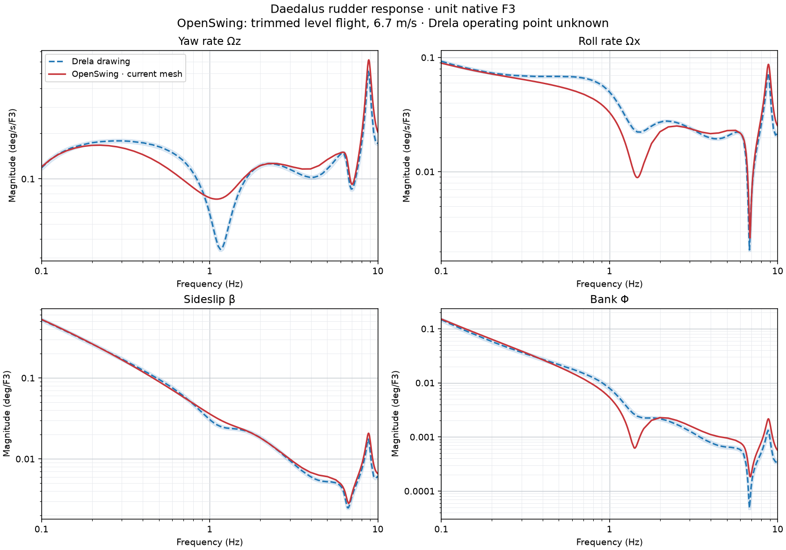

# Current-mesh Daedalus Bode comparison

The app now exposes the saved four-output comparison at
**Validation & scope → View Daedalus Bode comparison**, and below the aircraft
in **Plots**, including the mobile layout. The page at
`/validation/daedalus-bode/index.html` opens without loading the solver.

The comparison uses **162 distinct saved frequencies**, including the 41-point
log grid, additional samples around both cancellation/resonance regions,
locally refined extrema, and direct evaluations at the reference extrema.
It does not mix in older OpenSwing meshes. The original public model is
trimmed in level flight at 6.7 m/s on the redistributed default mesh, with
98 intervals, 103 nodes and all 1,953 descriptor coordinates retained.

Drela's original operating-point file and mesh are still unavailable. These
differences are descriptive comparisons with the drawing, not a new pass-count
suite or proof of an identical setup. No input gain, aircraft property or
physical coefficient was fitted.

## Differences

At exactly 1 Hz:

| Output | Drela drawing | OpenSwing | Difference |
| --- | ---: | ---: | ---: |
| Yaw rate, deg/s/F3 | 0.0587461 | 0.0748817 | +27.47% |
| Roll rate, deg/s/F3 | 0.0499106 | 0.0330206 | −33.84% |
| Sideslip, deg/F3 | 0.0306851 | 0.0359649 | +17.21% |
| Bank, deg/F3 | 0.00793452 | 0.00538130 | −32.18% |

The low-frequency response errors have opposite signs across outputs; a single
amplitude conversion cannot correct them. This confirms the earlier
[four-output finding](daedalus-rudder-four-outputs.md) on the current mesh.

| Feature | Drela Hz | OpenSwing Hz | Frequency difference | Extremum magnitude difference | Difference at Drela's Hz |
| --- | ---: | ---: | ---: | ---: | ---: |
| Low yaw dip | 1.15738 | 1.09942 | −5.01% | +115.72% | +117.29% |
| Low roll dip | 1.54881 | 1.46378 | −5.49% | −60.05% | −53.99% |
| High yaw dip | 6.94779 | 7.03166 | +1.21% | +7.41% | +9.19% |
| High roll dip | 6.79896 | 6.84458 | +0.67% | +27.27% | +55.28% |
| High yaw peak | 8.77304 | 8.83187 | +0.67% | +19.07% | +16.61% |

The extremum column compares each curve at its own dip or peak. The final
column compares both curves at the reference frequency, using a saved direct
OpenSwing solve there. Native features are vertices of the drawing; current
features use bracketed full-matrix frequency refinement. The graphic does not
supply response phases, so no phase comparison is claimed.

## Reference and numerical evidence

The [authoritative index](aswing-authoritative-references.md) and its source
catalog were consulted. Reference vertices are extracted from the retained
four-output evidence archive, whose embedded PDF is checked byte-for-byte
against the current local copy of Drela's
[original drawing](https://web.mit.edu/drela/Public/web/aswing/rudder-bode.pdf).
The old archive's OpenSwing responses are not used. All four log-axis
calibrations are independently reconstructed from the PDF rectangles and
checked against the stored vertex coordinates.

Blue shading retains the earlier conservative graphic envelope: 0.75 PDF
point half-width, with curve extrema over horizontal ±1.5 points and vertical
±0.75 points. It is neither physical uncertainty nor a solver tolerance.
Intermediate reference magnitudes use the drawing's connected log-log paths.

All **35 numerical stages** used by the report are successfully terminated and
reaped. Their recorded input hashes agree with each other and the current
numerical source/model files. The largest scaled matrix residual over the
saved frequencies is **1.209e−16**. The previously verified full-equation
assembly checks remain linked in the report. Small matrix residuals establish
solution consistency, not physical accuracy or mesh convergence.

The reporting job itself performed **no harmonic solve**, used one BLAS thread,
3.30 CPU seconds and 127,532 KiB peak RSS, and exited successfully within the
512 MiB / 15 CPU-second / 25 wall-second limits. Its figure was visually
inspected. The HTML page and downloads were checked through the existing Vite
server; browser rendering and packaged ZIP rebuilds remain held.

[Numerical report](../../artifacts/daedalus-regular-mesh-response-20261114/report/result.json),
[CSV](../../public/validation/daedalus-bode/comparison.csv),
[SVG](../../public/validation/daedalus-bode/comparison.svg),
[publication receipt](../../public/validation/daedalus-bode/publication.json),
[report generator](../../scripts/report_daedalus_regular_curve.py),
[publisher](../../scripts/publish-daedalus-bode.py).

## Interpretation and next investigation

The [playback-clock correction](daedalus-playback-clock-20261114.md) improves
visual interpretation but leaves every value in this comparison unchanged.
The [gyro audit](daedalus-yaw-output-20261114.md) does not support a mistaken
sensor position as the explanation. Prior source-equation and independent
mounting-span checks should not be repeated merely because the dip remains.

The [transmission-zero study](daedalus-transmission-zeros-20261114.md) identified
wing lift and the short wing–fairing mounting span as sensitive parts of the
coupled cancellation on its disclosed earlier mesh. That is a useful lead,
not evidence that either is implemented incorrectly. The current plot retains
the opposite yaw/roll depth errors and separates them from the much closer
high-frequency feature locations. A correction still needs independent
equation or historical-input evidence; altering stiffness to fit these curves
would not validate the model. The original operating point, mesh convergence
and native Bode agreement remain open.

No production physics, ISAE completion fraction, comparison scope or progress
event changed.
