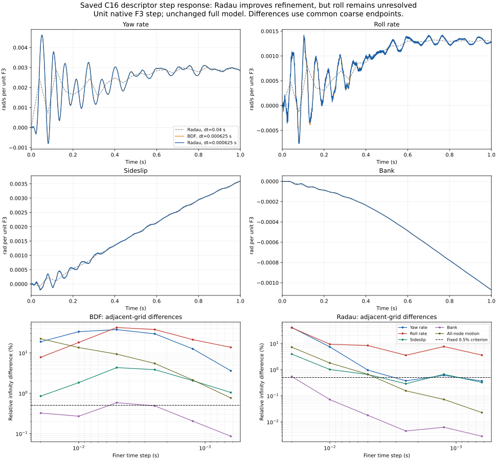

# Saved Daedalus descriptor: Radau and BDF time convergence

A [later 3,200/6,400-step study](daedalus-radau-resolution.md) exposes additional
rapid motion: dense roll and sideslip differences are 5.801% and 0.581%.
Temporal resolution remains unestablished. The seven-grid results below are
retained as the preceding comparison.

The complete saved-model Radau study improves the finest-grid differences but still does not establish temporal resolution: roll differs by 3.57627%, above the unchanged 0.5% criterion. All five differences decrease on the finest triplet. There is no new nonlinear aircraft run, new physical model validation, or correction to the unresolved near-1-Hz Drela Bode mismatch.

Protocol: the identical 2215-variable singular descriptor, saved trim, positive unit native F3 step and physical output map were used for both methods over 1 s. The initial snapshot precedes the step. Seven fixed grids span dt = 0.04 to 0.000625 s. Radau uses its three-stage collocation equations, including the first step; the previous BDF record uses BDF1 startup followed by BDF2. Two shifted full-descriptor factors per Radau grid are reused by an exact 3×3 stage transform. No mass inverse, modal truncation, damping change, retrim or input smoothing is used.

All values below are relative infinity differences in percent. Adjacent differences compare 800→1600 steps at every 800-grid endpoint; the Radau triplet compares 800→1600 on the 400-step common grid.

| Group | BDF adjacent | Radau adjacent | Radau triplet |
|---|---:|---:|---:|
| Yaw rate | 3.5992089 | 0.3647257 | 0.3658691 |
| Roll rate | 13.6866073 | 3.5762695 | 3.5801712 |
| Sideslip | 1.0399472 | 0.3219886 | 0.3219886 |
| Bank | 0.0858055 | 0.0028065 | 0.0028065 |
| All-node scaled motion | 0.7626869 | 0.0226265 | 0.0209014 |

Yaw, sideslip, bank and complete scaled nodal motion meet the finest Radau criterion; roll does not. All-node motion is the complete body-displacement/L and spatial-rotation vector, not a tip-only or amplitude-only quantity. Each group uses its own nonzero reference infinity norm. No physical error floor or post-result tolerance change was introduced. The full arrays, all other grid comparisons, peak norms and all component histories remain saved.

The original-stage minimum reciprocal condition estimate across seven grids is 1.740818e-10, above 1e-12. Maximum original-stage scaled residual is 1.278210e-16 and maximum backward error 5.564744e-18, below the original 1e-7/1e-9 gates. These numerical checks measure equation solution, not physical time accuracy. Exact raw stage increments are retained, with rates recoverable from the saved tableau.

The first attempt was interrupted by an external environment restart after six complete grids. It had built the final-grid factors, but the number of unfinished 1600-grid steps is unknown. No successful exit or reaping is invented for it. An explicitly authorized separate child computed only the missing 1600 trajectory, then combined it with the original six without recalculation. The new child completed 19/19 numerical checks in 29.016 s, with 2 LU factorizations, 3200 stage-factor solves and 3 condition estimates, exit 0/reaped. Its 47 pins remained exact. The interrupted evidence and all raw arrays are retained. Accepted-trajectory counts are 3175 steps/6350 factor solves; actual work also includes the explicitly unquantified discarded final-grid work.

These endpoint comparisons do not certify accuracy between endpoints. The retained stages permit a later saved-only dense-output comparison before selecting a nonlinear grid. Constant linear factors make this saved study inexpensive; nonlinear stage-factor construction and reuse have a separate performance contract. No new refinement is authorized by these results.

Independent saved-array audit passed 280/280 checks, reproducing 3175 saved steps and 9525 original stage equations, all physical output maps and every reported temporal metric. Maximum reconstructed output discrepancy is 4.337e-19. The audit used saved matrix products only, with no integration, solves, factors, inverse, eigendecomposition or aircraft calls; its 120 s child exited 0/reaped in 9.383 s.

[Machine-readable report](daedalus-linear-radau.json), [trajectory CSV](daedalus-linear-radau-trajectories.csv), [convergence CSV](daedalus-linear-radau-convergence.csv), and [raw evidence archive](daedalus-linear-radau-20261025-evidence.zip) retain the sources, plans, complete endpoint/stage arrays, both attempts, saved audit, and both presentation versions. The archive contains an explicit pinned dependency/member map for the reused BDF and C16 operator data.
