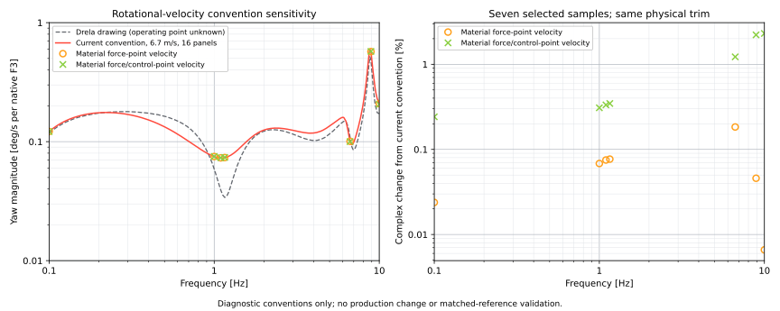

# Daedalus yaw: loaded aerodynamic motion and velocity conventions

The requested log–log magnitude axes, decimal decade labels and minor grids are
[implemented and tested](bode-log-axes.md). The yaw response still differs from
[Drela's published drawing](https://web.mit.edu/drela/Public/web/aswing/rudder-bode.pdf).
The two checks below found no correction that explains the minimum near 1 Hz.
Production equations and default parameters are unchanged.

## Loaded moving-fin reference

This extends the earlier [zero-circulation component test](daedalus-component-checks.md).
Both idealized surfaces now have 2° section incidence and nonzero base
circulation. A horizontal wing and vertical fin interact through their bound
vortices and wakes. The fin undergoes prescribed lateral translation; the wing
remains fixed. The input is unit physical displacement, with velocity `iωh`
and acceleration `−ω²h`. Rudder F3 remains zero. This is a motion-to-load test,
not the aircraft's rudder-to-yaw transfer.

The independent calculation integrates the Biot–Savart filaments directly and
forms its own circulation and load equations. It imports no production geometry,
vortex, aerodynamic or derivative functions. It retains the distinct control and
force sampling points, the specified cross-surface core and the loaded local
perpendicular speed in the circulation-lag term. Own-bound exclusion applies
only at force points; the wake remains present. The formulation follows Drela's
[steady theory](https://web.mit.edu/drela/Public/web/aswing/asw_theory.pdf) and
[unsteady extension](https://web.mit.edu/drela/Public/web/aswing/asw_uns_theory.pdf).

The comparison includes complete circulation vectors and all six force/moment
components for each surface and their sum. Separate saved terms account for
circulation changes, induced velocity changes, moving source/receiver geometry,
fin velocity, circulation-rate lift, apparent force and the moving moment arm.
The geometry, induced-velocity and moment-arm terms are explicitly nonzero;
this adds coverage absent from the earlier zero-circulation fixture.

All **12 cases** pass: 4/8 intervals per surface, 0.1/1/10 Hz, and circulation lag
off/on. Fixed 16/32-point reference quadrature and displacement widths
`1e-5`/`5e-6` are checked separately. The unchanged component criterion is
`abs(error) <= 2e-8 + 2e-8*abs(reference)`.

| Check | Largest absolute difference | Largest fraction of allowed error |
| --- | ---: | ---: |
| Circulation transfer | 5.14×10⁻¹⁰ | 0.0157 |
| Force/moment transfer components | 5.60×10⁻⁶ | 0.2632 |
| Output change when halving displacement width | 4.19×10⁻⁶ | 0.1970 |

Force and moment rows have different physical units and magnitudes, so their
absolute maximum alone is not a relative-accuracy measure. Every individual
component passes its own absolute-plus-relative test. The base circulation
residual is at most `8.20e-13`; the harmonic circulation residual is at most
`4.19e-15`. Translating both complete surfaces preserves forces and changes
moments by displacement cross base force, with maximum difference `3.55e-15`.

The run passes 756 checks using exactly 352 aerodynamic evaluations, 40 reference
field assemblies and 80 small circulation solves. It performs no aircraft trim,
structural solve or free-frame linearization. The independent reference equations
are retained in [loaded_wing_fin_reference.py](../../scripts/loaded_wing_fin_reference.py)
with the [fixture](loaded-wing-fin.asw). The machine-readable report retains the
full check records, seven-term decompositions and source/input hashes.
An independent saved-output audit passes 1,690 checks, reconstructing raw
derivative stencils and all 312 public wrench aggregations. It uses 80 saved
small matrix-vector products and performs no new physical evaluations or solves.

## Daedalus rotational-velocity conventions

The current aerodynamic evaluator samples rotational velocity at virtual,
wind-projected force/control points. Two isolated variants sample material
points on the section chord instead: the first changes only the quarter-chord
force-point velocity; the second also changes the control-point velocity.
Both rigid-frame and local elastic angular velocities use the selected arms.
The induced-flow, gust and other field receivers and the physical load moment
arms stay unchanged. These are convention sensitivities, not a claim that either
variant reconstructs original ASWING.

Each variant reuses the exact saved 16-panel Daedalus trim at 6.7 m/s, original
scales and six free-frame equations. One full matrix pair and a fresh native F3
input column are computed per variant. The zero-rate base residual, complete
mass matrix storage and F3 column remain bitwise identical to baseline. Changes
to the state matrix outside local/angular frame-rate columns are exactly zero.
No trim, damping, geometry or control setting is adjusted.

| Frequency, Hz | Current magnitude | Material force-point magnitude | Both material-point magnitude | Force-point complex change | Both-point complex change |
| ---: | ---: | ---: | ---: | ---: | ---: |
| 0.1 | 0.1216975 | 0.1216748 | 0.1214468 | 0.02383% | 0.24149% |
| 1 | 0.07494049 | 0.07497655 | 0.07509315 | 0.06830% | 0.30803% |
| 1.09648 | 0.07301746 | 0.07306803 | 0.07320153 | 0.07505% | 0.33352% |
| 1.15738 | 0.07345445 | 0.07351034 | 0.07366176 | 0.07687% | 0.34635% |
| 6.65333 | 0.1007542 | 0.1006293 | 0.1000555 | 0.18339% | 1.22347% |
| 8.90352 | 0.5710107 | 0.5711790 | 0.5732921 | 0.04582% | 2.21756% |
| 10 | 0.2088505 | 0.2088531 | 0.2056245 | 0.00661% | 2.30349% |

Magnitudes are degrees/second per native F3. Complex change is
`abs(Hvariant−Hbaseline)/abs(Hbaseline)`. All fourteen responses pass the original
conditioning and full-equation residual checks, with no gaps. The markers are
unconnected because these seven samples do not establish a sweep or bound the
change between them. The largest tested dip-region change is 0.34635% at
1.15738 Hz; neither variant explains the reference discrepancy there.

The optimized derivatives are separately checked against 32 fresh nonlinear
residual probes: real and imaginary parts of the saved 1 Hz response, each at
two fixed widths with a four-point stencil, for both variants. All eight
comparisons pass the original `2e-8` absolute-plus-relative criterion; the largest
error is `2.10e-9`. Each variant passes 173 technical checks. An independent
saved-array audit passes 124 checks, including full harmonic residual products,
probe reconstruction and exact base/mass/input identity. It does not repeat
factorization or independently estimate conditioning.

## Remaining discrepancy

The translating-fin test excludes section rotation, deformation, structural
feedback and free-frame dynamics. The convention study checks the implemented
Daedalus derivatives but does not supply an independent aircraft response.
The subsequent [loaded rotating-fin test](daedalus-rotating-motion.md) adds
oblique section rotation, profile force/couple and complete moment transport;
all twelve finite component cases pass without resolving the aircraft mismatch.
The published operating point remains unidentified. Higher-frequency mesh
convergence and a nonlinear rudder-step comparison remain open. These results
do not upgrade a broad requirement or ISAE case to fully validated.

[Machine-readable results](daedalus-loaded-motion.json),
[seven-frequency CSV](daedalus-motion-arms.csv), [PNG](daedalus-motion-arms.png)
and [PDF](daedalus-motion-arms.pdf) are available. The plot can be regenerated
from saved data with `scripts/plot-daedalus-motion-arms.py`; this increment
contains no new browser/WASM timing result or hosted release.
