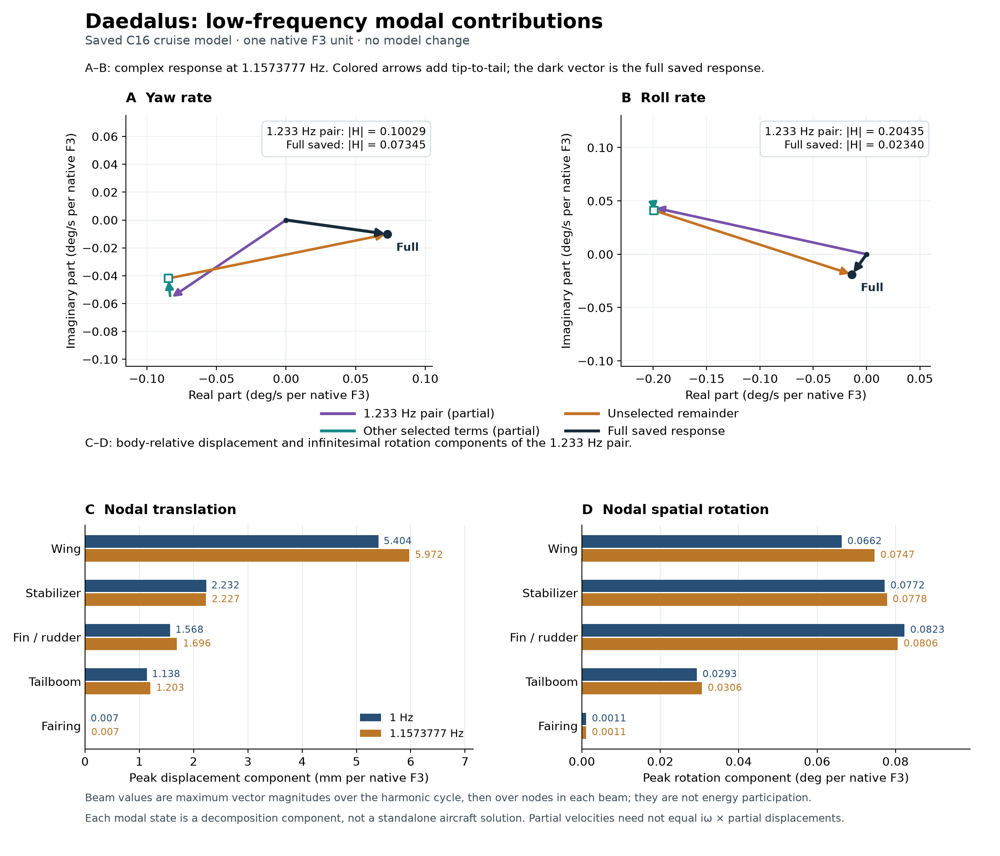

# Daedalus: low-frequency modal contributions

A strongly participating **1.23300 Hz pair** is present in the saved C16 model near the unresolved yaw dip. Its contribution is substantially cancelled by the rest of the response. A separate pole at **1.15722 Hz**, almost coincident with the drawing's dip frequency, contributes very little to native-F3 yaw. These results identify components of the calculated response; they do not explain or close its disagreement with Drela's drawing.

The study uses the existing full 2,215-coordinate, 6.7 m/s C16 descriptor, equilibrium and native F3 column. One fixed shift at `2*pi*i` and one shared sparse factorization supply the right and left queries. Of eight returned poles, two near-zero values form an unresolved cluster and receive no individual residues. The remaining four complex pairs and two real poles pass the original equation and pairing checks. Conjugate pairs are counted once; real poles are counted once. This is a local selection, not a complete modal expansion.

## Cancellation near the reference dip

The participating pair is `lambda = -5.075771 + 7.747171 i s^-1`, with damped frequency **1.233000 Hz** and damping ratio **0.54803**. At exactly **1.15737773741517 Hz**:

| Output, per native F3 | 1.233 Hz pair magnitude | Saved full magnitude |
| --- | ---: | ---: |
| Yaw rate, deg/s | 0.100295 | 0.0734544 |
| Roll rate, deg/s | 0.204350 | 0.0233970 |

Magnitudes cannot be added. For yaw, the selected terms sum to `-0.0844699 - 0.0419437 i` deg/s; the unselected remainder is `+0.157221 + 0.0318027 i`. Their sum is the saved full response, `+0.0727511 - 0.0101410 i` deg/s. Roll shows still stronger cancellation. The remainder is a subtraction from the saved full transfer, not an independently identified mode or a fitted correction.

The nearby **1.157219 Hz** pair has damping ratio **0.51421**, but contributes only **0.00004930 deg/s yaw** at the reference-dip frequency: **0.0671%** of the full calculated yaw magnitude. Matching a pole frequency to a minimum in a response magnitude therefore does not identify the cause of that minimum.

## Dimensional motion components

For one native F3 unit, the 1.233 Hz pair's body-relative node displacement component is largest at the wing tip, mainly along body z. Fin and boom displacement components are mainly lateral. The table gives the maximum vector magnitude over a harmonic cycle and then over nodes within each beam.

| Beam | Translation at 1 Hz / 1.157378 Hz, mm | Spatial rotation at 1 Hz / 1.157378 Hz, deg |
| --- | ---: | ---: |
| Wing | 5.404 / 5.972 | 0.06624 / 0.07468 |
| Stabilizer | 2.232 / 2.227 | 0.07721 / 0.07782 |
| Fin / rudder | 1.568 / 1.696 | 0.08227 / 0.08061 |
| Tailboom | 1.138 / 1.203 | 0.02929 / 0.03064 |

The corresponding frame roll/yaw magnitudes are **0.19157 / 0.08931 deg/s** at 1 Hz and **0.20435 / 0.10029 deg/s** at the reference-dip frequency. These are dimensional components of a forced modal decomposition, **not a standalone aircraft solution or energy participation**. Projected forcing enters each partial state's kinematic rows, so its partial velocities need not equal `i*omega` times its partial displacements. No such identity is imposed here.

## Numerical evidence and remaining uncertainty

The pole query passes **33/33 checks**. The 1.233 Hz pair's normalized left/right overlap is `6.52e-6`; its relative eigenvalue matching error is `1.82e-13`. A separate full-descriptor contour of radius **0.2 s^-1**, using 16 fixed resolvent nodes and no left eigenvector in the estimator, passes **111/111 checks**. Its four complex residues agree with the modal calculation within **2.55e-12 relative**; the 8-to-16-node change is at most **4.57e-8**. This independently supports numerical residue recovery, not physical-mode validity.

Source review leaves several finite-grid questions open: objective rotation-midpoint versus documented nodal Euler/arithmetic discretization; midpoint property versus nodal-compliance sampling; historical computational-break settings; some multi-point spline endpoint conventions; and historical finite-arc aerodynamic interpolation. Literal tailboom two-point property interpolants are not exposed to the spline-endpoint ambiguity. Refinement also changes spacing-limited interaction cores. These are uncertainties, not measured explanations of the Bode mismatch; the existing 16-to-32-panel yaw-minimum change remains only about **0.33%**.

The audit found that display-only shell-break locations influenced the saved native mesh. The separate [shell-mesh correction and fresh aircraft comparison](daedalus-shell-mesh.md) now preserves old saved meshes and removes shell-only breaks from fresh solves. Its four-frequency comparison leaves the Bode mismatch unresolved. The modal results above retain their original saved C16 mesh. No new omitted physical term or literal control/property scale error was established. The drawing's operating point, actual mesh, phase response and historical executable settings remain unresolved.

The [machine-readable report](daedalus-low-frequency-modes.json), [complex-contribution CSV](daedalus-low-frequency-modes.csv) and [SVG figure](daedalus-low-frequency-modes.svg) retain the saved-data comparison and input pins. Full complex modal and motion arrays remain in the staged evidence. Presentation adds no solves, queries, assembly, integration or physics changes. No aircraft-accuracy, historical-ASWING parity or reference-agreement pass is claimed.

The [evidence archive](daedalus-low-frequency-shell-mesh-20261025-evidence.zip) contains the modal queries, contour checks, dimensional arrays, source audits, correction tests, and separate fresh-mesh comparison. Its manifest maps retained original paths to archive members.
