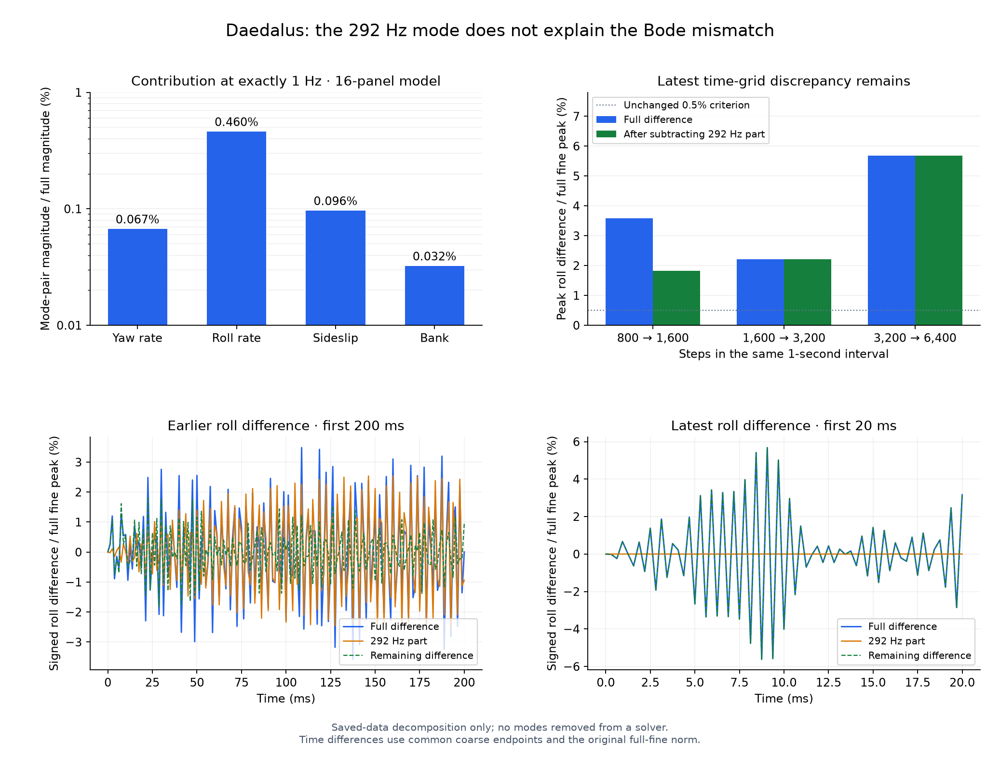

# Daedalus: forced participation of the 292 Hz mode

The identified **292.092 Hz mode does not explain the mismatch with Drela near
1 Hz**. In the saved 16-panel cruise model, its conjugate pair contributes only
**0.067% of the full yaw magnitude** and **0.460% of the full roll magnitude**
at 1 Hz. Its contribution explains part of an earlier time-grid discrepancy,
but essentially none of the latest early transient discrepancy. No production
equation, tolerance, model property or default changed.

## Bode comparison

This diagnostic uses the existing 6.7 m/s, level-flight, 16-panel equilibrium,
full descriptor matrices and native F3 rudder derivative. Four exact saved
frequencies are used: 0.1, 1, 1.15737773741517 and 10 Hz. It does not create
another frequency sweep. Rates and angles receive their output conversion to
degrees once; the native input receives no extra angular conversion.

| Output at 1 Hz | 292 Hz pair / full magnitude | Full / drawing | Diagnostic (full − pair) / drawing |
| --- | ---: | ---: | ---: |
| Yaw rate | 0.067% | 1.27567 | 1.27649 |
| Roll rate | 0.460% | 0.67070 | 0.67032 |
| Sideslip | 0.096% | 1.18658 | 1.18710 |
| Bank angle | 0.032% | 0.68640 | 0.68662 |

Complex contributions are subtracted before taking magnitudes. This arithmetic
is a diagnostic, not a proposal to remove a physical mode. At the drawing's yaw
minimum, the full/drawing ratio similarly changes only from 2.16130 to 2.16278.
The reference supplies magnitudes, with no corresponding phase or exact trim.
The separate [32-panel comparison](daedalus-rudder-cruise-mesh.md) remains the
latest finer-mesh Bode result; its sampled yaw minimum is 2.14 times the drawing's.

## Separating the transient issue

Projecting the four existing linear Radau trajectories onto this finite mode
allows its part of each numerical time-grid difference to be measured. The
denominator remains the original full finer-grid peak at common coarse
endpoints; it is not recomputed after subtraction.

| Steps over 1 s | Full peak roll difference | Remainder after subtracting the 292 Hz part |
| --- | ---: | ---: |
| 800 → 1,600 | 3.57627% | 1.81729% |
| 1,600 → 3,200 | 2.20866% | 2.21775% |
| 3,200 → 6,400 | 5.67979% | 5.67933% |

Thus the mode accounts for a substantial part of the earlier difference, but
not the latest difference near 9.06 ms. These endpoint comparisons are distinct
from the [previous dense interpolation comparison](daedalus-radau-resolution.md).
Full-response temporal accuracy still fails the unchanged 0.5% criterion.
No step was smoothed, filtered or repeated in this diagnostic.

## Numerical checks and limitations

One left-eigenvector query matches the six previously saved right modes. For
`M zdot = A z + B`, each residue uses `r = (C v)(wᴴ B)/(wᴴ M v)` and contributes
`r/(s−lambda) + conjugate(r)/(s−conjugate(lambda))`. The correct adjoint
shift-invert operator is checked explicitly. The left/right calculation passes
25 checks; saved full-transfer extraction passes 159 and comparisons pass 99.

The 292 Hz mode has a small, coordinate-dependent left/right overlap, so an
independent contour calculation verifies its residue without using eigenvectors
in the estimator. Sixteen full saved-pencil resolvent solves around that pole
recover all four residues to within 3.98e-10 relative to the modal calculation.
Eight-to-sixteen-point contour changes are below 4.47e-10. Original-equation
residual and conditioning gates pass, with 101 checks. This supports numerical
consistency for the saved model, not physical correctness of the aircraft mode.

The 292 Hz projection agrees with its scalar Radau solution within 4.53e-8
relative on all four grids. **The weak 284.894 Hz pair fails the unchanged
1e-6 projection gate**, with errors of 2.45e-6 to 2.65e-6. Five pairs pass;
all six-pair aggregates therefore remain qualified diagnostics. The main
conclusion above uses the independently checked 292 Hz pair alone.

An independent audit reproduces raw-state projections, scalar propagation,
contour equations and selected harmonic ratios. Its continuation passes 503
checks while retaining the failed weak-pair decisions. An earlier arithmetic
comparison failed because its roundoff bound omitted accumulation in a complex
power; that attempt is retained. The correction adds the explicit step-count
roundoff term only, without changing a scientific gate or repeating the
already-verified raw projections. The earlier full-transfer metadata schema
failure is also retained; it occurred before numerical work.

The next Bode investigation returns to the coupled wing/fin response near
1 Hz and the unidentified reference operating condition. High-frequency
spatial convergence, accurate full nonlinear transients and agreement with
original ASWING remain open. No reference match or goal completion is claimed.

The [data](daedalus-modal-participation.json), [summary CSV](daedalus-modal-participation.csv),
[SVG](daedalus-modal-participation.svg) and
[evidence bundle](daedalus-modal-participation-20261025-evidence.zip) retain this
diagnostic. The bundle maps large prior inputs to the pinned linear-Radau and
Radau-resolution archives; historical absolute paths require remapping for replay.
