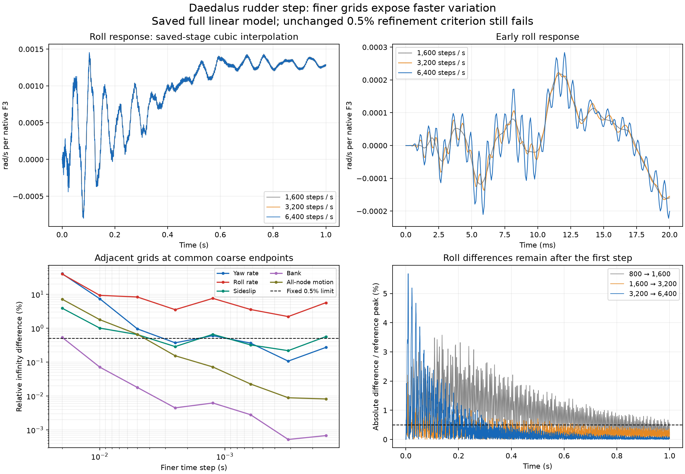

# Daedalus rudder step: unresolved rapid motion

The saved full linear model still fails the unchanged 0.5% time-refinement
criterion. Two additional grids, 3,200 and 6,400 steps over one second, expose
faster early motion: the finest dense comparisons differ by **5.801% in roll**
and **0.581% in sideslip**, both near **9.14 ms**. All original stage equations
pass their numerical checks. No production equation, input, tolerance or
integration default changed, and the near-1-Hz Drela Bode mismatch is unresolved.

## What was compared

The same 2,215-coordinate singular descriptor, corrected 6.7 m/s C16 trim,
positive unit native F3 step and physical output maps were retained. The initial
snapshot is before the input jump. Each new grid uses the exact three-stage
Radau transform with one real and one complex full-size shifted factor. There
is no aircraft mass inverse, mode removal, input smoothing or added damping.
The old 800- and 1,600-step trajectories were reused without integration.

The collocation polynomial is reconstructed from the saved stage increments
using integrated Lagrange weights. Its values at zero and all three stage
nodes are checked against the saved full state. The latest three trajectories
are compared at 12,801 common times, including points between their endpoints.
This is cubic interpolation, not a fifth-order dense-output or DAE accuracy
claim. Algebraic variables can have an initial jump; an off-grid interpolation
defect must not be confused with a failed stage solve.

| Response group | Earlier dense 800→1,600 | Finest endpoints 3,200→6,400 | Finest dense 3,200→6,400 |
| --- | ---: | ---: | ---: |
| Yaw rate | 0.364495% | 0.271825% | 0.271825% |
| Roll rate | 3.819299% | 5.679787% | 5.800583% |
| Sideslip | 0.344062% | 0.566410% | 0.581011% |
| Bank | 0.002806% | 0.000677% | 0.000822% |
| Complete scaled nodal motion | 0.031496% | 0.008170% | 0.008170% |

These are relative infinity differences, each divided by its own nonzero
finer-trajectory peak, with no denominator floor. Nodal motion includes all
117 nodes' displacement divided by reference length and spatial rotations.
The finer differences increase across the latest triplet for all four lateral
outputs; only complete nodal motion decreases. Thus even the below-limit yaw
and bank values do not satisfy the full decreasing-triplet requirement.
Agreement of every algebraic variable is outside these five response groups.

## Locating the rapid response

The earlier 800→1,600 roll difference has a prominent 292 Hz component. One
bounded local eigenvalue query on the unchanged full descriptor finds

`lambda = -1.4683383 + i*1835.270396 per second`,

or **292.092355 Hz**, with damping ratio **0.00080007** and decay time
**0.68104 s**. The largest normalized nodal coordinates are stabilizer rotations.
Its original `A v - lambda M v` residual is 2.48e-16, with action-relative
residual 2.62e-16. All six returned eigenpairs satisfy the original-equation
gates. This establishes a nearby finite pole of the saved model, not its forced
participation, physical validity, or completeness of the spectrum.

The later 3,200→6,400 difference contains faster components, including peaks
near 828, 1,501 and 1,565 Hz in the one-second windowed roll-difference spectrum.
Finite sampling and windowing permit aliasing and leakage; these peaks are not
identified aircraft modes. All accuracy comparisons use the unfiltered data.
The maximum moves to the early transient, rather than remaining at the earlier
0.14 s maximum. Resolving one component therefore did not resolve the response.

## Verification and remaining work

The new integration completes 9,600 steps using four shifted factorizations
and 19,200 stage-factor solves. Its native supervised elapsed time is 104.10 s,
including instrumentation and saving full stages; this is not a browser or
nonlinear performance benchmark. The minimum original coupled-stage reciprocal
condition estimate is 1.40e-11, above the unchanged 1e-12 threshold.

Independent saved-data checks re-evaluate all **28,800 new stage equations**;
103 checks pass, maximum scaled residual is 1.42e-18, and maximum raw residual
is 9.83e-15. Output maps and complete nodal motion reproduce the stored results.
The initial and refined dense reconstructions pass 94 and 104 checks, with
separate exact polynomial and saved-result audits. These establish faithful
solution and reconstruction of the declared discrete systems, not physical
validation or temporal resolution.

The pole query's first attempt stopped before factorization because its helper
associated one output-map multiplication differently, producing a 4.44e-16
rounding difference. The retained separate attempt uses the accepted arithmetic
ordering and passes the unchanged exact check. Across both attempts there is
one sparse factorization and one eigenvalue query; no physics or gate changed.

The next investigation should quantify which fast modes the rudder step excites
and check their coupling and initial-state behavior before selecting another
time grid or a nonlinear reference run. Full nonlinear temporal accuracy,
efficient browser execution, higher-frequency spatial convergence and agreement
with Drela's published Bode response remain open. No additional time grids were
run after these failures.

The subsequent [forced-participation study](daedalus-modal-participation.md)
confirms that the 292 Hz pair contributes to the earlier time-grid discrepancy,
but essentially none of the latest one. At 1 Hz it contributes only 0.067% of
full yaw and 0.460% of full roll magnitude in the saved 16-panel model, so it
does not explain the Bode mismatch. No further full trajectory was computed.

[Data](daedalus-radau-resolution.json), [comparison CSV](daedalus-radau-resolution.csv),
[vector figure](daedalus-radau-resolution.svg) and the
[evidence archive](daedalus-radau-resolution-20261025-evidence.zip) retain the
new raw endpoint/stage arrays, eigenpairs, source and receipts. The archive's
manifest maps reused inputs to the preceding
[Radau evidence archive](daedalus-linear-radau-20261025-evidence.zip).
Large derived dense-state arrays are reproducible from the retained raw stages
and are not duplicated in the new archive; their hashes and output curves are
retained. Historical absolute paths require remapping for replay.
