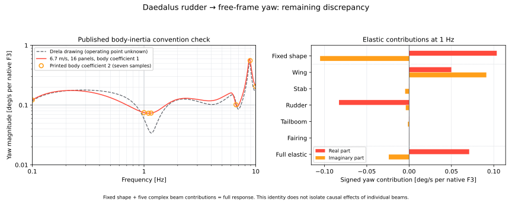
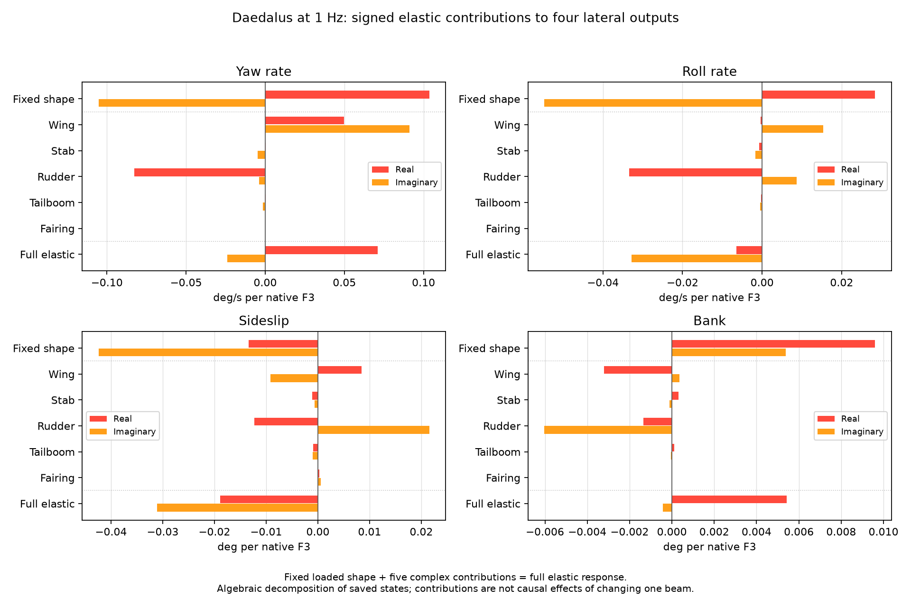

# Daedalus yaw: elastic coupling and body-inertia convention

The response still differs from Drela's published curve. These checks narrow
the investigation without changing production physics or fitting parameters.
The separate [cruise mesh comparison](daedalus-rudder-cruise-mesh.md) shows
that doubling the mesh barely changes the minimum near 1 Hz; high-frequency
mesh convergence remains open.

## Check the matrices against the nonlinear equations

At the saved 16-panel, 6.7 m/s trim and **1 Hz**, 49 fresh full-residual
evaluations check six directions: real/imaginary response states, their
real/imaginary time derivatives, native rudder F3, and primitive frame yaw.
Each direction uses two fixed widths and the four-point centered stencil.
All 12 comparisons pass the unchanged `2e-8 + 2e-8*abs(prediction)` criterion.
The largest difference is **2.1e-09**
in scaled residual derivatives; the fresh base residual is
`4.36e-13`. No trim or full linearization was repeated.

The saved-vector audit recomputes the stencils, including independently
accumulated scalar sums. It passes 379
checks. This verifies the selected assembled derivatives against the implemented
equations, not those equations against the aircraft or original ASWING.

## Where the elastic contribution appears

Partition the saved pencil `K = iωM − A` into retained circulation/free-frame
coordinates `R` and elastic coordinates grouped by beam `E_j`. The existing
fixed-loaded-shape response satisfies `K_RR y = B_R`. For the actual coupled
state `x`, each saved-state contribution solves
`K_RR d_j = −K_R,E_j x_E_j`. Their sum recovers `x_R − y`.
Internal-force/reaction columns are exactly zero in these retained rows.

The same 109-coordinate retained pencil handles ten right-hand sides per
frequency: position/rotation and local velocity/rate groups for each beam.
Seven selected frequencies require seven factorizations, with no new aircraft
residuals, trim or full-system solves. Maximum normalized state reconstruction
error is `6.77e-15`; maximum absolute yaw closure error is `1.06e-17 rad/s/F3`.
The independent saved-scalar audit passes 71 checks. A reporting-keyword error
after the first sample was retained; its raw solution was reused and only the
remaining six frequencies were solved. Two audit-only arithmetic/layout errors
were retained and corrected without repeating numerical study work.

At 1 Hz, the fixed-shape complex yaw is
`0.1035717-0.1051501j` deg/s per native F3.
Add these **signed complex contributions**, not their magnitudes:

| Beam | Real, deg/s/F3 | Imaginary, deg/s/F3 |
| --- | ---: | ---: |
| Wing | +0.04990774 | +0.09125868 |
| Stab | +0.0001918465 | -0.004682776 |
| Rudder | -0.08281594 | -0.003921419 |
| Tailboom | +0.0002269508 | -0.001382824 |
| Fairing | -8.965236e-05 | -0.000124029 |

The resulting full yaw is `0.07099267-0.02400245j`,
with magnitude `0.07494049` deg/s/F3.
Wing and rudder motion have the largest algebraic contributions near the dip.
They partly cancel. These use the actual coupled state and do **not** measure
the causal effect of changing an individual beam. A small tailboom contribution
does not bound sensitivity to its properties.

### All four lateral outputs

The same saved contribution states now recover roll rate, sideslip and bank,
using the actual frame scales and finite-trim sideslip derivative. All 237
recovery checks pass across the seven existing frequencies, without another
aircraft evaluation, matrix product, factorization or solve.

At 1 Hz, the fixed-loaded-shape roll response is
`0.02835112 - 0.05469568j` deg/s/F3. The fin's algebraic contribution is
`-0.03344927 + 0.00871893j`, which cancels most of the real component. The wing
contributes `-0.00040322 + 0.01535486j`. Including the other beams gives
`-0.00651191 - 0.03283545j`, of magnitude 0.03347494 deg/s/F3.
Fin motion also supplies the largest individual beam contribution to sideslip
and bank at this frequency. Wing and fin terms therefore remain relevant to
the simultaneous yaw/roll discrepancy, but this identity alone cannot identify
an erroneous equation or predict the response to changing a beam's properties.

The [four-output data](daedalus-lateral-contributions.json) and
[CSV](daedalus-lateral-contributions.csv) retain all signed contributions.
An independent saved-data review passes 99 checks. The
[evidence bundle](daedalus-lateral-contributions-20261025-evidence.zip) includes
the reduction source, direct inputs, outputs and review; historical input paths
must be remapped for replay.
The plotted reference magnitudes have no associated phase data, so there is
no corresponding reference decomposition to compare with these terms.

## Local elastic gravity

An independent scalar potential, `V = sum(m*g*Z)`, now checks gravitational
loads and their local derivatives in a prescribed deformed beam. The fixture
has five nodes, a rigid shoulder, two distributed centroid offsets, a point-mass
pylon, finite rotations and distinct moment/acceleration reference points.
Mass is integrated over the original material length. The potential uses full
material rotation interpolation, with its gradient and Hessian obtained by
independent second-order automatic differentiation.

Subtracting gravity-off from gravity-on residuals isolates the physical loads.
Spatial moments are transformed into the corresponding Euler and local rotation
coordinate derivatives before comparison with `-grad(V)` and `-Hessian(V)*d`.
Seven directions, two fixed perturbation widths, and 8/16/32-point quadrature
check local loads and mixed aircraft/elastic derivatives. The arbitrary
deformed fixture is not an equilibrium or an aircraft frequency response.

The original benchmark passes all 199 checks with 58 residual evaluations.
The largest load-vector error is **4.26e-14**; the largest tangent error is
**4.26e-10**, using **2.13%** of its unchanged component tolerance
`2e-8 + 2e-8*abs(reference)`. Force and moment components are compared in their
respective physical units. Mixed reciprocity and fixed quadrature checks pass.
No production gravity correction is indicated by this test.

The [portable regression](../../tests/test_local_gravity.py),
[independent potential](../../tests/local_gravity_reference.py), and literal
[fixture](../../tests/data/local-gravity/fixture.asw) retain this coverage.
Both targeted tests pass, including 189 physical array comparisons with the
same residual count and tolerances. A separate saved-data audit directly
reproduces the load and tangent comparisons; 28 displaced independent-centroid
moment comparisons remain source-reported because their centroid arrays were
not retained. The [machine-readable record](local-elastic-gravity.json)
preserves that distinction. Passing this component check does not resolve the
Daedalus Bode discrepancy.
The [evidence bundle](local-elastic-gravity-20261025-evidence.zip) retains the
independent oracle, fixture, raw residuals, source snapshot, regression and
reviews. Historical runner paths require remapping; the repository test runs
directly with `.venv/bin/python -I -B -m pytest -q tests/test_local_gravity.py`.

## Published body added-mass coefficient

Printed equation 45 of Drela's [unsteady formulation](https://web.mit.edu/drela/Public/web/aswing/asw_uns_theory.pdf)
uses twice the circular-cylinder coefficient used by the current default.
The existing `body_added_mass_factor=2` option implements that printed expression.
Only the nonlifting radius-based tailboom is affected in the literal model;
the chord-bearing fairing retains the lifting-surface formula.

The fresh comparison changes **only this coefficient**, keeping the same raw
physical trim, model, constructor scales and conditions. Steady rates and
accelerations are zero, so the changed apparent load vanishes at this base.
A fresh complete residual confirms this; the operators and native F3 input
are rebuilt once, then reused across the seven fixed frequencies. Both `A`
and `M` are rebuilt because operating acceleration coordinates occur in `A`.
No retrim, damping adjustment, geometry change or production-default change
is made. All seven samples retain the original harmonic checks. The independent
saved-data audit passes 33 checks: raw physical fields and the freshly computed
F3 derivative remain bitwise unchanged. The full residual is `4.36e-13`.
A-matrix differences outside the six acceleration columns are retained in the
report (33 entries, maximum `1.73e-13`); they are not silently replaced by zero.
All M-matrix changes occur in the expected tailboom local-motion columns.

| Frequency, Hz | Coefficient 1 | Coefficient 2 | Complex change |
| --- | ---: | ---: | ---: |
| 0.1 | 0.1216975 | 0.1217148 | 0.017283% |
| 1 | 0.07494049 | 0.07496188 | 0.037047% |
| 1.09648 | 0.07301746 | 0.07304384 | 0.046381% |
| 1.15738 | 0.07345445 | 0.07348445 | 0.052608% |
| 6.65333 | 0.1007542 | 0.1014324 | 1.0858% |
| 8.90352 | 0.5710107 | 0.5563001 | 5.9399% |
| 10 | 0.2088505 | 0.2055014 | 1.7231% |

Magnitudes are deg/s per native F3. Complex change is
`abs(H2−H1)/abs(H1)`, with no denominator floor. These seven points do not
establish a new response minimum, convergence, or a bound between samples.
The plot shows them as unconnected markers. At the three selected dip-region points (1, 1.09648 and 1.15738 Hz), complex changes are only 0.0370–0.0526%. The coefficient change does not resolve the discrepancy there. The largest selected change is 5.94% at 8.90352 Hz.

## Independent reference and remaining work

The source review found no demonstrated stiffness-axis, damping-sign or
rigid-offset defect. Literal material damping is zero. The one-foot fin/boom
joint offset is present in the model and retained. Objective midpoint versus
ASWING discrete kinematics and cubic-spline endpoint conventions remain
parity questions, not demonstrated explanations for this response.

[NASA-CR-183305](https://ntrs.nasa.gov/citations/19890001519) supplies nearby
structural modes and qualitative shapes, including loaded free-free modes
at 0.625, 0.838, 0.985, 1.352 and 1.552 Hz. Its flight identification concerns
Light Eagle, and the appendices have unresolved configuration and member-mapping
differences. These are useful separate benchmark leads, not matched targets for
`dae.asw`. The quoted 20% damping is aerodynamic; it is not a material damping
value to insert into this file. Exact source/page locators are in the report.

Subsequent [component checks](daedalus-component-checks.md) verify the loaded
boom–fin mechanics and idealized aerodynamic transfers. The
[loaded-motion follow-up](daedalus-loaded-motion.md) adds prescribed fin
translation and two aircraft velocity conventions. These component benchmarks
and sensitivities do not replace the full flight-response comparison.
The Bode drawing's actual operating point remains unidentified, no original
ASWING executable is available, and a nonlinear rudder step remains a separate
validation task. No broad requirement or ISAE validation status is upgraded.

[Machine-readable evidence](daedalus-rudder-coupling.json),
[seven-frequency CSV](daedalus-rudder-coupling.csv),
[PNG](daedalus-rudder-coupling.png) and [PDF](daedalus-rudder-coupling.pdf)
are available. `scripts/compare-daedalus-rudder-coupling.py` redraws the figure
from saved data only. The [log-log display changes](bode-log-axes.md) are already
implemented and tested; this diagnostic adds no browser or WASM timing claim.
