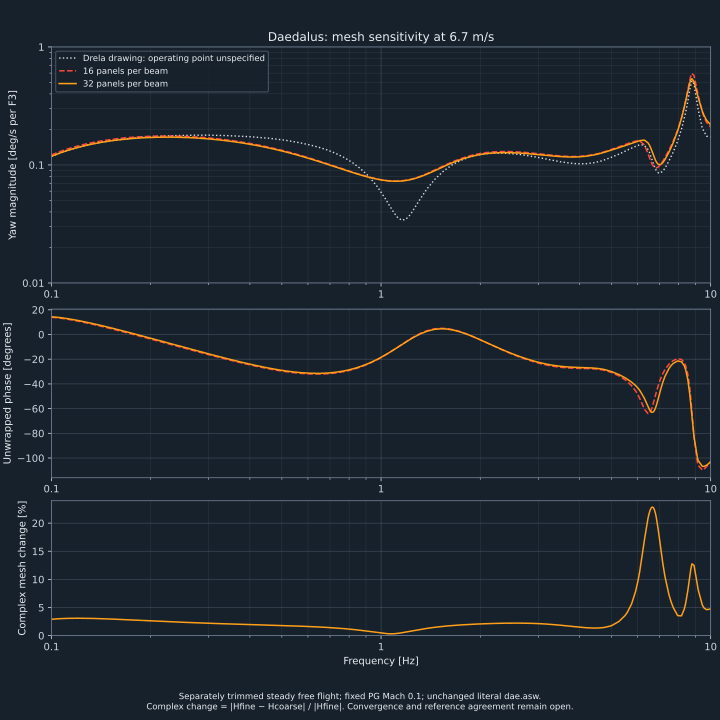

# Daedalus rudder response: cruise-speed mesh refinement

The 32-panel case completes all **203 frequencies**, but does not reproduce
the deep minimum near 1 Hz in Drela's drawing. At 1 Hz, the complex response
changes only **0.462%** from 16 panels. Around the higher-frequency features,
the maximum sampled change is **22.865% at 6.65333 Hz**. Thus this refinement
neither resolves the near-1 Hz discrepancy nor establishes mesh convergence.

## Matched conditions

Both meshes use the literal `dae.asw`, speed 6.7 m/s (21.9816273 ft/s), reference
density, fixed PG Mach 0.1, unsteady circulation and seven steady-level trim
constraints. Each mesh has its own corrected equilibrium. Six net-load equations
are released for free-flight dynamics. The 32-panel mesh has 197 nodes, 192
elements, 155 circulation unknowns and 3,719 dynamic coordinates.

The old 30 ft/s, 32-panel physical state was only an initial guess. A fresh
constructor supplies the scales and solves the new cruise trim. The final full
residual is `2.82e-10`. Source differs from the 16-panel cruise run only in the
previously checked progress callbacks; the physical equations are unchanged.

One native F3 input column and one pair of full matrices supply the 203 harmonic
solves. These study solves use the full sparse path. The production constructor
also performs its usual reusable-structure preparation; the study does not use
that optional structure in its harmonic calls. No extra physical output
stencils are used to recover yaw from the saved frame coordinate.

## Results

| Frequency, Hz | 16 panels | 32 panels | Drela drawing |
| --- | ---: | ---: | ---: |
| 0.1 | 0.121697 | 0.118360 | 0.118238 |
| 1 | 0.0749405 | 0.0746941 | 0.0587461 |
| 8.90352 | 0.571011 | 0.507585 | 0.486375 |
| 10 | 0.208850 | 0.218933 | 0.171868 |

Magnitudes are degrees/second per native file F3 unit. Drawing values use
log-linear interpolation of the digitized PDF-vector curve. The drawing's
operating point, mesh and phase response remain unknown. Design cruise is a
declared condition, not an identified reference state or a fitted parameter.

The sampled minimum within 0.7–2 Hz is **0.0727777 at 1.09648 Hz** on the fine
mesh, compared with **0.0339862 at 1.15738 Hz** in the drawing. Refinement changes
the calculated minimum by about 0.33%, leaving a substantial depth discrepancy.
The largest sampled magnitude mesh change is 22.558% at 6.60115 Hz. Relative
changes divide by `abs(H32)` with no floor; exact-zero denominators are undefined.
The CSV retains absolute complex changes as well.

All original harmonic gates pass with no gaps. Minimum reciprocal condition is
`5.72e-9`, maximum scaled residual is `5.01e-16`, and the study recorder passes
740 checks. An independent saved-data audit passes 62 checks, recovering all
203 complex yaw values exactly and checking the mesh differences, source,
scales and operation counts without new solves. These demonstrate numerical
consistency, not aircraft accuracy. A metadata-only audit path error is retained
separately; correcting that checker did not repeat the physical study.

Native trim took 520.86 seconds, linearization 43.32 seconds and the full sparse
sweep 313.74 seconds. The single attempt completed within its 900-second cap.
These are shared-host native observations, not browser benchmarks. Progress
events record each trim rebuild separately.

## Load the cases

Import the [paired cruise-mesh project](../../examples/dae-cruise-mesh-project.json)
through **Project & saved cases**, select a case and choose **Load case**. Each
case includes its own physical equilibrium, mesh and trimmed controls. After
solving, select **control.3 · Rudder → Flight frame → Yaw rate r**.

The project requests 101 logarithmic UI frequencies and the declared F2/F3/P1
inputs. This study uses the common 203-point comparison grid and F3 only. The
production project parser and saved-setting checks pass; this packaging does
not constitute another aircraft solve or browser performance test.

The [machine-readable report](daedalus-rudder-cruise-mesh.json),
[CSV](daedalus-rudder-cruise-mesh.csv), [PNG](daedalus-rudder-cruise-mesh.png)
and [PDF](daedalus-rudder-cruise-mesh.pdf) retain the comparison. The figure is
regenerated from saved data by `scripts/compare-daedalus-rudder-mesh.py`.
The separate [fixed loaded-shape diagnostic](daedalus-rudder-fixed-shape.md)
shows that elastic coupling matters, but does not identify a correction or
establish agreement with ASWING. A finite-amplitude nonlinear rudder step remains
a separate validation task.
