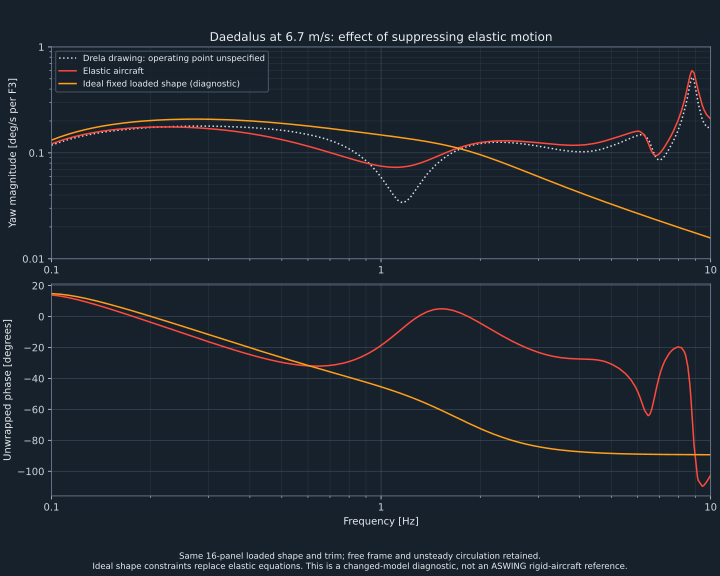

# Daedalus rudder response: fixed loaded-shape diagnostic

Suppressing elastic motion changes the calculated yaw response substantially.
At 1 Hz, the magnitude rises from **0.0749405 to 0.147593 deg/s per native F3
unit**. At 10 Hz it falls from **0.208850 to 0.0157029**. The dip near 1 Hz and
the high-frequency resonance therefore depend on elastic coupling in the
current model. This observation does not identify an erroneous term or resolve
the difference from Drela's drawing.

## What was changed

The diagnostic uses the saved 16-panel, 6.7 m/s steady trim and its full
linearized matrices. It holds all body-relative nodal positions and rotations
at that loaded shape and sets local elastic velocities to zero. The aircraft
frame remains free. Unsteady circulation, real inertia, apparent mass, gravity
and the original rudder forcing remain present.

The retained 109 unknowns comprise 91 circulation coefficients, six acceleration
unknowns and twelve flight-frame coordinates. The matching equations are the
circulation equations, six global load balances and frame kinematics. The saved
matrix blocks are restricted directly; there is no new trim, derivative probe,
aircraft evaluation, mass approximation or fitted parameter.

Ideal internal holding loads replace the elastic equations. Their individual
values are nonzero, but their global resultant cancels to numerical precision.
The largest saved resultant normalized by the force and moment scales is
`2.74e-13`. The other discarded equations have zero defect. These holding loads
are a diagnostic constraint system, not recovered physical beam stresses.

The global load rows already sum external and inertial loads before internal
beam and joint loads enter local balances. Their saved dependence on the
omitted internal-force and reaction coordinates is exactly zero. Adding the
local balances to those global rows would count loads twice. Freezing Earth
pose or removing the six acceleration coordinates would also define a different
problem.

## Results and limits

All 203 frequencies resolve with the original harmonic conditioning and
residual gates. The execution record passes **899/899 checks**, and the independent saved-data
audit passes **21/21**. That audit verifies the restriction, scalar responses,
holding-load signs and resultants; it performs no additional matrix products,
factorizations or solves. The full-column matrix
defects and holding loads are retained, including the deliberately nonzero
discarded local load equations. Passing the retained equations does not mean
the frozen-shape state solves the original elastic problem.

| Frequency, Hz | Elastic | Fixed loaded shape |
| --- | ---: | ---: |
| 0.1 | 0.121697 | 0.131798 |
| 1 | 0.0749405 | 0.147593 |
| 8.90352 | 0.571011 | 0.0176919 |
| 10 | 0.208850 | 0.0157029 |

Values are degrees/second per native file F3 unit. Yaw uses the original frame
rate scale, with one conversion to degrees. The plotted phase belongs to these
two model calculations; the reference drawing supplies no phase curve.

This is a changed-model sensitivity study. It does not establish a unique rigid
limit, ASWING rigid-aircraft parity, an additive separation of aerodynamic and
structural effects, mesh convergence, or aircraft validation. The published
reference's operating point remains unidentified. The production solver and
its physical defaults are unchanged by this diagnostic.

Two metadata-only checker failures are retained: a copied hash typo in the
prelaunch reviewer and an input-profile schema assumption in the saved-data
auditor. Their corrections changed neither the study nor its numerical results.
The earlier clipped-title figure is also retained; the linked figures use the
reviewed final layout.

See the [machine-readable report](daedalus-rudder-fixed-shape.json),
[CSV](daedalus-rudder-fixed-shape.csv), [PNG](daedalus-rudder-fixed-shape.png)
and [PDF](daedalus-rudder-fixed-shape.pdf). The [speed study](daedalus-rudder-speed.md)
explains the declared cruise condition and its relationship to the reference.
