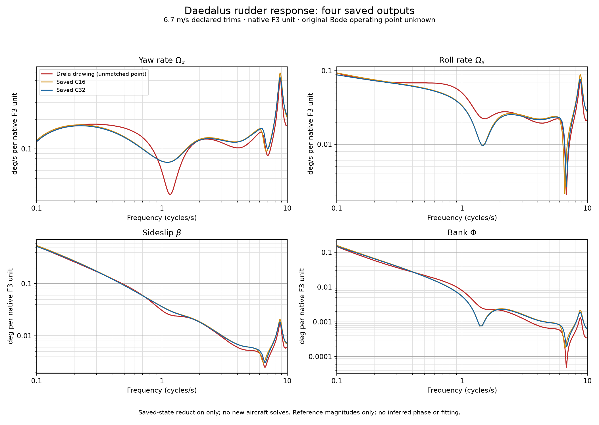
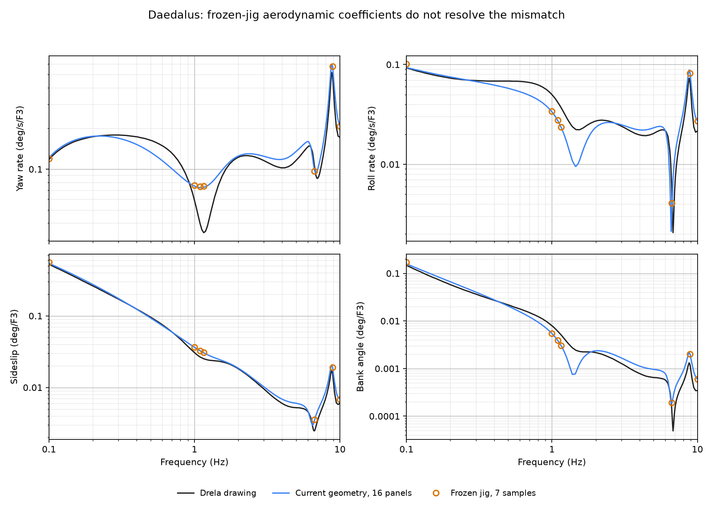
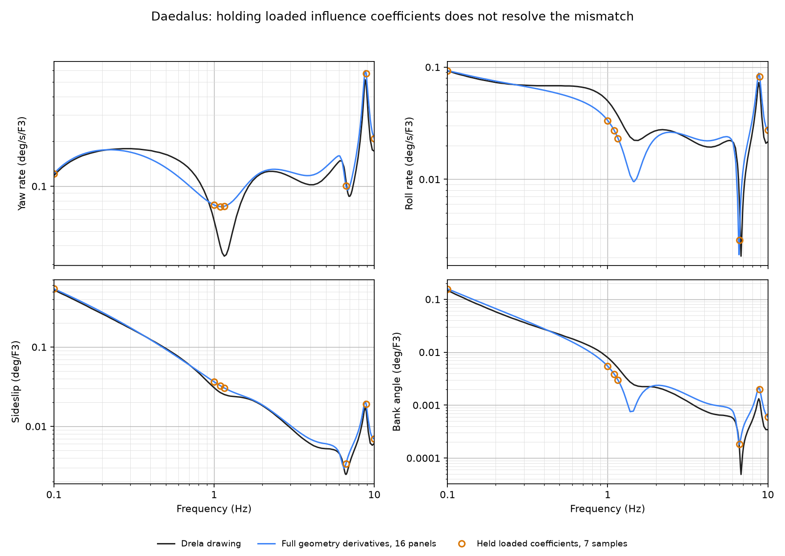

# Daedalus rudder response: yaw, roll, sideslip and bank

The disagreement with Drela's drawing affects several lateral responses. At
**1 Hz**, the 32-panel yaw magnitude is **27.1% higher**, while roll rate and
bank angle are **33.7% and 32.3% lower**. Sideslip is **17.6% higher**. A common
amplitude or units factor cannot explain these opposite differences.



These are the existing 16- and 32-panel, 6.7 m/s aircraft solutions, reduced to
four outputs without another aircraft solve. The published operating point is
still unidentified. This is a descriptive comparison, not matched-reference
validation, and no model property, equation or tolerance changed.

## Comparison

All values below are magnitudes per one native F3 control unit. Rates use
degrees/second; angles use degrees. The reference values are interpolated along
the digitized drawing in logarithmic coordinates.

| Output at 1 Hz | OpenSwing, 32 panels | Drela drawing | OpenSwing / drawing |
| --- | ---: | ---: | ---: |
| Yaw rate | 0.0746941 | 0.0587461 | 1.2715 |
| Roll rate | 0.0330691 | 0.0499106 | 0.6626 |
| Sideslip | 0.0360952 | 0.0306851 | 1.1763 |
| Bank angle | 0.00537490 | 0.00793452 | 0.6774 |

The yaw minimum between 0.7 and 2 Hz remains **0.0727777 at 1.09648 Hz**,
versus **0.0339862 at 1.15738 Hz** in the drawing. Roll has the opposite depth
error: **0.00951645 at 1.46143 Hz**, versus **0.0221981 at 1.54881 Hz**.
Those are minima on their respective existing grids, not refined extrema.
The calculated bank angle also has a deeper dip in this region. The sideslip
curve is visually closer, but has no reference-agreement acceptance result.

Higher-frequency mesh convergence remains open. Near the sharp roll-rate dip
at 6.79896 Hz, the 16-to-32-panel complex difference is 237.4% of the fine
response. This large relative value occurs near a small denominator; the CSV
retains the complex responses rather than applying a denominator floor.
The earlier [yaw mesh study](daedalus-rudder-cruise-mesh.md) retains its results.

## Recovering the outputs

Yaw and roll come directly from the saved aircraft angular-rate coordinates,
using each case's actual rate scale. Bank is the saved ASW Euler bank coordinate,
in radians. Sideslip is the derivative of the reference-flow angle; it is not
approximated by lateral speed divided by airspeed at a finite trim angle.
With the literal zero velocity-reference position,

```
beta_hat = (cos(alpha0)*sin(beta0)*Uhat_x
            + cos(beta0)*Uhat_y
            + sin(alpha0)*sin(beta0)*Uhat_z) / speed0
```

The velocity perturbation uses the saved coordinate scale, which differs from
airspeed. All four output conversions apply `180/pi` once. The native F3 input
already has unit amplitude and receives no extra angular conversion.

An elementary flow-angle check at two predeclared widths verifies this sideslip
derivative in every real and imaginary response direction. Its largest error
decreases from 6.74e-9 to 1.69e-9 when the width is halved. The saved bank states
also satisfy the ASW Euler-rate identity, including pitch/yaw coupling, with a
largest absolute residual of 6.86e-19 rad/s. No physical output stencils or new
harmonic equations are evaluated.

The [primary PDF](https://web.mit.edu/drela/Public/web/aswing/rudder-bode.pdf)
supplies the three additional reference polylines: 100 roll, 105 sideslip and
104 bank vertices. The accepted yaw CSV is copied byte-for-byte. Each panel's
logarithmic axes are checked separately: roll spans 0.001–0.1, sideslip
0.001–1, and bank 0.00001–1. Raw graphic coordinates are retained; the drawing
does not provide reference phase or exact numerical results.

The saved reduction passes **46/46 checks** across 406 existing aircraft states.
It takes 9.2 seconds including its supervisor on this host, with zero aircraft
imports, residual evaluations, matrix factorizations or harmonic solves.
This is not a new browser benchmark or a pass of the aircraft accuracy question.

## A clue about the reference operating point

At 99 exactly shared graphic vertices, the ratio
`2*pi*f*abs(bank)/abs(roll_rate)` lies between **0.99258 and 1.01328**.
The drawing is therefore consistent, within its graphical precision, with
bank angle obtained by integrating body roll rate.

Drela's [unsteady Euler equations](https://web.mit.edu/drela/Public/web/aswing/asw_uns_theory.pdf)
give, at a zero-rate base,

`i*omega*Phi_hat = -Omega_x_hat + tan(Theta0)*(sin(Phi0)*Omega_y_hat - cos(Phi0)*Omega_z_hat)`.

Zero base elevation makes the simple roll-rate integration relation exact.
The present steady-level cruise solutions instead have about three degrees of
elevation. This clue **does not identify the reference trim uniquely**, because
response phases and pitch-rate response are missing. No operating condition has
been fitted to the drawing.

### Zero-elevation comparison

A separately declared 16-panel study replaced the level-flight-path target
with zero elevation, solved a fresh equilibrium at the same 6.7 m/s, rebuilt
the matrices, and evaluated seven fixed frequencies. All 45 numerical checks
pass, including all seven harmonic solves, with unchanged accuracy tolerances.
This is a successful diagnostic calculation, not a reference-agreement pass.

It **does not resolve the discrepancy**. At the drawing's yaw minimum,
1.15738 Hz, the calculated magnitude is 0.06548 versus 0.03399: **1.93 times**
the reference. At 1 Hz, yaw is 11.2% high, sideslip is 0.5% low, and roll and
bank are both about 44% low. The latter two are worse than the corresponding
level-flight results. At 0.1 Hz, yaw is 18.5% low.

The new equilibrium has a -3.59267-degree flight path and requires **-8.95564 lb
of thrust** from the literal type-0 engine. Its `power.1` coordinate is a thrust
setting, not watts. The value is not clipped, and the source jet-domain checks
pass, but this is a conditional braking solution; it does not establish a
feasible positive-propulsion Daedalus cruise condition. No production model,
default, equation or tolerance changed. There is no new full sweep or mesh
convergence claim. The [diagnostic data](daedalus-zero-elevation.json) retain
the trim, all 28 output comparisons, numerical checks and process record.
An independent saved-data audit passes 391 checks without another physical
solve. The [evidence bundle](daedalus-zero-elevation-20261025-evidence.zip)
retains the source, matrices, states and audit; it is not a relocatable replay
package, and its prior-reference dependencies are in the four-output bundle.

### Frozen-jig aerodynamic coefficients

The ASWING [user guide](https://web.mit.edu/drela/Public/web/aswing/aswing_doc.txt)
documents the K/F option, which freezes vortex and volume influence coefficients
on undeformed geometry at zero influence wind angles. A fresh 16-panel study
changes only this existing option. It retains the seven original level-flight
trim conditions, solves a new equilibrium, and rebuilds the dynamic matrices
and native rudder input before evaluating seven fixed frequencies.



The option **does not explain the mismatch**. At the drawing's yaw minimum,
1.15738 Hz, the result is **0.07501 versus 0.03399**, or **2.21 times** the
reference. This is a comparison at a specified frequency, not a newly located
minimum. At 1 Hz:

| Output | Current geometry, 16 panels | Frozen jig, 16 panels | Drela drawing |
| --- | ---: | ---: | ---: |
| Yaw rate | 0.0749405 | 0.0760731 | 0.0587461 |
| Roll rate | 0.0334749 | 0.0338575 | 0.0499106 |
| Sideslip | 0.0364102 | 0.0365817 | 0.0306851 |
| Bank angle | 0.00544629 | 0.00549894 | 0.00793452 |

Units remain degrees or degrees/second per native F3. The complex yaw change
at 1 Hz is 2.52%; this does not mean every output changes by a small amount at
every frequency. In particular, roll changes by 57.5% at the selected 6.65333 Hz
sample, where the response is small and higher-frequency convergence is open.

All 47 numerical checks pass, including the seven harmonic solves. The fresh
full residual is 2.17e-10, the level-flight target is satisfied, and the required
thrust is positive at 6.19886 lb without clipping. The complete native study
takes 90.3 seconds on this host; this is not a controlled browser benchmark.
No production equation, default, or accuracy tolerance changed.

The option is verified through the physical residual and its source-owned jig
cache. Local normals, span, motion and load transfer remain active; this option
is distinct from selectively omitting geometry derivatives in a Newton matrix.
There is no evidence that the published rudder plot used K/F. These seven
samples neither validate the original case nor establish a new mesh-convergence
result. [Data](daedalus-frozen-jig.json) and [CSV](daedalus-frozen-jig.csv)
retain every output and comparison.
An independent saved-result audit passes 190 checks, including raw harmonic
residuals and all four output conversions, without new physical solves.
The [evidence bundle](daedalus-frozen-jig-20261025-evidence.zip) retains the
source, trim, matrices, states and reviews. Its historical paths require
remapping for replay; it is not an automatic relocatable runner.

The [independent inertia audit](daedalus-mixed-inertia.md) found no error in the
tested aircraft/elastic mass coupling. The remaining task is to distinguish
operating-condition differences from errors in the complete coupled dynamics.
No broad requirement or ISAE completion state changes.

### Holding loaded influence coefficients during linearization

Holding vortex and volume influence coefficients at the existing deformed
16-panel cruise state **does not explain the mismatch**. The seven sampled
complex responses change by at most 0.407% for yaw, 2.103% for roll, 0.231%
for sideslip and 1.334% for bank. These are maxima over the seven samples,
not bounds across the frequency range.



At the drawing's yaw dip, 1.15738 Hz, the magnitude changes from 0.0734544
to 0.0734462 deg/s per native F3, versus 0.0339862 in the drawing: **2.161
times the reference**. At 1 Hz:

| Output | Full derivatives, 16 panels | Held loaded coefficients | Drela drawing |
| --- | ---: | ---: | ---: |
| Yaw rate | 0.0749405 | 0.0748227 | 0.0587461 |
| Roll rate | 0.0334749 | 0.0332029 | 0.0499106 |
| Sideslip | 0.0364102 | 0.0364485 | 0.0306851 |
| Bank angle | 0.00544629 | 0.00539976 | 0.00793452 |

This diagnostic preserves the trim and base coefficient values. It removes
only their geometry derivatives, including the resulting engine-onset and
jet changes. Local normals, span, load arms, direct jet geometry, structural
and gravity terms, circulation and other state derivatives, the mass matrix,
and native rudder input remain original. Unlike the preceding K/F study, it
does not freeze coefficients on the undeformed jig or solve a new trim.
It also does not establish which derivatives the historical BODE run used.
Holding all coefficient geometry is broader than holding only relative
motion between surfaces; it is not proposed as a replacement physical model.

An 18-residual screen checks two geometry directions at two perturbation
widths. The assembled 702-column subtraction then passes both removed-chain
and held-action comparisons before any response solve, using the original
2e-8 absolute-plus-relative tolerance. All seven full sparse harmonic solves
pass the original residual and conditioning gates. Independent saved-array
audits reproduce the screen derivatives, matrix subtraction, harmonic
residuals, four outputs and reference comparisons. These checks establish
the declared diagnostic's numerical consistency, not aircraft validation.

The response study takes 11.69 seconds on this native host using one fresh
residual and the retained matrices; it is not a cold-start or browser timing.
The first screen attempt stopped after one valid base residual because of a
reporting-helper argument collision. That failure is retained; the corrected
screen uses the same physics, widths and gates. Across both screen attempts
and the operator study, there are 20 full residual evaluations and seven
harmonic solves. No production equation, default or accuracy tolerance changed.

[Data](daedalus-held-coefficients.json), [CSV](daedalus-held-coefficients.csv)
and the [evidence bundle](daedalus-held-coefficients-20261025-evidence.zip)
retain the original failure, corrected screen, operator construction and raw
responses. The bundle preserves historical paths and requires remapping for
replay. No new full sweep, continuous minimum or mesh-convergence result is
claimed.

## Data and replay

The [CSV](daedalus-rudder-four-outputs.csv),
[SVG](daedalus-rudder-four-outputs.svg) and
[machine-readable report](daedalus-rudder-four-outputs.json) retain all four
comparisons. The [evidence bundle](daedalus-rudder-four-outputs-20261025-evidence.zip)
includes the saved aircraft states, primary graphic, raw extractions, source
reviews, recovery checks and process closeouts.

Extract it and enter `four-outputs`. Run `python3 -I -B replay.py --verify-only`
to check the package without numerical work. An explicit
`python3 -I -B replay.py --run --target /absolute/path/to/new-output-directory`
repeats only the saved-state reduction and plotting, with a 120-second cap and
the dependencies listed in its README. Packaging verification and path remapping
were checked without rerunning the accepted diagnostic.
