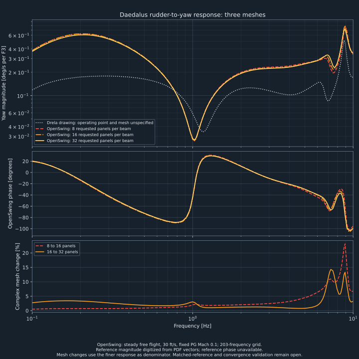

# Daedalus rudder-to-yaw response on three meshes

The 32-panel saved dynamic model now has **203 resolved frequency samples** on the same 0.1–10 Hz grid as the earlier 8- and 16-panel models. Two hundred new full sparse harmonic solves were performed; the three previously checked anchors were copied exactly. No trim, physical residual evaluation, matrix assembly or physical output stencil was repeated for this sweep.

| Mesh comparison | Maximum sampled complex change | Frequency | Maximum sampled magnitude change | Frequency |
|---|---:|---:|---:|---:|
| 8 to 16 panels | 23.1434% | 8.90352 Hz | 12.9958% | 8.52618 Hz |
| 16 to 32 panels | 14.2815% | 7.26242 Hz | 14.2499% | 7.26242 Hz |

Each change uses the finer response as its denominator. The 16-to-32 differences at 0.1, 1 and 10 Hz remain 2.73%, 3.04% and 3.22%; the full sweep reveals larger differences between those anchors. The frequency of the largest change also moves. These are sampled differences, not error bounds or proof of spatial convergence. Narrow features between samples remain possible.

The declared OpenSwing case is separately trimmed steady, level free flight at 30 ft/s and fixed PG Mach 0.1, with unit native F3 forcing and body yaw recovered from the raw state coordinate and recorded rate scale. The 32-panel matrix uses the [six-level field-refinement correction](daedalus-rudder-field-refinement.md); its acceptance formulas and tolerance are unchanged. The earlier matrices and curves were retained. The full comparison predates the separate canonical-frame local-rate optimization.

All frequency samples passed the original condition and full-equation checks: minimum estimated reciprocal condition `2.9154e-9`, maximum scaled residual `3.6751e-16`, and maximum backward error `7.4099e-18`. The fixed-grid extension took 327.89 seconds in native Python; this excludes prior trim and matrix assembly and is not a browser benchmark. An independent saved-data review passed 185 checks, recomputing yaw responses and mesh differences and verifying the three exact anchor states. That review did not repeat physical evaluations or matrix products; harmonic residual checks are those recorded by the original solver.

Drela's drawing still differs substantially. Its operating point and mesh are unidentified, so this is not a matched-ASWING validation. Reference magnitude was extracted from PDF vectors; no reference phase is available. A linear frequency sweep also does not verify a finite-amplitude nonlinear rudder step. The broader project and experimental validation remain incomplete.

[Machine-readable evidence](daedalus-rudder-mesh-sweep.json), [CSV](daedalus-rudder-mesh-sweep.csv), [PNG](daedalus-rudder-mesh-sweep.png), and [PDF](daedalus-rudder-mesh-sweep.pdf). The earlier [8/16 report](daedalus-rudder-sweep.json), [failed 32-panel construction](daedalus-rudder-refinement.md), and [saved-trim recovery](daedalus-rudder-field-refinement.md) remain separate records.
