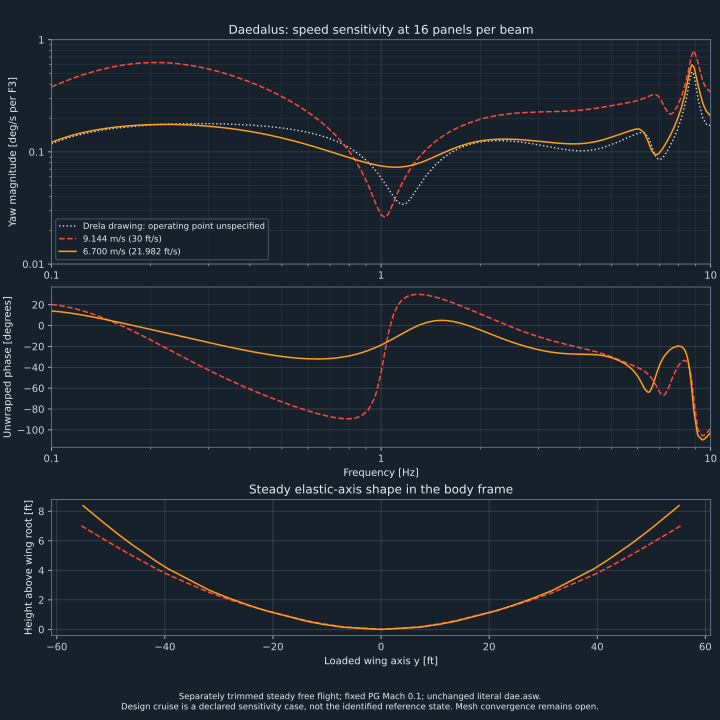

# Daedalus rudder response: operating-speed sensitivity

The nonzero free-flight yaw response depends strongly on the trimmed operating
point. At the published design speed of **6.7 m/s (21.9816 ft/s)**, the computed
0.1 Hz magnitude is 2.93% above Drela's drawing, compared with the much larger
discrepancy at 30 ft/s. The response still does not reproduce the dip near 1 Hz.
This is a speed-sensitivity study, **not matched-reference validation**.

The [Daedalus structural-design paper](https://web.mit.edu/drela/Public/web/hpa/hpa_structure.pdf)
specifies the design cruise speed. It does not identify that speed as the
operating point of the [rudder Bode drawing](https://web.mit.edu/drela/Public/web/aswing/rudder-bode.pdf).
The drawing's operating point and mesh remain unidentified. No physical
parameter was fitted to its curve.

## Setup and results

Both cases use the literal `dae.asw`, 16 requested panels per beam, the same
117 nodes and 112 elements, reference density 0.002378 in model units, PG Mach
0.1, current aerodynamic influences and seven steady-level trim constraints.
The new case restores the old physical equilibrium only as a starting guess,
then solves a new trim at the new speed. The six acceleration/net-load equations
are released for free-flight dynamics. Fixed PG Mach does not freeze local
section-normal Mach corrections or the effects of changing speed on propulsion.

All **203 frequencies** from 0.1 to 10 Hz pass the original harmonic checks,
with no missing responses. Fresh equilibrium residual is `4.36e-13`; maximum
scaled harmonic residual is `1.76e-16`. The study recorder passes 536 checks
and an independent saved-data audit passes 265 checks, including exact recovery
of all 203 complex yaw values from the saved states. These are numerical and
provenance checks, not an aircraft accuracy criterion.

| Frequency, Hz | 30 ft/s | 6.7 m/s | Drela drawing |
| --- | ---: | ---: | ---: |
| 0.1 | 0.379480 | 0.121697 | 0.118238 |
| 1 | 0.027372 | 0.074940 | 0.058746 |
| 10 | 0.340179 | 0.208850 | 0.171868 |

Values are yaw magnitude in degrees/second per native file F3 unit. The drawing
values use log-linear interpolation of its digitized PDF curve; reference phase
is unavailable. State yaw is dimensionalized with each layout's actual rate
scale, then converted to degrees/second once. The F3 forcing already represents
one native input unit and receives no extra degrees/radians conversion.

Across the sampled grid, the largest complex speed change is **189.607% at
1 Hz**, using `abs(H_30ft/s)` as denominator. The largest magnitude change is
183.189% at 1.02946 Hz. These relative values become large near response minima;
the CSV also retains absolute differences. The largest absolute complex change
is 0.00795996 rad/s/F3 at 0.213368 Hz.

The new response's sampled local minimum near 1 Hz is 0.0730175 deg/s/F3 at
1.09648 Hz. The drawing's sampled minimum there is 0.0339862 at 1.15738 Hz.
Thus the apparent low-frequency improvement does not resolve either the depth
or the location of this feature. Mesh convergence also remains open: the earlier
[30 ft/s three-mesh study](daedalus-rudder-mesh-sweep.md) found a 14.28% maximum
sampled complex change from 16 to 32 panels. The subsequent
[cruise-speed refinement](daedalus-rudder-cruise-mesh.md) now completes all 203
frequencies at 32 panels. It barely changes the near-1 Hz minimum, while retaining
substantial mesh sensitivity around higher-frequency features.

Retrimming changes alpha from -1.67779 to 3.03955 degrees, elevator F2 from
-2.46703 to -10.08996, rudder F3 from -0.00237508 to 0.105044, and the native
type-0 engine thrust setting from 7.92663 to 6.16870. That engine setting is not
watts. Wing-tip height above the wing root increases by approximately 1.367 ft.
The largest same-node body-coordinate position change is 1.40283 ft and the
largest rotation change is 5.05524 degrees. These changes include the coupled
equilibrium, controls and propulsion; they do not isolate a causal component.

Native timings were 120.48 seconds for trim, 21.75 seconds for linearization,
and 67.63 seconds for the sweep. They are single shared-host observations,
not browser timings or a controlled speed benchmark. The retained 30 ft/s
baseline precedes the separately checked geometry-refinement and local-rate
changes; the two source snapshots are explicitly pinned, not byte-identical.
The subsequent progress-display change was not part of this frozen study.

## Open the cases

Import [the two-speed project](../../examples/dae-speed-project.json) through
**Project & saved cases**, select a case, and choose **Load case**. Both cases
contain their own physical steady equilibrium and free-flight frequency
settings. After solving, select **control.3 · Rudder → Flight frame → Yaw rate r**.

The project uses **101 logarithmically spaced UI frequencies**. This report uses
203 frequencies combining that grid with reference-curve vertices. The UI's
control-input setting includes F2, F3 and the engine; this study solves F3 only.
Production project parsing and saved-case consistency checks pass. Importing a
saved equilibrium does not skip the full residual and constraint checks.

The [machine-readable report](daedalus-rudder-speed.json) binds the results,
source snapshots and audits. [CSV](daedalus-rudder-speed.csv),
[PNG](daedalus-rudder-speed.png) and [PDF](daedalus-rudder-speed.pdf) are available.
The plot can be regenerated from saved data with
`scripts/compare-daedalus-rudder-speed.py`; it performs no aircraft solve.
A linear Bode calculation does not validate a finite-amplitude nonlinear rudder
step. Reference agreement, refined aircraft response and the full project goal
remain incomplete.
