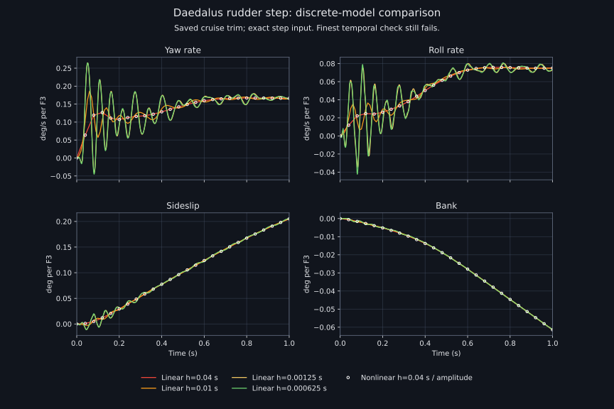

# Daedalus rudder-step consistency and temporal-resolution limit

The restored C16 free-flight public launch completes a 1 s, +0.1 native F3 step on a 0.04 s grid. Its nonlinear outputs closely match the full linear descriptor advanced on the same grid. **Temporal accuracy remains unestablished:** even the saved-linear 0.00125→0.000625 s refinement fails the fixed 0.5% resolution criterion in four of five groups. No fine nonlinear or half-amplitude case was run, and the full-aircraft near-1-Hz Bode mismatch remains unresolved.

The input is a native relative F3 step about the saved control value 0.105043813573132, held beyond the run. The initial saved snapshot precedes the step. Both paths use BDF1 startup then BDF2; the linear companion retains the complete singular descriptor without mass inversion or modal reduction. The nonlinear difference is baseline-subtracted and divided by 0.1. Yaw/roll are body angular rates, sideslip comes from body velocity, and bank follows the ASW attitude convention. All-node motion uses body displacement/L and spatial rotation radians.

| Group | Nonlinear vs linear, same 0.04 s grid | Linear 0.00125→0.000625 s |
|---|---:|---:|
| Yaw rate | 0.010848% | 3.599209% |
| Roll rate | 0.004397% | 13.686607% |
| Sideslip | 0.004870% | 1.039947% |
| Bank | 0.003305% | 0.085806% |
| All scaled nodal motion | 0.028907% | 0.762687% |

Each entry is an infinity norm over all matching times/components divided by the sampled linear-reference infinity norm, with no denominator floor. The coarse column is descriptive, not a substitute for the prospective fine-grid acceptance checks. Seven linear grids were retained: 0.04, 0.02, 0.01, 0.005, 0.0025, 0.00125 and 0.000625 s. All adjacent-pair and common-coarsest-grid triplet metrics remain in the JSON. The finest triplet differences decrease, but only bank meets 0.5%.

The largest finest-pair scalar differences occur at 0.12875–0.1475 s; they are not confined to the first 0.01 s. The full-motion maximum occurs at 0.0675 s in tailplane-tip rotation-y, with a later upper-fin rotation-z difference at 0.1875 s. The three fixed time bands are descriptive and leave the full-time gate unchanged. Saved peak envelopes do not establish modal stability.

The one coarse native run passed 50/50 technical checks: 25 accepted steps, no rejected steps or retries, 336 complete residual calls and two successful structured tangents, with no dense fallback or retrim. Its maximum accepted residual was 9.5477e-11. The independent saved-output audit passed 409/409 checks, recovering 26 raw states without new physics or solves. All original and refined linear numerical gates passed; these are distinct from the failed temporal-accuracy criterion.

The instrumented native child lifecycle took 24.744 s and used 284,248 KiB peak child RSS. These include audit instrumentation and do not measure browser performance. The completed C16 result is 44,185,789 bytes pretty-printed with indent=2, or **22,713,890 bytes with the actual bridge JSON encoding**, for 26 snapshots. Exact repeated state/options values account for 5,582,029 bridge-encoded bytes (24.5754%) before reference-key/schema overhead. Extra raw audit artifacts are counted separately in the JSON.

The separate historical Dae48 payload audit found 23.94% exact repeated state/options values. Its receipt predates the current C16 measurement and remains unchanged; payload sizes across those cases must not be compared without accounting for format, mesh and snapshot count. These saved-data results support testing lossless indexed retention. No encoder has yet been implemented or benchmarked, and the cause of the reported browser stall remains unproven.

Next work is to implement lossless trajectory/checkpoint storage against the exact saved data, with exact round-trip and browser-resume checks, preserving every step, precision and physical/restart value while leaving dt/equations unchanged. Efficient accuracy-controlled transient integration is a separate task. No production code, model equations/defaults, browser build or hosted release changed in this evidence publication.

[Data and receipt pins](daedalus-rudder-time-consistency.json) · [plotted trajectory CSV](daedalus-rudder-time-consistency.csv) · [PNG](daedalus-rudder-time-consistency.png) · [evidence ZIP](daedalus-rudder-time-consistency-20261025-evidence.zip). The bundle contains all current raw states, residual packets, snapshots/restarts, source/plans, retained preparation failures and terminal receipts. Historical repository evidence ZIPs are deliberately not duplicated; `external-dependencies.json` identifies their paths and hashes, and those old archives must be obtained separately to inspect their original members. Plotting source is retained at `study/plot.py`.
