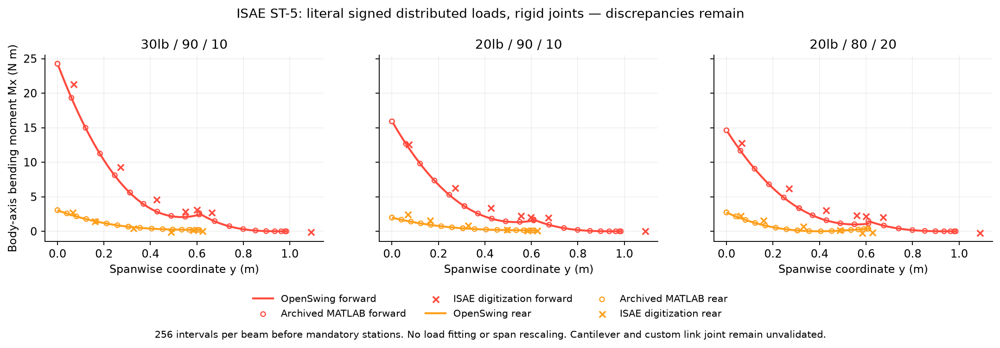

# Literal ST-5 distributed static loads

**Partial validation: direct file support is implemented; experimental
discrepancies remain.** Three original ST-5 rigid-joint files now solve without
replacing their signed `Dmg` distributions. All 15 calculations converge at
16, 32, 64, 128 and 256 intervals per beam, plus required attachment/property
stations. No source geometry, stiffness, load scale or measurement was fitted.

The current acceptance target is agreement with tested ASWING cases;
experimental agreement is optional. The newer [original-output comparison](isae-st5-reference.md)
checks the 20 lb 80/20 file using independently audited output units. Its
remaining geometry and mesh differences supersede the historical MATLAB
reduction as the reference-completion assessment.

## Load definition and implementation

The [ASWING theory](https://web.mit.edu/drela/Public/web/aswing/) equations
77–80 and the mass-property definitions on pages 43–44 describe two independent
distributed weights, `mg` and `Dmg`, with separate `Ccg/Ncg` and `DCcg/DNcg`
centroids. ISAE Part III, page 42, explicitly uses negative additional mass
to represent the upward bench load from pulleys.

Structural static mode now permits either distribution to carry a signed
gravity load. It keeps their separate rotating centroid offsets, preserving
the force couples even when net force cancels. The physical assembly,
material-midpoint integration, interpolation, sparse solver, rank guards and
convergence tolerances are unchanged.

This option does not enable negative physical inertia. Such results have
`physical=false`, no physical CG, and no time-launch setup. Negative point
masses and distributed weights still reject in aerodynamic, modal and dynamic
analyses. Centroidal inertia validation is unchanged. Negative weight input
knots are classified even if a coarse mesh misses the negative region.

Three byte-identical original files are included under **ISAE static
validation** in the example selector. They automatically select **Structural
static · no airflow** and a bending-moment distribution. Both wings can be
selected in the structural plot, with file or custom body-axis gravity.

## Numerical checks

There are **115 passing native tests**, including 22 distributed-load checks
and 19 existing point-static workflow checks. Independent tests verify total
force/moment under arbitrary large rotations, separate offset centroids,
zero gravity, and a nonlinear cantilever elastica solved as a continuous
boundary-value problem. Both load signs converge toward that reference with
mesh refinement. Physical mass and moving-frame rejection checks remain.
Thirteen JavaScript project/solution data tests also pass.

Maximum residual over the 15 literal ST-5 solves is 1.31e-13. Maximum force
and moment imbalance is 3.56e-14 lb and 3.60e-11 lb·ft. The three original
ST-3 point-load controls give identical nodal positions and rotations to
their previous native results.

The previous [ST-5 study](isae-st5.md) integrated the negative distribution
into nodal forces with eight-point Gauss quadrature. The direct path uses
the existing midpoint representation. They are different finite-mesh
approximations, so exact equality is not expected. Their differences decrease
with refinement. At 256 intervals the maximum node-position difference is
1.708e-6 ft (0.000521 mm), and the maximum section-moment component difference
is 0.002995 lb·ft (0.004061 N·m). No tolerance or load normalization was changed
to make those comparisons agree.

**All four offline browser tests pass:** ST-5 and ST-3 each run on desktop
and mobile. The three 64-interval ST-5 solutions compare every node and
section force, moment, strain and curvature with native results, as well as
applied loads, reactions and balances. Maximum position difference is
4.89e-15 ft; maximum section-moment component difference is 3.32e-12 lb·ft.
The tests also check negative-mass rejection, both structural plot surfaces,
exports and the ST-3 saved-solution round trip. Mobile has no horizontal
overflow at 390 × 844 pixels. No browser JavaScript errors were recorded.
See the [browser results](distributed-static-browser.json) and
[check summary](distributed-static-checks.json).

## Archived and experimental comparisons

The same reduction and dimensional coordinates as the original study are
used. Interpolation does not cross a joint jump; missing measurements and
out-of-span samples remain explicitly excluded. Six forward-wing and five
rear-wing measurements contribute to each experimental statistic.

| Input label | Archived forward / rear RMSE, N·m | Experimental forward / rear RMSE, N·m |
|---|---:|---:|
| 30 lb, 90/10 | 0.04389 / 0.01552 | 1.70667 / 0.25439 |
| 20 lb, 90/10 | 0.02767 / 0.01058 | 1.09296 / 0.52723 |
| 20 lb, 80/20 | 0.02566 / 0.00996 | 1.37776 / 0.49265 |



The archived reference is the upstream MATLAB reduction, not independently
verified physical ASWING output. Its exponent scaling conflicts with the
clamped root dihedral, and a smaller forward-wing geometry/spline difference
also remains. The original experiment’s complete apparatus and uncertainty
description have not been recovered. These results do not resolve the
experimental discrepancies.

## Literal coverage and remaining work

All 38 ST-5 inputs were rechecked: **20 construct a static network**; 16 still
reject out-of-range attachment stations and two reject numeric syntax. A
successful network setup is not a solved or validated case. Only the three
rigid-joint files above receive the full mesh/curve comparison here.

Five constructed inputs are from the custom link-joint set. ISAE states that
those results required modified ASWING: x/y translations and z rotation are
released. Standard ASWING Joint type 2 does not specify that law. Those
custom-joint cases remain unvalidated. The selected cantilever still rejects
its out-of-range attachments at every tested mesh; no record was deleted or
moved to force a solve.

The [source transition audit](distributed-static-transition.json) limits
kernel changes to six functions in three modules. The other 94 modules and
ASW parser are unchanged. Earlier numerical studies retain their original
source pins and are not presented as fresh reruns. Ten of 41 ISAE families
have partial comparisons; the other 31 and the full ASWING feature goal
remain incomplete.

## Sources and reproduction

The [pinned ISAE repository](https://github.com/rom1isae/ISAE_Aswing_Experimental_Validation/tree/f62943df20e9e4d7d9f50e070477b22426b5f865),
Jan’s *Experimental validation of ASWING, Part III: Structure*, pages 40–44,
and its original ST-5 inputs, MATLAB output and experimental CSVs provide the
setup and reference data. The primary experiment is
[Lin, Jhou and Stearman, SAE 891060](https://doi.org/10.4271/891060); the
publisher abstract alone does not establish its full experimental setup.

[Native results and literal audit](distributed-static.json),
[curve comparisons and exclusions](distributed-static-comparison.json).

```sh
OPENBLAS_NUM_THREADS=1 OMP_NUM_THREADS=1 .venv/bin/python scripts/verify-distributed-static.py
OPENBLAS_NUM_THREADS=1 OMP_NUM_THREADS=1 .venv/bin/python scripts/summarize-isae-st5.py --input distributed-static.json --output distributed-static-comparison.json
.venv/bin/python scripts/plot-isae-st5.py --input distributed-static.json --comparison distributed-static-comparison.json --output distributed-static-comparison --literal
OPENBLAS_NUM_THREADS=1 OMP_NUM_THREADS=1 .venv/bin/python -m pytest -q tests/test_distributed_static_loads.py tests/test_structural_static_workflow.py
npx playwright test tests/browser/distributed-static.spec.js tests/browser/structural-static.spec.js
```

The native runner uses the pinned repository cache and the prior `isae-st5.json`
and `structural-static-workflow.json` reference records. It retains rejected
cases and does not overwrite those earlier results.
