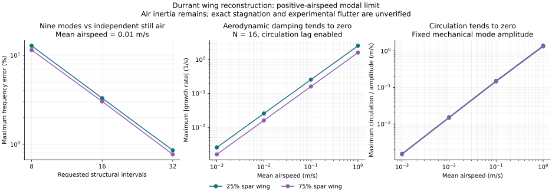

# Durrant wings: finite-frequency limit at low positive airspeed

This study tests whether the documented unsteady equations retain still-air
inertia as positive mean airspeed tends to zero. It uses the two main-table
structural reconstructions in [the structural study](durrant-structure.md),
without changing the production solver or browser interface. The comparison
is an independent mechanical limit, not a reproduction of the thesis's
unrecorded zero-airspeed ASWING setup or an experimental flutter validation.

## Sources and setup

The pinned [reference manifest](durrant-low-speed-reference.json) records
[Drela's unsteady extension](https://web.mit.edu/drela/Public/web/aswing/asw_uns_theory.pdf)
and [Durrant's thesis](https://doi.org/10.6084/m9.figshare.26317378.v1).
Table 3.11 (printed page 67, PDF page 80) supplies Case 4 section properties:
lift slope 2π/radian, CLmax = 1, CLmin = −0.3, alpha = 4 degrees,
Cm = −0.1, and zero Cdf/Cdp. These are additions to the main-table structural
reconstruction, not the incompatible appendix input. Other thesis tables
contain a positive printed CLmin; those values are not silently substituted.

The wing extends along +z, its chord points along +x, and its normal is −y.
Its positive incidence therefore corresponds to body beta. Both body angles
are zero in this study; the section camber and pitching moment still produce
small equilibrium loads. Density is 1.225 kg/m³, PG Mach is fixed at zero,
and gravity is zero. There are no engines or controls. K/F is off and K/W
retains its default. Requested uniform interval counts are 8, 16 and 32;
required property breaks can increase the actual element count.

## Which limit is tested

Linearize the solved equilibrium at positive airspeed U, then take U toward
zero while keeping a nonzero mechanical modal frequency and a fixed physical
mode amplitude. Equations 33–35, 41–44 and 49–56 of the unsteady extension
give the following interpretation:

- With circulation lag enabled, its coefficient proportional to 1/U makes
  the finite-frequency circulation perturbation O(U). Both steady circulatory
  and circulation-rate loads then vanish. Slow aerodynamic roots approach
  zero separately and are outside this structural-mode comparison.
- Surface inertia remains: normal mass per unit span is ρπc²/4 at midchord,
  with spanwise rotary inertia per unit span ρπc⁴/128. At the zero-motion base,
  the mean-flow angular-rate terms vanish with U.
- With K/L disabled, circulation is algebraic and its perturbation need not
  approach zero. The circulation-rate force is disabled, while steady
  circulatory loads vanish with mean airspeed. Apparent mass remains.

The independent reference integrates this surface mass and rotary inertia
with cubic Hermite bending and linear torsion elements. It shares the source
property transcription with the application model, but does not call the
application's structural residual, aerodynamic loads or modal matrices.
The preceding structural study retains the independent 96/192-element
reference refinement and analytic torsion checks.

Vacuum removes fluid inertia and has different frequencies. A DC limit,
an exact-stagnation nonlinear launch, and the finite-frequency limit tested
here are distinct problems. The production circulation equations, load
coefficients and state scaling divide by airspeed or local flow magnitude;
simply accepting U = 0 would leave undefined equations. This study does not
change that guard or label a small positive speed as zero.

## Verification design

Twenty native cases cover both wings, three meshes at U = 0.01 m/s, and
U = 1, 0.1, 0.01 and 0.001 m/s at the middle mesh. Further middle-mesh cases
change the linearization step, eigenvalue search shift, circulation-lag
setting, and input time unit. The time-unit case changes all affected input
quantities consistently and reports physical roots in 1/s.

The full-descriptor search requests 24 roots. The first nine positive
oscillatory roots above 20 rad/s are selected, then their complex mechanical
shapes are matched to the independent still-air reference. Original-pencil
left/right residuals check each selected root. This window does not classify
the complete finite spectrum or validate the excluded slow aerodynamic roots.

Mesh frequency errors must decrease by a factor smaller than 0.45 at each
refinement, and refined modal assurance must exceed 0.99. Step, search and
unit changes must preserve physical roots to a scaled tolerance of 2e−7.
Each factor-of-ten airspeed decrease must reduce aerodynamic growth/decay
and circulation per mechanical amplitude by a factor below 0.15; the final
frequency change must be below 2e−6 relative. Mode normalization cannot
manufacture the circulation limit: circulation is divided by the mechanical
norm √Σ(|δr|² + c²|δθ|²). The K/L-off case separately checks structural
shape agreement; it is not subject to the lag-enabled circulation limit.

Six packaged-WASM replays cover both wings at the coarse mesh, the lowest
speed, and the alternate time unit. The offline browser workflow imports
the same literal models, verifies the applied mesh, solves both wings at
0.01 m/s with air inertia enabled, checks nine exported roots per wing,
and inspects a nonzero y-displacement mode plot and CSV.

## Native results

All 20 native cases passed. The maximum left/right original-pencil backward
error was 9.682e−15, and the maximum base continuous residual was 1.913e−14.
The nine structural frequencies converge toward the independent still-air
reference on both wings:

| Wing | Maximum error, N=8 | N=16 | N=32 | Minimum N=32 modal assurance |
|---|---:|---:|---:|---:|
| 25% spar | 12.7812% | 3.2968% | 0.8554% | 0.9995278 |
| 75% spar | 11.4548% | 3.0264% | 0.7697% | 0.9998614 |

At N=32 and U=0.01 m/s, the first bending/torsional frequencies are
9.723762/34.932073 Hz for the 25% wing and 8.627300/31.021403 Hz for the
75% wing. The independent 192-element still-air values are
9.723301/34.928398 Hz and 8.626882/31.018606 Hz, respectively. The reference
itself has finite discretization error, retained in the structural study.

Changing the differentiation step, search shift or time unit changes physical
roots by at most 2.345e−12 on the specified scaled metric. Reducing U from
0.01 to 0.001 m/s changes frequency by at most 1.085e−7 relative.
All selected roots are damped. Across each factor-of-ten speed decrease,
the largest damping-magnitude ratio is 0.10195 and the largest normalized
circulation ratio is 0.10994. Both support the predicted O(U) behavior.

At N=16 and U=0.01 m/s, disabling K/L changes the nine frequencies by at
most 1.021e−7 relative to the lag-enabled calculation. This is an observed
comparison, not an additional automatic acceptance threshold. K/L-off
shape assurance against the independent still-air reference exceeds 0.9948.



The figure is also available as [PDF](durrant-low-speed.pdf) and
[PNG](durrant-low-speed.png). Full physical roots, complex shapes, normalized
circulation, generated ASW text, conditions and hashes are in
[the native record](durrant-low-speed.json).

## Portability and browser outcomes

All six packaged-WASM cases passed, comparing 54 positive structural roots,
their complex shapes and circulation per mechanical amplitude. The maximum
scaled native/WASM root difference is 1.4017e-12; all shape comparisons exceed
1−1e−9 modal assurance. The same 56 numerical modules are used in both runtimes.
The [WASM record](durrant-low-speed-wasm.json) pins the native study, verifier,
packaged modules and runtime lock.

One corrected offline browser workflow passed both wings, checking 18 roots,
requested and solved speed, applied mesh, a y-displacement mode plot, CSV,
and mobile layout. The initial browser run solved its first wing but failed
on an incorrect test field: it accessed `base.condition.speed` instead of
the top-level request condition and `base.operating_values.speed`. The test
was corrected without changing production sources or numerical tolerances.
The [checks record](durrant-low-speed-checks.json) retains both outcomes and
the tested source/asset hashes. The scientific figure and both browser
mode plots were visually inspected.

This is a positive-airspeed structural-limit study. It does not establish
exact stagnation, the excluded slow aerodynamic spectrum, nonlinear rest
launch, the thesis's original ASWING setup, experimental flutter, or a full
project regression. Those gaps and the other full-scope requirements remain.

## Reproduce

```sh
OPENBLAS_NUM_THREADS=1 OMP_NUM_THREADS=1 .venv/bin/python scripts/verify-durrant-low-speed.py
node scripts/test-durrant-low-speed-wasm.mjs
.venv/bin/python scripts/plot-durrant-low-speed.py
npm run test:browser -- tests/browser/durrant-low-speed.spec.js --workers=1
```

The native script caches cases under a hash of its source, the structural
reference, production modules and numerical runtime versions. A partial run
does not overwrite the complete report. Native results, WASM replays and
the final checks record retain their own provenance. The browser needs the
built application served at the configured test URL.
