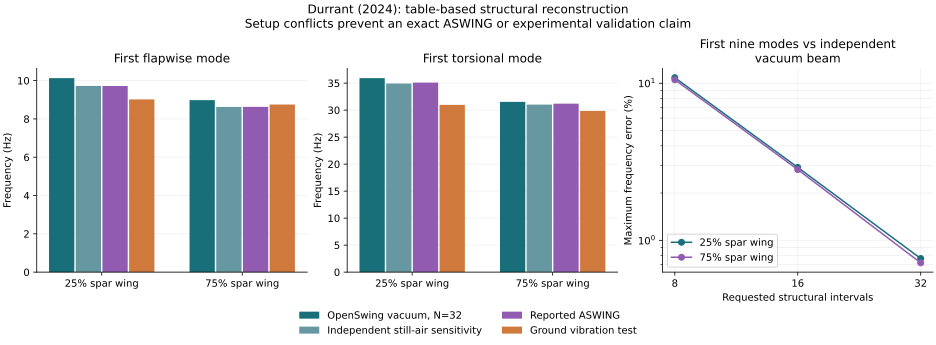

# Durrant flexible-wing structural reconstruction

This study checks structural eigenfrequencies of two wings reconstructed from
published numerical tables against an independent beam finite-element model.
It also records the thesis's measured and ASWING frequencies, with unresolved
setup differences. It does **not** establish exact ASWING reproduction,
experimental flutter validation, or a correction to the production solver.

The reference is Matthew Durrant's 2024 University of Canterbury thesis,
[Aeroelastic Instability of Reduced-scale High-altitude Pseudo-satellite Wings](https://doi.org/10.6084/m9.figshare.26317378.v1).
The author-deposited version is CC BY 4.0. The source manifest and numeric
transcription are in `durrant-reference.json`; values were checked against
rendered PDF pages, including line-wrapped appendix tables. The full PDF is
fetched separately into `.reference/durrant` and is not distributed with the app.

## Source audit

The main tables and Appendix A do not define the same model:

| Quantity | 25% wing, main tables | 25% wing, appendix | 75% wing, main tables | 75% wing, appendix |
|---|---:|---:|---:|---:|
| EIcc (N m²) | 9.3684 | 6.1510 | 7.2588 | 6.3275 |
| EInn (N m²) | 311.19 | 219.2454 | 428.03 | 357.8866 |
| EIcn (N m²) | −7.856 | −4.4661 | −8.889 | −7.3680 |
| GJ (N m²) | 0.7101 | 0.4081 | 0.6887 | 0.4185 |
| Elastic-axis fraction Xax | 0.2505 | 0.3168 | 0.3844 | 0.3663 |
| Integrated distributed mass (kg) | 0.0730971 | 0.0860539 | 0.0724994 | 0.0868368 |

The appendix names contain `UNCORRELATED`. Its stiffness differs by up to 43%
from the main tables, and its distributed mass is larger. These inputs cannot
be exchanged while claiming the same experiment or numerical model. Table 2.21
reports total masses 0.0731 and 0.0726 kg; the small discrepancy in the second
table-integrated mass is retained, without rescaling.

Additional unresolved conventions are consequential:

- Section 3.10 gives `Nea=0.005 m` in prose; Table 3.7 and Appendix A use
  `0.001 m`. The baseline follows the table and separately checks the prose value.
- The appendix's Weight comments place inertia immediately after weight.
  The public ASWING guide puts drag area, volume and angular momentum before
  inertia. The study does not reinterpret these columns from comments. Its
  Reference line also prints six values where the guide specifies three on
  the first line and optional reference coordinates on later lines. The
  reconstruction writes the documented layout; it is not a literal import.
- The nominal 75% spar location is not the elastic axis: the measured elastic
  axis is about 38% chord. Substituting 75% would create a different model.
- The ground vibration test used a temporarily taped accelerometer with a
  suspended lead wire (section 2.2.13). Their exact mass and attachment are not
  established there. Appendix F describes additional wings with two tip
  accelerometers. The appendix's two point objects are not assumed to describe
  the ground vibration apparatus.
- The reported zero-airspeed ASWING modes omit the exact mesh, gravity/preload
  settings and whether quiescent-air apparent mass was active.
- Experimental flutter speed was recorded at catastrophic structural failure.
  A linear eigenvalue crossing indicates local onset of instability, a different
  observable. Matching these speeds without resolving that distinction would
  not validate the dynamic model.

## Reconstruction and independent reference

The baseline uses Tables 2.19–2.20 and 3.4–3.7: a vertical 0.718 m cantilever,
0.09446 m chord, clamped root, and three constant-property mass regions of
12, 700 and 6 mm. Stiffness is uniform and coupled, axial/shear stiffness is
infinite, and material damping is zero. Doubled stations retain the mass jumps.
The logical coordinate starts at 1 to avoid implicit surface mirroring.
Constants use the appendix's SI gravity, density and sound speed. The native
baseline is **vacuum with zero gravity**, with no concentrated objects.
Aerodynamic coefficients are not reconstructed; generated inputs are intended
for this structural study only.

The independent reference uses cubic Hermite bending and linear torsion
elements, with six-point quadrature and exact material boundaries. It constructs
mass and stiffness from energy, without calling OpenSwing's geometry, inertia,
beam or modal routines. In local c/s/n coordinates, bending displacements are
`w_c,w_n` and twist is `phi`. Rotations are `(w_n',phi,-w_c')`. With zero tension-axis
offsets, reference-axis translation is `(w_c-Nea*phi,0,w_n+Cea*phi)`; the
centroid velocity additionally includes rotation crossed with the CG offset.
The energy retains EIcn coupling and all supplied centroidal rotary inertia.

An independent uniform torsion-wave check tests the first three frequencies
against `(2j-1)/(4L) sqrt(GJ/Ipolar)` and verifies second-order refinement.
The wing references use requested resolutions 48, 96 and 192. The maximum
96-to-192 frequency change across the first nine modes is 0.0862% for the 25%
wing and 0.0758% for the 75% wing.

OpenSwing uses requested uniform resolutions 8, 16 and 32, plus required
material-boundary nodes. Its dense reduction initially flagged ambiguous weak
inertia. The study uses the existing full-descriptor Arnoldi search, retaining
those inertias and the original residual checks. No rank threshold or physical
parameter was changed to obtain agreement. Total finite spectrum dimension
remains unclassified by that local search.

Modes are matched to independent physical shapes using a span-weighted metric
that scales rotations by chord. Eigenvector phase and amplitude do not affect
this comparison. Dominant strain-energy labels are diagnostic; a mixed mode can
change its dominant family under refinement. The study does not assign all
published mode identities by sorted frequency alone.

## Results and limits

All nine compared vacuum modes converge toward the independent reference:

| Requested OpenSwing intervals | Largest frequency error, 25% wing | Largest frequency error, 75% wing |
|---|---:|---:|
| 8 | 10.853% | 10.527% |
| 16 | 2.913% | 2.821% |
| 32 | 0.766% | 0.719% |

Every successive frequency error is less than 40% of its preceding value.
At 32 requested intervals, the minimum modal-assurance value across all nine
modes is 0.999963 and 0.999827 respectively. Search-shift and differentiation-step
changes alter frequencies by at most 1.35e-13 relative in the recorded native
runs. The largest original-pencil backward error is 2.90e-15.

The independent reference also computes a **still-air sensitivity**, adding
the documented thin-plate normal mass `rho*pi*c²/4` at midchord and rotational
inertia `rho*pi*c⁴/128`, with density 1.225 kg/m³. It has no circulation forces
or gravity preload. This is an independent calculation, not a zero-speed
OpenSwing aerodynamic solve or a confirmed original-ASWING setting.
Its 96-to-192 refinement changes the first nine frequencies by at most 0.0823%
and 0.0733% for the two wings.

| Wing and mode | OpenSwing vacuum, N=32 (Hz) | Independent still air (Hz) | Reported ASWING (Hz) | Measured GVT (Hz) |
|---|---:|---:|---:|---:|
| 25%, first flapwise | 10.1307 | 9.7233 | 9.72 | 9.02 |
| 25%, first torsion | 35.9278 | 34.9284 | 35.10 | 30.97 |
| 75%, first flapwise | 8.9811 | 8.6269 | 8.63 | 8.75 |
| 75%, first torsion | 31.5237 | 31.0186 | 31.19 | 29.85 |

Still-air inertia makes the first bending frequencies close to the published
ASWING values. This is evidence that the missing air-mass setting matters;
agreement does not establish the original setup. Experimental differences,
instrumentation uncertainty and the main-table/appendix conflict remain.

At 16 requested intervals, gravity changes the first bending frequency by
−0.247% and −0.315%; the alternate `Nea` changes it by +0.0128% and +0.00372%.
Replacing only the distributed properties by the appendix values changes it
by −24.77% and −14.83%. That sensitivity deliberately omits the ambiguous
appendix point objects and is labelled `appendix_distributed`; it must not be
presented as the complete appendix model.



## Reproduction and browser inspection

```sh
python3 scripts/fetch-durrant.py
OPENBLAS_NUM_THREADS=1 OMP_NUM_THREADS=1 .venv/bin/python scripts/verify-durrant-structure.py
OPENBLAS_NUM_THREADS=1 .venv/bin/python scripts/plot-durrant-structure.py
node scripts/test-durrant-structure-wasm.mjs
npm run test:browser -- tests/browser/durrant-structure.spec.js
```

The native study records 16 cases: three baseline meshes plus a changed tangent
step, changed search shift, gravity, alternate `Nea`, and appendix-distributed
sensitivity for each wing. Source/runtime hashes and full shapes are retained.
The packaged-WASM verifier replays four baseline cases and checks nine positive
roots and their phase-independent shapes in each. The browser workflow imports
both generated inputs, selects the same uniform mesh and vacuum/full-descriptor
settings, solves offline, exports JSON and checks the plotted results.

To create a model for manual inspection, copy a case's literal `source` from
`durrant-structure.json` into an `.asw` file. In the browser use **Coupled
eigenmodes**, **Vacuum**, zero custom gravity, 24 modes, **Full descriptor**,
shift −0.01 + 0i, and the case's uniform interval count. Keep both mass breaks.
The input is a documented reconstruction, not the original experimental file.

The final 16-case native study, four packaged-WASM replays and the offline
browser workflow all pass. The maximum scaled native/WASM root difference is
8.178e-11 across 36 positive roots; all corresponding shape comparisons pass.
The browser matches 18 frequencies and both masses after checking the exact
applied meshes. Its mobile layout has no horizontal overflow.

Verification outcomes, including initial parser/reference-fixture, dense-rank,
browser-name and premature mesh-import comparison failures, are retained in
`durrant-structure-checks.json`. The final browser fixture waits for the committed
mesh and verifies its exported settings before comparing frequencies.
No production kernel or UI code is changed by this study, and no hosted app is
updated. Exact source reconciliation, zero-speed air-mass behavior, nonlinear
aeroelastic response, closed-loop/aircraft validation and flutter remain open.
