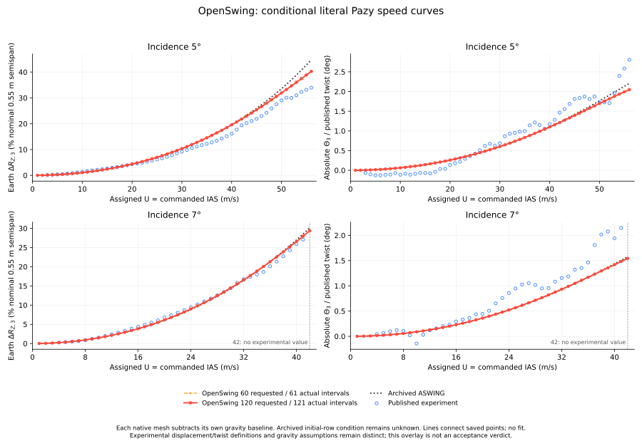
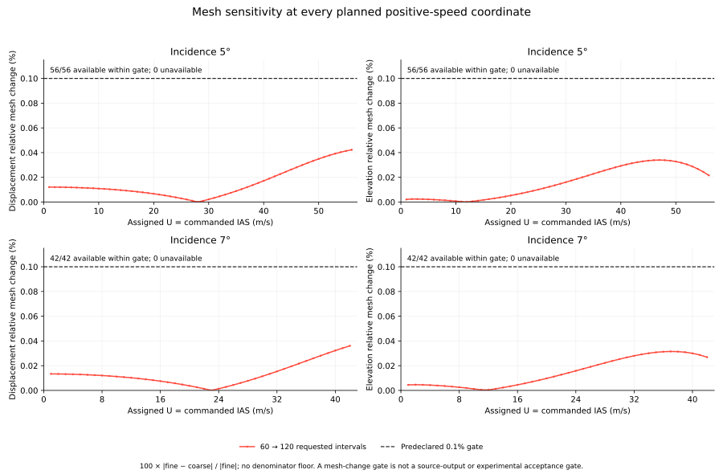
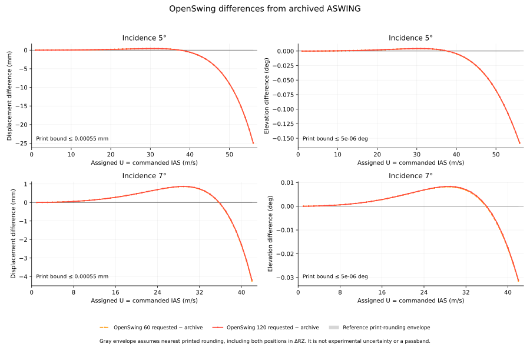

# Conditional literal Pazy speed curves

The subsequent [full frozen-influence sweep](isae-ae1-literal-frozen-curves.md)
now covers all 98 archived positive-speed coordinates on both meshes. Its
closer archived-output agreement does not resolve the historical setting or
experimental disagreement. Results and scope below describe the earlier study.

2026-10-25. All **198 fresh equilibrium states** and **196 mesh comparisons** pass for the declared conditional Pazy setup. Differences from archived ASWING and the measurements remain, especially at high speed. The original partial attempt is retained separately; none of its numerical results enter these curves or metrics.

A subsequent [four-condition frozen-influence diagnostic](isae-ae1-literal-frozen.md)
reduces the selected high-speed discrepancies markedly by changing only the
K/F modeling setting. At 5°/56 m/s the displacement difference falls from
24.90 mm in magnitude to 0.631 mm. The historical flag is still unknown;
the updated-influence full curves and experimental differences below retain
their original meaning.

This report uses the unchanged literal ISAE model with only its two entirely null off-domain Weight rows removed. It compares saved native equilibria with the archived ASWING output and separately shows the supplied experimental curves. It does not establish the complete historical operating conditions, stability or experimental validation.

Numerical status: **COMPLETE_NUMERICAL_PASS**. The saved catalog contains 196 requested aerodynamic mesh/coordinate rows, of which 196 are accepted. There are 2/2 accepted fresh gravity baselines. Across all 198 requested states, 198 succeeded, 0 failed and 0 were unlaunched; 0 launched cases lack a complete final report. There are 98 positive-speed coordinates (5°: 1–56; 7°: 1–42 m/s) on each of two meshes, with no reused native states.

Both mesh curves retain all available states. Experimental markers retain all 184 finite values at 92 coordinates; missing values are not zeroed or fitted. The 7° points at 41/42 remain visible even though the historical MATLAB display stopped at 40; the experiment has no value at 42. The retained historical initial row is not assigned a proved zero-speed condition or plotted as a new native state.

The exact predeclared 0.1% mesh-change gate passes 196/196 available metric checks out of 196 planned checks; overall mesh status is **PASS**. Its denominator is the magnitude of the finer-mesh value with no floor. Requested 60/120 intervals produce 61/121 actual intervals because the literal stiffness break is retained. This is a mesh-change test, not a source-output or experimental accuracy tolerance.

The following statistics include every planned positive-speed coordinate.

| Requested intervals | Incidence | Coordinates used / planned | Source ΔRZ RMSE (mm) | Source ΔRZ max abs (mm) | Source elevation RMSE (deg) | Source elevation max abs (deg) |
| ---: | --- | ---: | ---: | ---: | ---: | ---: |
| 60 | 5° | 56 / 56 | 6.23324 | 24.9932 | 0.0424053 | 0.158483 |
| 60 | 7° | 42 / 42 | 1.04126 | 4.24527 | 0.00828665 | 0.0315095 |
| 120 | 5° | 56 / 56 | 6.20295 | 24.8995 | 0.0421879 | 0.158039 |
| 120 | 7° | 42 / 42 | 1.02804 | 4.18704 | 0.00821835 | 0.0310943 |

At 5° / 56 m/s, the displacement changes by 0.0936244 mm between the two meshes, while the fine-mesh difference from archived ASWING is -24.8995 mm. The observed mesh change is much smaller than that remaining source-output discrepancy; reference printing resolution is also much smaller. This separates numerical mesh sensitivity from the unresolved historical/model comparison.

Reference print bounds assume nearest rounding. For displacement, the bounds add the half-units of the current and initial printed positions. They do not represent experimental uncertainty, truncation-error estimates or acceptance gates. The absolute archived sensor angle is compared directly, without subtracting its initial value.

| Selected coordinate | Native 120 ΔRZ (% span) | Archived ΔRZ (% span) | Experiment displacement (% span) | Native 120 Theta3 (deg) | Archived Theta3 (deg) | Experimental twist (deg) |
| --- | ---: | ---: | ---: | ---: | ---: | ---: |
| 5° / 30 | 10.377 | 10.3003 | 9.19298 | 0.603972 | 0.599742 | 0.686033 |
| 5° / 56 | 40.25 | 44.7772 | 33.9464 | 2.04949 | 2.20753 | 2.80862 |
| 7° / 30 | 14.4452 | 14.2902 | 14.4103 | 0.820719 | 0.812554 | 0.954719 |
| 7° / 41 | 27.9542 | 28.5259 | 27.0693 | 1.48163 | 1.50541 | 2.14868 |
| 7° / 42 | 29.3637 | 30.125 | unavailable | 1.54394 | 1.57503 | unavailable |

| Requested intervals | Incidence | Displacement / twist values used (of available) | Experiment displacement RMSE (percentage points of span) | Experiment twist RMSE (deg) |
| ---: | --- | ---: | ---: | ---: |
| 60 | 5° | 54/54 ; 54/54 | 2.46118 | 0.236353 |
| 60 | 7° | 38/38 ; 38/38 | 0.573415 | 0.299687 |
| 120 | 5° | 54/54 ; 54/54 | 2.46661 | 0.236161 |
| 120 | 7° | 38/38 ; 38/38 | 0.575788 | 0.299503 |

These experimental differences are descriptive, without an acceptance gate. Displacement differences above are percentage points of nominal semispan, not relative percent errors.

The source archive itself differs from experiment at large displacement: its 5° / 56 m/s increment is 44.7772% of nominal semispan, while the supplied experimental value is 33.9464308%. Reproducing the simplified source model therefore does not by itself resolve the experimental disagreement. These saved comparisons cannot attribute the difference to a particular aerodynamic or structural assumption.

All speeds are assigned equal to the source !V indicated-speed commands under the explicit rho = rho_SL = 1.23 kg/m³, zero-rate condition. PG Mach 0, identity Earth pose and transverse gravity 9.81 m/s² remain declared reconstruction choices; the original scripts do not fully identify atmosphere, gravity or attitude. The native displacement uses each mesh’s own no-airflow gravity baseline. This conditional literal study remains separate from the prior primary-property zero-gravity model.

Uppercase archived RX/RZ are Earth-frame positions. Theta3 is sensor3’s absolute apparent elevation, not a rotation-vector component. The experimental twist is recovered from LE–TE positions, and experimental displacement-axis/baseline parity remains qualified. The overlays retain the source comparison conventions without asserting that all measurement definitions are identical.

The original attempt stopped at fine-mesh 5° / 4 m/s and coarse-mesh 7° / 40 m/s. The solver correction permits a fixed-geometry circulation-only finishing step only when its freshly evaluated full residual satisfies the unchanged acceptance tolerance and improves the full residual merit. It changes no aircraft properties or residual equations. This report does not treat successful equilibrium solves as a stability assessment.

The plotting process imports no production kernel and performs zero new physics calls. CSVs retain every plotted value and missing-data mask; source, comparison, plan, owner-closeout and figure pins are in presentation.json. The published curves preserve those saved results and conventions.

## Numerical checks and timing

All 198 fresh full-equation checks pass; the maximum residual norm is
9.98760e-13. An independent saved-output audit passes 18,096 checks, including
all 196 mesh comparisons and the complete experimental missing-data masks.
The worst relative mesh change is 0.0422922%, below the predeclared 0.1% gate.
No experimental or historical-output acceptance band was imposed.

Native case execution has a median of 2.88 s and a maximum of 8.34 s on this
host. The two concurrent single-thread batches took 863.07 and 949.94 s,
including per-child process startup, source checks and retained output. These
batch times should not be confused with one aircraft's solver time.

## Numerical correction and earlier mesh study

The [circulation correction](isae-circulation-finish.md) fixes the stalled
finishing iterations while retaining the original full-equation tolerance.
The current built browser completes the nominal-120, 5°/30 m/s case in 7.97 s
after a separate 14.95 s runtime startup; its exported physical outputs agree
with the current native result. These timings are specific to this host.

Before that correction, a separate 30/60/120 study at 5°/30 m/s completed
four new cold states and reused the two exactly pinned nominal-30 pilot states (31 actual intervals).
All six predeclared 0.1% mesh-change checks passed. The 60→120 changes were
0.00217% in baseline-subtracted displacement and 0.01609% in elevation. The
finest result remained 0.7450% / 0.7054% above the archived displacement /
elevation. An independent audit passed 573 checks. See the
[mesh record](isae-ae1-literal-mesh.json) and
[saved-data audit](isae-ae1-literal-mesh-audit.json). The nonmonotone displacement
increments and growing elevation increment do not establish an asymptotic
order or continuum error bound. That historical study retains its old source
pins; the current full curves use fresh states with the corrected kernel.

## Data and reproducibility

The [machine-readable comparison](isae-ae1-literal-curves.json),
[source catalog](isae-ae1-literal-curves-source.json),
[execution receipt](isae-ae1-literal-curves-execution.json),
[independent audit](isae-ae1-literal-curves-audit.json), and
[figure checks](isae-ae1-literal-curves-presentation-check.json) retain the
counts, definitions and input/output hashes. Download the plotted
[curves](isae-ae1-literal-curves-curve-plot.csv),
[mesh changes](isae-ae1-literal-curves-mesh-plot.csv), and
[source differences](isae-ae1-literal-curves-source-discrepancy-plot.csv).

The [raw evidence archive](isae-ae1-literal-curves-20261025-evidence.zip)
contains the original partial attempt, its failures, the corrected attempt,
all retained source snapshots, browser checks, scripts and process receipts.
Its README explains dependency preparation and mapping the recorded absolute
paths; archive verification checks integrity, not another physical replay.
No hosted deployment or new experimental acceptance is claimed. ISAE coverage
remains 18 partial families, 23 pending and zero fully validated.
