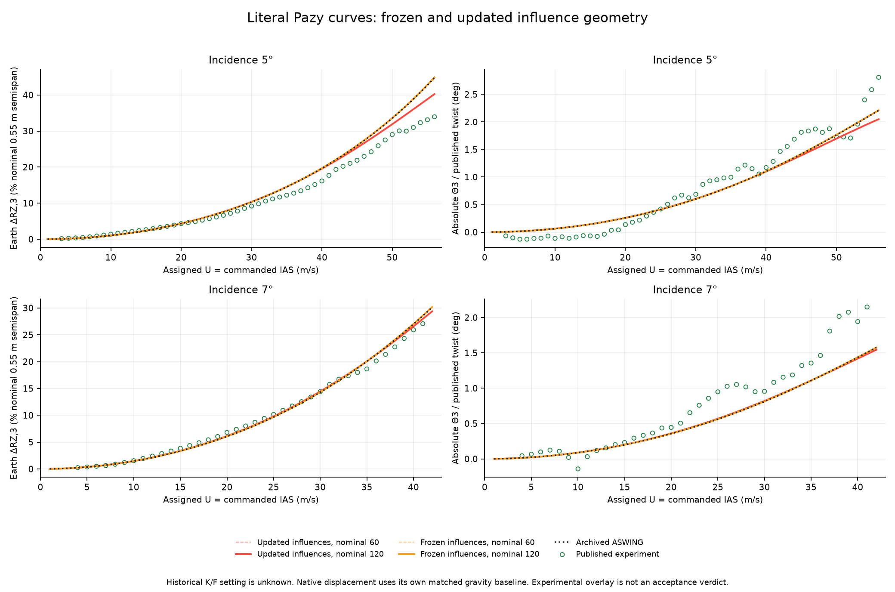
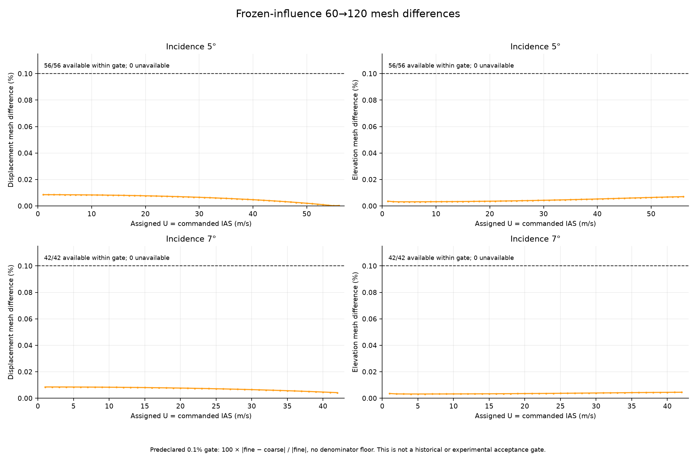
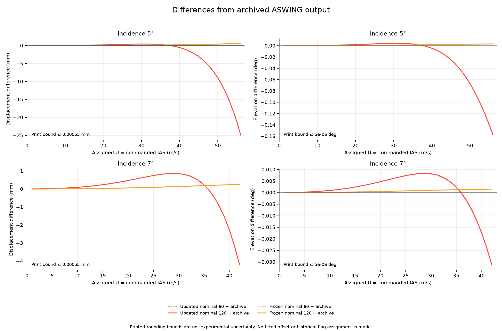

# Literal ISAE Pazy curves with frozen aerodynamic influence coefficients

Frozen influence coefficients substantially reduce the full-curve difference from archived ASWING: fine-mesh displacement RMSE is **0.240 mm at 5° and 0.120 mm at 7°**, compared with 6.203 and 1.028 mm when influences update. Experimental displacement RMSE worsens at both incidences; twist RMSE improves slightly. This supports a reference-setting explanation, without establishing the historical setting or experimental accuracy. No production equation, property, default or tolerance changes.

The frozen-influence calculation retained 188 successful new cold airflow states and 8 exact earlier frozen-influence states, out of 196 planned airflow states. Two unchanged no-airflow gravity baselines were reused. The saved-data reduction status is **COMPLETE_NUMERICAL_PASS**, and 196/196 predeclared mesh checks passed (196 available).

The only changed operating option relative to the earlier complete updated-influence curves is `freeze_influences=True`. This freezes vortex and volume influence geometry and the relevant receiver positions. The structural shape, circulation, section frames, lengths, motion and loads still update. The historical ASWING K/F setting is **unknown**; agreement under this option does not establish which setting produced the archived output.

The source remains the literal ISAE model with exactly two all-zero Weight records removed. Each new state is an independent cold solve with the same four nominal continuation steps, physical properties, convergence criteria and declared atmosphere as the earlier run. No coefficient, property or reference value was fitted.

The 98 positive commanded coordinates are incidence 5° at IAS 1–56 m/s and incidence 7° at IAS 1–42 m/s, each on nominal meshes 60 and 120 (61 and 121 actual intervals). Assigned true airspeed equals commanded IAS only under the declared density = sea-level density = 1.23 kg/m³. Historical density and startup conditions remain unknown.

Native Earth sensor-3 displacement subtracts its own matched no-airflow transverse-gravity baseline. Archived displacement subtracts its retained initial row. Body and Earth positions coincide here because the declared pose is identity. The second observable is absolute sensor-3 elevation Θ3; projected chord angle is retained separately and is not relabeled as the unused MATLAB matrix-division expression.

The following archive errors use every positive coordinate. Displacement is in millimetres and elevation in degrees. All errors are descriptive; there is no archive or experimental acceptance band.

| Influence setting | Mesh | Incidence | Coordinates | Δz RMSE (mm) | Δz bias (mm) | Max abs Δz error (mm) | Θ3 RMSE (deg) | Θ3 bias (deg) | Max abs Θ3 error (deg) |
|---|---:|---:|---:|---:|---:|---:|---:|---:|---:|
| Frozen | 60 | 5° | 56/56 | 0.2421181 | 0.1678081 | 0.6304998 | 0.0014931 | 0.001119181 | 0.003026051 |
| Frozen | 60 | 7° | 42/42 | 0.1242238 | 0.09303505 | 0.2574772 | 0.0007444829 | 0.0005956045 | 0.001229739 |
| Frozen | 120 | 5° | 56/56 | 0.2398622 | 0.165226 | 0.6312715 | 0.001554088 | 0.001161108 | 0.00318122 |
| Frozen | 120 | 7° | 42/42 | 0.1202126 | 0.08981585 | 0.2504836 | 0.0007745692 | 0.0006179618 | 0.001287412 |
| Updated | 60 | 5° | 56/56 | 6.233245 | -2.487401 | 24.99317 | 0.04240531 | -0.01723636 | 0.1584831 |
| Updated | 60 | 7° | 42/42 | 1.041261 | 0.00685173 | 4.245268 | 0.00828665 | 0.0007297747 | 0.03150951 |
| Updated | 120 | 5° | 56/56 | 6.20295 | -2.470463 | 24.89955 | 0.04218793 | -0.01705023 | 0.1580393 |
| Updated | 120 | 7° | 42/42 | 1.028036 | 0.01623834 | 4.187038 | 0.008218348 | 0.000862024 | 0.03109427 |

Experimental comparisons retain all original masks and signed values. The plots contain 184 finite scalar observations at 92 coordinates and preserve 16 missing scalar values. The table uses only available positive-coordinate observations: 54 coordinates for 5° and 38 for 7°. Incidence-7° U=41 remains included despite lying outside the MATLAB plot limit; U=42 has no experimental value. Displacement errors below are percentage points of the nominal 0.55 m semispan.

| Influence setting | Mesh | Incidence | Observed coordinates | Δz RMSE (% span) | Δz bias (% span) | Max abs Δz error (% span) | Twist RMSE (deg) | Twist bias (deg) | Max abs twist error (deg) |
|---|---:|---:|---:|---:|---:|---:|---:|---:|---:|
| Frozen | 60 | 5° | 54/54 | 3.49472 | 2.172319 | 10.94541 | 0.2121561 | -0.04548383 | 0.5980592 |
| Frozen | 60 | 7° | 38/38 | 0.681445 | 0.02219701 | 1.502177 | 0.2977568 | -0.2050266 | 0.7138071 |
| Frozen | 120 | 5° | 54/54 | 3.494354 | 2.171832 | 10.94555 | 0.2121189 | -0.04544035 | 0.5979041 |
| Frozen | 120 | 7° | 38/38 | 0.6811547 | 0.021584 | 1.500906 | 0.2977286 | -0.2050038 | 0.7137501 |
| Updated | 60 | 5° | 54/54 | 2.46118 | 1.67167 | 6.286556 | 0.2363534 | -0.06451942 | 0.7595684 |
| Updated | 60 | 7° | 38/38 | 0.5734154 | 0.02637676 | 1.425623 | 0.2996867 | -0.2040225 | 0.7226797 |
| Updated | 120 | 5° | 54/54 | 2.46661 | 1.674864 | 6.303579 | 0.2361612 | -0.06432639 | 0.7591246 |
| Updated | 120 | 7° | 38/38 | 0.5757877 | 0.02798517 | 1.429976 | 0.2995033 | -0.2038873 | 0.7222735 |

The earlier updated-influence results, statistics and mesh checks are preserved unchanged. Source-print rounding bounds are retained separately; they are not experimental uncertainty.

The predeclared mesh criterion is |fine − coarse| / |fine| ≤ 0.1%, without a denominator floor, independently for baseline-subtracted displacement and absolute elevation at all 98 positive coordinates.

- Maximum frozen displacement mesh difference: 0.008524055% at 5° / 1 m/s.
- Maximum frozen elevation mesh difference: 0.007018962% at 5° / 56 m/s.

Representative fine-mesh values are shown below. These points were already studied in the earlier four-point diagnostic and are exact reuses here, not additional solves.

| Incidence / IAS | Updated Δz (m) | Frozen Δz (m) | Archive Δz (m) | Updated Θ3 (deg) | Frozen Θ3 (deg) | Archive Θ3 (deg) |
|---|---:|---:|---:|---:|---:|---:|
| 5° / 30 m/s | 0.05707356 | 0.05676161 | 0.0566515 | 0.6039724 | 0.6007043 | 0.599742 |
| 5° / 56 m/s | 0.2213751 | 0.2469059 | 0.2462746 | 2.049491 | 2.210711 | 2.20753 |
| 7° / 30 m/s | 0.0794485 | 0.07873109 | 0.0785959 | 0.8207194 | 0.813575 | 0.812554 |
| 7° / 42 m/s | 0.1615006 | 0.1659381 | 0.1656876 | 1.543936 | 1.576212 | 1.57503 |

The 188 newly launched public solves recorded 33022 residual evaluations, including 188 independent final residual evaluations. These counts exclude the original work for reused states. New-case median/max reported runtime: 1.841384/4.660238 s. Batch wall times: nominal 60: 712.6117 s, nominal 120: 729.1492 s.

Maximum fresh full residual among the new states: 9.93303221e-13 (m60-a5-u32).

This is a conditional steady comparison. Transverse gravity, the assumed atmosphere and missing historical settings prevent calling it an exact reconstruction of the experiment or archived ASWING run. A converged equilibrium does not determine stability; high-speed steady solutions are retained without claiming that the experiment was steady. The earlier primary-model and experimental-coordinate caveats remain applicable.

## Independent checks and browser result

Independent saved-data audits pass **44,293 assertions**: 11,228 raw-state,
27,648 comparison, 1,808 native-lifecycle and 3,609 presentation checks.
A further 976 closure checks bind the terminal producer, reducer and all
121 runtime plus 844 comparison pins. The reduction itself passes 784 checks.
No new states failed, retried or remained unlaunched. Two supervisor guard exits
before authorization created no child, lock or physical state; their logs remain
in the preparation history. They are not hidden physical retries.

One separately counted offline Chromium case uses nominal mesh 120, incidence
5°, IAS 56 m/s and frozen influences. Its cold solve takes **7.24 s**, separately
from **25.29 s runtime startup**; the whole browser check takes 44.80 s. All
1,052 browser checks pass. Its 18,968 physical numerical fields match native
output with maximum absolute difference 3.61e-12; the unchanged parity gate is
2e-8 absolute plus relative. The full residual is 4.94e-13. Execution counters
are excluded from physical parity, and the documented equivalent mesh/zero-mode
representations are normalized. This is one selected case on this host, not a
timing guarantee for the entire family.

A separate [saved browser/export audit](isae-ae1-literal-frozen-curves-browser-audit.json)
passes 867 independent checks without rerunning the browser. It reproduces the
native comparison and verifies all 111 source/runtime modules and byte-identical
restoration. These checks are separate from the 44,293 native/data checks above.

The [importable project](../../examples/pazy-isae-literal-frozen-project.json)
contains editable inputs and the checked computed solution. Its result and
project bytes survive import/open/export unchanged without another equilibrium
solve. The [viewport](isae-ae1-literal-frozen-curves-browser-viewport.png) shows
the deflected wing and wall through the canvas software renderer; WebGL rendering
is not claimed by this check. No browser or solver code changed for this study.

The full frozen speed sweep is now complete. Historical K/F, mesh, complete
operating settings and the initial archived state remain unknown. Resolving
experimental setup/observable differences and high-speed dynamics takes priority
over further repeating this flag sweep. No property fitting or switch of the
application's default follows from a closer archival match. Coverage remains
**18 partial / 23 pending / 0 fully validated**.

## Data and reproduction

The [comparison JSON](isae-ae1-literal-frozen-curves.json) and
[196-row CSV](isae-ae1-literal-frozen-curves-comparison.csv) retain the earlier
updated-influence values unchanged. The [prospective plan](isae-ae1-literal-frozen-curves-plan.json),
[execution receipt](isae-ae1-literal-frozen-curves-execution.json),
[raw audit](isae-ae1-literal-frozen-curves-audit.json),
[comparison audit](isae-ae1-literal-frozen-curves-comparison-audit.json),
[presentation audit](isae-ae1-literal-frozen-curves-presentation-audit.json),
[audit closeout](isae-ae1-literal-frozen-curves-audit-closeout.json), and
[browser receipt](isae-ae1-literal-frozen-curves-browser-closeout.json)
retain numerical criteria and scope. Plotted data are available as
[curves](isae-ae1-literal-frozen-curves-plot.csv),
[mesh changes](isae-ae1-literal-frozen-curves-mesh.csv) and
[archive differences](isae-ae1-literal-frozen-curves-source-discrepancy.csv).

The [raw evidence archive](isae-ae1-literal-frozen-curves-20261025-evidence.zip)
contains the bounded run, retained source snapshots and prior states, reduction,
independent audits, browser results/project and preparation history. Its manifest
maps original paths to retained files. The earlier full updated-influence and
four-point frozen archives remain explicitly pinned dependencies. Integrity
verification checks archive CRC and extracted hashes without repeating the
scientific runs. The source/local downloads include the new report and project;
the separate validation download includes raw evidence. No hosted deployment is
claimed.
