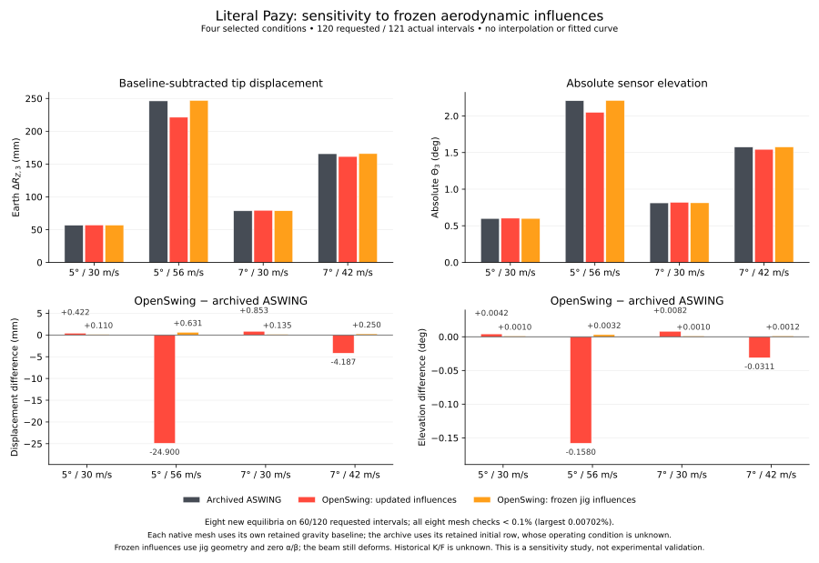

# Literal Pazy: frozen-influence sensitivity

The subsequent [full frozen-influence sweep](isae-ae1-literal-frozen-curves.md)
now covers all 98 archived positive-speed coordinates on both meshes. Its
closer archived-output agreement does not resolve the historical setting or
experimental disagreement. Results and scope below describe the earlier study.

Using frozen aerodynamic influence matrices brings OpenSwing substantially closer to the archived ISAE ASWING values at all four selected conditions. At 5° and 56 m/s on the finer mesh, the displacement difference changes from **-24.8995 mm to +0.631271 mm**, and the absolute sensor-elevation difference changes from **-0.158039° to +0.00318122°**. This identifies a consequential modeling setting; it does not establish the setting used for the historical ASWING runs.

The existing updated-influence results come from the completed [literal speed-curve study](isae-ae1-literal-curves.md). This increment changes only `freeze_influences` to `true`: four conditions, each on 60 and 120 requested intervals (61 and 121 actual intervals). All eight new cold equilibria pass their unchanged physical checks. The two matching no-airflow gravity baselines are reused exactly; no aerodynamic solution is reused as an initial state. This is eight new states and eight mesh checks, not a full frozen-influence speed sweep.

The [ASWING user guide](https://web.mit.edu/drela/Public/web/aswing/aswing_doc.txt), in its OPER K menu and “Fast,Slow Vortex-Lattice Model” description, defines F as a toggle between matrices based on the undeformed geometry at zero alpha/beta and matrices updated with current geometry and flow direction. The displayed menu has the freeze flag enabled, but that display alone does not prove the historical setting. The published ISAE `alpha5.sh` and `alpha7.sh` scripts never issue the K/F toggle; the historical `.set` file is unavailable. The historical flag therefore remains **unknown**.

Freezing the influence matrices does not hold the wing rigid. The coupled beam still deforms, and the current section frames, circulation and loads remain active. No material property, gravity, atmosphere, mesh, wake-core parameter, or tolerance was fitted or changed between each matched pair.

The table uses the finer mesh. Displacement is sensor 3 Earth-Z minus the same native mesh’s retained no-airflow gravity baseline; the archived displacement subtracts its own retained initial row. The historical initial row’s operating condition remains unproved. Theta is the absolute sensor-3 elevation, without baseline subtraction. Commanded IAS is assigned to true speed conditionally at the retained density of 1.23 kg/m³.

| Condition | Archive ΔZ (mm) | Updated ΔZ (mm) | Frozen ΔZ (mm) | Archive Θ3 (°) | Updated Θ3 (°) | Frozen Θ3 (°) |
| --- | ---: | ---: | ---: | ---: | ---: | ---: |
| 5° / 30 m/s | 56.651500 | 57.073556 | 56.761615 | 0.599742 | 0.603972 | 0.600704 |
| 5° / 56 m/s | 246.274600 | 221.375053 | 246.905871 | 2.207530 | 2.049491 | 2.210711 |
| 7° / 30 m/s | 78.595900 | 79.448503 | 78.731089 | 0.812554 | 0.820719 | 0.813575 |
| 7° / 42 m/s | 165.687600 | 161.500562 | 165.938084 | 1.575030 | 1.543936 | 1.576212 |

All eight frozen-result mesh changes are below the predeclared 0.1% gate; the largest is **0.00701896%**. Across the four finer-mesh coordinates, the largest absolute relative differences from the archive are **0.256328%** for displacement and **0.160451%** for elevation. These are descriptive discrepancies, not an acceptance band. The remaining discrepancies are much larger than the retained printed-token rounding bounds; those bounds are not experimental uncertainty.

The evidence supports aerodynamic influence treatment as a strong explanation for the earlier high-speed mismatch under the declared literal-model assumptions. It does not show which treatment better matches the physical experiment, establish the missing historical settings, validate every aerodynamic or structural equation, or justify changing the default. No experimental data are used as an acceptance target in this sensitivity comparison.

The distinction matters at 5° and 56 m/s: frozen-influence displacement is **44.89198% of the nominal span**, compared with **44.77720%** in the ASWING archive and **33.94643%** in the published experiment. The updated-influence value is **40.25001%**. Under this conditional displacement overlay, moving closer to the archived solver result moves farther from the measured displacement. The experiment’s datum and physical setup remain subject to the qualifications in the full curve study.

The presentation was generated from terminal saved results only: zero new physics calls. The value CSV retains both meshes, the plotting CSV retains every displayed value, and the mesh CSV retains all eight checks.

## Verification, runtime and remaining work

The independent saved-data audit passes **2,347 checks**, with 14 additional
closure checks. It reconstructs saved residual maxima, force/moment balance,
root constraints and sensor outputs, and verifies the exact one-flag input
change. The saved reduction passes 363 checks. All eight physical states pass;
maximum freshly evaluated full residual is 6.96727e-13. No retries, failed or
unlaunched states are omitted. The 1,723 residual evaluations include eight
fresh verification evaluations.

Native case execution has a median of 2.52 s and a maximum of 3.10 s on this
host. The two four-case batches take 31.43/31.26 s including process startup,
source checks and retained output. These are native timings, not a new browser
benchmark. Production equations, UI defaults and numerical tolerances are
unchanged; this study exercises the existing K/F setting.

The historical influence flag, mesh details, complete operating settings and
initial archived state remain unresolved. A complete frozen-influence speed
sweep has not been run. Experimental disagreement and high-speed stability
remain open. ISAE coverage stays **18 partial / 23 pending / 0 fully validated**.

## Data and reproduction

The [comparison](isae-ae1-literal-frozen.json),
[prospective plan](isae-ae1-literal-frozen-plan.json),
[execution receipt](isae-ae1-literal-frozen-execution.json),
[raw-state audit](isae-ae1-literal-frozen-audit.json),
[comparison audit](isae-ae1-literal-frozen-comparison-audit.json), and
[source review](isae-ae1-literal-frozen-source.md) preserve the checks and
qualifications. Download the [values](isae-ae1-literal-frozen-values.csv),
[plotted values](isae-ae1-literal-frozen-plot.csv), or
[mesh changes](isae-ae1-literal-frozen-mesh.csv).

The [raw evidence](isae-ae1-literal-frozen-20261025-evidence.zip) contains the
bounded run, source snapshots, exact selected prior results, preparation
history and independent audits. Its manifest maps original paths to retained
files. The preceding full-curve archive remains an explicitly identified
prerequisite for replaying the entire earlier study. Archive checks verify
integrity without rerunning the scientific calculations. No hosted deployment
or browser replay is claimed.
