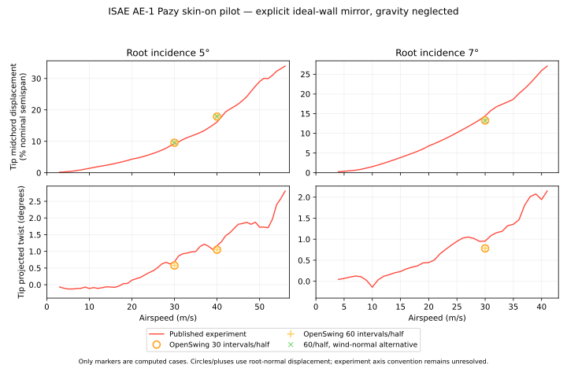

# ISAE AE-1: first coupled Pazy comparison

The eight-state pilot completes: six coupled flow cases and two zero-flow
baselines. The ideal tunnel-wall model now has a verified explicit mirror
construction. Numerical checks pass, but the experiment is **not matched**.
No production equation, input tolerance or literal ISAE file was changed.

At 60 intervals per half wing, the root-normal displacement and projected
twist are:

| Incidence / speed | Displacement, OpenSwing / experiment (% nominal semispan) | Displacement error | Twist, OpenSwing / experiment (degrees) | Twist error |
| --- | --- | --- | --- | --- |
| 5° / 30 m/s | 9.6086 / 9.1930 | +4.52% | 0.5786 / 0.6860 | −15.66% |
| 5° / 40 m/s | 17.9995 / 16.1491 | +11.46% | 1.0538 / 1.1724 | −10.12% |
| 7° / 30 m/s | 13.3484 / 14.4103 | −7.37% | 0.7858 / 0.9547 | −17.69% |

These are errors relative to the individual published values, not acceptance
verdicts. Experimental uncertainty is unavailable. The six measured values
are evaluated on each of two meshes; alternative displacement projections
are not additional independent measurements.

Only the markers represent new computed conditions. The lines retain the
published processed experimental sweeps, including their missing entries.
The high-speed 7° region may contain oscillatory response and is not part
of this pilot.

## What the wall representation verifies

The [original setup review](isae-ae1-readiness.md) found two separate limitations:
the literal model has an attachment outside its beam domain, and the current
ground-image guard rejects a lifting root exactly on the wall. Both remain
true. Allowing contact alone would also leave constrained-root perturbations
in numerical tangents to resolve.

The new [adapter](../../scripts/isae_ae1.py) instead constructs one continuous
beam from a reflected left tip to the actual right tip, with a full clamp at
the center. The second half explicitly supplies the ideal solid-wall image;
only the positive half is compared with the measurements. A common physical
beam identity preserves the image calculation's vortex-core convention.
No epsilon displacement or production clearance override is used by the pilot.

The reflection changes the signs of `EIcs` and `EIsn`; copying all stiffness
fields evenly would be incorrect. Point positions and full inertia tensors
are reflected, and all original section and mass stations remain. The source
review derives these mappings and retains the ideal-wall assumption separately
from the actual tunnel's 20 mm spacer geometry.

Seven [new tests](../../tests/test_isae_ae1.py) pass. They check all section
stiffness/compliance maps, mirrored masses/tensors, finite-rotation mechanical
compatibility and virtual work. Four aerodynamic comparisons use jig and
curved/twisted geometries at Mach 0 and 0.55, each comparing the full mirror
with the same right-half panels and explicit images. Circulation, CP/HV and
off-surface velocities, loads, moments and Trefftz diagnostics agree. The
half-image reference uses a narrowly asserted test-only contact allowance;
production contact and crossing rejection are also checked. These are
representation-equivalence tests, not an independent validation of the vortex
kernel or a general wall-contact implementation.

## Frozen model and observation choices

- Primary Technion skin-on properties use the existing CONM2-audited
  conversion. Its small intrinsic extension–torsion `K12` projection remains
  explicit; the prior structural calibration is not a new fit to this pilot.
- Aerodynamics use the archived NACA0018 section slope 6.1185/rad and lift
  limits ±1.1, with zero section moment/profile-drag defaults. This is a
  declared mixed-source reconstruction, not the literal ISAE model or a
  verbatim primary UM/NAST model.
- Density is explicitly 1.23 kg/m³; Mach is explicitly zero. The exact
  experimental atmosphere is not established. Gravity is neglected as in
  the cited primary static modeling assumption; model gravity remains
  positive solely for the original weight-to-mass conversion.
- The separate Test 2 tip masses are 10 g at each reflected trailing edge.
  Avin and Riso disagree about a 10 mm aft offset. That choice produces no
  load in this stationary zero-gravity pilot and remains unresolved for
  gravity-loaded or dynamic work.
- The true primary tip span is 0.549843728 m. It is not stretched to the
  nominal 0.55 m used to normalize measured displacement.
- Tip LE/TE material positions recover the midchord and the projected chord
  angle. Each mesh subtracts its own zero-flow baseline. No experimental
  zero is invented and no fitted offset is removed.

The processed experimental export does **not** explicitly settle whether its
vertical displacement uses the root normal or tunnel/wind normal. Both are
retained. For the stated airflow convention the latter is
`−sin(alpha)·Δx + cos(alpha)·Δz`. At 60 intervals/half, that alternative gives
9.5691%, 17.9210% and 13.2412% of nominal semispan, respectively; errors become
+4.09%, +10.97% and −8.11%. The axis choice does not explain the larger mismatch.
The projected twist increment is unchanged by a common span-axis rotation
of the loaded and baseline chord vectors.

The saved report also includes the four pinned primary UM/NAST-VLM tables and
comparisons at the exact same speeds. These are model controls with their own
setup assumptions, not additional experiments.

## Numerical evidence and runtime

The two meshes have 30 and 60 intervals per half, hence 60 and 120 intervals
in the explicit full model. Every case starts from its jig state and follows
four accepted load-continuation stages. No symmetry constraint is imposed
on the free nodes; their converged reflected agreement is checked afterwards.
Convergence does not establish static or dynamic stability.

The maximum fresh normalized residual is 2.696e−13. Maximum scaled force and
moment balance errors are 1.570e−12 and 1.717e−14. Reflected nodal positions
agree within 4.303e−16 m and rotation matrices within 1.027e−15.

Increasing the mesh from 30 to 60 intervals/half changes root-normal
displacement by 0.663–0.681%, passing all three predeclared 1% mesh checks.
Twist changes by 0.00314–0.00548° (0.509–0.542%); no separate twist gate was
invented. Two-grid agreement is not a continuum error bound.

The native batch took 27.04 s with single-thread numerical libraries.
Individual coupled states took 3.41–4.96 s; these are local native timings,
not browser measurements. All eight requested states succeeded on their first
physics attempt. One earlier shell launch failed before Python because the
log directory did not yet exist; it performed no calculation. Test execution
also retains an earlier missing-system-pytest failure before any tests ran.

## Evidence and remaining work

[Full states and comparisons](isae-ae1-pilot.json), [comparison CSV](isae-ae1-pilot.csv),
[wall/source addendum](isae-ae1-mirror-source.json),
[saved-output audit](isae-ae1-pilot-audit.json) and
[execution receipts](isae-ae1-pilot-execution.json) retain the calculations
and their provenance. The report includes exact generated inputs, all raw
nodal/strip results, source hashes, solver paths and both displacement
interpretations. The original setup and literal input are preserved.
The independent stdlib reader passes **161,376 checks**, including the raw
state-to-node map, symmetry/load sums, all eight source observation/control
tables, both projections, baseline subtraction, mesh differences and CSV.
It performs no new aerodynamic or structural evaluation.

Next: extend the moderate-speed sweep with the same declared model, investigate
the incidence-dependent displacement and consistently low twist, and resolve
section-data/measurement/setup limitations before interpreting high-speed
response. General production wall-root support, browser replay of this new
fixture and the full experimental sweep remain unfinished. AE-1 remains a
pilot supplement to the pending family; the coverage ledger stays
**17 partial / 24 pending / 0 fully validated**.
