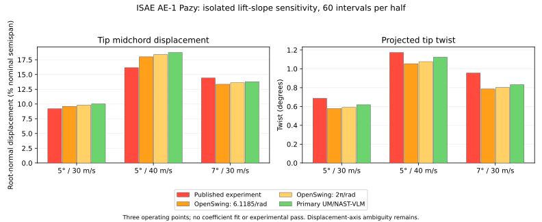

# ISAE AE-1: isolated section lift-slope sensitivity — 2026-10-25

Changing the section lift slope from **6.1185/rad to 2π/rad** increases the selected Pazy wing displacements and twists by about **2%**. This explains part of the gap to the primary numerical model, but leaves predicted twist **8.25–16.04% below the three experimental values**. Displacement agreement worsens at both 5° conditions and improves at 7°. These results do not justify replacing the baseline section data.

Six new coupled equilibria cover 5°/30 m/s, 5°/40 m/s and 7°/30 m/s on 30- and 60-interval half-span meshes. The comparison reuses six exact original loaded states and two no-airflow reference states from the [full baseline sweep](isae-ae1-sweep.md). No baseline state was rerun or overwritten. This diagnostic changes only the two `dCLda` table values in the derived model, not production equations, material properties or browser defaults.

The following values use 60 intervals per half, tip midchord displacement in percent of **nominal 0.55 m semispan**, and projected leading/trailing-edge tip twist in degrees. Arrows run from the original slope to 2π. The processed experimental displacement axis remains unresolved; the JSON and CSV also retain the wind-normal interpretation.

| Incidence / speed | Measured displacement | Predicted displacement, baseline → 2π | Measured twist | Predicted twist, baseline → 2π |
| --- | ---: | ---: | ---: | ---: |
| 5° / 30 m/s | 9.1930 | 9.6086 → 9.8082 | 0.68603 | 0.57863 → 0.59073 |
| 5° / 40 m/s | 16.1491 | 17.9995 → 18.3826 | 1.17243 | 1.05376 → 1.07568 |
| 7° / 30 m/s | 14.4103 | 13.3484 → 13.6202 | 0.95472 | 0.78583 → 0.80162 |

Signed errors below are percentages of the corresponding measured value, not percentage points of semispan.

| Incidence / speed | Displacement error, baseline → 2π | Twist error, baseline → 2π |
| --- | ---: | ---: |
| 5° / 30 m/s | +4.52% → +6.69% | -15.66% → -13.89% |
| 5° / 40 m/s | +11.46% → +13.83% | -10.12% → -8.25% |
| 7° / 30 m/s | -7.37% → -5.48% | -17.69% → -16.04% |

The candidate is 1.08–1.97% below the primary UM/NAST-VLM displacement and 3.56–4.42% below its twist. That closer agreement is useful numerical context, not an experimental acceptance criterion.

## What the parameter change means

The [source review](isae-ae1-section-source.json) traces the original slope to the archived MATLAB linear fit of XFOIL lift between −7.5° and +7.5°; no new fit was performed. Riso and Cesnik's separate 15-strip potential model uses the flat-plate value 2π/rad. The supplied primary UVLM curves instead belong to their 36-spanwise × 18-chordwise lifting-surface model. This one-parameter diagnostic does not reproduce that VLM discretization, its load distribution, or the strip model's fitted span weighting. See the primary [low-order-modeling study](https://doi.org/10.2514/1.C036869), section III.C, and the retained source review.

The input change is **+2.6916%**. In ASWING's section law it changes the virtual control-point distance `a0/(4π)` from 0.48689476 to 0.5 chord and the smooth leakage factor proportional to `1/a0`; these are inherent consequences of the same parameter. The candidate therefore rebuilds the aerodynamic geometry and solves a new coupled equilibrium. It is not a postprocessed lift multiplier. The physical quarter-chord force arm, structural reference axis, `Ks`, lift limits, section moment and profile-drag coefficients all remain unchanged. Input-token and parsed-field checks cover both sides, receiver stations and endpoint derivatives.

The archived XFOIL polar uses Re=200,000, Mach=0 and Ncrit=5, and contains 155 finite samples. It does not establish measured section properties at these tunnel conditions. In particular, a section moment evaluated at root incidence cannot be substituted for local-incidence data without checking its reference and normalization. The selected PG Mach is zero; actual local section Mach, evaluated from local speed, is still nonzero. With the current zero `Cm`, its separate local-Mach correction contributes zero. No Mach-path defect was found.

## Numerical evidence and limits

All six states completed in **52.05 seconds total** under shared native load, including driver overhead; individual state times were 4.01–11.47 seconds. These are local timings, not new browser benchmarks. The numerical thresholds stayed at 1e−8 for residual, 1e−7 for scaled force/moment balance, 1e−8 for mirror position/span and rotation, and 1% for two-grid displacement change. Maximum residual was 3.37e−13 and maximum scaled force balance 1.98e−12. All three displacement mesh checks pass with 0.672–0.691% changes. Twist changes by 0.516–0.550% between meshes; no separate twist acceptance threshold was declared. Two meshes do not establish a continuum error bound.

The independent, standard-library [saved-data audit](isae-ae1-section-audit.json) passes **238,889 checks**, including all 14 candidate/reused states, original measurement tables, two changed source tokens, load/observable reconstruction, mesh comparisons and CSV output. Ten [control/corruption probes](isae-ae1-section-audit-selfcheck.json) verify detection of altered slope, lift limit, pose, strip load and circulation data. No new production solve is performed by these checks. The first driver invocation failed before physics because a preflight guard compared NumPy arrays as scalar dictionary values; its source and failure are retained. Rowwise exact comparison corrected the guard without changing inputs, equations or gates. All recorded processes have been reaped.

The separate [saved load and twist reconstruction](isae-ae1-loads.md) passes **71,043 checks** on six selected fine-mesh baseline states. It finds no supported load-transfer or twist-output defect. At fixed converged geometry/compliance, quarter-chord lift couples account for 92.28–98.56% of projected twist. That algebraic attribution is not the re-equilibrated response to changing a pitching moment. Smooth profile/stall contributions are negligible in those states but are not mathematically zero.

All three operating points here lie below published dynamic indicators, which does not certify stability. This study computes no eigenvalues, flutter boundary or time response. It establishes no experimental pass, changes no coverage classification, and adds no browser replay of the candidate. Baseline browser comparisons remain the separately dated evidence in the [browser report](isae-ae1-browser.md). The ISAE ledger remains **18 partial / 23 pending / 0 fully validated**.

Remaining work is to resolve independently supported section properties and experimental setup/measurement definitions, general wall-root support and literal attachment compatibility, and dynamic stability at the higher-speed conditions. Coefficients should not be tuned merely to remove these discrepancies.

## Reproducible artifacts

- [Results JSON](isae-ae1-section.json), [18-row CSV](isae-ae1-section.csv), [SVG](isae-ae1-section.svg) and [PNG](isae-ae1-section.png).
- [Execution receipt](isae-ae1-section-execution.json), [source review](isae-ae1-section-source.json), [independent audit](isae-ae1-section-audit.json) and [audit control probes](isae-ae1-section-audit-selfcheck.json).
- [Bounded evidence archive](isae-ae1-section-20261025-evidence.zip): candidate and selected baseline raw states, source pins, source review, saved-load reconstruction, failed attempts and replay instructions.
- [Driver](../../scripts/compare-isae-ae1-section.py), [reducer](../../scripts/summarize-isae-ae1-section.py), [independent checker](../../scripts/check-isae-ae1-section.py) and [figure script](../../scripts/plot-isae-ae1-section.py).
