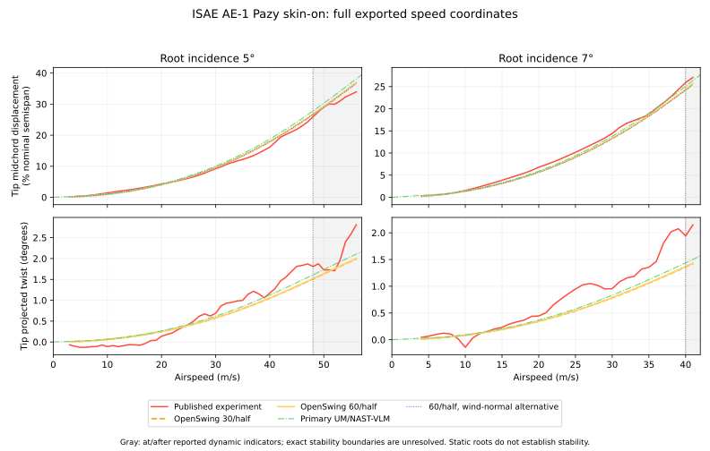
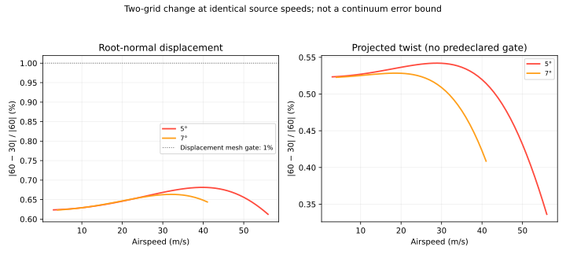

# ISAE AE-1: full exported Pazy speed sweep

All **186 states complete**, with no failed or unrun requests. All **92**
predeclared 1% displacement mesh checks pass. The experiment remains unmatched:
the displacement error changes with incidence, and the largest twist
differences substantially exceed the two-grid change. No production equation,
literal input or acceptance threshold was changed.

The [eight-state pilot](isae-ae1-pilot.md) is extended without changing its
physics, convergence gates or observation definitions. The new comparison
retains every finite experimental displacement and twist value: 54 speeds
from 3 to 56 m/s at 5° and 38 speeds from 4 to 41 m/s at 7°. Each mesh also
has a zero-flow baseline. That is 186 states, 184 loaded mesh/condition pairs
and 184 unique measured values. Alternative displacement projections and
the two meshes do not create additional independent measurements.

Eight exact pilot states are reused with their original identities, values
and timings; the remaining 178 states are requested once. Every new state
starts from the jig geometry with four load-continuation stages. Failed or
unrun requests remain in the record. There is no warm-start continuation
between speeds and no coefficient fitting to the measurements.

## Experimental differences

The fine mesh has 60 intervals per half wing. The following errors are
root-mean-square differences from the processed experimental curves. A
displacement unit here is **one percentage point of nominal semispan**, not
one percent relative error in the measurement.

| Incidence / source region | Speeds | Root-normal displacement RMSE (percentage points) | Alternative wind-normal RMSE (percentage points) | Twist RMSE (degrees) |
| --- | ---: | ---: | ---: | ---: |
| 5°, all exported coordinates | 54 | 1.0568 | 0.9896 | 0.2605 |
| 5°, below reported 48 m/s indicator | 45 | 0.8433 | 0.7990 | 0.2171 |
| 7°, all exported coordinates | 38 | 0.8679 | 0.9528 | 0.3258 |
| 7°, below reported 40 m/s indicator | 36 | 0.8244 | 0.8981 | 0.2975 |

“Below” is a source-location label, not a computed stability classification.
No experimental error tolerance is invented. Absolute errors are emphasized
because relative errors become misleading near zero and across the negative
low-speed twist readings. The complete signed and relative differences remain
in the [CSV](isae-ae1-sweep.csv) and [JSON](isae-ae1-sweep.json).

The original pilot's 30–40 m/s cases retain displacement errors of +4.52%,
+11.46% and −7.37%, with twist 10–18% low. The full sweep exposes larger
high-speed twist differences: at 5°/56 m/s the predicted twist is 1.9990°
versus 2.8086° measured (28.82% low); at 7°/41 m/s it is 1.4299° versus
2.1487° (33.45% low). Both points require the dynamic qualifications below.
The largest absolute twist error at 7° is actually at 38 m/s: −0.7718°.
Thus the discrepancy is not confined to points beyond the reported indicator.

The inherited primary UM/NAST-VLM curves have fewer exact shared speeds:
10 at 5° and seven at 7°. At those coordinates, root-normal displacement
RMSE is 0.6528 and 0.3819 percentage points; twist RMSE is 0.06192° and
0.04175°. OpenSwing is below that model in both outputs at every shared speed.
These are comparisons between distinct aerodynamic models, not extra
experimental measurements or proof that either model is correct.

## Numerical checks and runtime

The 30- and 60-interval half meshes correspond to 60 and 120 intervals in the
explicit full wing. Displacement changes by **0.612–0.681%**, giving 92 passes,
zero failures and zero unavailable mesh pairs. Twist changes by 0.336–0.542%,
at most 0.00710°. No separate twist threshold was introduced. Two-grid
agreement is not a continuum error bound.

The largest fresh normalized residual retained from the original state solves
is 9.915e−13. Maximum scaled force and moment balance errors are 4.867e−12
and 2.250e−13; mirrored positions agree within 9.132e−15 m and rotation
matrices within 2.188e−14. No computed strip triggers the section stall flag;
the largest section lift coefficient is 0.71251 against the unchanged 1.1 limit.
This describes the model's states, not the absence of stall in the experiment.

The extension batch took **1,018.49 s (16.97 min)** for 178 newly calculated
states plus reuse/storage of eight exact pilot states. New state calls ranged
from 2.17 to 12.71 s. Numerical libraries used one thread; the batch overlapped
the browser comparison and includes output/provenance overhead. These are
local run observations, not isolated solver benchmarks. All new state requests
succeeded on their first physics attempt. Original pilot timings remain intact.

## Model and measurement scope

This is the pilot's explicit, mechanically and aerodynamically checked
ideal-wall reconstruction: one continuous reflected full wing, clamped at
the center, with only the positive half used for comparison. The second
half supplies the ideal tunnel-wall image. The literal ISAE input's attachment
error and the production ground-plane root-contact limitation remain open.
The real tunnel has a root spacer; exact equivalence to the experiment is
not asserted.

The primary skin-on structure retains the corrected CONM2 inertia convention,
the existing structural calibration and the declared small extension–torsion
projection. Aerodynamics retain the supplied NACA0018 slope 6.1185/rad, lift
limits ±1.1 and zero section moment/profile-drag defaults. Density is
1.23 kg/m³, Mach is zero and gravity is neglected as in the primary static
modeling assumption. This combines declared source choices; it is neither
the unmodified literal ISAE file nor a verbatim reproduction of the primary
UM/NAST aerodynamic model.

The actual primary tip is at 0.549843728 m; 0.55 m is used only for the
experimental displacement normalization. Tip leading/trailing-edge material
positions recover midchord displacement and projected twist. Each mesh
subtracts its own zero-flow baseline. Missing experimental zero-speed entries
stay missing; no offset is fitted or removed.

The processed experimental displacement axis remains unresolved. The report
therefore retains root-normal displacement and the alternative wind-normal
projection, `−sin(alpha)·Δx + cos(alpha)·Δz`, against the same observations.
The projected twist increment is unchanged by a common rotation of the jig
and loaded chord about the span axis. Primary UM/NAST-VLM tables are retained
as a separate model comparison, not as additional experiments.

## High-speed interpretation

The [source/setup review](isae-ae1-source-scope.md) maps every coordinate to
the published dynamic evidence. Of the 92 speeds, 81 lie below a reported
dynamic indicator; this does not certify them as stable. At 5°, one point is
at the reported 48 m/s strain peak and eight points follow it, with recovery
boundaries unresolved. At 7°, two exported points are at or above the reported
40 m/s instability indication. The 43 m/s visibly large oscillations lie
beyond the finite exported comparison coordinates.

All of these supplied points remain visible in the plots and tables. A static
equilibrium can converge in an unstable region. This sweep computes neither
modal stability nor a time-averaged oscillatory response, so agreement there
would not by itself validate the experiment's dynamic behavior.

## Browser reproduction

The [actual browser replay](isae-ae1-browser.md) checks a zero-flow case and
the 5°/30 m/s and 7°/30 m/s coupled cases on the fine mesh through the UI and
WebAssembly worker. The [importable project](../../examples/pazy-isae-ae1-project.json)
preserves an editable 5°/30 m/s loaded configuration, not a saved computed
solution. Its UI export/import/restore check adds no new solve.

## Remaining physical questions

The source review separates two useful follow-ups. The primary potential-VLM
model uses different section assumptions; a declared 2π lift-slope sensitivity
would test one difference without reproducing its complete aerodynamic model.
The supplied single-Reynolds-number XFOIL polar also has nonzero pitching
moments, omitted from the current simplified inputs. Those may matter for
the experimental twist comparison, but do not explain a difference from a
potential-VLM model by themselves. Root incidence is not local section
incidence, so root-angle coefficients must not be inserted as local values.

Matched section data, measurement axes and uncertainty, actual tunnel-wall
geometry, structural/setup assumptions and high-speed dynamics remain open.
No experimental acceptance threshold is available. Passing numerical checks
or a two-mesh comparison does not establish full physical validation.

## Evidence and coverage

The [independent saved-output audit](isae-ae1-sweep-audit.json) passes
**829,488 checks**. It reconstructs raw-state nodal poses, tip observables,
symmetry and load sums; verifies all eight source tables and their missing
entries; and independently checks every comparison, source-region grouping,
mesh pair and all 552 CSV rows. Its maximum reduction/CSV difference is
5.69e−14. It performs no new physics evaluation: the recorded fresh residuals
are checked as saved evidence, not recomputed by this reader.

The [execution record](isae-ae1-sweep-execution.json) retains the fixed plan,
native process receipt, original pilot reuse, environment, browser attempts,
audit and source hashes. The [evidence archive](isae-ae1-sweep-20261025-evidence.zip)
contains all 186 compressed raw states, frozen dependencies, source tables,
browser outputs and the independent stdlib checker. Its accompanying
[archive receipt](isae-ae1-sweep-archive.json) records member verification and
the extracted-data replay.

AE-1 now has a completed quantitative study across the supplied steady
deflection coordinates, so the family moves from pending to **partial
numerical comparison**. It is not fully validated. The current source ledger
therefore has **18 partial families, 23 pending and zero fully validated**.
This research update changes no production kernel and publishes no new
hosted or downloadable application release.
