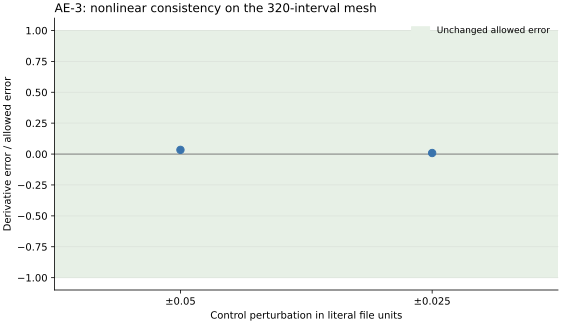

# AE-3 nonlinear consistency on the 320-interval mesh

The two prescribed finite-control comparisons produce **2 passes, 0 failures and 0 unavailable results**. **4/4 nonlinear cases complete**. This checks the saved linear control response against nonlinear equilibrium on the same mesh. **AE-3 remains pending**; it does not establish mesh convergence or experimental agreement.

Each target uses the literal Straight_20O model and exactly the audited 321-node, 320-interval, 4,172-unknown topology. The four targets are ±0.05 and ±0.025 in literal file-control units. Every case independently starts from the same zero-control physical state; no finite result seeds another case. Only the prescribed control changes. The original fixed mount, density, speed, incidence, stall setting, frozen aerodynamic influences and references remain.

| Control setting | Native Cl | Fresh full residual | Newton iterations | Equilibrium time (s) | Execution |
|---:|---:|---:|---:|---:|---|
| +0.05 | -1.17565027781e-05 | 1.42431e-11 | 2 | 239.037 | Complete |
| -0.05 | +1.17565027756e-05 | 1.42431e-11 | 2 | 258.556 | Complete |
| +0.025 | -5.8782535148e-06 | 3.30398e-12 | 2 | 239.396 | Complete |
| -0.025 | +5.87825351418e-06 | 3.30398e-12 | 2 | 94.823 | Complete |

Times are native diagnostic measurements, not browser benchmarks. The saved phase and residual-evaluation journals retain internal corrector work. Exactly one public equilibrium attempt is allowed per case, followed by a separate fresh-network validation. Actual totals are 4 equilibrium attempts, 8 network constructions and 0 new derivative calls.

The public seeded route calls the original full corrector with tolerance 1e-9. Its existing Newton limits and final column-scaled rank check remain unchanged. A successful case must pass the original result and fresh full physical residual gates of 1e-8 and the rank gate of 1e-10. The corrector returns one corrected step; this is not a four-stage load continuation. Finite-rotation restoration differences are saved descriptively, with the full fresh residual providing the acceptance test.

Native Cl is −Mx/(fixed baseline qS × Bref), using the distributed aerodynamic moment and the same stability axes as the saved derivative. There is no experimental sign, area or angle-unit conversion. The exact comparator is **-0.00023513016903714936** per file-control setting, from the independently audited default-step 1e-5 derivative.

| Perturbation | Centered derivative | Absolute difference | Allowed difference | Result |
|---|---:|---:|---:|---|
| ±0.05 | -0.000235130055537 | 1.13500582e-10 | 3.35130169e-09 | **PASS** |
| ±0.025 | -0.000235130140579 | 2.84577022e-11 | 3.35130169e-09 | **PASS** |

For each h, D(h) = (Cl(+h) − Cl(−h))/(2h). The unchanged criterion is abs(D(h) − D320) ≤ 1e-9 + 1e-5 × abs(D320). The even component is retained only as a diagnostic. These perturbations test numerical consistency; they do not establish correspondence with experimental control amplitudes or uniqueness of every nonlinear solution branch.

The independent saved-output audit passes 874/874 checks. It verifies the raw residual vectors, seed and target metadata, native moment normalization, operation accounting and both comparisons without new physics calls, matrix products or linear solves. The original source-owned rank results are recorded evidence; the audit does not repeat their factorizations.

All five previous mesh failures remain: **2.0773% and 7.1435%** for the original global comparisons, and **3.46876%, 4.17286% and 6.36203%** for the regional comparisons, each against its unchanged 1% criterion. A passing finite-control check cannot resolve these mesh failures. Coverage stays **17 partial / 24 pending / 0 fully validated**. Production source, runtime bundles and hosted release are unchanged. No original ASWING executable was available.

Next: Refine all 320 intervals together, including both previously tested regions, and repeat matched convergence and finite-control checks. Resolve the separate 20O-04 convergence failure and experimental amplitude/incidence/sign, section-control and fixture/stiffness matching before driven-roll and reversal validation.

[Machine-readable results](isae-ae3-320-finite-control.json) · [Regional mesh study](isae-ae3-two-axis-mesh.md) · [Evidence archive](isae-ae3-320-finite-control-20261024-evidence.zip)
