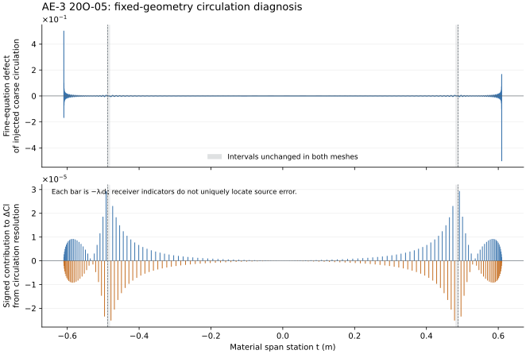

# AE-3 saved circulation defect and roll-output weighting

Circulation resolution accounts for **98.528%** of the saved fixed-geometry aerodynamic mesh change; the output-functional change accounts for **1.4723%**, with both solver-residual corrections retained. This diagnoses the **clamped aerodynamic part** of the earlier coupled discrepancy. It does not resolve the full coupled mesh failures, establish continuum accuracy or validate the experiment. AE-3 remains pending.

The existing 20O-05 responses use 160 and 286 circulation intervals. Each coarse interval's constant circulation is copied into its fine children. Evaluating this represented coarse field with the saved fine operator measures the defect between coarse collocation samples; coarse residual zeros are not interpolated. One transpose solve weights the fine-equation defects by their effect on the clamped roll-control output.

| Signed contribution | Native Cl control derivative |
|---|---:|
| Fine minus coarse clamped Cl | +6.74579925788e-06 |
| Output change for the same represented coarse field | +9.93156923188e-08 |
| Circulation-resolution term −λᵀd | +6.64648356556e-06 |
| Fine primal residual correction +λᵀr_f | -3.82775843686e-18 |
| Adjoint residual correction +tᵀe | +6.15303397322e-21 |
| Sum of the four terms | +6.74579925788e-06 |

The reconstructed clamped change is +6.74579926e-06. The identity error is +3.5508e-18, within the frozen arithmetic allowance 1.6712e-11. The gross absolute circulation-defect contribution is 0.00137119904; its ratio to the absolute signed contribution is 206.304. These are discrete algebraic quantities, not a continuum error bound. The earlier decomposition attributed about 42% of the signed full coupled change to this clamped part; elastic coupling remains separate.

The upper panel shows the injected coarse-field defect at all fine receivers. The lower panel shows each signed contribution −λᵢdᵢ. Shaded intervals are unchanged between the two meshes; dashed lines mark the literal control breaks. Receiver-weighted contributions are refinement indicators, not proof that the source of error is local to that receiver.

| Receiver region | Fine rows | Signed circulation contribution | Share of gross absolute contribution |
|---|---:|---:|---:|
| left root | 8 | -1.00291361e-07 | 0.057661% |
| left inner | 61 | +7.93404975e-06 | 15.077% |
| left control break | 29 | -1.67538945e-06 | 15.823% |
| left outer | 19 | +1.6910463e-06 | 7.2672% |
| left tip | 26 | -4.52617345e-06 | 11.775% |
| right root | 8 | -1.00291361e-07 | 0.057661% |
| right inner | 61 | +7.93404975e-06 | 15.077% |
| right control break | 29 | -1.67538945e-06 | 15.823% |
| right outer | 19 | +1.6910463e-06 | 7.2672% |
| right tip | 26 | -4.52617345e-06 | 11.775% |

The ten regions were fixed before execution. Their signed and gross sums reconstruct the global quantities. Gross shares use the sum of absolute contributions, not the potentially cancelling net change. Every receiver is retained.

There are 34 genuinely common collocation intervals and 252 receivers in split intervals. The common checks include sample and collocation coordinates, source endpoints, section directions, control forcing and nonzero stall leakage. Aggregated fine sources reproduce the coarse common rows within the previously declared influence and forcing tolerances. The maximum normal-influence difference is 5.68434e-14; the maximum centered-forcing difference is 0. This consistency check cannot bound error shared by the unchanged patch.

The largest injected defect is 0.499043, versus 2.69923e-15 at unchanged receivers. No convergence threshold is imposed on that defect. The new adjoint's normalized equation residual is 5.37764e-17, below the unchanged 1e-8 limit; the column-scaled fine circulation operator has reciprocal condition estimate 0.00201685, above the unchanged 1e-10 criterion. Saved coarse and fine primal responses also satisfy their original equation checks.

The adjoint solves A_fᵀλ=ell_f. With d=A_f P g_c+b_f, e=P g_c−g_f, r_f=A_f g_f+b_f and t=A_fᵀλ−ell_f, the retained identity is:

    H_f(g_f) − H_c(g_c) = [H_f(P g_c) − H_c(g_c)] − λᵀd + λᵀr_f + tᵀe

H includes the sampled force moment arms and direct section-Cm offset. The original output functional and actual centered control partial are retained. The prior exact-integral sensitivity is not substituted. The block retains the nonzero stall derivative and zero same-beam vortex core. The circulation representation, horseshoe construction, equation constraints, stall leakage and output integrals are described in Drela's [ASWING steady formulation](https://web.mit.edu/drela/Public/web/aswing/asw_theory.pdf), §§3.1, 4.2, 5.6–5.7 and 8.6. The injection and adjoint identity are deductions for these saved systems, not claims about an unavailable ASWING executable.

Exactly one new circulation-block rank SVD, one transpose LU factorization and one right-hand-side solve completed. All saved matrix/vector products and absolute-bound products are counted in the raw evidence. Two literal geometries were reconstructed from saved inputs. There were no new aerodynamic-kernel, equilibrium, derivative-API or physical-residual evaluations, and no new physical mesh cases. The independent audit passes 1298/1298 checks without a new solve or factorization. No browser performance claim is made.

The first attempt stopped at a reporting-helper argument collision after saving the coarse block and one signed and one absolute matrix/vector product. It performed no SVD, factorization or solve. That attempt, its 29 completed checks and its independent 323-check failure audit are retained. The separately reviewed revision changes only the helper parameter name in the numerical runner; all scientific formulas, inputs and tolerances are unchanged. Its repeated coarse operations are counted separately from those in the failed attempt.

Both original coupled 1% mesh failures remain **2.0773% and 7.1435%**. Coverage stays **17 partial / 24 pending / 0 fully validated**. Production source, runtime bundles and hosted release are unchanged. No original ASWING executable is available.

Next: Run the prepared two-axis 20O-05 refinement: retain the existing 160/286-interval grids and split all 34 shared intervals to create 194/320-interval grids. Test patch refinement and refinement elsewhere separately with the unchanged 1% native Cl_control criterion. Preserve the original 2.0773% and 7.1435% failures. Complete 20O-04 convergence, experimental amplitude/incidence/sign, section-control provenance and fixture/stiffness matching, driven-roll and reversal comparisons. The two additional station lists were prepared before these diagnostic outcomes; no physical case has yet run on them. They preserve all original stations and use the saved coarse Glauert sample to split every shared interval.

[Machine-readable results](isae-ae3-circulation-defect.json) · [Output-integration sensitivity](isae-ae3-output-integration.md) · [Evidence archive](isae-ae3-circulation-defect-20261024-evidence.zip)
