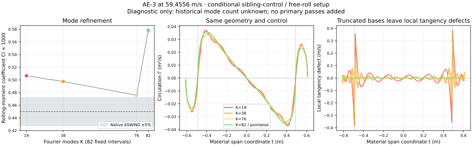

# AE-3: circulation representation and the remaining high-speed difference

Follow-up, 2026-11-12: the [76-mode refinement](isae-ae3-mode-mesh-20261112.md)
changes by less than 5% for the last truncated mesh and mode pairs (2.88% and
0.81%), but retains an 8.97% difference from the saved pointwise result and
24.16% native Cl error on the conditional setup. Representation convergence
remains open. No primary passes are added; the next audit concerns this
representation gap and deformed-wing fields and force transfer.

Follow-up: [fixed-mode grid refinement](isae-ae3-fixed-mode-mesh-20261111.md)
shows that the 38-mode error rises from 10.53% to 25.17% as intervals increase
82→164→328. The final mesh change is 2.43%; mode convergence remains open.
A verified [matrix assembly optimization](steady-fourier-local-assembly-20261111.md)
preserves the full solution exactly and enables these bounded runs. No primary
passes are added.

Observed 2026-11-11 UTC. The conditional high-speed rolling-moment error falls
from **28.49% with pointwise circulation to 5.70% with 76 Fourier modes** on
the same 82 structural intervals. However, the full 82-mode basis reproduces
the pointwise answer and its larger error. This is not a converged correction
or evidence to adopt a particular mode count. **Primary AE-3 remains 434/725**
at 5%, with all 113 unavailable references retained.

## Controlled comparison

The geometry, explicit 82-interval grid, stiffness, density, Mach zero,
59.4556 m/s speed, frozen-jig influences and F1=1 are unchanged. This uses the
previously disclosed **sibling dCLdF=.0686 / dCMdF=-.0102** and **free roll
acceleration with net Mx=0** diagnostic. These inputs have not been established
as the archived run's original inputs. Only the circulation representation
changes; this is one coefficient at one operating point, not another full
native-export comparison.

| Circulation representation | Computed Cl | Error against native Cl=.000450 | Maximum local tangency defect |
|---|---:|---:|---:|
| 19 Fourier modes | .000506505735 | 12.56% | .38458 m/s |
| 38 Fourier modes | .000497363047 | 10.53% | .36394 m/s |
| 76 Fourier modes | .000475664884 | 5.70% | .28468 m/s |
| 82 Fourier modes / pointwise | .000578213766 | 28.49% | 1.62e−11 m/s |

The 19, 38 and 76 mode counts were declared before solving. Each truncated
solution starts from the ordinary unloaded continuation. The full 82-mode
control changes coordinates in the previously accepted pointwise state and
checks two additional off-equilibrium states; it is not another nonlinear
solve. Physical circulation, loads and transformed full residuals agree.

All accepted full residuals are at most **5.05e−13**. There is **no stalled
strip** in these states. Fourier weighted-residual convergence does not require
every local tangency defect to vanish; those defects remain reported explicitly.
The largest truncated defects occur near the flap boundary. The successive Cl
changes are **1.84%, 4.56% and 17.74%**. The final change fails the existing 5%
discretization gate, despite the two earlier pairs passing it.

The [complete assessment](../../artifacts/isae/ae3-circulation-modes-origin-fixed-20261111/assessment.json)
records **113 representation/equilibrium checks, 16 accepted-boundary checks
and nine split-route parity checks**, all passing. These checks add no native
votes. Sampling condition numbers range from 1.003 to 11.89; the full basis
passes its existing invertibility gate. Its equivalence to pointwise circulation
does not establish convergence to the continuous lifting-line solution.

## What the references establish

Drela's [steady description](../../reference/aswing-authoritative-20261108/drela-aswing-steady.pdf),
§3.1, Eqs. 62–63, permits pointwise or Fourier circulation. Section 5.6,
Eqs. 200–201, defines the weighted tangency constraints when fewer Fourier
coefficients than structural intervals are used. The implementation's material
Glauert basis and projection were independently reconstructed in this study.

The [extended manual](../../reference/aswing-authoritative-20261108/aswing-extended-user-manual.pdf),
§1.3.5, p. 21, Fig. 1.13, illustrates modes 1 through 19. It does not identify
that count as a default or an AE-3 setting. Its caption says 180 nodes, while
the embedded graph says 100; neither count was adopted. The retained AE-3
`Roll_rate.sh` has no NODE selection, and no paired `Straight_20O.set` was found.
The [authoritative source catalog](aswing-authoritative-sources.json) and the
literal driver were authenticated before the study.

The closer truncated answers support investigating historical mode/node
settings. They do not justify choosing settings from the reference errors.
The next numerical check should hold Fourier order fixed while refining the
structural grid, separating mode truncation from physical interval resolution.
Historical model/control identity and MM constraints remain open.

## A checkpoint defect found and fixed

The first 76-mode job reached its final load stage but hit the unchanged
15-second CPU cap. Splitting the same continuation exposed a separate bug:
the checkpoint did not preserve the starting values of its operating-target
ramp. A fresh network therefore restarted that ramp from the halfway state.

The [checkpoint correction](steady-continuation-operating-origin-20261111.md)
preserves those starting values. The complete 38-mode split control now matches
all **1,035 normalized solution components exactly**, with zero coefficient
difference from the uninterrupted solve. The 76-mode chain then completes in
two serial stages, without changing a physical equation or tolerance.

All eight workers in the main original/fixed comparison are reaped. The two
earlier checkpoint-attempt workers and the independent origin-audit worker are
also reaped. The original capped job and failed restore remain preserved.
Each numerical child retained one BLAS thread, 512 MiB address space, 15 CPU
seconds and 25 wall seconds. Library preload was separately bounded and did no
numerical work. The four corrected stages used 9.02–11.21 CPU seconds each.
No browser/WASM rebuild or runtime verification was attempted.
