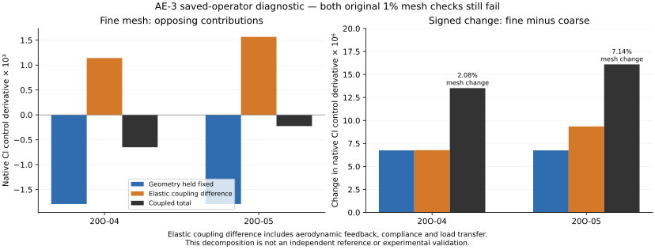

# AE-3 fixed-geometry and elastic coupling diagnostic

Both the fixed-geometry aerodynamic response and the elastic coupling difference contribute to the remaining mesh sensitivity. At pressure point 20O-05, their signed shares of the coarse-to-fine change are **41.91% and 58.09%**. The original mesh failures remain **2.0773% and 7.1435%**, against the unchanged 1% criterion. AE-3 remains pending.

| Pressure point | Fixed-geometry share of mesh change | Elastic coupling share | Fine-mesh gross/net cancellation ratio | Original mesh result |
|---|---:|---:|---:|---|
| 20O-04 | 49.91% | 50.09% | 4.508 | 2.0773% — FAIL |
| 20O-05 | 41.91% | 58.09% | 14.906 | 7.1435% — FAIL |

The diagnostic uses the four saved zero-control operators from the [corrected-method mesh study](isae-ae3-analytic-global-mesh.md). Each case solves only the circulation block with every other state increment fixed at zero. Subtracting that response from the saved coupled response gives the elastic coupling difference. It includes aerodynamic feedback, compliance and load transfer; **it is not a measurement of structural discretization error**. These are algebraic diagnostics of the captured discrete operators, not independent rigid-wing or continuum solutions.

On the fine 20O-05 mesh, the native Cl derivative per literal file-control setting is −0.00179199813112 with geometry held fixed, plus an elastic coupling difference of +0.00156667962061, yielding −0.000225318510512. The sum of the absolute contributions is 14.906 times the absolute total. This cancellation ratio is descriptive, not a condition number. The two gross contributions change by about 0.3764% and 0.5968% across meshes, while the small net response changes by 7.1435%.

The reconstruction retains the section pitching-moment contribution, its actual local Mach correction, and the force moment arms at the aerodynamic strip locations. The PG Mach setting is zero, but local section Mach is nonzero. The maximum absolute difference between reconstructed and serialized full Cl derivatives is 8.674e-19. Signed zone allocations and common-node displacement/rotation changes are retained in the machine-readable report; the zones are conservative bookkeeping, not an error-origin map.

Exactly **four circulation-block solves, four single right-hand sides and four block-rank SVDs** were performed. There were no new full-system solves, residual/physics evaluations, derivative calls or meshes. All four owned children completed and were reaped. The maximum block residual is 3.588e-15; the recomputed full-system residual is at most 1.326e-12, below the unchanged 1e-8 gate. The independent saved-output audit passes **1,536/1,536 checks** without new solves or rank factorizations. The exact 107-module source, default step 1e-5 and original two mesh failures are preserved.

Next work must address both contributions: independently check the fixed-geometry aerodynamic discretization and load integration, and compare the existing structural meshes under a common prescribed load. A source plan for the latter is archived but has not been executed. Global convergence and fixed control-boundary patch error remain unresolved. Experimental amplitude/incidence/sign, section-control provenance, fixture/stiffness matching, driven-roll and reversal are still open. No original ASWING executable is available. Coverage remains **17 partial / 24 pending / 0 fully validated**.

No production source, runtime bundle or hosted release changed. This study makes no performance or experimental acceptance claim.

[Machine-readable results](isae-ae3-clamped-circulation.json) · [PNG figure](isae-ae3-clamped-circulation.png) · [Evidence archive](isae-ae3-clamped-circulation-20261024-evidence.zip)
