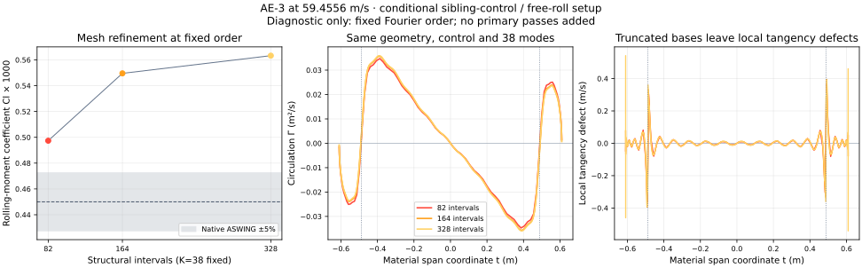

# AE-3: physical-grid refinement with 38 Fourier modes fixed

Follow-up, 2026-11-12: the [76-mode refinement](isae-ae3-mode-mesh-20261112.md)
changes by less than 5% for the last truncated mesh and mode pairs (2.88% and
0.81%), but retains an 8.97% difference from the saved pointwise result and
24.16% native Cl error on the conditional setup. Representation convergence
remains open. No primary passes are added; the next audit concerns this
representation gap and deformed-wing fields and force transfer.

Observed 2026-11-11 UTC. Refining the grid while retaining 38 Fourier modes
moves the conditional high-speed rolling coefficient **farther from the native
ASWING value**. Its error rises from **10.53% to 22.12% to 25.17%** on 82, 164
and 328 intervals. The final mesh change is **2.43%**, within the existing 5%
mesh gate, but this does not establish convergence with Fourier order. The
closer coarse-grid result does not justify adopting a mode count or changing
the primary setup. **Primary AE-3 remains 434/725**.

| Structural intervals | Fourier modes | Cl | Error against native Cl=.000450 | Fresh full residual | Maximum local tangency defect |
|---:|---:|---:|---:|---:|---:|
| 82 | 38 | .000497363047 | 10.53% | 4.21e-13 | .36394 m/s |
| 164 | 38 | .000549546198 | 22.12% | 2.41e-13 | .39415 m/s |
| 328 | 38 | .000563246826 | 25.17% | 1.29e-13 | .54139 m/s |

The successive Cl changes, relative to the finer result, are **9.50%** and
**2.43%**. All sections remain unstalled. The truncated Fourier equations
constrain weighted tangency residuals; local defects need not vanish and are
reported explicitly. Receiver locations change with refinement, so these
maxima are not comparisons at identical physical points. They add no passes.

## Controls and acceptance

Every interval is bisected in the original material coordinate, preserving all
old nodes, the root and flap boundaries. The independent audit verifies equal
material-arc subdivisions on this piecewise-straight wing. Speed stays at
59.4556 m/s, with frozen-jig influences, Mach zero, rho=1.2256, unchanged
geometry/stiffness and F1=1. This retains the disclosed **sibling dCLdF=.0686 /
dCMdF=-.0102** and **free roll acceleration / net Mx=0** diagnostic. Those are
still not authenticated archived producing inputs.

The [assessment](../../artifacts/isae/ae3-fixed-mode-mesh-local-20261111/assessment.json)
records **135 passing physical, projection, continuation-boundary and mesh
checks**. The finer cases each use four serial accepted load stages, with a
fresh residual and initial-rank check after every restart. All nine workers
are reaped. CPU time summed over the workers is **1.41, 4.64 and 9.85 seconds**
for the three grids; this excludes separately bounded library preloads and
parent evidence checks. Individual numerical children use at most 2.79 CPU
seconds and 137,832 KiB peak RSS, within the unchanged limits.

The [original attempt](../../artifacts/isae/ae3-fixed-mode-mesh-20261111/cases/k38-n164-stage1/terminal.json)
with the previous matrix assembly hit its wall cap and remains uncomputed.
A verified [local-strip matrix optimization](steady-fourier-local-assembly-20261111.md)
then enabled the refinement. It reproduces the original matrices and Newton
corrections exactly in two full AE-3 controls, passes 17 selected native
regression cases and reproduces all 1,035 original cold-solution components
exactly. No residual equation, physical parameter or acceptance gate changed.

## Interpretation and next check

The [earlier mode sweep](isae-ae3-circulation-modes-20261111.md) varied mode count
on only 82 intervals. This study shows that its closer 38-mode answer was
materially affected by interval resolution. It does not determine how the
76-mode answer behaves on finer meshes, nor identify the historical mode/node
settings. The next comparison should hold **76 modes** fixed on the **164- and
328-interval grids**, then compare 38 and 76 modes on those same grids. No mode
count should be chosen from its native-reference error.

Drela's [steady description](../../reference/aswing-authoritative-20261108/drela-aswing-steady.pdf),
§3.1, Eqs. 62–63 and §5.6, Eqs. 200–201, provides the representation and
weighted-residual definitions. The [authoritative reference catalog](aswing-authoritative-sources.json)
was checked before the study. Historical control/model identity, the MM
constraint convention and embedded ASWING-m curve inputs remain unresolved.
All 113 unavailable primary comparisons remain in the denominator. This
study adds zero primary votes. Browser/build checks remain held.
