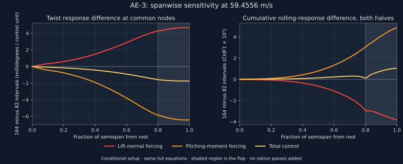

# AE-3: full native comparison with frozen influences

Follow-up, 2026-11-12: the [76-mode refinement](isae-ae3-mode-mesh-20261112.md)
changes by less than 5% for the last truncated mesh and mode pairs (2.88% and
0.81%), but retains an 8.97% difference from the saved pointwise result and
24.16% native Cl error on the conditional setup. Representation convergence
remains open. No primary passes are added; the next audit concerns this
representation gap and deformed-wing fields and force transfer.

Follow-up: [fixed-mode grid refinement](isae-ae3-fixed-mode-mesh-20261111.md)
shows that the 38-mode error rises from 10.53% to 25.17% as intervals increase
82→164→328. The final mesh change is 2.43%; mode convergence remains open.
A verified [matrix assembly optimization](steady-fourier-local-assembly-20261111.md)
preserves the full solution exactly and enables these bounded runs. No primary
passes are added.

Observed 2026-11-11 UTC. This replay uses the original literal `Straight_20O`
model, both declared coefficient meshes and all native auxiliary outputs.
The 725 required comparisons comprise 612 native comparisons and 113 embedded
values with unresolved producing inputs. The native comparisons contain 576
distinct source values; 36 finite coefficients are repeated on the second mesh.
Original ASWING, ASWING-m and experimental results remain distinct.

## Audited result

**434/725 comparisons pass at 5%: 612 computed, 178 mismatches and 113
unavailable.** All 30 native jobs completed; no native result remains capped or
unrun. The total is unchanged from the previous updated-influence comparison.
At original printed precision, 388 pass (previously 387). The original model,
denominator, numerical gates and 5% policy are unchanged; AE-3 is not validated.

The subsequent [constrained warm-correction improvement](isae-ae3-constrained-warm-20261111.md)
passes 43 regressions and 46 numerical checks, reducing the two independent
roll-target jobs from about 24.7 to 5.4 supervised seconds. Only warm eligibility
changed; this native comparison retains its original source hashes and counts.

The [independent nonlinear control check](isae-ae3-control-nonlinear-20261111.md)
now completes eight full solves and passes 130 physical/response checks on the
high-speed conditional base. Both response conventions reproduce their saved
tangents; the held-acceleration CldF1 discrepancy remains 26.95%.

The subsequent [circulation-mode study](isae-ae3-circulation-modes-20261111.md)
reduces the conditional high-speed Cl error to 5.70% with 76 modes on the same
82-interval grid, but the full basis reproduces the 28.49% pointwise error.
Mode/mesh convergence remains open. Its independently verified checkpoint fix
retains the original operating-target ramp; 47 native regressions pass, with
exact 1,035-component AE-3 restart parity. Neither change adds primary votes.

| Output group | Passing / required | Computed | Mismatches | Unavailable |
|---|---:|---:|---:|---:|
| Finite coefficients, nominal 80 and 160 | 50/72 | 72 | 22 | 0 |
| Native derivatives, nominal 80 | 174/252 | 252 | 78 | 0 |
| Native mass/inertia/centroid, nominal 80 | 174/252 | 252 | 78 | 0 |
| Native normalized rates, nominal 80 | 36/36 | 36 | 0 | 0 |
| Embedded original-ASWING locked curves | 0/43 | 0 | 0 | 43 |
| Embedded ASWING-m locked curves | 0/43 | 0 | 0 | 43 |
| Embedded ASWING-m rolling curves | 0/27 | 0 | 0 | 27 |
| **Total** | **434/725** | **612** | **178** | **113** |

The [audited assessment](../../artifacts/isae/ae3-frozen-primary-r2-20261111/assessment.json)
and [725-row comparison CSV](../../artifacts/isae/ae3-frozen-primary-r2-20261111/comparisons.csv)
retain every target, prediction, error and acceptance decision. Unavailable
predictions remain blank in the CSV. Five unpaired model inventory records
remain visible with zero targets and no votes.

All 870 base-check records and 258 auxiliary checks pass. The base evidence
comes from twelve fresh equilibria (348 unique base checks); the eighteen
auxiliary jobs authenticate and inherit those checks, then calculate their
outputs afresh. Maximum fresh residual is 9.6403e-13. All thirty numerical
children are reaped. The auxiliary calculations take 1.562–3.804 CPU seconds,
2.745–5.196 worker wall seconds and at most 116,992 KiB RSS; these timings
exclude supervisor source/artifact auditing. Resource limits remain unchanged.

The [current test assessment](../../artifacts/isae/ae3-frozen-primary-r2-20261111/test-assessment.json)
records **83 passing regressions out of 84 selected**. The unchanged
`test_summary_rebuilds_ae3_sources_once_and_checks_all_declared_settings`
regression hit the 25-second cap twice and remains explicitly uncompleted.
No timeout is counted as a passing test. Earlier capped larger batches are
also retained. The full-ledger integration test now authenticates one shared
source catalog before and after its checks, retaining all 725 targets and
per-job canonical reconstruction. No production source check was bypassed.

Follow-up: the [remaining source-summary check now passes](isae-ae3-adapter.md#final-reporting-check)
after correcting the runner's standalone sibling-import path. Four reporting
and registry tests were replayed successfully; the original 83-test evidence
is retained. This is not a new full numerical replay and adds no primary votes.

Among computed failures, median Cl/CX/derivative errors are 51.42% /51.04%
/52.04%. Failed non-tiny derivatives span 7.52–6188.16%. Fifty-five of the
78 mass/inertia failures have reference magnitude <=1e-8 and retain their
original absolute gates; the other 23 have median 228.62% error. The largest
mass discrepancy remains apparent mass yz: -2.019e-5 native versus
+6.90744509e-5 computed, an absolute difference of 8.92644509e-5.

All six CLa, Cma and Clp comparisons pass. All six CldF1, Clu, CYa and CLb
comparisons still fail for the literal model. Frozen influences do not resolve
the control/constraint ambiguity. This correction follows the documented
default; it was not selected to increase the pass count. The separate diagnostic
below must not be substituted for these primary results.

## Why the adapter setting changed

The adapter explicitly disabled frozen influences although OpenSwing defaults
to enabling them. Drela's [original manual](../../reference/aswing_doc.txt),
OPER / Option selection, displays `F reeze VL matrices (fast) : T`.
His [steady technical description](../../reference/aswing-authoritative-20261108/drela-aswing-steady.pdf),
§4.6, pp. 36–37, describes the simplified mode with influence coefficients
precomputed on the undeformed geometry at zero wind angles. This is distinct
from temporarily lagging matrix terms during a Newton iteration.

The adapter now selects that documented setting and checks it in both the cold
and restored results. Current section frames, circulation, lengths, motion and
loads remain active; only the documented influence coefficients are frozen.
The auxiliary calculation differentiates this selected physical model with its
full coupled matrix. It does not replace that derivative with a lagged Newton
matrix. No governing-equation or numerical-gate change was made for this replay.

This follows the user's direction to adopt ASWING defaults. The manual display
does not prove the exact K/F setting used in the archived ISAE runs. Exact model
identity, the operating mask, atmosphere and MM constraint conventions remain
qualified as in the [previous complete comparison](isae-ae3-native-completion-20261111.md).
Jan's [Part IV](../../reference/aswing-authoritative-20261108/isae-part-4-aeroelasticity.pdf),
§3.3, pp. 13–14, remains authoritative for the model/control and ASWING-m
distinctions. The [reference index](aswing-authoritative-references.md) and
[checksummed source catalog](aswing-authoritative-sources.json) were consulted.

An initial attempt converged but was rejected because the adapter's exact
setup expectation still required updated influences. That attempt and its
source bytes are preserved under
[`ae3-frozen-primary-20261111`](../../artifacts/isae/ae3-frozen-primary-20261111/).
The subsequent replay corrects the expectation and starts fresh equilibria.
The checkpoint regression explicitly rejects pairing a new frozen job with an
old updated-influence checkpoint.

## Independent diagnostic evidence

These diagnostics use the already disclosed sibling-control slope and free
roll-acceleration setup. They are **not** primary model replacements and add no
votes to the 725-target total.

At the low-speed alternative equilibrium, the refined sideslip decomposition
passes all 33 checks. With the same full physical state Jacobian, suppressing
only the wind-dependent influence response changes CLb from 0.00350539169 to
0.00212665083; the native value is 0.002120. The refined steps are 1e-5 and
5e-6 radians. The original coarser diagnostic's failed refinement is retained;
no gate was relaxed. This decomposition identifies a sensitivity but is not
itself a self-consistent alternative equilibrium.

Fresh, genuinely frozen equilibria then give:

| Alternative setup | All native fields | Derivatives | CLb prediction | Native CLb | CLb error |
|---|---:|---:|---:|---:|---:|
| Lowest speed | 84/96 | 42/42 | 0.00212666049 | 0.002120 | 0.314% |
| Highest speed | 73/96 | 31/42 | 0.0131359100 | 0.01351 | 2.769% |

All 114 physical/numerical checks pass. High-speed CYa still differs by
261.53%, Clu by 6.36% and CldF1 by 26.95%. Neither the alternative control slope
nor its free-acceleration constraint has been adopted into the primary adapter.
Frozen influences alone do not resolve the literal-model discrepancies.

Evidence: [refined decomposition](../../artifacts/isae/ae3-sideslip-inputs-20261111/cases/tangent-op1-m80/result.json),
[independent frozen equilibria and native comparisons](../../artifacts/isae/ae3-frozen-native-20261111/assessment.json).
These artifacts retain their original producer-source provenance; the later
adapter default change is not retroactively applied to them.

## Follow-up: full conditional sweep and mesh reversal

A subsequent bounded sweep completes all six speeds under the **separate**
sibling-control/free-roll-acceleration setup described above. All 576 distinct
native fields are compared: **492/576 match at 5%**. This diagnostic does not
replace the literal model or add votes to the primary **434/725** total.

| Speed (m/s) | Coefficients | Derivatives | Mass/inertia/centroid | Rates | All fields, nominal 80 |
|---|---:|---:|---:|---:|---:|
| 27.0934 | 6/6 | 42/42 | 30/42 | 6/6 | 84/96 |
| 38.5020 | 6/6 | 41/42 | 31/42 | 6/6 | 84/96 |
| 43.0429 | 6/6 | 41/42 | 31/42 | 6/6 | 84/96 |
| 47.2340 | 6/6 | 40/42 | 31/42 | 6/6 | 83/96 |
| 50.9245 | 5/6 | 40/42 | 33/42 | 6/6 | 84/96 |
| 59.4556 | 5/6 | 31/42 | 31/42 | 6/6 | 73/96 |

The first five speeds match **204/210 derivatives**. Their non-tiny derivative
misses are Cna at the second speed (7.29%), CXp at the third (32.23%), CXp/CLr
at the fourth (6.10% /17.45%), and Clu/CLr at the fifth (92.18% /7.76%). The
small and zero reference failures remain in every denominator. These results
strengthen the input/constraint interpretation, without authenticating the
archived generating model or establishing complete model agreement.

The high-speed nominal-160 result improves to **78/96**: 5/6 coefficients,
34/42 derivatives, 33/42 mass properties and 6/6 rates. CldF1 error falls from
26.95% to 10.11%, and CYa error from 261.53% to 125.06%. These are overlapping
mesh diagnostics, not additional independent source values.

A further, prospectively selected **nominal-320 frozen equilibrium completes**
under the same limits and passes all eleven physical checks. Its rolling error
increases again, so the earlier improvement is not monotonic convergence:

| Nominal intervals (actual intervals) | Cl | Error against native 0.000450 | Ratio of adjacent inner/outer widths at the flap break |
|---|---:|---:|---:|
| 80 (82) | 0.000578214 | 28.49% | 1.62838 |
| 160 (162) | 0.000508477 | 12.99% | 0.29714 |
| 320 (322) | 0.000559406 | 24.31% | 0.83533 |

The 160-to-320 Cl change is **9.10%**, still above the prospective 5% mesh
gate. The 320 result matches five of six finite coefficients; its derivatives
have not been computed. Its fresh residual is 2.1003e-13. This successful
frozen solve does not resolve the separate updated-influence assembly-memory
failure retained in the earlier study.

The saved-data audit rules out an enabled minimum-spacing limiter: these grids
have no `min_spacing` setting, whose implementation default is zero. All retain
the exact flap boundary at ±0.48768000000000006 m. Global cosine refinement
changes the widths on either side of that inserted boundary substantially.
Independent strip-wrench reconstruction passes on all three grids. The
160-to-320 Cl increase is split between the controlled outer region
(+2.15461e-5) and uncontrolled inner region (+2.93833e-5). Thus the change is
not confined to a final coefficient-integration term at one strip. The width
ratio is a clue, not a demonstrated cause. The next check should bisect every
existing interval to preserve relative boundary spacing, then separate
aerodynamic and structural resolution; no spacing should be tuned to pass
the archive.

The four intermediate coarse states and high-speed fine state pass **285 new
physical/numerical checks**. With the two reused endpoints, the full-observable
study contains **399 passing checks**; the extra 320 equilibrium and saved
mesh audit add eleven and three, respectively. All eleven newly launched
children are reaped. The nominal-160 auxiliary calculation uses 8.70 CPU
seconds, 10.39 worker wall seconds and 199,020 KiB RSS. The nominal-320 solve's
supervised wall time is 7.84 seconds. No limits, gates, governing equations or
primary inputs were changed.

The retained XFOIL scripts request **31 points**; each of the four retained
airfoil polars has **29 rows**. The commented `Post_analysis.m` assigns
29 uniform flap labels from −14° to +14° without identifying which requests
are absent. Reproducing that declared fit gives different slope values from
the model constants, so these files do not uniquely authenticate either
0.0581 or 0.0686 as the native export's generating input. No new coefficient
was fitted or adopted.

Evidence: [full conditional sweep](../../artifacts/isae/ae3-frozen-sweep-20261111/assessment.json),
[all diagnostic comparisons](../../artifacts/isae/ae3-frozen-sweep-20261111/comparisons.csv),
[320 solve and three-grid audit](../../artifacts/isae/ae3-frozen-refine-20261111/mesh-audit.json),
[airfoil-source audit](../../artifacts/isae/ae3-frozen-sweep-20261111/airfoil-source-audit.json).

## Follow-up: fully nested grids and rigid aerodynamic controls

The next check uses the existing explicit-node API, with **82, 164 and 328
actual intervals**. Starting from the saved nominal-80 grid, each refinement
bisects every interval. These are different grids from the preceding nominal
160/320 cosine runs, which have 162/322 actual intervals. The physical model,
qualified sibling control slopes, frozen influences, conditional free roll
acceleration and operating point remain unchanged. No production solver or
default mesh setting changes.

The explicit-node 82-interval cold solve reproduces both the saved coefficients
and roll acceleration **exactly**. All parent nodes, root and flap breaks survive
both refinements. Independent material-arc checks confirm equal interval
bisection within 1.78e-15 m. The flap-boundary inner/outer width ratio stays
1.62837731828, eliminating changing boundary-width ratio as the sole explanation
for the refinement response.

| Actual intervals | Coupled Cl | Error against native 0.000450 | Rigid-jig Cl |
|---:|---:|---:|---:|
| 82 | 0.000578213766 | 28.4919% | -0.002106963606 |
| 164 | 0.000617723783 | 37.2720% | -0.002108445436 |
| 328 | 0.000613774376 | 36.3943% | -0.002110590347 |

The coupled relative mesh changes are **6.3961% and 0.6435%**. The latter
passes the prospective 5% gate for that pair, while the first fails. This does
not establish a continuum error bound or erase the earlier cosine-grid
failures. The two finer nested results remain about 36–37% above the native
coefficient under this explicitly conditional setup.

The rigid controls hold the original jig geometry fixed, solve circulation
using exactly these node lists, and set accelerations to zero. Their Cl mesh
changes are only **0.0703% and 0.1016%**. Rigid values are not compared with the
archived flexible target. The larger sensitivity thus appears in the coupled
response rather than in rigid-jig aerodynamic control effectiveness alone.
This does not isolate a structural error: deformed-flow evaluation, load
transfer and structural discretization remain candidates, along with the
unresolved generating-input/MM conventions. Rigid and coupled differences
cannot be treated as additive corrections because their geometry and solved
acceleration differ.

All **74 new numerical/physical checks pass**: 33 coupled equilibrium checks,
20 mesh/control checks and 21 rigid circulation/wrench checks. Fresh coupled
residuals are at most 5.05e-13; fresh rigid circulation residuals are at most
6.46e-17. All six new children exited normally and were reaped. Supervised
wall times were 6.04–7.53 seconds for coupled solves and 3.51–5.30 seconds for
rigid controls, with the unchanged one-thread 512 MiB /15 CPU /25 wall limits.
These diagnostics add **zero primary votes**; AE-3 stays **434/725**.

The following study separates aerodynamic loading on a prescribed deformed
shape from structural response under prescribed loads. Exact historical
control/MM setup remains open; no spacing or coefficients are selected to fit
the native output.

Evidence: [nested equilibrium assessment](../../artifacts/isae/ae3-frozen-nested-20261111/assessment.json),
[rigid-grid assessment](../../artifacts/isae/ae3-frozen-nested-rigid-20261111/assessment.json).
Their adjacent `run.py`, `plan.json` and per-case folders retain the prospective
inputs, reproducible serial launch commands, source pins and process receipts.

## Follow-up: prescribed deformation and prescribed fluid loads

Two complementary studies now complete on the same 82/164/328-interval grids.
The first holds the saved 82-interval position polyline and shortest SO(3)
rotation arcs fixed, together with its solved roll acceleration. Nested
subdivision preserves that continuous prescribed field. Only circulation is
solved; current normals, section laws and the production Glauert sampling remain
active. Section positions and frames agree with the prescribed field within
4.45e-16. The coarse replay matches the original Cl within 5.55e-14.

The second holds the saved full fluid forces and equivalent arithmetic-midpoint
couples fixed as piecewise constant densities per undeformed material length.
Each child interval inherits the same density. A diagnostic subclass adds these
constant body-axis nodal wrenches to the unchanged source mechanics equations;
it does not replace any production option. No aerodynamic feedback or free-roll
constraint is solved. A separate circulation probe evaluates the resulting
deformation without feeding its loads back into mechanics. The coarse control
matches the original positions within 2.34e-12 m, frames within 1.41e-11, and Cl
within 6.04e-12. These diagnostic states are not exported as normal restart
packets.

| Refinement | Fully coupled Cl change | Cl change with prescribed deformation | Cl probe change after prescribed-load mechanics | Prescribed-load tip-displacement change | Prescribed-load tip-rotation change |
|---|---:|---:|---:|---:|---:|
| 82 → 164 | 6.3961% | 0.3051% | 0.5075% | 0.3764% | 0.1550% |
| 164 → 328 | 0.6435% | 0.3171% | 0.1101% | 0.0942% | 0.0388% |

Cl changes use the finer result magnitude; displacement/rotation changes use
the norm of the vector difference divided by the finer vector norm. The
fixed-load probe includes both its changed deformation and refined aerodynamic
sampling. It is not a purely structural coefficient correction, and the two
studies cannot be added to reconstruct the full coupled change.

Both separated studies vary much less than the first fully coupled refinement.
This is evidence for investigating **amplification by the coupled response**,
not proof of its magnitude, a stability eigenvalue or the cause of the archived
ASWING discrepancy. The finer coupled pair still misses native Cl by about
36–37% under the conditional setup. These tests justify inspecting the coupled
tangent and roll-acceleration/apparent-fluid balance before increasing the
mesh count again.

The mechanics audit also confirms that the literal model has **zero real mass
and inertia**. The original high-speed `.fmat_006`, lines 13–29, likewise prints
zero real tensors and nonzero apparent-fluid tensors. Thus the conditional
free-roll equation here is governed by fluid loads/apparent inertia, not an
ordinary material-mass rolling response. This agrees with the retained input
and output; it does not recover the historical MM mask. Jan Part IV §3.3
pp.13–14 separately notes that the experimental mass/inertia distribution was
unavailable, so experimental rolling acceleration is not a reference target.

All **70 new checks pass**: 31 prescribed-shape circulation/geometry/wrench
checks and 39 prescribed-load mechanics/control/probe checks. Fresh structural
residuals are at most 1.60e-14; all three prescribed-load equilibria complete
their four continuation steps. All six children exited normally and were
reaped under the same one-thread 512 MiB /15 CPU /25 wall limits. Supervised
wall times were 4.63–4.87 seconds for prescribed-shape jobs and 8.12–22.94
seconds for prescribed-load jobs. Observed scheduling interruptions mean these
are process receipts, not a portable solver benchmark.

No production physics, input, acceptance gate, comparison denominator or pass
count changed. The primary result remains **434/725**. The following study
isolates the net-roll feedback within that coupled response. A complete
attribution of the measured mesh defects remains open; no missing physical term
or fitted stiffness/control constant is inferred from the mismatch alone.

Evidence: [prescribed-shape assessment](../../artifacts/isae/ae3-frozen-prescribed-shape-20261111/assessment.json),
[prescribed-load assessment](../../artifacts/isae/ae3-prescribed-loads-20261111/assessment.json),
[cross-audit, source pins and native mass excerpt](../../artifacts/isae/ae3-prescribed-loads-20261111/cross-audit.json).

## Follow-up: roll feedback measured and checked nonlinearly

The conditional roll constraint produces a measurable amplification of response
at high speed. Its apparent-fluid moment is consistent with the independently
reported inertia tensor. For this zero-rate, zero-real-mass case with coincident
reference origins, the net moment is

\[
M_x(a,F_1)=-qSb\,C_l(a,F_1)-I_{xx}(a,F_1)a,
\]

where \(a=\dot\Omega_x\). The full physical tangent at fixed acceleration is
factored once per state for the acceleration and control columns. The single
net-moment row is then eliminated exactly. The derivative includes both changes
in aerodynamic moment and the deformation-dependent apparent inertia:

\[
M_a=-qSb\,C_{l,a}-I_{xx}-aI_{xx,a}.
\]

The acceleration response to a moment target is \(1/M_a\), compared with
\(-1/I_{xx}\) if geometry and aerodynamic loading are fixed. Their signed ratio
is \(-I_{xx}/M_a\). This is a static sensitivity, not a dynamic eigenvalue or a
stability verdict. Reconstructed product-rule derivatives and the resulting
control response are checked against the original augmented physical residual;
no matrix terms are dropped.

| Speed | Actual intervals | Acceleration amplification | OpenSwing Cl / (F1·CldF1) | Native Cl / (F1·CldF1) | Ratio difference |
|---:|---:|---:|---:|---:|---:|
| 27.0934 m/s | 82 | 1.05453 | 1.05442 | 1.05490 | 0.0458% |
| 59.4556 m/s | 82 | 3.12055 | 3.11964 | 3.08219 | 1.2149% |
| 59.4556 m/s | 164 | 3.15615 | 3.15510 | 3.08219 | 2.3655% |

The coefficient/derivative ratio uses the actual archived fields and F1=1.
Interpreting it as feedback requires a nearly linear control response and the
declared fixed-acceleration MM derivative convention. The native acceleration
derivative itself is unavailable. Similar ratios therefore support the
conditional interpretation without establishing the historical MM mask or
generating model. They are not new reference-pass votes.

Two independent full nonlinear corrections change the high-speed 82-interval
net-moment target by **±0.0001 N m**. The centered acceleration response agrees
with the tangent prediction within **0.0000842%**, and Cl response within
**0.0001264%**. Both pass the predeclared `1e-9 + 1e-5·abs(prediction)` gates.
Each correction converges in one Newton iteration and retains the original
physical balance, root, residual and full-rank checks.

This narrows the high-speed discrepancy. The native fixed-acceleration CldF1 is
**0.000146**; OpenSwing gives **0.0001853465** on 82 intervals and
**0.0001957858** on the nested 164 intervals: errors **26.95% and 34.10%**.
The corresponding finite Cl errors remain 28.49% and 37.27%. Splitting their
difference algebraically at the native coefficient/derivative ratio assigns
**94.59% and 91.49%** of the Cl difference to the fixed-acceleration control
derivative difference. This is a stated algebraic split, not a unique physical
cause or additive correction to adopt.

All **92 new checks pass**: 72 tangent/transfer/balance checks, 18 nonlinear
physical checks and two independent nonlinear-response checks. All five
children exited normally and were reaped within the unchanged one-thread
512 MiB /15 CPU /25 wall limits. The larger tangent used 7.51 CPU seconds and
195,968 KiB peak RSS. The nonlinear checks also expose an implementation
performance gap: saved-state correction with an operating constraint declines
the optimized warm path and uses the dense path, taking about 24.7 supervised
wall seconds here. This is recorded without changing limits or equations.

Next: decompose the fixed-acceleration control response into lift-normal forcing,
flap pitching moment and the resulting elastic response. Check their cancellation
and load arms against the documented equations. The roll-feedback evidence
does not establish the cause of the remaining control-effectiveness discrepancy;
no coefficients, stiffness, spacing, default physics or primary counts change.

Use the [condition-aware audited assessment](../../artifacts/isae/ae3-roll-feedback-20261111/assessment-audited.json)
and [nonlinear check](../../artifacts/isae/ae3-roll-feedback-nonlinear-20261111/assessment.json).
The reused generic summary incorrectly labeled a difference between two speeds
as a mesh change. That summary is retained and explicitly superseded by
`audit.py`; only high82/high164 form the actual matched-condition mesh pair.
Their amplification changes by 1.128%, while Cl changes by 6.396%. The corrected
report preserves all individual numerical results and original references.

## Control-forcing decomposition, 2026-11-11 UTC

The fixed-acceleration control discrepancy is a small remainder of two large,
opposing elastic responses. This follow-up identifies the cancellation and
checks the input/load formulas; it does **not** identify an incorrect ASWING
term or close the historical setup gap. The primary count remains **434/725**.

The [bounded diagnostic](../../artifacts/isae/ae3-control-forcing-20261111/run.py)
restores the same low-speed 82-interval and high-speed nested 82/164-interval
conditional states used above. It retains their actual solved roll acceleration,
frozen-jig influence matrices, sibling-file lift-control slope and unchanged
moment-control slope. Those conditional inputs remain separate from the literal
primary comparison. Every component uses the same complete physical tangent.

At an identical state, the control input column splits into:

- Rotation of the flow-tangency normal through `dCLdF1/dCLda` (Drela steady
  Eqs. 158–159, pp. 32–33), including its separation-drag partial from Eq. 70.
- The direct section pitching-moment partial from Eqs. 72–73 (pp. 16–17), using
  local perpendicular velocity, local Prandtl–Glauert factor, current span
  direction, chord squared and section length.

The supplied model has zero direct `dCDdF1`, which is checked before making
this two-part split. The complete structural and aerodynamic tangent is
factored once and reused for both input columns. Their sum reproduces the
previous total control response. Each term includes the elastic and circulation
response to its forcing; neither is a standalone rigid aerodynamic coefficient.
All derivatives below use literal file control-setting units.

| Speed | Actual intervals | Lift-normal contribution to CldF1 | Pitching-moment contribution | Total CldF1 | Sum of absolute contributions / absolute total |
|---:|---:|---:|---:|---:|---:|
| 27.0934 m/s | 82 | −0.002494941809 | +0.000549962197 | −0.001944979611 | 1.566 |
| 59.4556 m/s | 82 | −0.007105500791 | +0.007290847308 | +0.000185346517 | 77.673 |
| 59.4556 m/s | 164 | −0.007143935125 | +0.007339720913 | +0.000195785787 | 73.977 |

Drela explicitly identifies the flap pitching-moment derivative as responsible
for aileron reversal immediately after Eq. 73. This measured cancellation is
consistent with that mechanism. The last column describes sensitivity to
independent changes in the two contributions; it is not a dynamic stability
eigenvalue or evidence of numerical roundoff failure.

The same diagnostic holds each **deformed** geometry fixed and solves only the
circulation tangent as a separately labelled control. At high speed the
lift-normal response is then −0.002112821969 / −0.002114303514. The direct
pitching-moment projection contributes only +0.000005898410 /
+0.000005900105. Consequently **99.919%** of the full pitching-moment response
comes through the state response. The large cancellation belongs primarily to
the aeroelastic feedback, rather than the direct force/moment projection.
This auxiliary fixed-shape calculation earns no native pass and does not
replace any equation in the full response.

Across the matched high-speed nested pair, the two full contributions change by
**0.5380% and 0.6659%**, respectively. Their signed changes are
−3.84343e−5 and +4.88736e−5, leaving a net change of +1.04393e−5, or
**5.3320%** of the finer total. Both states satisfy the same setup and roll
constraint; their actual solved accelerations and deformations differ, so this
is mesh sensitivity of the coupled states, not a fixed-state operator-only
comparison. The low/high speed pair is not called a mesh comparison.

The native high-speed total remains **0.000146**. The current absolute gaps,
3.93465e−5 / 4.97858e−5, are only **0.540% / 0.678%** of the corresponding
pitching-moment contributions, but **26.95% / 34.10%** of the native remainder.
This quantifies the sensitivity without prescribing a coefficient adjustment.
Native outputs do not separate these forcing contributions, so they cannot
identify which component or historical input differs. Jan Part IV §3.3,
pp. 13–14, distinguishes fixed coefficients in original ASWING from the
Reynolds-dependent ASWING-m modification; those versions remain distinct.

All **96 checks pass** across three serial children. Independent vector
normal-rotation, Eq. 70/73 load and symmetric section-wrench reconstructions
agree within 6.94e−18 in their checked metrics. Full input finite differences,
two-step output derivatives, random full-tangent directions, rank gates and
the previous total response also agree. The largest linear-solve residual
metric is 1.12e−16. These checks verify the diagnostic calculation and rule
against simple input-unit, missing-couple or loose linear-solve errors here;
they do not establish native parity of the full elastic feedback.

All three children exited normally and were reaped. CPU times were
1.82 / 1.97 / 6.42 seconds; supervised wall times were 6.84 / 5.89 / 10.31
seconds. Peak RSS was at most 195,580 KiB. The one-thread **512 MiB /15 CPU
/25 wall-second** limits, source hashes, primary settings and acceptance gates
are unchanged. No production solver change, background job or browser/build
check was made. See the [complete assessment](../../artifacts/isae/ae3-control-forcing-20261111/assessment.json).

Next, inspect the spanwise torsional response and stiffness/load sampling of
the two opposing responses against the source equations and retained model
data. The evidence supports investigating small differences in that elastic
response; it does not support fitting airfoil coefficients or stiffness to
the native remainder. The original generating input and MM mask remain open.

## Spanwise torque and twist audit, 2026-11-11 UTC

The [saved-response field audit](../../artifacts/isae/ae3-spanwise-control-20261111/assessment.json)
adds **129 passing checks** with no new equilibrium solve or matrix
factorization. It restores the three accepted conditional states above and
uses their already verified full response vectors. Two directional step sizes
check the complete physical residual and recover both the beam fields and
individual strip contributions to CldF1. Source hashes and actual node lists
are checked before and after each bounded job.

For this model the constitutive matrix has no bending/torsion cross terms.
The independent reconstruction combines Drela's translated torque (Eq. 18)
and the second row of the surface curvature relation (Eqs. 9, 53–54):

\[
\delta(\theta_b-\theta_a)
=\frac{\Delta s_0}{GJ_a}\,
 \delta(M_{s,a}-n_{ea,a}F_{c,a}+c_{ea,a}F_{n,a})
+\delta\left[\frac{\sin\psi_a+\sin\psi_b}{2}(\phi_b-\phi_a)\right].
\]

Here `a` on section properties/resultants means the arithmetic average, while
the endpoint subscripts on Euler angles label the two ends. Local resultants
use the average endpoint transform of Eqs. 50–51. The initial curvature is
constant under a control perturbation. The reconstruction retains the
elastic-axis force arm and the Euler-angle coupling; neither is discarded as
small. It matches the computed incremental twist within **9.04e−14 rad**.
This checks the selected source discretization, not the unknown historical
ASWING executable's sampling details.

| Control forcing | High-speed tip twist, 82 intervals | High-speed tip twist, 164 intervals | Difference |
|---|---:|---:|---:|
| Lift-normal | +0.680314° | +0.685001° | +0.004686° |
| Pitching-moment | −1.091818° | −1.098258° | −0.006440° |
| Total | −0.411504° | −0.413258° | −0.001754° |

Values are positive-semispan tip Euler-twist derivatives per literal control
unit, at fixed actual acceleration for each state's response. Each state
retains the same net-roll constraint at its base, so actual accelerations and
deformations differ between meshes. This is a comparison of the matched
coupled states, not two derivatives at an identical geometry.



The figure uses the application's VibeLattice plot-color order. The right
panel accumulates both wing halves and conservatively groups each pair of
fine intervals into its original coarse interval. All three final cumulative
values reproduce the independently reported global derivative differences.
The shaded region is the actual outer 20% flap; there is no native spanwise
reference curve available for these components.

| Material-span region | Contribution to total CldF1 mesh difference (×10⁻⁶) | Contribution to positive-side twist difference (millidegrees) |
|---|---:|---:|
| Root–50% | +1.330775 | −0.614403 |
| 50–80% | −0.228443 | −0.960941 |
| 80–100%, flap | +9.336938 | −0.178233 |

Regions classify original intervals by their material midpoint; 80% is an
exact retained node on both meshes. **89.44%** of the net CldF1 mesh difference
appears in the flapped region, while **89.84%** of the total tip-twist difference
accumulates inboard of it. Thus local output sensitivity and the location of
the structural-response difference are distinct. These are signed bookkeeping
contributions, not an independent causal attribution to a single strip.

The scalar torsional-compliance sum `Σ Δs0/GJ_a` differs from direct integration
of the same input spline by **−0.16535%** on 82 intervals and **−0.04141%** on
164. Independent 16/32-point quadratures agree within 2.06e−11 in the checked
metric, and the undeformed geometry is verified piecewise straight. The
roughly fourfold reduction is consistent with second-order property sampling.
Holding each computed average torque fixed, that quadrature difference would
change the total tip-twist derivative by −0.0008929° / −0.0002246°.
These are fixed-field error indicators, **not** recalculated coupled solutions
or a proposed replacement for Eq. 54's inverse-averaged stiffness. They do not
establish which mesh or sampling the archived ASWING run used.

The largest fresh full directional-balance residual is **1.85e−12**; the
largest strip-sum discrepancy is **1.31e−14** in CldF1. Root twist remains fixed,
the forcing components add back to the total at every retained field sample,
and all base states retain their original physical checks. All three numerical
children exit normally and are reaped: CPU times **0.326 / 0.594 / 0.564 s**,
supervised wall times **3.52 / 22.11 / 11.27 s**, maximum RSS **110,900 KiB**.
A separate bounded rendering child also completes and verifies all three
cumulative plot endpoints. The unchanged one-thread 512 MiB /15 CPU /25 wall
limits remain in force. Browser/build checks remain held.

This audit finds no missing elastic-axis torque or violated discrete beam
relation in these states. It does not validate the archived result or add
primary passes: **434/725** remains current. Next, split the **outer-region
output derivative** into its circulation and geometry/load-projection parts,
using the same saved full responses. This can distinguish a change in the
circulation field driven by inboard twist from a change in the force/moment
integration itself. Preserve the original model and native tolerances; the
observed sensitivity alone does not justify changing flap spacing or stiffness.

## Output chain and rigid regional controls, 2026-11-11 UTC

The [full output-chain audit](../../artifacts/isae/ae3-output-chain-20261111/assessment.json)
and [three-grid rigid control audit](../../artifacts/isae/ae3-rigid-control-fields-20261111/assessment.json)
add **175 passing checks**. They identify circulation redistribution as the
dominant contributor to the measured mesh change. They do not resolve the
native discrepancy or add primary votes: **434/725** remains current.

At each accepted high-speed state, let `q` contain the physical geometry
variables and let `A` be the fixed-geometry circulation tangent. The saved full
coupled control response obeys

\[
A\,\Gamma_F+R_q q_F+R_F=0.
\]

The diagnostic factors `A` once and reconstructs the circulation response as
`Γ_input = −A⁻¹ R_F` and `Γ_deformation = −A⁻¹ R_q q_F`. It then separates
the output chain rule into those two circulation contributions, direct geometry
and load projection, and explicit control dependence. The physical equations
and the saved complete response are unchanged. Geometry-only and
circulation-only perturbations are output derivatives, not separately accepted
coupled equilibria. Apparent loads are removed from the aerodynamic coefficient
exactly as in the primary adapter.

All **130 checks** pass for the nested 82/164 pair. The reconstruction matches
the saved normalized circulation response within **2.95e−14**, each strip's
complete output derivative within **7.26e−16**, and the prior global derivative
within **1.86e−14**. Finite-step refinement, the full fixed-acceleration physical
response, circulation-block rank and linear residual checks are retained.
With frozen jig influences and zero frame rates, the measured geometry-only
velocity derivative is exactly zero; physical section frames and loads still
change. Both circulation blocks are well resolved, with column-scaled reciprocal
condition numbers **0.04573 / 0.02349**.

| Contribution to total CldF1 | 82 intervals | 164 intervals |
|---|---:|---:|
| Fixed-shape control circulation | −0.002112821969 | −0.002114303514 |
| Deformation-driven circulation | +0.002292271262 | +0.002304190456 |
| Geometry/load projection | −0.000000001187 | −0.000000001261 |
| Explicit section control moment | +0.000005898410 | +0.000005900105 |
| Total | +0.000185346517 | +0.000195785787 |

The two cases hold their own actual base acceleration fixed when taking the
derivative. Their different solved deformations and accelerations remain
explicit, as in the preceding audit. The explicit section moment in this table
is its direct output projection; its much larger effect through structural
deformation is included in the deformation-driven circulation row.

| Contribution to 164-minus-82 CldF1 | Whole wing (×10⁻⁶) | Outer 20% flap region (×10⁻⁶) |
|---|---:|---:|
| Fixed-shape control circulation | −1.481545 | +4.786226 |
| Deformation-driven circulation | +11.919194 | +4.549135 |
| Geometry/load projection | −0.000074 | −0.000117 |
| Explicit control moment | +0.001695 | +0.001695 |
| Total | +10.439270 | +9.336938 |

Geometry and direct-control projection together contribute less than **0.02%**
of the whole-wing mesh change in absolute magnitude. The flap-region change
splits **51.26% / 48.72%** between the two circulation terms. Thus the earlier
small whole-wing rigid-grid change did not exclude a meaningful regional
aerodynamic discretization effect: changes of opposite signs can cancel when
summed across the wing.

The independent rigid-jig control holds geometry fixed on all three nested
grids and restores the previously accepted rigid circulation. It verifies the
fresh tangency residual and original loads, solves the exact control-derivative
block, and checks it with two direct input/output perturbation steps. These are
rigid aerodynamic checks; **structural equilibrium is neither solved nor
claimed**. All **45 checks** pass.

| Rigid-jig circulation contribution | 82 intervals | 164 intervals | 328 intervals |
|---|---:|---:|---:|
| Inboard of flap | −0.000608009564 | −0.000614278595 | −0.000617611662 |
| Flapped region | −0.001505060542 | −0.001500275197 | −0.001499087680 |
| Whole wing | −0.002113070106 | −0.002114553792 | −0.002116699342 |

The first rigid flap-region increment is **+4.785345e−6**, compared with
**+4.786226e−6** for the fixed-shape control term at the coupled states: their
difference is only **0.01841%** of the latter increment. This confirms that
this part of the redistribution occurs without elastic response. The next
rigid flap increment is **+1.187517e−6**, about a quarter as large. Inboard
increments are −6.269031e−6 and −3.333067e−6, so whole-wing increments need
not decrease monotonically. These measured increments do not establish an
absolute continuum error or a matching native ASWING regional result.

The source review confirms that pointwise, piecewise-constant circulation is
explicitly allowed by Drela steady Eq. 153; Eqs. 150–154 use the Glauert-angle
midpoint, and Eqs. 155–160 specify the wind-aligned horseshoes and control
normal. Nothing in this result justifies replacing those equations or adding
a same-surface core. The earlier
[circulation-defect study](isae-ae3-circulation-defect.md) reached a related
conclusion under its older setup and source revision. Its results remain
historical; the new controls above verify the current frozen-influence setup
without reusing the older percentages as current evidence.

All five children exited normally and were reaped under the unchanged
one-thread **512 MiB /15 CPU /25 wall-second** limits. The two coupled audits
took **0.562 / 1.032 CPU seconds** and **3.50 / 7.42 supervised wall seconds**.
The rigid audits took **0.212 / 0.352 / 0.448 CPU seconds** and
**3.73 / 7.86 / 2.93 supervised wall seconds**; maximum RSS across all five
was **147,744 KiB**. No new full structural factorization or nonlinear solve
was needed. Production physics, browser/build hold and native tolerances are
unchanged.

The current diagnostic chain has verified the control forcing, beam torque
relation and output mapping, while retaining a finite-grid circulation effect
and the unresolved original model/MM setup. It has not located a justified
physical-equation correction. This audit motivated the subsequent
[constrained warm-correction change](isae-ae3-constrained-warm-20261111.md),
now adopted after isolated dense-parity and full residual/rank verification.
Its two AE-3 roll-target jobs take about 5.4 supervised seconds rather than
24.7 in the saved dense runs. The subsequent
[nonlinear control-response study](isae-ae3-control-nonlinear-20261111.md)
passes all 130 checks for both active-constraint and held-acceleration responses.
The native discrepancy persists. Next: audit the retained node and circulation
representation settings against the driver and documented defaults. Native
inputs, reference acceptance and the historical setup qualifications are unchanged.

## Reproduction

The [bounded runner](../../scripts/replay_isae_ae3_bounded.py) evaluates one
new selected coefficient job per invocation. Repeat until all twelve finish:

```sh
.venv/bin/python scripts/replay_isae_ae3_bounded.py \
  --output-dir artifacts/isae/ae3-new-base \
  --job-pattern '*coefficients*' --max-new-jobs 1
```

Use the [checkpoint runner](../../scripts/replay_isae_ae3_checkpoint.py) for
each of `derivatives`, `mass_properties` and `normalized_rates`, at each point
001–006. For example:

```sh
.venv/bin/python scripts/replay_isae_ae3_checkpoint.py \
  --output-dir artifacts/isae/ae3-new-auxiliary \
  --base-run artifacts/isae/ae3-new-base --job-pattern '*001-derivatives'
```

Run the bounded runner with `--job-pattern '*embedded*' --max-new-jobs 15`
and then `--job-pattern '*model*' --max-new-jobs 5` to record the source-blocked
arrays and unpaired inventory. These records perform no numerical solves.
Existing directories are immutable evidence; changed sources or settings need
a new directory. Every numerical child remains limited to one BLAS thread,
512 MiB address space, 15 CPU seconds and 25 wall seconds, and is reaped before
the next launch. Browser/build verification remains held.
