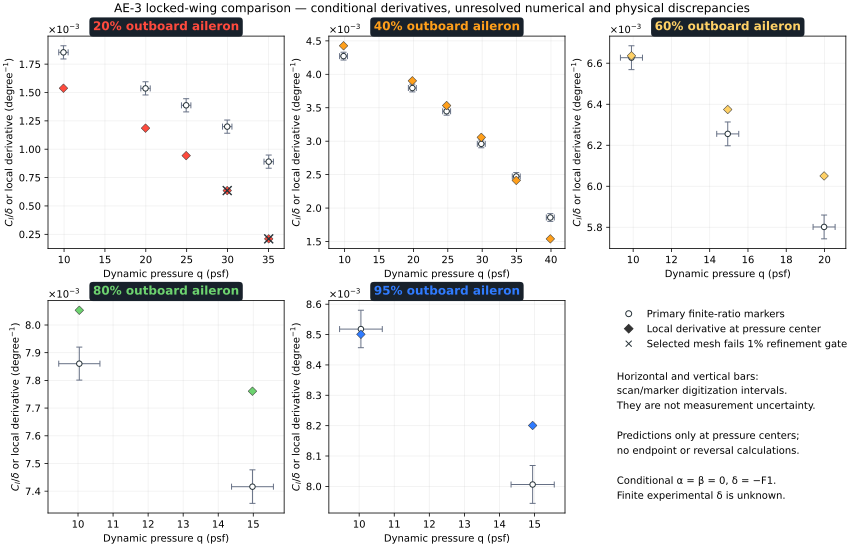

# AE-3 locked-wing comparisons at primary pressure readings

All 18 primary markers across five aileron spans now have conditional local-derivative predictions at their digitized pressure centers. This completes the authorized 70-state evidence stage; **AE-3 remains pending.** These are not experimentally validated control curves or reversal predictions. The [machine-readable report](isae-ae3-locked-control.json) preserves signed coefficients, numerical failures, assumptions and source hashes; the [mechanical comparison](isae-ae3-mechanics.md) and [earlier pilot](isae-ae3-progress.json) remain separate evidence.

The model uses α = β = 0, Mach 0, literal density 1.2256 kg/m³, frozen aerodynamic influences and literal stiffness/section slopes. One file-control unit is interpreted as one degree, with the single convention δ_primary = −F1. The moment coefficient is converted from the literal 0.185 m² reference area to the primary 0.18580608 m² area. Experimental incidence, finite control amplitudes and positive-deflection convention remain unresolved: a measured finite Cl/δ ratio is not automatically the local derivative about zero control.

The study retains 56 initial and 14 additional native states (42 bases and 28 finite-control states). Initial 32→64 refinement has 6 failures; these remain recorded. The original gate uses |fine−coarse|/max(|fine|, 10⁻³⁰) ≤ 1%; an initial denominator transcription error was corrected in a separate saved-data reduction, without rerunning states or relaxing the gate. Final selected meshes use 12 points at 64, 6 points at 128 requested intervals; the largest selected adjacent change is 4.115%, with 2 selected-mesh failures. Maximum fresh and derivative residuals are 5.052e-11 and 8.615e-14. 12/14 centered-control checks at ±0.05° and ±0.025° pass their unchanged gates; **2 centered-control failures remain**, separately from the mesh failures. Individual checks and their original thresholds remain in the report.

**20O-05 at mesh 128, h = 0.025° fails:** the absolute centered-minus-implicit native derivative difference is 3.664942e-09 degree⁻¹, above the unchanged 3.10995e-09 degree⁻¹ limit. **20O-05 at mesh 128, h = 0.05° fails:** the absolute centered-minus-implicit native derivative difference is 3.654156e-09 degree⁻¹, above the unchanged 3.10995e-09 degree⁻¹ limit. Halving h from 0.05° to 0.025° leaves the discrepancy essentially unchanged. The nonlinear equation residuals and implicit derivative linear residual pass; the cause remains unresolved.

| Point | q (psf) | Primary Cl/δ (1/deg) | Predicted derivative (1/deg) | Signed difference (1/deg) | Difference (%) | Mesh | Adjacent change (%) |
|---|---:|---:|---:|---:|---:|---:|---:|
| 20O-01 | 9.9255 | 0.0018538 | 0.0015376 | -0.0003162 | -17.06 | 64 | 0.0382 |
| 20O-02 | 19.9663 | 0.0015363 | 0.0011857 | -0.0003506 | -22.82 | 64 | 0.1542 |
| 20O-03 | 24.9384 | 0.0013871 | 0.0009436 | -0.0004436 | -31.98 | 64 | 0.4039 |
| 20O-04 | 29.9603 | 0.0011993 | 0.0006356 | -0.0005637 | -47.00 | 128 | 1.2000 **FAIL** |
| 20O-05 | 35.0363 | 0.0008907 | 0.0002101 † | -0.0006806 | -76.41 | 128 | 4.1155 **FAIL** |
| 40O-01 | 9.8450 | 0.0042719 | 0.0044268 | +0.0001549 | +3.63 | 64 | 0.6391 |
| 40O-02 | 19.8465 | 0.0037947 | 0.0039026 | +0.0001079 | +2.84 | 64 | 0.8954 |
| 40O-03 | 24.8291 | 0.0034473 | 0.0035326 | +0.0000853 | +2.47 | 128 | 0.1840 |
| 40O-04 | 29.8669 | 0.0029597 | 0.0030568 | +0.0000971 | +3.28 | 128 | 0.2345 |
| 40O-05 | 34.9524 | 0.0024721 | 0.0024133 | -0.0000588 | -2.38 | 128 | 0.3371 |
| 40O-06 | 39.9014 | 0.0018587 | 0.0015393 | -0.0003194 | -17.18 | 128 | 0.6213 |
| 60O-01 | 9.9111 | 0.0066271 | 0.0066361 | +0.0000090 | +0.14 | 64 | 0.4232 |
| 60O-02 | 14.9427 | 0.0062555 | 0.0063743 | +0.0001188 | +1.90 | 64 | 0.4358 |
| 60O-03 | 19.9787 | 0.0058017 | 0.0060503 | +0.0002486 | +4.29 | 64 | 0.4516 |
| 80O-01 | 10.0366 | 0.0078603 | 0.0080531 | +0.0001928 | +2.45 | 64 | 0.1393 |
| 80O-02 | 14.9766 | 0.0074162 | 0.0077608 | +0.0003446 | +4.65 | 64 | 0.0986 |
| 95O-01 | 10.0494 | 0.0085180 | 0.0085007 | -0.0000173 | -0.20 | 64 | 0.5367 |
| 95O-02 | 14.9453 | 0.0080062 | 0.0082006 | +0.0001944 | +2.43 | 64 | 0.5232 |

† At least one same-mesh centered-control check fails its unchanged gate; this remains a numerical discrepancy, with no assigned cause.

Horizontal and vertical bars show digitization bounds from the scanned figure, not laboratory measurement uncertainty or an acceptance threshold. Model predictions are at the pressure centers only; neither pressure endpoints nor a reversal crossing were computed. No source measurements or model properties were fitted. Crosses mark failed selected-mesh refinement. 20O-05 also retains 2 failed centered-control checks, described above.

The ISAE report attributes section lift/moment control slopes 0.0581/−0.0107 per degree to XFOIL, but the literal files mix coefficients: 20O uses 0.0581/−0.0102, 40O uses 0.0686/−0.0107, and 60O/80O/95O use 0.0686/−0.0102 per degree. The specific assignments are unexplained in the inspected sources. The 20O section lift-control slope is 15.306% lower than the others; this is not a whole-wing correction factor. The primary finite-ratio markers remain separate from Pearson/Cole theoretical curves and archived ASWING/ASWING-m predictions.

Four selected 64-panel cases were replayed in actual local Pyodide, including two complete derivative calculations; terminal replay status is **FAILURES_RETAINED**. A separate comparison of the already saved JSON has status **PASS_SAVED_JSON_PORTABILITY_COMPARISONS**. It addresses in-memory integer control keys versus persisted JSON string keys; all 4 original replay failures remain unchanged, and no physical cases were rerun. The saved comparisons pass 62,292 numeric values at unchanged componentwise absolute/relative gates of 2×10⁻⁸; the largest dimensionless tolerance ratio is 0.040804, and the largest fresh normalized residual is 2.4711e-11 against 10⁻⁸. Complete state/output comparisons and every retained failure are included in the report. This covers the kernel API, not the browser interface or finer-mesh extensions. It establishes no original ASWING executable parity.

Further refinement of the remaining mesh failures will follow the derivative-performance investigation; this stage includes no 256-panel cases. Retained centered-control discrepancies also need investigation. Section-control provenance, mechanical specimen/fixture discrepancies and finite-amplitude/incidence/sign conventions remain unresolved. Driven zero-average-moment rolling and reversal comparisons are still unfinished; the diagnostic p column is not a free-roll response. AE-3 remains pending because the local derivative has not yet been shown to represent the primary finite-ratio observable. Partial coverage requires a primary-compatible finite-control convention/amplitude or documented evidence that the finite-ratio distinction is negligible; it does not require every roll/reversal subcase to be finished. Coverage stays **17 partial / 24 pending / 0 fully validated**. These workspace research results do not certify a hosted release.
