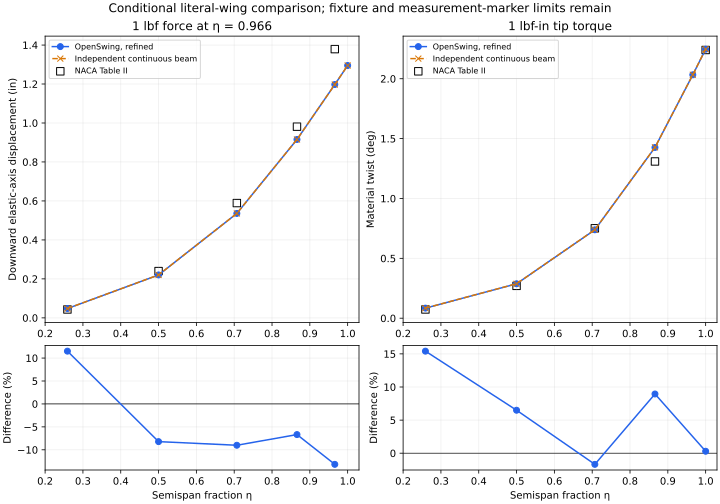

# AE-3 unit-load mechanics and primary pressure readings

The literal wing agrees with an independent continuous beam calculation, but the conditional comparison with the original measured deflections has unresolved discrepancies. **AE-3 remains pending.** No stiffness, source measurements or production kernel code were changed.

This study uses Table II and Figures 11/18 of [NACA TN 2563](https://ntrs.nasa.gov/citations/19930083276). It follows the [source audit and numerical pilot](isae-ae3-progress.json). The [machine-readable report](isae-ae3-mechanics.json) retains conventions, all rows, numerical failures and input hashes; the [raw evidence archive](isae-ae3-mechanics-20261024-evidence.zip) includes scripts, frozen source and complete saved states.

## Unit-load comparison

The two separate tests apply a 1 lbf force at 96.6% semispan on the elastic axis, or a 1 lbf-in tip torque. The reconstruction uses an ideal root clamp, no air, an unloaded opposite half, a fixed body-force direction and a tip couple along the undeformed material span. The displacement marker, exact clamp and torque apparatus were not recovered from the report. The table below uses elastic-axis displacement and material Euler twist; alternative leading-edge and midchord readings remain in the raw evidence.

| Semispan fraction | Measured bend (in) | Computed bend (in) | Difference | Measured twist (deg) | Computed twist (deg) | Difference |
|---:|---:|---:|---:|---:|---:|---:|
| 0.259 | 0.043 | 0.04795 | +11.50% | 0.073 | 0.08425 | +15.41% |
| 0.500 | 0.240 | 0.22027 | -8.22% | 0.270 | 0.28753 | +6.49% |
| 0.707 | 0.589 | 0.53593 | -9.01% | 0.751 | 0.73838 | -1.68% |
| 0.866 | 0.981 | 0.91545 | -6.68% | 1.309 | 1.42609 | +8.94% |
| 0.966 | 1.379 | 1.19738 | -13.17% | — | 2.03293 | — |
| 1.000 | — | 1.29510 | — | 2.240 | 2.24663 | +0.30% |

Missing measurements remain missing. Force predictions use 256 requested intervals and torque predictions use 64. No experimental error bars or pass threshold were invented.

## Numerical evidence

All 12 native states pass the original equation and balance gates; the maximum freshly evaluated normalized residual is 5.303e-13. Actual node counts increase from 24 to 264. Bending refinement initially fails at 16→32 and 32→64; 64→128 and 128→256 pass the unchanged 1e-5 m gate. The final adjacent difference is 2.421e-6 m. Torque refinement initially fails at 16→32; 32→64 passes the original 0.005° gate, with a maximum change of 0.0019374°.

The independently implemented continuous beam agrees with the finest native bending result within 8.28e-7 m at the sampled elastic-axis points. The maximum common twist difference for the torque case is 0.000889°. Its ten original finite solutions satisfy shooting and rotation checks. The original positive-only small-load checks fail because their full-vector comparison retains quadratic in-plane displacement; those failures are preserved. Six additional opposite-load solutions support centered derivatives at two step sizes. All 16 full-component derivative checks pass the unchanged 2e-8 m displacement and 2e-8 rad rotation gates. Maximum errors are 2.17e-10 m and 6.20e-10 rad; maximum adjacent step changes are 1.37e-10 m and 4.24e-10 rad.

Both force64 and torque64 also pass actual Pyodide replay through the public structural API. Complete physical outputs and states agree within the declared componentwise tolerances, with fresh normalized full residuals below 6.60e-14. This is WebAssembly API evidence, not a browser UI check or a new experimental result.

## Pressure readings for the next aerodynamic comparison

Figure 18 was independently re-read using its printed axis ticks. All 18 archived response values fall inside the declared pixel bounds; none of the 18 archived pressure values do. The first 20% aileron point is 9.9255 psf with a digitization interval of 9.3497–10.5014 psf, whereas the archived CSV gives 11.3559 psf. Nominal grid pressures and measured marker coordinates are stored separately. The original CSV is unchanged.

Exact experimental incidence, finite aileron amplitudes and positive-deflection convention remain unresolved. The plotted finite ratio Cl/δ cannot automatically be treated as an infinitesimal control derivative. The next comparison must retain those assumptions and the mechanical discrepancy; it must also distinguish driven zero-moment rolling from a free-roll transient.

The complete goal and the 41-family suite remain incomplete: **17 partial / 24 pending / 0 fully validated**. These workspace results do not certify a new hosted release.
