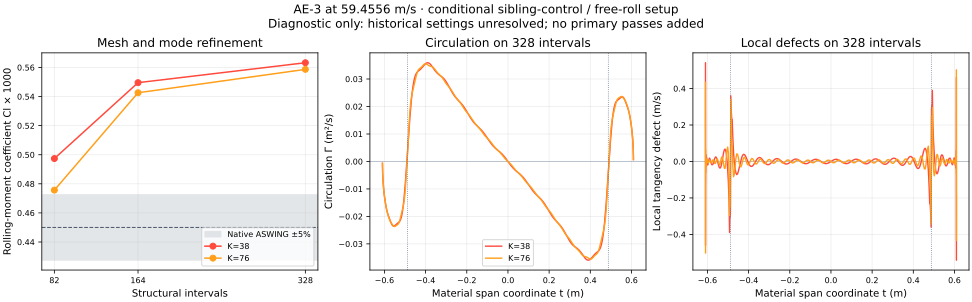

# AE-3: independent mode and mesh refinement

Follow-up, 2026-11-12: the [current-kernel field comparison](isae-ae3-representation-fields-20261112.md)
reproduces the pointwise result and retains the 8.97% gap. Independent field
and load checks pass; the coupled difference is about 10.56 times the direct
fixed-shape circulation effect. Representation convergence remains open.

Observed 2026-11-12 UTC. The last tested truncated-mode and mesh pairs change
by less than **5%**, but **circulation-representation convergence remains
open**: the 76-mode result still differs from the saved pointwise result by
**8.97%** on 328 intervals. Its conditional high-speed rolling coefficient
differs from archived ASWING by **24.16%**. Increasing from 38 to 76 modes
changes Cl by **0.81%** on that grid; refining 164 to 328 intervals at 76 modes
changes it by **2.88%**. Those two small changes are insufficient to rule out
representation error or establish the historical setup.
**Primary AE-3 remains 434/725**.

The figure contains the two truncated Fourier models. The separate saved
pointwise comparison below must also be considered when judging convergence.

| Intervals | Cl, 38 modes | Native error | Cl, 76 modes | Native error | Mode change, relative to K76 |
|---:|---:|---:|---:|---:|---:|
| 82 | .000497363047 | 10.53% | .000475664884 | 5.70% | 4.56% |
| 164 | .000549546198 | 22.12% | .000542613697 | 20.58% | 1.28% |
| 328 | .000563246826 | 25.17% | .000558697531 | 24.16% | .81% |

The native value is **Cl=.000450**. For 38 modes the two adjacent mesh changes
are 9.50% and 2.43%; for 76 modes they are 12.34% and 2.88%. The coarse 82-grid
result is therefore materially resolution-dependent even though its mode-only
change is under 5%. Choosing that closer result would not establish accuracy.
The finest K76 difference is **ΔCl=.000108698**, equivalent to **0.05311 N m**
in the aerodynamic rolling moment under the declared conditions.

## Saved pointwise comparison

| Intervals | Pointwise Cl | Native error | K76 difference relative to pointwise |
|---:|---:|---:|---:|
| 82 | .000578213766 | 28.49% | 17.74% |
| 164 | .000617723783 | 37.27% | 12.16% |
| 328 | .000613774376 | 36.39% | 8.97% |

The [saved-evidence review](../../artifacts/isae/ae3-mode-mesh-k76-20261112/pointwise-review.json)
passes 21 input, node and operator-identity checks. Source text, material nodes,
gravity, controls and operating constraints match; the physical condition
packets differ only in circulation mode count. All three coefficient
differences exceed 5%. The pointwise 164→328 change is only 0.64%, so small
changes within each representation do not establish agreement between them.

The saved runs have four intervening kernel changes: `aero.py`,
`structured_static.py`, `seeded_corrector.py` and `steady_continuation.py`.
They cover the documented matrix optimization, warm correction and checkpoint
fixes. This read-only comparison discloses that source boundary; it is not a
fresh isolation of mode count on one kernel revision. It adds no solves or
primary passes and leaves the earlier assessment and final audit unchanged.
The compared quantity is the independently checked **aerodynamic** Cl in
`report.values`; the net Cl including apparent inertia is nearly zero under
the imposed net-Mx constraint and is not the native reference observable.

## Inputs and numerical checks

This extends the [fixed-38-mode study](isae-ae3-fixed-mode-mesh-20261111.md).
Every physical interval is bisected, retaining the root, flap boundaries and
all original nodes. The audit compares the complete input packets at each
mesh and confirms that **only the mode count changes**. Speed remains
59.4556 m/s, with Mach zero, rho=1.2256, F1=1, frozen-jig influences and the
same geometry, materials, references, wake and core conventions.

The inputs remain the explicitly conditional **sibling dCLdF=.0686 /
dCMdF=-.0102** and **free roll acceleration / net Mx=0** setup. They are not
proven original producing inputs. Original ASWING, ASWING-m and experimental
data remain separate. No parameter was fitted, no mode count was adopted as
a default, and the primary comparison was not rerun or rescored.

The [assessment](../../artifacts/isae/ae3-mode-mesh-k76-20261112/assessment.json)
records **135 passing physical/mesh checks and 15 passing setup comparisons**.
All sections remain unstalled. Fresh full residuals are at most **4.03e-13**.
The finest K76 system contains 4,025 unknowns. The local tangency defect is
reported separately from its converged Fourier projection; a truncated basis
does not enforce pointwise zero tangency defect.

All nine numerical workers exit zero and are reaped. The 82-grid baseline
uses one four-step cold solve; each finer grid uses four serial accepted load
stages. Summed worker CPU times are **1.46, 4.75 and 8.89 seconds** for 82, 164
and 328 intervals. Library preload and parent evidence checks are excluded.
Every numerical child retains one BLAS thread and the unchanged limits of
512 MiB address space, 15 CPU seconds and 25 wall seconds.

## Replay qualification

The new 76-mode cold replay does **not** pass its predeclared exact-equality
control against the earlier two-stage solution. Among 1,073 normalized state
components, 1,054 differ, with maximum difference **7.99e-14**. The maximum
coefficient difference is **7.04e-18**. Both full residuals are about 4.02e-13.
It passes the adapter's existing **2e-10 restore-parity gate**, which is
reported as a separate check rather than replacing the failed zero gate.
The saved failure and original gate remain in the assessment.

This does not invalidate the earlier exact 38-mode matrix/solution controls.
Nor is that earlier exact result generalized to every solve or mode count.
No production source changed during this study.

Two additional K76 assembly controls, at the accepted state and an independent
perturbation, pass **16 checks**: the complete original and optimized matrices,
Newton corrections and physical residuals match exactly. These checks preserve
the small nonzero cold-replay result rather than redefining it as exact. The
[final audit](../../artifacts/isae/ae3-mode-mesh-k76-20261112/final-audit.json)
keeps the checks and the failed zero gate separate. Both additional numerical
workers are reaped, for eleven numerical workers in this study.

## Next investigation

The [current-kernel field comparison](isae-ae3-representation-fields-20261112.md)
now resolves the source boundary and independently checks the accepted
deformed-section aerodynamic fields and moments. The discrepancy remains.
Next test the full coupled tangent response to the omitted local-flow
residual, including tip and control-boundary contributions. The last
truncated-mode pairs alone do not justify deprioritizing resolution or
attributing the remaining native error to historical inputs.

The [earlier native AVL comparison](isae-ae3-native-avl-20261111.md) established
excellent agreement for the actual rigid-wing geometry after matching receiver
and force conventions. It does not by itself validate the current deformed,
Fourier-represented state. Any new comparison must preserve frozen-jig source
positions and distinguish native AVL results from an independently projected
operator diagnostic. Local section moment and apparent-inertia terms must
remain explicit; native AVL does not provide those ASWING terms.

Drela's steady §§3.1 and 5.6 define the circulation representations and their
weighted tangency constraints. Jan Part IV §3.3 distinguishes the mounted and
freely rolling cases and the modified code. The [authoritative index](aswing-authoritative-references.md)
and checksummed source catalog govern this comparison. The native exports
explicitly give Mach zero and PG factor one, so replacing that PG Mach with a
speed-derived value would contradict retained evidence. Historical control
identity and MM constraints remain unresolved. All 113 unavailable references
remain in the primary denominator. No primary votes are added; browser/build
verification remains held.
