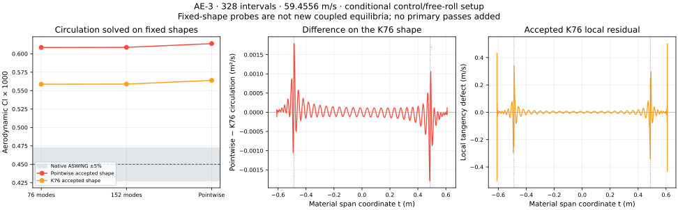

# AE-3: circulation differences amplified by the coupled response

Follow-up, 2026-11-12: the [full coupled tangent check](isae-ae3-coupled-residual-response-20261112.md)
predicts the observed difference within 0.062%. Structural and frame-response
gains are 3.33× and 3.17×; control-boundary flow errors dominate the correction.
All 38 checks pass, without adding native-reference passes.

Observed 2026-11-12 UTC. The **8.97% pointwise/Fourier rolling-coefficient gap
persists on the same current solver code**. Independent aerodynamic field and
load calculations reproduce both accepted states. Changing circulation on a
fixed wing shape accounts for about **9.47% of the total gap**; the changed
wing shape accounts for the other **90.53%** in either of two diagnostic paths.
This narrows the investigation to the sensitivity of the coupled response to
the circulation representation. It does not establish which representation is
converged or validate the archived case. **Primary AE-3 remains 434/725**.

## Current-kernel replay

The pointwise solution on 328 intervals was recomputed from a cold start in
four serial load stages. All **47 physical and continuation checks pass**.
The aerodynamic Cl is **0.0006137743759172373**, differing from the earlier
saved pointwise result by only **5.53e-18**. Its fresh full residual is
**2.61e-13**. All 142 production kernel files match the already completed
76-mode run. Model text, mesh, gravity and operating constraints match; only
circulation representation changes in the physical condition packet.

The corresponding 76-mode Cl is **0.0005586975305304229**. The difference is
**0.0000550768454**, or **8.97% relative to pointwise**. Their errors against
the conditional native target Cl=0.000450 remain **36.39% and 24.16%**.
The intervening optimization, warm-correction and checkpoint changes do not
explain the previously reported gap. No production source changed here.

## Independent field and load checks

Two bounded workers restore the accepted pointwise and Fourier states and pass
**38 checks**. They use the actual deformed section normals, force directions
and moment arms, while preserving the documented frozen-jig vortex sources
and receivers. The inputs remain speed 59.4556 m/s, rho 1.2256, PG Mach zero,
F1=1, sibling dCLdF=.0686, dCMdF=-.0102 and free roll acceleration with net
Mx=0. These control and constraint choices remain conditional historical inputs.

The diagnostic uses the [previously native-verified AVL transcription](../../scripts/avl_vorvelc_reference.py)
for the control-point operator, and direct Biot–Savart integration for the
zero-core bound-receiver field. It does **not** run a new native AVL executable
or substitute AVL for the coupled ASWING formulation.

- Retaining AVL's native core and rounded constant gives relative maximum
  operator differences of **5.71e-9 at control points** and **5.63e-8 at bound
  receivers** compared with OpenSwing.
- Matching the zero-core law and constant gives differences of **1.03e-15**
  and **2.52e-16**, respectively. The bound field is integrated independently
  at 16, 32 and 64 quadrature points; successive matrix differences are below
  **2.41e-22 relative** for this planar geometry.
- Independent recovery of each accepted aerodynamic Cl differs by at most
  **2.17e-19**. Forces, bound velocities and the weighted circulation residual
  also pass their original gates. Independently solved circulation agrees
  within **5.60e-11 m²/s** under the declared linear, fixed-shape diagnostic.

The load reconstruction retains the beam-tangent lift vector, section pitching
moment with its local-Mach correction, quarter-chord arm, profile force and
the tangency-leakage drag term. Apparent inertia remains separate from the
aerodynamic Cl. No force convention or numerical acceptance threshold changes.

## Holding each accepted shape fixed

Each row below is an independent linear circulation calculation with the
specified shape held fixed. The 152-mode entries are **not new coupled
equilibria**. The last digits can differ from the nonlinear accepted state
within the checked residual and recovery gates.

| Accepted wing shape | 76-mode Cl | 152-mode Cl | Pointwise Cl |
|---|---:|---:|---:|
| Pointwise solution | .000608557431 | .000608721646 | .000613774377 |
| 76-mode solution | .000558697532 | .000558859470 | .000563911571 |

Switching pointwise/76-mode circulation on either fixed shape changes Cl by
about **0.000005215**, whereas the coupled solutions differ by
**0.000055077**. The total difference is **10.56 times** the direct fixed-shape
difference. Splitting the gap along either shape gives **9.47% direct
circulation change and 90.53% associated with shape change**. This is an
algebraic comparison along two paths, not a unique causal partition or a
measurement of roll-acceleration feedback alone.

On the Fourier shape, increasing 76→152 modes changes Cl by only about
**0.029%**, while the maximum local tangency defect decreases from **0.5023 to
0.3945 m/s**. Small changes in that integrated output therefore still do not
demonstrate representation convergence. The largest 76-mode local defects
occur near the tips at t≈±0.60919 m; the largest fixed-shape circulation
differences occur around the aileron boundaries at t≈±0.48768 m. Neither a
new default nor a mode count chosen for native agreement follows from this.

## Retained failed reference attempts

The first field worker stopped on a diagnostic Python list/absolute-value
type error. Its corrected successor then exposed four failed checks in the
binary64 **zero-core reference transcription**. Near a collinear exterior
bound segment, subtractive cancellation gave **18675.18** for a unit-circulation
velocity component that direct quadrature and **90-digit arithmetic** both
give as **132.285281003703**. Their relative disagreement is **2.15e-16**.
The original native small-core calculation and OpenSwing's stable zero-core
kernel do not show that large error.

Both failed attempts and their original gates remain preserved. The successful
diagnostic uses independently integrated finite segments and analytic trailing
rays; it does not loosen the failed thresholds or alter production physics.

## Execution and next step

The four cold numerical stages used **7.90 CPU seconds / 8.65 supervised wall
seconds** in total. The two successful independent field workers used **2.30
CPU seconds** in total. Import/preload and parent source verification are
excluded from these numerical timings. All eight numerical children, including
the two failed diagnostic attempts, were reaped. The plot renderer also exits
normally. Every numerical/render child retains one BLAS thread and the limits
of **512 MiB address space, 15 CPU seconds and 25 wall seconds**.

The subsequent [full coupled tangent check](isae-ae3-coupled-residual-response-20261112.md)
now predicts the endpoint difference and separates tip/control-boundary and
structural/frame contributions. It supports the tested response mechanism;
it does not validate the unknown archived inputs or establish every
structural/frame term independently.

Drela steady §§3.1, 4.2 and 5.6, Eqs.62–63, 150–154 and 200–201, specify the
two representations and weighted flow tangency. Jan Part IV §3.3, pp.10–13,
separates the mounted and rolling setups and original versus modified code.
The [authoritative index](aswing-authoritative-references.md) and checksummed
catalog were consulted. Historical model/control/MM settings and all 113
unavailable primary references remain open. No primary passes are added;
browser/build verification remains held.

[Audited inputs, results and receipts](../../artifacts/isae/ae3-representation-fields-r3-20261112/assessment.json)
· [cold replay](../../artifacts/isae/ae3-pointwise-current-20261112/plan.json)
· [independent field plan](../../artifacts/isae/ae3-representation-fields-r3-20261112/plan.json)
