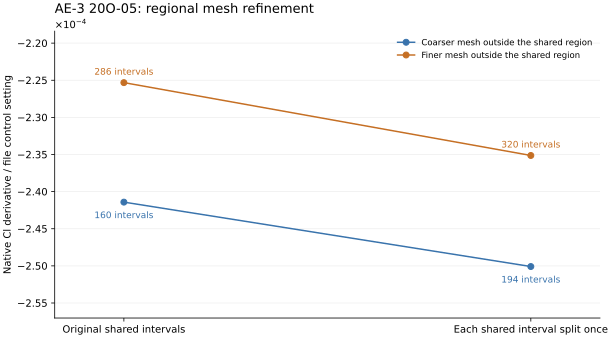

# AE-3 regional mesh refinement

The three predeclared regional mesh comparisons produce **0 passes and 3 failures** against the unchanged 1% native Cl control-derivative criterion. Both new physical derivative cases complete and satisfy their equation checks. This is a finite-grid sensitivity study at 20O-05; **AE-3 remains pending**. The original coupled mesh failures of **2.0773% and 7.1435%** remain recorded.

The earlier 160- and 286-interval meshes shared 34 unchanged intervals around the control boundaries. All 34 were selected for subdivision before the circulation-defect results were available. Splitting each at its saved coarse Glauert sample adds the same 34 stations to both meshes, producing 194 and 320 intervals. All original stations, the root and the control breaks remain. Glauert sampling does not imply uniform halving in material coordinates or a known convergence order.

| Circulation intervals | Source | Native Cl control derivative | Cl roll-rate derivative (descriptive) |
|---:|---|---:|---:|
| 160 | Reused | -0.000241414230842 | -0.94498395 |
| 194 | New | -0.000250089218261 | -0.944883209 |
| 286 | Reused | -0.000225318510512 | -0.94534326 |
| 320 | New | -0.000235130169037 | -0.945242905 |

| Comparison | Region changed | Signed fine-minus-coarse change | Relative change | 1% result |
|---|---|---:|---:|---|
| 160 → 194 | Shared intervals | -8.67498742e-06 | 3.46876% | **FAIL** |
| 286 → 320 | Shared intervals | -9.81165852e-06 | 4.17286% | **FAIL** |
| 194 → 320 | Elsewhere, with shared intervals already split | +1.49590492e-05 | 6.36203% | **FAIL** |

Every relative change uses abs(D_fine−D_coarse)/max(abs(D_fine),1e-30). The denominator and tolerance are unchanged. A passing pair applies only to that pair of finite meshes and cannot erase a previous failure or establish continuum accuracy.

The signed change from refining elsewhere was +1.60957203297e-05 with the original shared intervals and is +1.49590492239e-05 after splitting them. Their difference is -1.13667110576e-06; equivalently, the shared-region refinement changes the coarser and finer outside meshes by -8.67498741919e-06 and -9.81165852496e-06. On these meshes, splitting the shared intervals makes the response more negative, while refining elsewhere makes it less negative; the changes partly offset each other. Their nonzero interaction prevents treating them as independent additive errors. Because the same station lists define aerodynamic, structural and load-transfer discretization, this comparison does not isolate a purely aerodynamic or structural error.

The two new cases use fresh zero-displacement, zero-rotation, zero-force and zero-circulation states on their own networks. No state is restored across topologies. Full physical residuals are checked before and after derivatives against 1e-8; saved full-system linear residuals also pass 1e-8. The recorded column-scaled reciprocal condition indicators are 8.98793e-08 and 7.41891e-08, above the unchanged 1e-10 gate. The independent audit verifies saved products and records the rank evidence without a new rank factorization.

The exact 107-module corrected source, literal model, condition, fixed-acceleration response, standard basis, stability axes and full-API step 1e-5 match the two reused results. Parameters are control.1 and p. Actual parameter and output-direction steps are retained for each mesh; output-direction steps need not be identical merely because the API step is unchanged. The existing analytic circulation columns and complete centered noncirculation probes remain in use. No scientific formula or acceptance threshold changed.

In the revised run, exactly two new networks and two derivative API calls completed. There were no new equilibrium or finite-control solves. Their derivative times were 28.502 and 217.748 seconds in this native diagnostic environment; these are not browser timings. Internal residual evaluations and the existing SVD/LU/multiple-right-hand-side solve are recorded in raw evidence.

The initial independent audit completed 931 checks, including one signed and one absolute saved-system product per new case, then stopped at its 932nd check: a reused-file lookup expected an original path instead of following the intermediate copied-input manifest. Its failed report is retained. The additive completion audit passes 1385/1385 checks, verifies the exact copy chain and unchanged inputs, and completes the remaining comparisons. It reuses the already completed product checks without repeating them. Across these audits there are two signed and two absolute saved-system products, with no new solve or physical evaluation. The path correction changes no numerical result or scientific criterion.

The first attempt constructed both meshes and evaluated their zero base residuals, but stopped before either derivative call: a harness guard compared in-memory integer control keys with JSON string keys. The serialized physical conditions match exactly. That attempt and its 876-check partial-outcome audit and 403-check cause audit are retained. The revised runner changes only the metadata comparison, using JSON normalization before exact equality; physical inputs, formulas and gates remain unchanged. Across both attempts there were four network constructions, two derivative calls, and two additional base-residual evaluations from the failed attempt. Its three mesh comparisons remain recorded as unavailable.

Nonlinear finite-control consistency on the new 320-interval topology has not been tested. Earlier checks belong to their original topology and do not transfer automatically. No result here establishes experimental agreement, resolves 20O-04, or compares with an original ASWING executable. Coverage stays **17 partial / 24 pending / 0 fully validated**. Production source, runtime bundles and hosted release are unchanged.

Next: Check the new 320-interval response against bounded nonlinear finite-control perturbations before transferring any earlier consistency claim. Resolve both regional/global mesh sensitivities and the remaining 20O-04 convergence failure without changing the 1% criterion. Complete experimental amplitude/incidence/sign, section-control provenance and fixture/stiffness matching, then driven-roll and reversal comparisons.

[Machine-readable results](isae-ae3-two-axis-mesh.json) · [Circulation diagnosis](isae-ae3-circulation-defect.md) · [Original corrected mesh comparison](isae-ae3-analytic-global-mesh.md) · [Evidence archive](isae-ae3-two-axis-mesh-20261024-evidence.zip)
