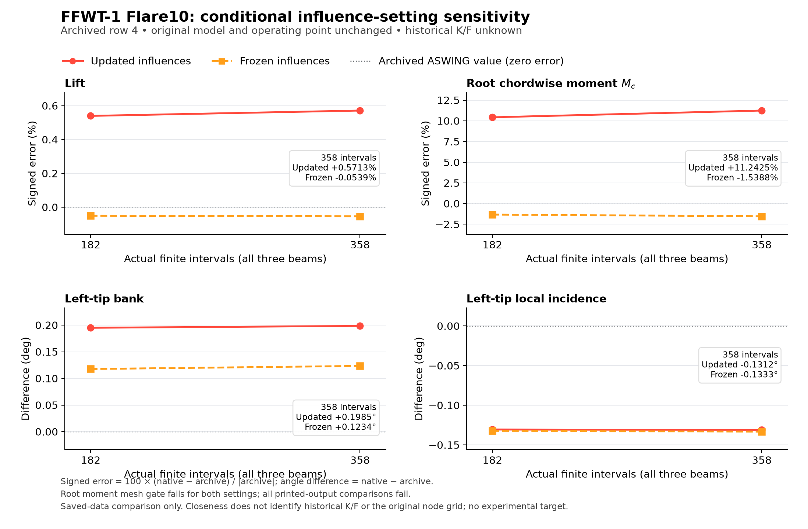

# Original FFWT comparison: frozen versus updated influences

Using ASWING's documented frozen-influence option substantially reduces the load
difference in the selected original FFWT case, but does not reproduce all four
archived outputs. The historical option remains unknown. **No solver default,
model property or accuracy gate changed.** Experimental agreement is optional;
the target is still the tested ASWING calculation.

## Paired comparison

Both cases use the unchanged Flare10 file, archived row 4 at 5° and commanded
IAS 20.941885325558797 m/s, and the same declared atmosphere, constraints,
physical indices, controls and 182/358-interval meshes. The sole request change
is `freeze_influences: false` to `true`. Both meshes were selected before
execution; finer execution depended on physical checks, not reference agreement.

| Fine-mesh output | Archived ASWING | Updated influences | Frozen influences |
|---|---:|---:|---:|
| Lift, N | 8.23892 | 8.28599214 | 8.23448170 |
| Root chordwise moment, N·m | 0.0505454 | 0.05622796 | 0.04976763 |
| Left-tip bank, degrees | 6.17936 | 6.37781691 | 6.30274578 |
| Left-tip airflow incidence, degrees | 4.59708 | 4.46587536 | 4.46373877 |

Frozen influences reduce the lift difference from **+0.5713% to −0.05387%**
and the root-moment difference from **+11.2425% to −1.5388%**. Bank differs
by +0.12339°, versus +0.19846° with updated influences. Airflow incidence is
slightly worse: −0.13334°, versus −0.13120°. None of the eight coarse/fine
channel comparisons matches the archive's printed precision.

Three of four frozen-case mesh checks pass the original 0.1% criterion.
Root moment changes **0.21276%**, so it still fails. The other changes are
0.00328% for lift, 0.09171% for bank and 0.02385% for airflow incidence.
The maximum saved full velocity magnitude falls from 148.53 to 20.93 m/s on
the fine mesh. This is consistent with the earlier diagnosis of strong
updated-geometry hinge interactions, but it is a different documented
aerodynamic approximation, not an accuracy-preserving optimization.

All 82 physical/restoration checks pass. Fresh residual maxima are
1.07×10⁻¹³ and 2.40×10⁻¹³. The two cold native solves take 9.42 and 15.09 s.
These timings describe this option and host, not equivalence with the updated
physical equations or a general speed guarantee.

## What the source audit establishes

The [Drela user guide](https://web.mit.edu/drela/Public/web/aswing/aswing_doc.txt)
defines K/F as freezing influence matrices at undeformed geometry and zero
wind angles, or updating them using current geometry and wind. Its example
menu shows the frozen option, but does not establish the original FFWT run's
setting. The archived script sets the iteration limit without toggling F;
startup settings files could also affect the run and are not retained.

The [steady theory](https://web.mit.edu/drela/Public/web/aswing/asw_theory.pdf#page=32)
uses the bound-vortex receiver for lift and a different control point for
tangency. The guide and [version notes](https://web.mit.edu/drela/Public/web/aswing/version_notes.txt)
explicitly give zero mutual vortex cores to beams sharing a physical index.
No inspected rule requires merging adjacent hinge endpoints or dropping
cross-beam bound-vortex interactions. Their exact historical endpoint and
force-quadrature construction remains unproved. The existing finite-incidence
steady/unsteady receiver ambiguity is recorded separately in the
[Durrant source audit](durrant-source-audit.md); it is not a new established bug.

The [grid audit](isae-ffwt-influence-grid-audit.json) also finds no recoverable
original node arrays. NODE/I requests nodes, while the current comparison
uses interval requests plus attachment stations. The tiny current hinge cells
come from cosine endpoint clustering, not added interior weight stations.
The center beam's doubled control data creates a documented ASWING zero-length
interval that consumes a node; OpenSwing uses one vertex with sided traces.
Matching total counts alone would therefore not recover the historical grid.

The [primary-source audit](isae-ffwt-influence-source-audit.json) and
[implementation review](isae-ffwt-influence-implementation-audit.json) found no
proven correction to justify changing the vortex kernel, adding a core or
altering physical inputs. The setting comparison changes what to investigate
next, without promoting the case to a reference pass.

## Browser and evidence

The sole offline browser solve takes **23.80 s**, after a separate 26.66 s
runtime initialization. All 1,062 checks pass, including 50,308 numerical
comparisons with native output under `2e-8 + 2e-8*abs(reference)`. The maximum
absolute difference is 2.87×10⁻⁹, including predictor diagnostics. The result
and [checked frozen project](../../examples/isae-ffwt-frozen-project.json)
restore exactly without solving. No page errors or offline HTTP requests occur.

The [machine report](isae-ffwt-influence-choice.json),
[vector plot](isae-ffwt-influence-choice.svg) and
[evidence archive](isae-ffwt-influence-choice-20261026-evidence.zip) retain
the paired requests, source pins, old/new results, original physical and
reference gates, browser evidence and independent audits. Two new native
FFWT solves and one browser solve were performed, with no automatic retries.
Earlier original and startup reports/projects retain their own identities.

Remaining work is to resolve the required archived outputs and historical
setup/discretization, including the residual moment mesh sensitivity. Seven
other original coordinates remain untested in this pilot. A closer frozen
result does not prove that the original executable used that option.
