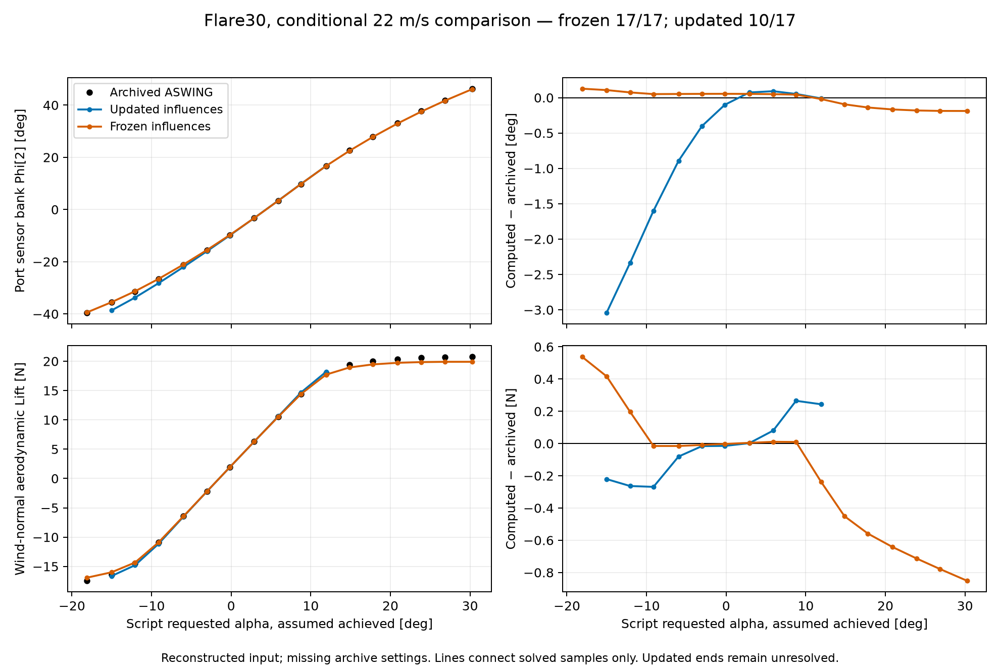

# FFWT-1 archived curve and independent finite-chord reference

Updated 2026-10-15. Production remains integrated08 with unchanged accuracy
gates and defaults. This extends the [single-point study](isae-ffwt1-hinge-aero-08.md).
ISAE coverage remains **17 partial / 24 pending / 0 fully validated**; FFWT-1
experimental validation is still pending. No original ASWING executable is
available.

## All 17 archived Flare30 incidences

The comparison retains every row of `FFWT_Flare30_V22.txt` and its associated
script request, from −18.0947083° to +30.2638899°. The calculation assumes true
speed 22 m/s, the requested global incidence achieved, zero sideslip, level
body/Earth attitude and the source sea-level atmosphere. It uses the explicitly
reconstructed input and 100/40/40 requested intervals. Actual producing model
bytes, constraints, atmosphere, realized mesh, circulation order, initial branch
and K/F settings remain unknown.

Each influence option starts from its already computed row-7 root. Decreasing
and increasing incidence sequences start independently there. This is a declared
numerical continuation, not reconstruction of the archive's original branch.
No archived or experimental angle is used as a seed or fitting target.

| Recorded result | Updated influences | Frozen influences |
| --- | ---: | ---: |
| Accepted requested points | 10/17, rows 2–11 | 17/17 |
| Maximum circulation residual | 4.75e−13 | 1.34e−13 |
| Maximum torque imbalance (N m) | 2.80e−15 | 4.48e−13 |
| Maximum absolute bank difference (degrees) | 3.03982 | 0.18812 |
| RMS bank difference (degrees) | 1.35064 | 0.11138 |
| Maximum absolute Lift difference (N) | 0.26882 | 0.85132 |
| Maximum absolute full-flow sensor-alpha difference (degrees) | 1.22597 | 0.14852 |

Error statistics apply to each column's retained points, so the ranges differ.
They are reported discrepancies, not an accuracy acceptance test. The frozen
option's close bank agreement does not establish which K/F setting produced
the archive. Its largest lift difference occurs at the highest incidence and
is about 4.10% of the archived lift. Both possible support-side moment traces
and both implemented sensor-flow conventions remain in the recorded results.
Phi[2] is sensor bank, not physical hinge fold; alpha[2] is local sensor flow
angle, not global incidence. The experimental Fig. 7.13 hinge-angle curve is
preserved separately and has not been merged with these numerical observations.

[Figure PDF](isae-ffwt1-curves-08.pdf) · [comparison CSV](isae-ffwt1-curves-08.csv)

Updated influences encounter the local section-normal Mach guard at the
unresolved ends. Adaptive continuation reaches internal incidences
−17.67344165° and +14.67984378°, but cannot reach archived row 1 or rows 12–17
within the declared minimum 0.01° interval. All 22 failed attempts remain
recorded. The frozen curve requires no failed outer step. The original
1e−12 circulation and 1e−12 N m torque gates remain unchanged.

Independent saved-array checks cover all 27 reported points, all 61 attempt
seed transitions and 493 wrapped reference evaluations, including 22 failures.
Each accepted point also has a prescribed-circulation sensor postprocessing
call; those calls are additional to the wrapped evaluation counter. A reviewer
initially expected nonzero influence wind angles under K/F; that incorrect audit
assumption and its correction are retained.

The concurrent native runs took 102.17 seconds for the partial updated curve
and 65.87 seconds for the complete frozen curve, including postprocessing.
These are reduced-reference observations under concurrent work, not controlled
benchmarks or browser/full-network solver timings.

## Highest-incidence mesh check

The endpoint with the largest frozen lift discrepancy was selected for
refinement without changing any physical parameter. Each mesh starts from the
same computed 100/40/40 endpoint, not a measured angle.

| Main / each tip intervals | Port bank (degrees) | Lift (N) | Result |
| --- | ---: | ---: | --- |
| 50 / 20 | 46.09932459 | 19.90351569 | strict gates pass |
| 100 / 40 | 46.10658411 | 19.90208138 | previous curve point passes |
| 200 / 80 | 46.10786463 | 19.90161283 | strict gates pass |
| 400 / 160 | — | — | inner circulation gate fails |
| Archived ASWING | 46.29470000 | 20.75340000 | producing setup incomplete |

The accepted 50-to-200 lift change is only −0.001903 N, while the difference
from the archive at 200 is −0.851787 N. This check does not explain the lift
discrepancy through those mesh changes. It does not prove convergence order or
justify extrapolation. The 400 trial reaches a circulation residual of
1.0398516e−12 and is rejected; it supplies no accepted equilibrium. Its partial
torques are not an endpoint solution.

The study's own timer records 157.39 seconds, below its 180-second cap. An
external process elapsed-time display was inconsistent; a contemplated stop
found the process already terminal before sending any signal. The earlier
commentary was corrected. This is a numerical rejection, not a timeout.

All 23 refinement evaluations and both new accepted states were independently
checked from saved arrays. Their saved `sensor_airflow` fields have not received
the curve harness's deformed sensor-position postprocessing and must not be
used as refined local sensor-alpha evidence. Bank, Lift and moment outputs do
not depend on those fields.

An additional fixed-pose diagnostic replays the rejected 400/160 state with
its saved circulation. One Newton correction using the existing residual and
analytic Jacobian reduces its circulation residual from 1.0398516e−12 to
3.7475294e−13, with a maximum circulation step of 4.32e−15. It changes no
physical parameter, pose or acceptance gate. This shows that the rejected
inner residual can be improved; it is not evidence of an unavoidable rounding
floor. The maximum remaining hinge imbalance is 9.68e−6 N m, so this diagnostic
still supplies **no accepted 400/160 equilibrium**. The correction is isolated
from production and makes no browser performance claim.

## Independent aerodynamic reference

A separate implementation now assembles incompressible vortex-ring influence
matrices, solves no-penetration circulation, and computes full-vector segment
loads and moments. It imports no OpenSwing modules. It extends the previously
checked oblique-hinge geometry with quarter-panel ring fronts, full-panel side
vectors, three-quarter-panel collocation and straight semi-infinite trailing
wakes. Exact trailing-edge bound cancellation and logical shared-edge
connectivity are explicit; coordinate proximity does not choose neighbors.

Healy's printed equation 3.78 does not unambiguously define usable closed-ring
loads: its literal same-velocity closed-loop sum vanishes. The reference
therefore declares a separate [Lambert et al. (2017), equation 4](https://eprints.usm.my/37284/1/%28Vortex_Lattice_Simulations%29_aerospace-04-00022.pdf)
segment-midpoint Kutta–Joukowski load model. It retains crossflow, circulation
differences, total induced velocity and actual segment moment arms. It is not
claimed to reproduce the thesis author's implementation.

The final `kernel-collinearity-v3` passes 73 boundary controls, 17 load controls
and 15 supplementary edge controls. These include analytic segment velocities,
independent quadrature, zero incidence, symmetry, forcing linearity, force signs,
moment-reference translation, skew crossflow and explicit own-edge principal
value handling. They are not 105 independent aerodynamic benchmarks. No core,
distance cutoff or relaxed residual gate is added.

Review found and corrected represented on-filament and endpoint cases in the
new reference kernel: normalization could otherwise create a false tiny radial
distance or misclassify an endpoint. Final classification uses raw cross and
dot products. Earlier source versions, failed controls and counterexamples are
retained; all relevant controls were rerun against v3. Production kernels are
unchanged.

Flat-wing refinement reaches 1,152 panels. At 5° the final reference gives
CL = 0.44523074 and CD = 0.00515940. Successive circulation-profile changes
shrink, while drag refinement is not monotonic. These are internal refinement
checks, not externally established accuracy. The maximum recorded boundary
residual is 1.95e−14 m/s; the canonical load graph has its own boundary checks.
Trefftz-force comparison remains unimplemented.

The reference uses thin-surface potential flow, not the archive's 5.7897/rad
section slope, stall model or compressibility correction. Half-chord hinge
datum, grid blending, rigid main-wing assumption and prescribed wakes remain
explicit modeling choices. These controls alone do not validate folding-wing
physics.

## Independent two-hinge equilibria

The finite-chord reference now also solves both tip angles at nominal true
speed 22 m/s and zero incidence/sideslip. Every trial reassembles and solves
the aerodynamic system. Tip forces use the tip's signed edge circulation
contribution and the total local velocity from all surfaces. Shared edges
on the hinge axis have zero hinge-axis moment. Gravity acts at each rotated
point-mass center; the declared small restoring spring is 1e−6 N m/rad.

The conditional fixture uses hinge span 0.365 m, tip mass 0.061 kg, and
initial tip centers at [0.0139, ±0.4243, 0] m in aft/starboard/up coordinates,
with primary 30° hinge axes. Gravity is 9.81 m/s² and density is 1.2256 kg/m³.
The main wing remains rigid and fixed. There is no friction or physical
contact model; the ±125° trial bound is only a numerical guard.

Each mesh starts independently from the same previously computed nominal
root. No experimental angle initializes the solve, and symmetry is not
imposed. The calculation retains all 30 evaluations.

| Total panels | Chordwise × (main + each tip + each tip) | Port physical fold (degrees) | Maximum boundary residual (m/s) | Maximum hinge imbalance (N m) |
| ---: | --- | ---: | ---: | ---: |
| 56 | 2 × (16 + 6 + 6) | −9.18065968 | 2.66e−15 | 5.88e−15 |
| 224 | 4 × (32 + 12 + 12) | −9.65736115 | 1.38e−14 | 1.55e−15 |
| 896 | 8 × (64 + 24 + 24) | −9.92656068 | 5.84e−14 | 5.17e−16 |

All three roots pass the unchanged 1e−12 m/s boundary and 1e−12 N m torque
gates. Independent saved-array review checks all states, force attribution,
gravity and source pins, without another aerodynamic solve. The timed native
three-mesh solve and result logging take 15.05 seconds, excluding source loading
and preliminary mechanical checks. This is an isolated two-angle reference,
not a full-network or browser timing.

The last port-angle refinement still changes the result by −0.26920°.
No converged mesh limit, physical branch connection or dynamic stability is
established. Differences from the previous lifting-line roots combine mesh
and declared aerodynamic-model changes; they cannot yet identify an OpenSwing
implementation error or explain the experimental discrepancy.

## Evidence and remaining work

The [machine-readable index](isae-ffwt1-curves-08.json) and
[selected evidence package](isae-ffwt1-curves-08-evidence.zip) record exact inputs,
source versions, arrays, failures and review results. The
[verification record](isae-ffwt1-curves-08-evidence.json) covers fresh extraction,
payload hashes and reconstruction of the recorded-result index; it does not
claim numerical replay of every study. No app rebuild is required
for these isolated reference calculations and validation documents. Previously
audited app downloads retain their existing contents.

Remaining work includes explaining the archived high-incidence load difference,
resolving updated-influence mesh/branch limitations, using the independent
reference for mesh-converged and matched-model comparisons, matching the
physical fixture and spatial flow field, and completing dynamic
response/stability validation. Complete
historical FFWT raw-study packaging is still unfinished.
