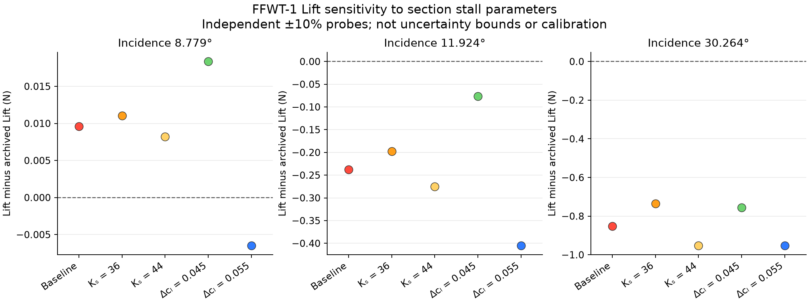

# FFWT-1 lift discrepancy diagnostics

Updated 2026-10-15. The archived high-incidence Lift discrepancy remains
unresolved. Force-definition checks, independent aerodynamic controls and
controlled stall-parameter perturbations narrow the possible explanations;
they do not establish experimental agreement. Production source and defaults
remain at the verified circulation-correction release. ISAE coverage remains
**17 partial / 24 pending / 0 fully validated**.

## Force definition and decomposition

Drela's [steady formulation](https://web.mit.edu/drela/Public/web/aswing/asw_theory.pdf),
equations 67, 70 and 185, specifies the circulation force, profile force and
wind-axis Lift projection used by this comparison. Independent arithmetic
reproduces all 27 accepted updated/frozen curve projections. The saved cases
have no body, engine, apparent-mass, circulation-rate or point-drag force;
gravity contributes to root moments, not aerodynamic Lift.

The following decomposition uses the original frozen-influence endpoint at
30.2638898547° and the 100/40/40 requested mesh, with 184 realized panels:

| Quantity | Force or Lift in N |
| --- | ---: |
| Circulation-force contribution to Lift | 20.02225319 |
| Stall-related profile contribution to Lift | −0.12017181 |
| Total computed Lift | 19.90208138 |
| Archived Lift | 20.75340000 |
| Computed minus archived Lift | −0.85131862 |
| Magnitude of the computed force vector | 20.58616812 |

Even the computed force magnitude is smaller than archived Lift, so changing
only the unit projection axis cannot close this gap. Removing the profile
contribution also cannot explain it. At fixed circulation, replacing local
velocity by freestream velocity in the circulation force gives 20.34649392 N;
this is a diagnostic component, not a new equilibrium or an alternate force law.

All 17 frozen points pass independent force decomposition, including scalar
cross products and quaternion-based tip-span rotations. The largest discrepancy
in the reconstructed leakage/profile force is below 1e−14 N. The archive's
MATLAB plotting script uses a different incidence abscissa at the last row;
the current comparison already uses the scripted operating request. Neither
that plotting difference nor substituting the distinct Trefftz coefficient
provides a justified correction to the documented Lift comparison.

## Controlled stall parameter sensitivity

The published central values are `K_s = 40` and `delta_cl = 0.05`:
[Jan, Part I, page 18](https://raw.githubusercontent.com/rom1isae/ISAE_Aswing_Experimental_Validation/f62943df20e9e4d7d9f50e070477b22426b5f865/5%20-%20Technical%20Reports/Experimental_validation_of_ASWING_Part_1_Aerodynamics_V4.pdf).
The archived executable's realized settings remain unrecorded. Independent
±10% perturbations are predeclared numerical probes, not a proposed default
change, a fit, or experimental uncertainty bounds.

Fifteen two-hinge equilibria cover incidences 8.779176°, 11.923603° and
30.263890°. Each starts independently from the same row's previously computed
root. Geometry, section limits, speed, density, mesh, frozen influences and
accuracy gates are fixed. No archived fold angle or load initializes a solve.

| Parameter change | Lift change at 8.779° | At 11.924° | At 30.264° |
| --- | ---: | ---: | ---: |
| `K_s` 40 → 36 | +0.001437 N | +0.040384 N | +0.115379 N |
| `K_s` 40 → 44 | −0.001431 N | −0.037325 N | −0.101303 N |
| `delta_cl` 0.05 → 0.045 | +0.008729 N | +0.161184 N | +0.094842 N |
| `delta_cl` 0.05 → 0.055 | −0.016110 N | −0.167560 N | −0.101346 N |

All 15 states pass the unchanged 1e−12 normalized circulation and 1e−12 N m
hinge gates. Maximum circulation residual is 2.375e−13; independently
reconstructed hinge imbalance is below 9.60e−17 N m. The largest fold change
is 0.045314°. Both root-moment traces, bank and local sensor incidence are
retained and independently checked alongside Lift.

The closest high-incidence result in this declared set still falls short by
0.735939 N. The probes therefore do not close the discrepancy, and their range
does not bound every possible model or operating-setting difference. The study
records 136 wrapped evaluations plus 15 supplied-circulation sensor replays.
Its 74.64-second native timing covers the isolated two-hinge study, including
setup and postprocessing; it is not a browser benchmark.

[Figure PDF](isae-ffwt1-lift-diagnostics.pdf) · [all five outputs in CSV](isae-ffwt1-lift-diagnostics.csv)

## Independent aerodynamic comparison

A separate vortex-ring implementation matches OpenSwing at 5° and
30.2638898547° for a flat 32-panel common model: 2π section slope,
incompressible flow, frozen x-directed wakes, no stall or profile coefficients,
and explicitly identical quarter-chord, collocation and force points. The
independent operator and load implementations do not import OpenSwing kernels.

At the higher incidence, maximum circulation difference is 2.22e−15 and maximum
force-component difference is 2.13e−14 N. Both give wind-axis Lift
58.09506731 N. Both dimensional boundary residuals are below 3.38e−14 m/s.
Bound-segment and complete segment loads are retained separately; their total
Lift agrees in this flat symmetric case. Independent saved-array review checks
forces, both moment vectors, geometry and circulation.

This control deliberately uses physical arithmetic midpoint stations. It does
not substitute for the app's default Glauert stations, which differ by up to
0.00775049 m on this boundary grid. Two preflight failures remain recorded:
an incorrect diagnostic mesh-settings dictionary and a 3.47e−18 m difference
between two algebraically equivalent collocation-point constructions. Neither
failure reached a scientific solve. The corrected test uses one explicit
quarter-plus-half-chord construction and retains exact geometry checks.

The comparison checks the shared attached-flow equations and implementation.
It does not establish high-incidence physical validity, folded-wing frozen
semantics or archived ASWING executable equivalence.

### Nonlinear section control

The same flat common model was also checked with the published nonlinear
section law, `K_s = 40`, `delta_cl = 0.05` and section limits ±1.15. At 5°,
the independent and native solutions pass the declared control gates; their
force components differ by at most 5.33e−15 N.

At 30.2638898547°, the independent solver initially returns a dimensional
boundary residual of 2.87681e−12 m/s, above this control's predeclared
1e−12 m/s limit. That failure is retained. A separate bounded finite-difference
Newton correction reduces the independent residual to 3.46390e−14 m/s, changing
circulation by at most 2.08e−14.

The subsequent native solution passes this study's 1e−12 normalized
requirement with a residual of 1.43269e−13. OpenSwing's standalone convergence
threshold is 1e−8 normalized; its terminal correction targets 1e−12. Direct
independent evaluation gives 3.15459e−12 m/s, which fails the stricter
dimensional control limit. The full high-incidence nonlinear comparison
therefore remains unaccepted. Saved force components agree within 9.24e−14 N;
this arithmetic agreement does not override the failed gate. Both original
failures, all trial arrays and the independent recovery are retained. No native
correction, threshold change or production-source change was made for this
control.

## Evidence and remaining work

The [recorded-result index](isae-ffwt1-lift-diagnostics.json),
[selected evidence](isae-ffwt1-lift-diagnostics-evidence.zip) and
[extraction verification](isae-ffwt1-lift-diagnostics-evidence.json) retain
contracts, source versions, arrays, original failures and independent reviews.
Index reconstruction verifies recorded evidence; it does not rerun the studies.

The remaining physical comparison must reconcile the producing model and
folded-wing aerodynamic assumptions while checking Lift, root moments, bank
and local flow together. Updated-influence branch limitations, fixture and
spatial-flow matching, and dynamic response remain open. App defaults and
numerical source are unchanged by these diagnostics; the earlier audited
app downloads retain their release contents.
