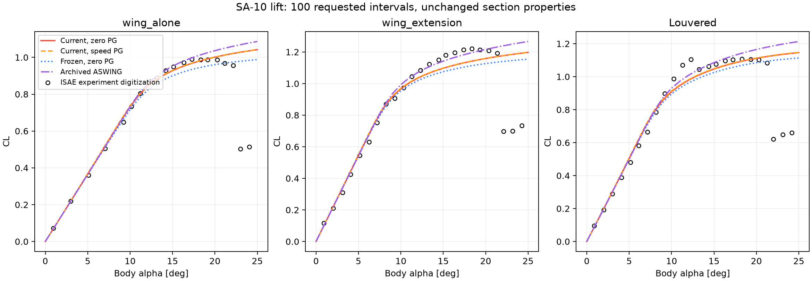
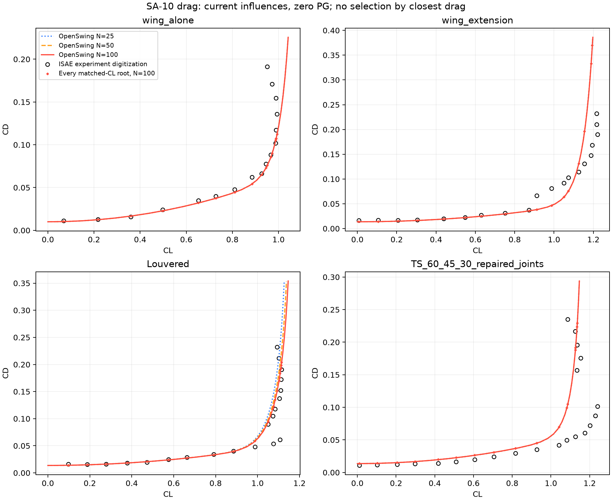
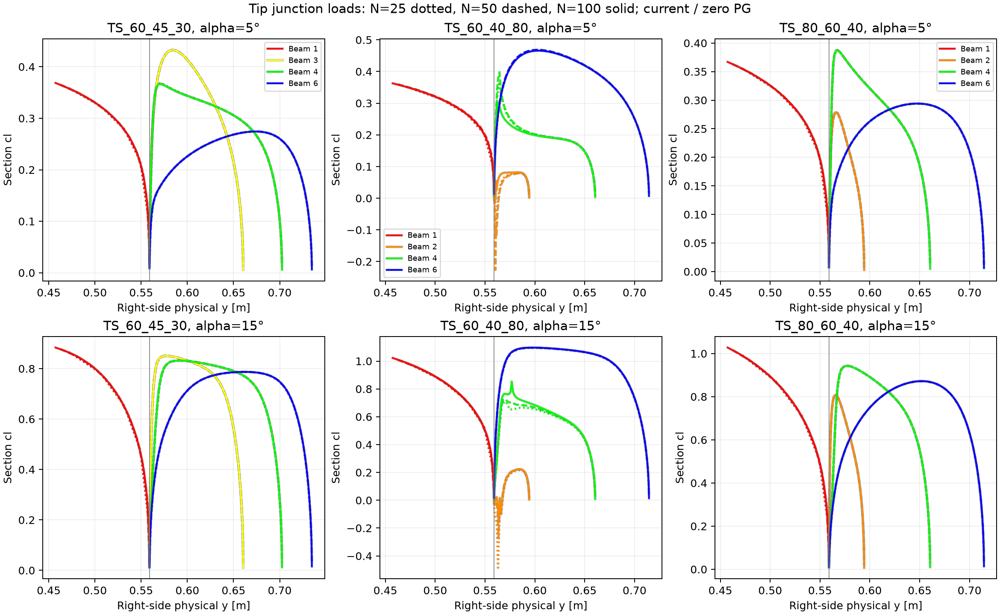

# SA-10 winglet and tip-sail validation

**Status: partial quantitative comparison; no experimental validation pass.**

The newer [SA-10 stall/junction comparison](isae-sa10-stall-junction-20261031.md)
targets archived ASWING outputs at the provisional 3% tolerance. It completes
all 162 planar states and independently diagnoses the tip-root Mach rejection.
The broader experimental study below remains historical context; its mesh
grid and metrics are separate from that comparison.

The unchanged production solver completed 2,238 of 2,676 requested polar states; 438 were rejected and remain in the report. Five literal geometries are runnable. The sixth, `TS_60_45_30`, parses but rejects mesh construction because the first two root joints name the opposite-side beams. Its separately labeled reconstruction swaps only those two beam references. The literal source is preserved.

The [explicitly reconstructed input](isae-sa10-TS_60_45_30-repaired-joints.asw) can be loaded directly into OpenSwing. Its bytes match the audited reconstruction used in the numerical and browser checks; it is not presented as an unmodified upstream file.

## Sources and setup

[Romain P. Jan’s ISAE archive](https://github.com/rom1isae/ISAE_Aswing_Experimental_Validation/tree/f62943df20e9e4d7d9f50e070477b22426b5f865) is pinned to revision `f62943df20e9e4d7d9f50e070477b22426b5f865`. The [source audit](isae-sa10-sources.json) retains all 30 SA-10 files with hashes, the six inputs, archived 82-column polars, unexecuted shell scripts, CSV row mappings and the exact joint reconstruction. The setup discussion is Jan, *Experimental validation of ASWING, Part I: Aerodynamics*, SA-10 / Figure 21.

The cited primary experiment is D. S. Miklosovic, [“Analytic and Experimental Investigation of Dihedral Configurations of Three-Winglet Planforms”](https://doi.org/10.1115/1.2948372), J. Fluids Engineering 130(7), 071103 (2008). Only publisher-deposited metadata and abstract parameters were recovered: effective wing aspect ratio 6.29, winglet aspect ratio 4.6 and Reynolds number 600,000. Full geometry, normalization, tunnel corrections and uncertainty remain unverified. The 2005 conference study is a different source and is not substituted.

All runs use 55 m/s and the input density, reference dimensions and section properties. Each state starts independently with the production nonlinear model, tolerances, wake-core rules and continuation unchanged. The grid has 25/50/100 requested intervals per beam, current/frozen influences and zero/speed-derived PG Mach. Seven-segment tip models contain 176/350/700 actual strips. Lift is additionally solved at every experimental angle. The original shell files put K/F after defining the operating-point stack but **before the first XX solve**. The guide's displayed F=T default supports current influences after that toggle; actual executable defaults and saved settings remain unrecorded. The current/frozen and PG variants in this historical study remain separately reported sensitivities.

Important source limits:

- The supplied schematic shows slotted extension/louvered tips; the literal single-beam models are continuous surfaces. Archived tip-sail span/chord is about 4.06, versus 4.6 in the primary abstract.
- The 60/40/80 and 80/60/40 files use different section properties and half the reference span of 60/45/30. They are not isolated cant-angle changes. In increasing physical x, the file named 60/40/80 actually orders its right tip angles approximately 40/60/80.
- The 60/45/30 input also has asymmetric friction drag: beam 2, the left leading sail, explicitly sets Cdf=0.01 in addition to Cdp=0.01; its right counterpart sets Cdf=0. This setting is preserved in the joint reconstruction. The independent zero-incidence drag check includes both terms and records each beam contribution; symmetric lateral forces/moments cannot be assumed.
- Only the baseline, extension and louvered configurations have measured lift curves. The measured tip-sail drag curve is labeled 60/45/30; it is not assigned to the other two variants.
- The planar drag CSV stores CD,CL; the tip-sail CSV stores CL,CD. The mapping is explicit. All six archived polars repeat alpha=12° identically; those rows are retained but counted once in statistics.

## Comparison with the digitized measurements

The following lift errors use current influences, zero PG and 100 requested intervals. They include post-stall samples and have no uncertainty-based acceptance band.

| Configuration | Compared / requested | CL bias | CL RMSE | Maximum absolute CL error |
|---|---:|---:|---:|---:|
| wing_alone_literal | 19 / 19 | +0.06170 | 0.17161 | 0.52616 |
| wing_extension_literal | 24 / 24 | +0.04128 | 0.17389 | 0.48668 |
| Louvered_literal | 24 / 24 | +0.05310 | 0.17951 | 0.50793 |

For a separate, fixed 0°–8° low-angle window, least-squares slopes use exactly the same measured angles on both sides. The small sample counts and absent uncertainty prevent an acceptance claim.

| Configuration | Samples | CL RMSE, 0°–8° | Lift-slope difference |
|---|---:|---:|---:|
| wing_alone_literal | 4 / 4 | 0.01036 | +4.1% |
| wing_extension_literal | 7 / 7 | 0.02843 | +6.3% |
| Louvered_literal | 7 / 7 | 0.03241 | +10.1% |



Drag is compared at matched CL using bracketed nonlinear solves on every sign-changing adjacent converged polar interval, at 50 and 100 intervals. Failed intervals are not bridged, values are not extrapolated and multiple roots are not reduced to the best drag match. The CSV supplies no angle for these drag observations. “Single observed root” applies only to the sampled 0°–25° domain and the independent solver’s branches; it is not a proof of global uniqueness.

| Configuration, N=100 | Single observed root | Multiple roots | No resolved root | CD RMSE, single-root subset |
|---|---:|---:|---:|---:|
| wing_alone_literal | 17 | 0 | 0 | 0.03665 (n=17) |
| wing_extension_literal | 17 | 0 | 3 | 0.06983 (n=17) |
| Louvered_literal | 21 | 0 | 0 | 0.03937 (n=21) |
| TS_60_45_30_repaired_joints | 17 | 0 | 5 | 0.05179 (n=17) |

Subset errors use only single observed roots with no failed scan intervals or root solves; their sample counts are explicit. They do not establish agreement over missing or ambiguous points. Every root, failed bracket, matched-lift residual and original CSV row appears in the [fixed-lift report](isae-sa10-drag.json).



## Archived ASWING and numerical checks

| Configuration, current / zero PG / N=100 | Compared / requested | Archived CL RMSE | Archived CD RMSE |
|---|---:|---:|---:|
| wing_alone_literal | 26 / 26 | 0.023844 | 0.003181 |
| wing_extension_literal | 26 / 26 | 0.040916 | 0.008135 |
| Louvered_literal | 26 / 26 | 0.037635 | 0.012413 |
| TS_60_45_30_repaired_joints | 26 / 26 | 0.033150 | 0.005693 |
| TS_60_40_80_literal | 26 / 26 | 0.030308 | 0.004703 |
| TS_80_60_40_literal | 26 / 26 | 0.024128 | 0.002435 |

Computed / requested states across all three meshes, including experimental lift angles where supplied:

| Configuration | Current, zero PG | Current, speed PG | Frozen, zero PG | Frozen, speed PG |
|---|---:|---:|---:|---:|
| wing_alone_literal | 135 / 135 | 135 / 135 | 135 / 135 | 135 / 135 |
| wing_extension_literal | 150 / 150 | 150 / 150 | 150 / 150 | 150 / 150 |
| Louvered_literal | 150 / 150 | 150 / 150 | 150 / 150 | 150 / 150 |
| TS_60_45_30_repaired_joints | 78 / 78 | 78 / 78 | 5 / 78 | 5 / 78 |
| TS_60_40_80_literal | 78 / 78 | 78 / 78 | 5 / 78 | 5 / 78 |
| TS_80_60_40_literal | 78 / 78 | 78 / 78 | 5 / 78 | 5 / 78 |

The raw archived CM differs strongly from OpenSwing’s moment about the input `Xmom=0.05 m`. This historical report retained a separate origin translation. The later [moment-output audit](isae-sa10-moment-origin-20261031.md) adopts the body-origin convention from steady equations 221/225 and adds explicit production origin outputs; the file-reference wrench remains available for constraints. The original numbers here are retained as historical evidence. Native execution settings remain unverified. Actual V/beta/alpha columns 69–71 equal reference-flow columns 72–74 for every archived row (zero-based indexing).

The archived commands prescribe an angle sequence. OpenSwing requests here start independently, so these comparisons do not establish reproduction of the archived solution-branch history. This matters especially near stall and is a separate limitation from matching residual tolerances or global coefficients.

Independent force/moment reconstruction agrees within 1.39e-17 in coefficient units. Analytical zero-angle profile drag checks pass for all six runnable geometries and all 12 mesh/flag combinations. The maximum accepted circulation residual is 1.99e-11; matched-lift roots are within 2.34e-10 of their target CL. These are numerical checks, not experimental validation.

The [full polar report](isae-sa10.json) retains every requested state, rejection, per-beam force and mesh comparison. Selected states retain sectional loads and local Mach. Some frozen-influence tip-junction states violate the subsonic local-Mach limit; these rejections are not removed or repaired by fitting a core radius. Jan’s report independently describes problematic close tip-sail interactions and missing circulation continuity. The check here does not establish an accurate junction model.

Global coefficient refinement does not establish local-flow convergence. For the reconstructed 60/45/30 variant at 25° incidence, current influences and zero PG:

| Requested intervals per beam | Peak section-normal Mach | Status |
|---|---:|---|
| 25 | 0.3037 | Computed |
| 50 | 0.5159 | Computed |
| 100 | 0.9724 | Computed |
| 150 | 1.4363 | Rejected: subsonic local-Mach limit |

This additional refinement is separate from the 2,676-state polar grid. It retains the same solver and validity checks; no core radius or local velocity is clipped to obtain a result.



Actual [Pyodide replays](isae-sa10-wasm.json) and [offline browser checks](isae-sa10-browser.json) compare with the pinned native solver, including the literal attachment rejection and explicitly repaired model. The browser also displays a frozen-influence local-Mach rejection, disables stale exports and recovers the matching valid current-influence result. These checks verify delivery of the same calculation; they do not make the physical discrepancies disappear.

A separate [input-recovery regression](isae-sa10-input-recovery.json) first reproduced a stale error banner after loading a valid model. Model inspection now clears the previous error when a fresh inspection starts. This UI change leaves all numerical modules unchanged.

Remaining work includes reconciling the apparatus and section polars with the full primary paper, determining the archived CM/reference and PG/K/F settings, resolving junction validity and nonlinear branch sensitivity, and obtaining measurement/setup uncertainty. The other ISAE families remain tracked separately in the [coverage ledger](isae-coverage.md).

## Reproduction

Restore the pinned ISAE cache with `scripts/fetch-isae-validation.py`. The separate SA-10 raw archive retains inputs, cached solves and logs. It does not redistribute the unavailable primary paper or the complete Crossref abstract. To regenerate the source audit, `scripts/fetch-isae-sa10.py` retrieves and checks the original public metadata; changed metadata is retained separately for review. Existing numerical caches are keyed by all production modules, scripts and source-report hashes.

```sh
export OPENBLAS_NUM_THREADS=1 OMP_NUM_THREADS=1
.venv/bin/python scripts/fetch-isae-sa10.py
.venv/bin/python scripts/isae_sa10_reference.py
.venv/bin/python scripts/verify-isae-sa10.py
.venv/bin/python scripts/verify-isae-sa10-drag.py
.venv/bin/python scripts/check-isae-sa10.py
node scripts/test-isae-sa10-wasm.mjs
npx playwright test tests/browser/isae-sa10.spec.js
.venv/bin/python scripts/summarize-isae-sa10.py
```

For long runs, `scripts/precompute-isae-sa10.py` can fill selected case caches with separate process workers using the exact pinned compute function. Create-only atomic publication preserves entries already consumed by the serial report writer. Such rows retain the helper and compute-script hashes. The serial command above reproduces the same independent requests without requiring the helper.
