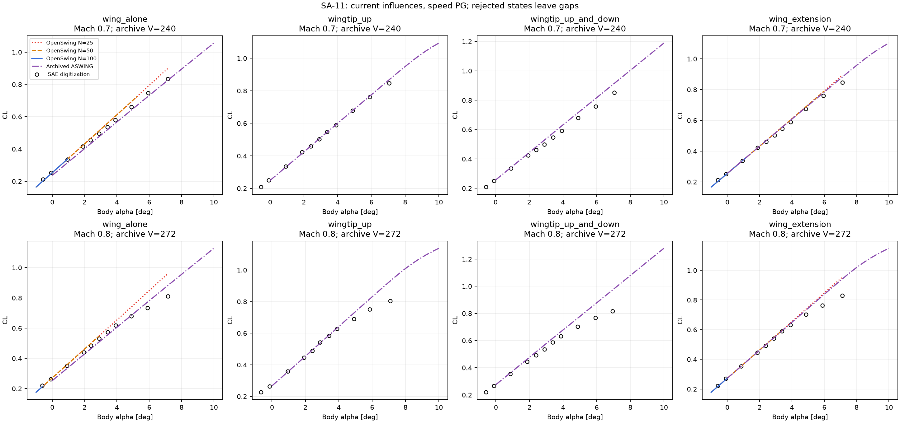
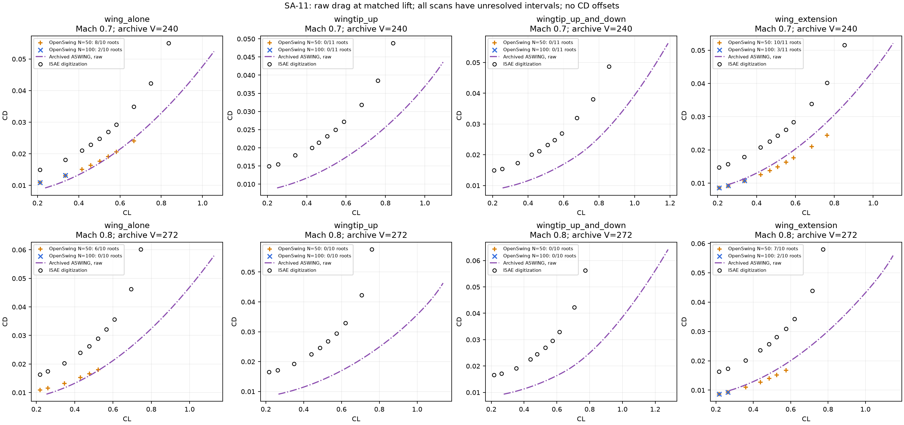

# SA-11 numerical comparison

**This is not a validation pass.** Of 5,304 planned states, 1,227 computed, 4,077 rejected, and 0 are pending.

Errors below use only computed states; rejected and pending states remain explicit. The measurements use exact nominal Mach, while the archived comparisons use the recorded speed. The coefficients retain each source file’s reference area and section properties.

An [independent archive audit](isae-sa11-archive.md) also finds a force/coefficient normalization conflict at Mach 0.75/0.78. At the supplied density those archives imply an area near 97.67 m², versus 0.9329 m² in the comparison inputs.

| Model | Mach | N | Computed / measured points | Rejected | Pending | CL RMSE | Relative slope error on computed subset |
| --- | ---: | ---: | ---: | ---: | ---: | ---: | ---: |
| wing_alone_literal | 0.7 | 25 | 11 / 11 | 0 | 0 | 0.02917 | 10.98% |
| wing_alone_literal | 0.7 | 50 | 9 / 11 | 2 | 0 | 0.018615 | 9.55% |
| wing_alone_literal | 0.7 | 100 | 3 / 11 | 8 | 0 | 0.0054461 | 9.25% |
| wingtip_up_station_scaling | 0.7 | 25 | 0 / 11 | 11 | 0 | — | — |
| wingtip_up_station_scaling | 0.7 | 50 | 0 / 11 | 11 | 0 | — | — |
| wingtip_up_station_scaling | 0.7 | 100 | 0 / 11 | 11 | 0 | — | — |
| wingtip_up_and_down_station_scaling | 0.7 | 25 | 0 / 11 | 11 | 0 | — | — |
| wingtip_up_and_down_station_scaling | 0.7 | 50 | 0 / 11 | 11 | 0 | — | — |
| wingtip_up_and_down_station_scaling | 0.7 | 100 | 0 / 11 | 11 | 0 | — | — |
| wing_extension_literal | 0.7 | 25 | 11 / 11 | 0 | 0 | 0.019636 | 7.30% |
| wing_extension_literal | 0.7 | 50 | 10 / 11 | 1 | 0 | 0.012964 | 5.58% |
| wing_extension_literal | 0.7 | 100 | 3 / 11 | 8 | 0 | 0.0047213 | 7.67% |
| wing_alone_literal | 0.8 | 25 | 11 / 11 | 0 | 0 | 0.061176 | 23.49% |
| wing_alone_literal | 0.8 | 50 | 6 / 11 | 5 | 0 | 0.013773 | 8.08% |
| wing_alone_literal | 0.8 | 100 | 1 / 11 | 10 | 0 | 0.0063555 | — |
| wingtip_up_station_scaling | 0.8 | 25 | 0 / 11 | 11 | 0 | — | — |
| wingtip_up_station_scaling | 0.8 | 50 | 0 / 11 | 11 | 0 | — | — |
| wingtip_up_station_scaling | 0.8 | 100 | 0 / 11 | 11 | 0 | — | — |
| wingtip_up_and_down_station_scaling | 0.8 | 25 | 0 / 11 | 11 | 0 | — | — |
| wingtip_up_and_down_station_scaling | 0.8 | 50 | 0 / 11 | 11 | 0 | — | — |
| wingtip_up_and_down_station_scaling | 0.8 | 100 | 0 / 11 | 11 | 0 | — | — |
| wing_extension_literal | 0.8 | 25 | 11 / 11 | 0 | 0 | 0.046172 | 17.68% |
| wing_extension_literal | 0.8 | 50 | 7 / 11 | 4 | 0 | 0.0057034 | 3.42% |
| wing_extension_literal | 0.8 | 100 | 2 / 11 | 9 | 0 | 0.0038047 | — |

The two unchanged standalone wings and three explicitly reconstructed joint inputs are distinguished in the source audit. The cant0 input has no assigned experiment. The transonic tunnel data, source geometry and section differences, unknown archived discretization, and growing local Mach under refinement prevent an accuracy claim.

See [source audit](isae-sa11-sources.md), [full numerical data](isae-sa11-comparison.json), [Fourier sensitivity](isae-sa11-circulation.json), and [independent velocity integration](isae-sa11-velocity.json).

## Completed scope and rejected states

The completed sweep includes all 656 rows of 16 archived polars and all 88 digitized lift points, with three meshes (N25/50/100). All archived convergence flags are one. Current/frozen influences and PG-off alternatives are setup diagnostics; they are not selected by lowest discrepancy. The cant0 input is retained as an unmeasured diagnostic.

| Model | N | Computed | Rejected: local Mach | Other solver failure |
| --- | ---: | ---: | ---: | ---: |
| wing_alone_literal | 25 | 365 | 9 | 0 |
| wing_alone_literal | 50 | 193 | 265 | 0 |
| wing_alone_literal | 100 | 30 | 428 | 0 |
| wingtip_up_station_scaling | 25 | 4 | 370 | 0 |
| wingtip_up_station_scaling | 50 | 0 | 455 | 3 |
| wingtip_up_station_scaling | 100 | 0 | 413 | 45 |
| wingtip_up_and_down_station_scaling | 25 | 0 | 374 | 0 |
| wingtip_up_and_down_station_scaling | 50 | 0 | 458 | 0 |
| wingtip_up_and_down_station_scaling | 100 | 0 | 458 | 0 |
| wing_extension_literal | 25 | 374 | 0 | 0 |
| wing_extension_literal | 50 | 218 | 240 | 0 |
| wing_extension_literal | 100 | 43 | 415 | 0 |
| wingtip_up_cant0_joint_station | 25 | 0 | 48 | 0 |
| wingtip_up_cant0_joint_station | 50 | 0 | 48 | 0 |
| wingtip_up_cant0_joint_station | 100 | 0 | 46 | 2 |

These are invalid or unresolved model states, not measurements of physical supersonic flow. The [independent swept-line diagnosis](swept-lifting-line-limit.md) establishes a singular same-line force-velocity limit for smooth prescribed circulation. It does not resolve every winglet junction or prove how the reference ASWING executable treats them. No core, guard or physical input was tuned.

## Drag at matched lift

All 83 measured drag points were requested at N50 and N100 (166 requests). There are 38 requests with one observed root, 0 with multiple observed roots, and 128 without a root. Every sampled angle scan contains rejected intervals, so an observed root does not establish uniqueness. The scan includes −1° to 10° and the exact measured lift angles; failed intervals are not bridged or extrapolated.

| Model | Mach | N | One observed root / requested | No root | Rejected scan intervals | Raw CD RMSE on observed roots |
| --- | ---: | ---: | ---: | ---: | ---: | ---: |
| wing_alone_literal | 0.7 | 50 | 8 / 10 | 2 | 21 | 0.00723636 |
| wing_alone_literal | 0.7 | 100 | 2 / 10 | 8 | 45 | 0.00445547 |
| wing_alone_literal | 0.8 | 50 | 6 / 10 | 4 | 34 | 0.00811856 |
| wing_alone_literal | 0.8 | 100 | 0 / 10 | 10 | 51 | — |
| wingtip_up_station_scaling | 0.7 | 50 | 0 / 11 | 11 | 52 | — |
| wingtip_up_station_scaling | 0.7 | 100 | 0 / 11 | 11 | 52 | — |
| wingtip_up_station_scaling | 0.8 | 50 | 0 / 10 | 10 | 52 | — |
| wingtip_up_station_scaling | 0.8 | 100 | 0 / 10 | 10 | 52 | — |
| wingtip_up_and_down_station_scaling | 0.7 | 50 | 0 / 11 | 11 | 52 | — |
| wingtip_up_and_down_station_scaling | 0.7 | 100 | 0 / 11 | 11 | 52 | — |
| wingtip_up_and_down_station_scaling | 0.8 | 50 | 0 / 10 | 10 | 52 | — |
| wingtip_up_and_down_station_scaling | 0.8 | 100 | 0 / 10 | 10 | 52 | — |
| wing_extension_literal | 0.7 | 50 | 10 / 11 | 1 | 17 | 0.00992418 |
| wing_extension_literal | 0.7 | 100 | 3 / 11 | 8 | 43 | 0.00659558 |
| wing_extension_literal | 0.8 | 50 | 7 / 10 | 3 | 31 | 0.0108506 |
| wing_extension_literal | 0.8 | 100 | 2 / 10 | 8 | 49 | 0.00779345 |

The plot and main errors use raw CD. The upstream MATLAB offsets (+0.0064 at Mach 0.7 and +0.0075 at Mach 0.8) appear only as separately labeled diagnostics in [the drag data](isae-sa11-drag.json); they are not applied to the solver. Errors on the small N100 surviving subset cannot establish an improvement over N50.

## Runtime verification and remaining work

The existing 40-state WebAssembly replay matches 16 native solutions and 24 rejections, plus nine literal-input rejections. The 14-state offline browser check matches eight solutions and six rejections, plus three literal-input rejections. These samples do not replay all 5,304 states or the newly computed drag roots. See [numerical audit](isae-sa11-checks.json) and [matched-lift audit](isae-sa11-drag-checks.json).

Physical validation remains incomplete: resolve the swept/junction flow treatment, source geometry and normalization conflicts, recover archived discretization and initialization, and independently extract measurements with uncertainties. The ISAE report treats SA-11 as a transonic tendency study; PG alone does not model shocks or wave drag. This completed evidence package is ahead of the released app.
