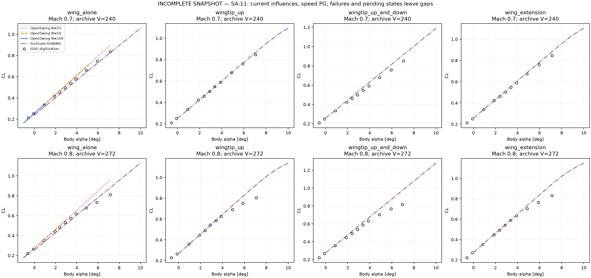

# SA-11 incomplete comparison snapshot

**This is not a validation pass.** The full sweep is still running. Of 5,304 planned states, 600 computed, 1,497 rejected, and 3,207 are pending.

Errors below use only computed states; rejected and pending states remain explicit. The measurements use exact nominal Mach, while the archived comparisons use the recorded speed. The coefficients retain each source file’s reference area and section properties.

An [independent archive audit](isae-sa11-archive.md) also finds a force/coefficient normalization conflict at Mach 0.75/0.78. At the supplied density those archives imply an area near 97.67 m², versus 0.9329 m² in the comparison inputs.

| Model | Mach | N | Computed / measured points | Rejected | Pending | CL RMSE | Relative slope error on computed subset |
| --- | ---: | ---: | ---: | ---: | ---: | ---: | ---: |
| wing_alone_literal | 0.7 | 25 | 11 / 11 | 0 | 0 | 0.02917 | 10.98% |
| wing_alone_literal | 0.7 | 50 | 9 / 11 | 2 | 0 | 0.018615 | 9.55% |
| wing_alone_literal | 0.7 | 100 | 3 / 11 | 8 | 0 | 0.0054461 | 9.25% |
| wingtip_up_station_scaling | 0.7 | 25 | 0 / 11 | 0 | 11 | — | — |
| wingtip_up_station_scaling | 0.7 | 50 | 0 / 11 | 0 | 11 | — | — |
| wingtip_up_station_scaling | 0.7 | 100 | 0 / 11 | 0 | 11 | — | — |
| wingtip_up_and_down_station_scaling | 0.7 | 25 | 0 / 11 | 0 | 11 | — | — |
| wingtip_up_and_down_station_scaling | 0.7 | 50 | 0 / 11 | 0 | 11 | — | — |
| wingtip_up_and_down_station_scaling | 0.7 | 100 | 0 / 11 | 0 | 11 | — | — |
| wing_extension_literal | 0.7 | 25 | 0 / 11 | 0 | 11 | — | — |
| wing_extension_literal | 0.7 | 50 | 0 / 11 | 0 | 11 | — | — |
| wing_extension_literal | 0.7 | 100 | 0 / 11 | 0 | 11 | — | — |
| wing_alone_literal | 0.8 | 25 | 11 / 11 | 0 | 0 | 0.061176 | 23.49% |
| wing_alone_literal | 0.8 | 50 | 6 / 11 | 5 | 0 | 0.013773 | 8.08% |
| wing_alone_literal | 0.8 | 100 | 1 / 11 | 10 | 0 | 0.0063555 | — |
| wingtip_up_station_scaling | 0.8 | 25 | 0 / 11 | 0 | 11 | — | — |
| wingtip_up_station_scaling | 0.8 | 50 | 0 / 11 | 0 | 11 | — | — |
| wingtip_up_station_scaling | 0.8 | 100 | 0 / 11 | 0 | 11 | — | — |
| wingtip_up_and_down_station_scaling | 0.8 | 25 | 0 / 11 | 0 | 11 | — | — |
| wingtip_up_and_down_station_scaling | 0.8 | 50 | 0 / 11 | 0 | 11 | — | — |
| wingtip_up_and_down_station_scaling | 0.8 | 100 | 0 / 11 | 0 | 11 | — | — |
| wing_extension_literal | 0.8 | 25 | 0 / 11 | 0 | 11 | — | — |
| wing_extension_literal | 0.8 | 50 | 0 / 11 | 0 | 11 | — | — |
| wing_extension_literal | 0.8 | 100 | 0 / 11 | 0 | 11 | — | — |

The two unchanged standalone wings and three explicitly reconstructed joint inputs are distinguished in the source audit. The cant0 input has no assigned experiment. The transonic tunnel data, source geometry and section differences, unknown archived discretization, and growing local Mach under refinement prevent an accuracy claim.

See [source audit](isae-sa11-sources.md), [full numerical data](isae-sa11-progress.json), [Fourier sensitivity](isae-sa11-circulation.json), and [independent velocity integration](isae-sa11-velocity.json).
