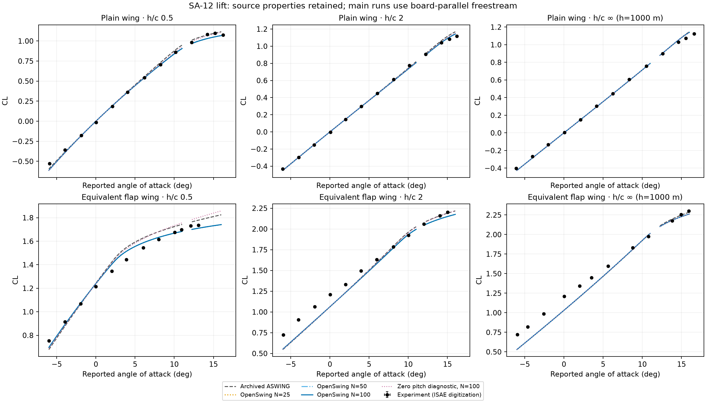
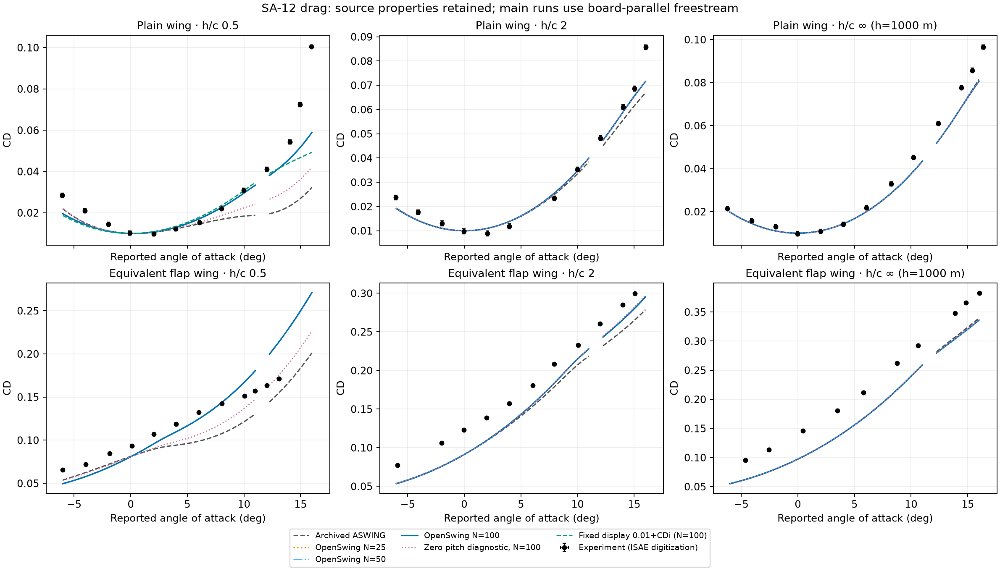

# ISAE SA-12: ground effect on plain and slotted-flap wings

**Quantitative comparison complete; physical validation remains partial.** Neither low residuals nor browser agreement establishes ASWING parity. The literal section model and unresolved source pose/datum limit the conclusions.

The study completed 2,866 requested states: 2,866 computed and 0 rejected. It covers both unchanged `.asw` files, all six 85-point archived polars, all 75 measured lift points and 71 measured drag points at their exact angles, and three meshes. Failed or unavailable values remain in the machine-readable results.

## Provenance and setup

The upstream revision is `f62943df20e9e4d7d9f50e070477b22426b5f865`. The [source audit](isae-sa12-sources.md) pins all 28 study files and two primary reports. The measurements are the ISAE CSV digitizations of [NACA-TN-705](https://ntrs.nasa.gov/citations/19930081443), not newly digitized curves. The two-dimensional section reference is [NACA-TR-664](https://ntrs.nasa.gov/citations/19930091739).

The rectangular NACA 23012 wing has span 1.524 m, chord 0.254 m, reference area 0.3871 m² and speed 35.76 m/s. Both finite heights, 0.127 and 0.508 m, are measured at the quarter chord. The nominal infinite-height script retains a solid image at 1000 m; a separate ground-off calculation checks that limit. Requested N=25 produces 26 strips because the root is a feature station; N=50 and N=100 produce 50 and 100. No literal input was repaired.

The primary experiment has freestream parallel to a stationary ground board. Main comparisons set Earth pitch equal to the reported angle of attack. The scripts record alpha and height but omit Earth pitch. Zero pitch is therefore a separately labeled diagnostic. Its nonzero-alpha cases have no common stationary Trefftz plane, so CDi remains unavailable rather than being replaced by near-field drag. Total CD is still retained. The plain-wing angle datum is additionally unresolved: ISAE describes a zero-lift shift, while the literal input uses section alpha=0. No angle shift is fitted here.

Main runs use current influences and zero PG Mach. All scripts toggle K/F once, but the original startup state, PG setting, exact node interpretation and Fourier mode count are not archived. Frozen/current and speed-based PG sensitivities are separate calculations. These choices do not establish an exact recreation of the original executable state.

## Experimental comparisons

The following errors use every supplied measurement, including stall and post-stall. Predictions are solved at the exact CSV angles. Coefficient errors are absolute, not percentages. No interpolation of the OpenSwing grid is used.

| Wing | h/c | Lift points | CL RMSE, N=25 / 50 / 100 | Drag points | CD RMSE, N=25 / 50 / 100 |
|---|---:|---:|---:|---:|---:|
| no_flap | 0.5 | 13 | 0.029976 / 0.0300368 / 0.0300264 | 13 | 0.0135734 / 0.0135745 / 0.0135741 |
| no_flap | 2 | 13 | 0.0156303 / 0.0156325 / 0.0156399 | 12 | 0.00466339 / 0.00467222 / 0.00467211 |
| no_flap | ∞ | 13 | 0.0213735 / 0.0214875 / 0.021495 | 13 | 0.00610967 / 0.00612036 / 0.00612037 |
| slotted_flap | 0.5 | 12 | 0.0376322 / 0.0377124 / 0.0377131 | 12 | 0.0198563 / 0.0198987 / 0.0199068 |
| slotted_flap | 2 | 12 | 0.106121 / 0.105704 / 0.105697 | 11 | 0.0247329 / 0.0247628 / 0.0247615 |
| slotted_flap | ∞ | 12 | 0.119103 / 0.118734 / 0.11873 | 10 | 0.0430904 / 0.0431017 / 0.0430984 |

Plain-wing lift RMSE is 0.0156–0.0300 at N=100. The equivalent flap wing has larger discrepancies at h/c=2 and nominal infinity (CL RMSE 0.106 and 0.119). Drag also disagrees, especially at high incidence. Refining N=50 to N=100 changes CL by less than 0.000089 and CD by less than 0.000035 on the archived angle grids. Those small numerical changes do not remove the measured discrepancies.





Error bars show the primary report’s estimated ±0.1° angle and ±0.001 coefficient errors. They are not standard deviations or a complete uncertainty budget. CSV digitization error, section properties, angle datum, Reynolds effects and apparatus differences remain additional uncertainties. Four missing archive angles (11.25°, 11.5°, 11.75°, 12°) are not interpolated across. Measurements outside the archive range remain usable for exact OpenSwing calculations but have no archived counterpart.

Only the upstream plain-wing h/c=0.5 drag display substitutes `0.01+CDi` for total CD. The green curve preserves that documented fixed transformation as a separate quantity; it is not a correction to OpenSwing total drag. Raw CD retains the production stall-pressure contribution. The source text says post-stall drag was disabled, but the scripts contain no explicit flag that establishes how this was done.

For that one curve, N=100 raw-CD RMSE is 0.0135741; the fixed-display RMSE is 0.0165547. These measure different reported quantities.

## Archived ASWING comparisons

These are errors against all 85 stored points per curve, using N=100. The first value uses board-parallel freestream; the second uses zero pitch. The different error levels quantify pose sensitivity and do not establish the missing historical pitch.

| Wing | h/c | CL RMSE, main / zero pitch | CD RMSE, main / zero pitch |
|---|---:|---:|---:|
| no_flap | 0.5 | 0.0251664 / 0.0116503 | 0.0108434 / 0.00402739 |
| no_flap | 2 | 0.00985296 / 0.00636981 | 0.00157018 / 0.00150684 |
| no_flap | ∞ | 0.00114543 / 0.00114543 | 0.000134644 / 0.000134644 |
| slotted_flap | 0.5 | 0.0434752 / 0.0132703 | 0.0342994 / 0.0117707 |
| slotted_flap | 2 | 0.0206952 / 0.00392997 | 0.00683838 / 0.00759751 |
| slotted_flap | ∞ | 0.00776228 / 0.00776227 | 0.00129764 / 0.00129764 |

At nominal infinity, OpenSwing and archived ASWING are much closer to each other than the equivalent flap-wing predictions are to the experiment. That agreement does not validate the shared input section model. Near the board, both pose and the unrecorded influence/discretization settings matter. No zero-pitch CDi statistic is promoted as a full-polar result: only the single alpha=0 point has an available Trefftz value in each such curve.

## Numerical sensitivity and source limitations

| Wing | h/c | max ΔCL, N50→100 | max ΔCD, N50→100 |
|---|---:|---:|---:|
| no_flap | 0.5 | 4.26141e-05 | 1.37154e-06 |
| no_flap | 2 | 2.85932e-05 | 7.45512e-07 |
| no_flap | ∞ | 2.07342e-05 | 7.46045e-07 |
| slotted_flap | 0.5 | 6.81554e-05 | 3.48635e-05 |
| slotted_flap | 2 | 8.75128e-05 | 1.322e-05 |
| slotted_flap | ∞ | 8.87414e-05 | 1.43965e-05 |

The 30 ground-off limit checks change CL/CD by at most 2.83067e-08 relative to the 1000 m image case. The 72 Fourier checks use 5, 9 and 19 modes at N=50/100 and alpha=5°/10°. Their largest projected residual is 5.02971e-09, while the largest pointwise local defect is 0.0538348. The projected equations can converge without a small local defect. Full coefficient differences are retained in [the comparison JSON](isae-sa12-comparison.json).

Sixteen corner probes vary angle by ±0.1° and height by ±1/16 inch around alpha=5° for both finite heights. These are bounded input sensitivities, not an exhaustive uncertainty propagation. Another 270 states vary PG and influence freezing. The 510 zero-pitch states remain separate from primary-pose comparisons.

The slotted-flap input is one straight lifting line with fixed alpha=12.5°, slope 7.44/rad, CLmax=2.6 and Cdf=0.04. It does not resolve the slot, a moving flap, its tip clearance or changes in section behavior near the board. Both inputs set section Cm=0, although the primary flap experiment has nonzero pitching moments. Agreement with archived near-zero Cm cannot validate the physical flap moment.

The primary uses Reynolds number 609,000 (effective 974,000), whereas the section reference has different tunnel and Reynolds conditions. The primary reports a stationary-board approximation and unequal wall-correction treatment between free-air and ground-board runs. These limitations prevent assigning all disagreement to the numerical solver.

## Evidence and reproduction

The [native results](isae-sa12.json), [comparison data](isae-sa12-comparison.json), [source audit](isae-sa12-sources.json) and [pose pilot](isae-sa12-setup.json) retain source hashes and individual outcomes. The [independent image-velocity check](isae-sa12-velocity.json) uses numerical Biot–Savart quadrature for 24 force-point velocities and 24 ground-boundary points in eight states. It holds production geometry/circulation fixed, so it does not independently solve the lifting-line problem.

All 33 [actual WebAssembly replays](isae-sa12-wasm.json) and 17 [offline browser cases](isae-sa12-browser.json) pass. The browser verifies exported pose, source text, module hashes and coefficients, retains six unavailable CDi values, and checks mobile layout. The [numerical/provenance checks](isae-sa12-checks.json) independently verify CSV rows, coefficient statistics, force/moment conventions, ground normals, finite values and source/runtime hashes. These are implementation checks, not proof of experimental accuracy.

```sh
OPENBLAS_NUM_THREADS=1 OMP_NUM_THREADS=1 .venv/bin/python scripts/verify-isae-sa12.py --workers 1
OPENBLAS_NUM_THREADS=1 OMP_NUM_THREADS=1 .venv/bin/python scripts/summarize-isae-sa12.py
OPENBLAS_NUM_THREADS=1 OMP_NUM_THREADS=1 .venv/bin/python scripts/check-isae-sa12.py
```
