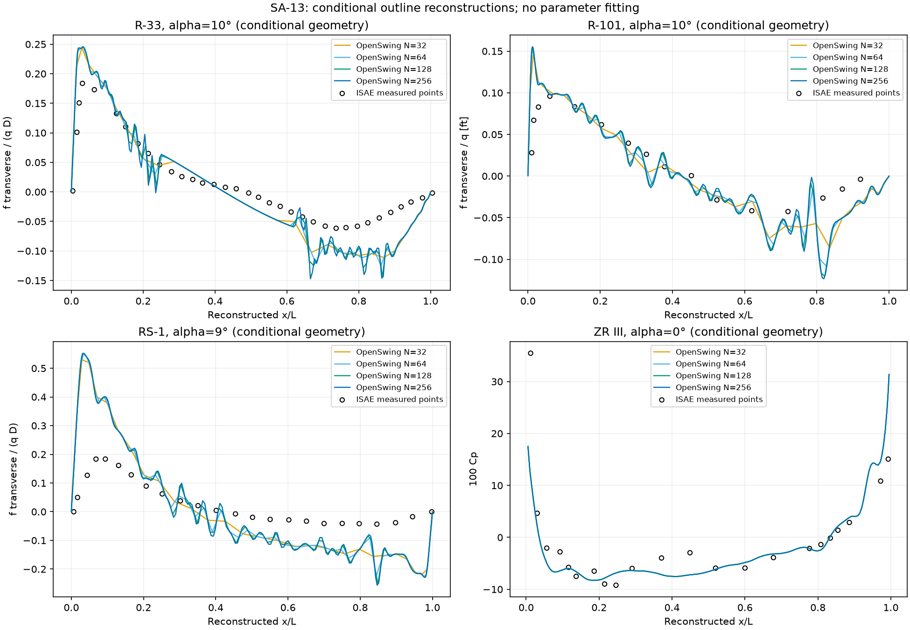
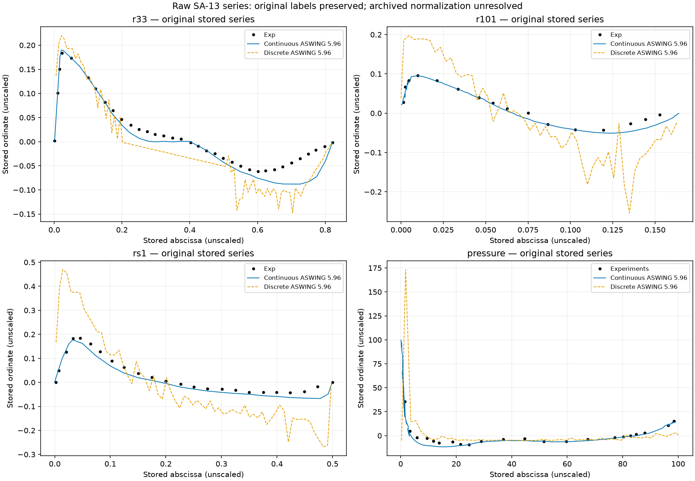

# SA-13 airships: conditional numerical comparison

The [continuous-curve equation comparison](isae-sa13-continuous-laws-20261109.md)
now checks the NACA local-ellipsoid and finite-body corrections alongside
Drela's force law. They reduce some differences but do not reconcile the
archived blue curves on the existing reconstruction. Geometry scale and the
supplied radius derivative remain unresolved; no physics or pass count changes.

A further reference search located a related U.721 model in
[ARC R&M 600](https://reports.aerade.cranfield.ac.uk/handle/1826.2/1409), following
the contemporary R101 description. The retained
[web text extract](../../reference/isae-sa13/primary-model-search-20261109/aca-rm-600-web-extract.txt)
contains a radius/diameter table, but the PDF download returned HTTP 403 and
the ambiguous OCR entries have not been visually verified. This related model
is not established as the original R101 test model and has not been used as a
replacement input. ARC R&M 801/1169 and the original generating inputs remain
unrecovered; the reference lead does not change the native denominator or count.

The [full JSON follow-up](isae-sa13-discrete-bridge-20261109.md) now checks the
180 admissible discrete lift stations through complete current rigid solves,
using public force/moment output and the same disclosed linear-radius models.
This extends the earlier kernel check without claiming an original-case pass
or a browser/WebAssembly run.

The [pressure-geometry follow-up](isae-sa13-pressure-geometry-20261109.md)
now identifies all 56 finite red pressure ordinates as a shifted squared
backward radius slope. This resolves their algebraic relation to the outline,
but not their interpretation as pressure; all original rows remain required.

**Current follow-up:** the [discrete-load identity](isae-sa13-discrete-loads-20261109.md)
now reproduces all 183 finite red-curve loads from the stored radius samples.
The current force kernel matches 180 valid station values on an explicit
linear-radius reconstruction. This distinguishes nodal density from integrated
strip averages and resolves the red-curve normalization/angle relation; it
does not establish the complete native cases or change 0/612.

**Historical numerical snapshot.** The exact-endpoint repair described below
was subsequently applied in the [source transition](endpoint-source-transition.json).
It is present in the current source and is not an outstanding candidate.
The [2026-11-09 source follow-up](isae-sa13-pressure-reference-20261109.md)
also identifies an archived pressure value incompatible with the declared
incompressible Bernoulli observable. Native comparison remains 0/612; no
current browser rerun or new physical validation is claimed here.

The [current equation and load-integral audit](isae-sa13-load-integrals-20261109.md)
verifies five focused body implementation checks and compares the archived
continuous/discrete curve integrals without changing their native score.
It also follows the folder rename back to its initial four-figure-only version.

The subsequent [body-quadrature correction](isae-sa13-body-quadrature-20261109.md)
fixes integration across spline knots in production source and its derivatives.
It improves the numerical integrals on the disclosed outlines but does not
recover missing native inputs or change the archived comparison score.

**Physical validation remains unresolved.** All 38 native calculations and 38 WebAssembly numerical replays completed. These use four explicitly reconstructed hulls, because the upstream family supplies figures without original `.asw` inputs. The WebAssembly display check exposes an endpoint-roundoff defect, recorded below.

[Source audit and primary references](isae-sa13-sources.md) · [Machine-readable comparison](isae-sa13-comparison.json) · [Native results](isae-sa13.json) · [Independent velocity integration](isae-sa13-velocity.json) · [WebAssembly results](isae-sa13-wasm.json) · [Offline browser results](isae-sa13-browser.json) · [Evidence audit](isae-sa13-checks.json)

## Comparison with measured points

The table uses the primary-source angle, N=256, and the explicitly stated normalization. It reports discrepancies, not a pass/fail accuracy certification. Experimental uncertainty and the exact original geometry/operating inputs have not been recovered.

| Hull | Angle | Compared / retained points | Ordinate | RMSE | N128→256 maximum change |
|---|---:|---:|---|---:|---:|
| r33 | 10° | 34 / 35 | f/(qD) | 0.04523898 | 0.02262328 |
| r101 | 10° | 16 / 16 | f/q [ft], conditional scale | 0.04760925 | 0.004038831 |
| rs1 | 9° | 24 / 24 | f/(qD) | 0.1527828 | 0.01806814 |
| pressure | 0° | 22 / 22 | 100Cp | 6.133918 | 0.0003191356 |

The one excluded R33 point is outside the reconstructed closed hull; its source coordinate and measurement remain in the JSON. No extrapolation fills it. The finite measured sample count is 75 for force and 22 for pressure.

RS-1 is 9° in NACA-TR-405, although the ISAE caption says 10°. The separate 10° diagnostic has larger force RMSE. R101 uses a different, dimensional force ordinate: the 33.01-inch model length supplies a conditional conversion to feet. R33 and RS1 use maximum tabulated outline diameter; natural cubic radius overshoot is a separate geometry uncertainty.

Pressure is static gauge pressure coefficient100Cp. The primary NACA-TM-574 case is ZR III, while the ISAE filename says R101. Treating these values as nonnegative local dynamic pressure would be incorrect.

## Numerical checks and remaining physics

The native study spans 32, 64, 128 and 256 intervals. Closed-body net force tends to zero, and the integrated moment tends to the independently integrated squared-radius volume law. Local force profiles remain sensitive to radius derivatives and digitization noise; their mesh changes are not uniformly decreasing. These checks concern the implemented body law and do not add finite-body apparent-mass corrections, viscous stern forces, boundary-layer displacement or an independently measured geometry.

| Pressure intervals | Max velocity difference [m/s] | Max 100Cp difference [percentage points] |
|---:|---:|---:|
| 32 | 0.001121843 | 0.01383094 |
| 64 | 8.623149e-05 | 0.0009577268 |
| 128 | 3.45636e-05 | 0.0003207469 |
| 256 | 1.781726e-06 | 2.264413e-05 |

The independent calculation integrates the declared axial source law with adaptive quadrature split at every spline knot. It retains the implemented source core R/2. Its finest-mesh discrepancy is much smaller than the measurement discrepancy. This verifies numerical integration of that regularized field; it does not establish an impermeable surface or experimental pressure accuracy. Surface offsets 1e-4, 1e-6 and 1e-8 are reported without changing the body mask.

Four R101 scale checks use the physical 33.01-inch length and verify coefficient invariance, force scaling with length squared and moment scaling with length cubed. The full report retains all errors and all 38 conservation checks.

The evidence audit also compares every native strip against exact area-difference transverse forces and piecewise-polynomial local moments. This separates body quadrature error from the subsequent strip-profile interpolation and from uncertainty in the radius table.

## Runtime and display defect

All 38 numerical states meet the native/WebAssembly comparison tolerances. Overall runtime status is `NUMERICAL_REPLAY_PASS_DISPLAY_DIVERGENCE` because display behavior is checked separately.

| Hull | Native display | WebAssembly display | WebAssembly tail radius |
|---|---|---|---:|
| r33 | rejected | rejected | -1.626303e-19 |
| r101 | constructed | rejected | -1.01644e-20 |
| rs1 | constructed | constructed | 9.893345e-19 |
| pressure | constructed | constructed | 1.084202e-19 |

The offline browser reproduces both failures, and its eight available body-load solves match the native calculations. Pressure at the exact measurement stations is checked in Pyodide; the browser pressure-plane UI does not supply those same stations.

A mathematically zero spline endpoint can evaluate as a tiny negative number. The display correctly rejects negative radii, so this roundoff prevents loading affected models. An [isolated endpoint candidate](isae-sa13-endpoint-candidate.patch) returns the exact tabulated value at a segment endpoint. It does not clip radii, change nearby values or alter spline derivatives.

Candidate evidence: all 279 original input files retain their parse outcomes; 4,767 distributions are checked; first through third derivatives remain bitwise unchanged. All 38 candidate WebAssembly numerical cases match the native baseline. All four candidate display models construct with exactly zero endpoint radii. The offline candidate browser passes 16 solve/export cases and still rejects both genuinely negative-radius controls. See [native audit](isae-sa13-endpoint-candidate-native.json), [WebAssembly replay](isae-sa13-endpoint-candidate-wasm.json), and [browser replay](isae-sa13-endpoint-candidate-browser.json).

At the time of this numerical snapshot, the candidate was not applied to production or the released app. The later source transition linked above applied it. Interior spline overshoot and geometric uncertainty remain separate concerns.

## Archived ASWING curves

The original Continuous/Discrete ASWING 5.96 labels and NaN gaps are preserved below. The archive supplies no matching input files or modified radius-derivative implementation. R101 normalization and the plotted geometry scale remain unresolved, so these curves do not receive a physical parity score.

## Work needed for a physical validation claim

- Recover or independently establish the radius tables, geometric scale, maximum diameter, operating states and measurement uncertainty.
- Reconcile the RS1 incidence, R101 dimensional ordinate, pressure hull identity, and reported aspect ratios.
- Verify current packaged/browser behavior when the resource hold permits; the exact-endpoint source transition has already completed.
- Establish the expected finite-body and viscous contributions, and compare them without fitting corrections to the measured curves.
- Reproduce the archived ASWING Continuous/Discrete states with traceable executable inputs and radius derivatives.

This study does not increase the released family coverage or mark an ASWING-parity requirement complete.
