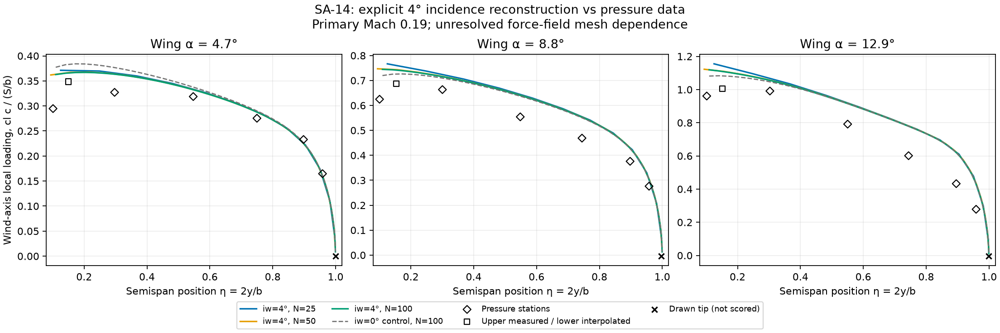

# SA-14: explicit 4° incidence reconstruction

The 54-state native protocol passes force reduction and equivalent-coordinate checks. Experimental discrepancies remain. This is a conditional comparison using two explicit reconstructions; neither is a recovered original iw=4° input.

The source case is from [ISAE’s validation repository](https://github.com/rom1isae/ISAE_Aswing_Experimental_Validation), revision `f62943df20e9e4d7d9f50e070477b22426b5f865`. All 50 case files remain byte-for-byte unchanged. The experiment is [NACA TN 3730](https://ntrs.nasa.gov/citations/19920075067).

## Geometry and source interpretation

- The report defines α as wing-root chord angle and iw as wing angle minus body angle (PDF p.5). Thus α_body = α_wing − 4°.
- PDF p.6 and Figure 1 retain the root leading edge’s height when incidence changes. The reconstruction rotates about the prescribed root-leading-edge location x=36.76 in, z=3.18 in. The original model’s approximate chord and quarter-axis geometry are retained; the pivot is not fitted.
- In the wing frame the wing stays fixed and the body rotates −4°. In the body frame the body stays fixed and the wing rotates +4°. The latter requires local normal-section twist 5.6490231965° on the swept beam; adding 4° directly to section twist is not the same geometry.
- The source file named Figure17.csv contains positive absolute iw=4° loads matching the markers and curves in primary Figure 15 (PDF p.39). Primary Figure 17 shows increments. The Figure 15 assignment is a documented inference; original digitization metadata is unavailable.
- Each of three angles has six standard pressure stations, one η=0.15 station with measured upper-surface pressure and interpolated lower-surface loading (PDF p.7), and one drawn tip endpoint. The η=0.15 points are retained as partly measured pressure data. Tip endpoints are excluded from pressure error metrics.

The generated [wing-frame input](isae-sa14-iw4-wing-frame.asw) and [body-frame input](isae-sa14-iw4-body-frame.asw) preserve reference values, section properties, beam identities, joint stations and all non-geometric distributions. Constants and original source values are not fitted.

## Protocol and checks

The protocol uses meshes N=25, 50 and 100, wing angles 4.7°, 8.8° and 12.9°, and both primary Mach 0.19 and the archived mixed-PG convention (speed-derived PG at 4.7°, zero at 8.8°/12.9°). Each condition has an iw=0 control and both iw=4 frames: 54 states, 42 new solves and 12 reused states with matching source/module/cache hashes. All states solved.

Local loading is wind-axis strip lift divided by dynamic pressure, projected span width and primary mean geometric chord S/b. It is not section-normal cl multiplied by a constant. Total, full-wing, exposed-wing and body lift are retained separately. No extrapolation fills data outside native midpoint coverage.

For 18 frame pairs, the largest force difference is 1.65e-11 N, translated-moment difference 3.76e-11 N·m, local-load difference 7.23e-14, and velocity difference 1.62e-10 m/s. Moments include the change of origin: M_body = R M_wing + (p − R p) × F_body. All 54 cases independently reconstruct force, moment and normalized lift from their exported strips.

## Experimental comparison

The table reports dimensionless local-load RMSE over seven pressure-derived points per angle, including η=0.15 with its lower-surface interpolation. The final column uses only the six fully instrumented stations. Original coordinates and values are preserved; no points are discarded to improve agreement.

| Wing α | N=25 | N=50 | N=100 | iw=0 control, N=100 | N=100, full-pressure stations only |
|---:|---:|---:|---:|---:|---:|
| 4.7° | 0.032949 | 0.030896 | 0.030431 | 0.038832 | 0.032107 |
| 8.8° | 0.079709 | 0.074624 | 0.073393 | 0.063957 | 0.076076 |
| 12.9° | 0.151856 | 0.145680 | 0.143995 | 0.134831 | 0.149547 |

The incidence reconstruction improves this metric at 4.7° relative to the iw=0 control; discrepancies increase at the higher angles. These are error measurements, not a demonstrated validation pass. Experimental uncertainty and justified acceptance bounds have not been recovered.

## Limits and remaining work

The [swept-force mesh diagnosis](swept-lifting-line-limit.md) remains unresolved: increasing resolution can increase near-tip force-point velocity even when integrated lift changes little. This study does not establish mesh convergence or cure that defect. Accurate section stall, near-juncture interference, missing source geometry provenance and experimental uncertainty still limit a full validation claim.

The [iw=0 pilot](isae-sa14-pilot.md), [extended polars](isae-sa14-polars.md), and [original ASWING load-export audit](isae-sa14-load-exports.md) remain separate evidence. No original iw=4 ASWING output was available for a direct solver comparison.

## Reproduction and evidence

Run `scripts/isae_sa14_incidence.py`, `scripts/verify-isae-sa14-incidence.py`, and `scripts/summarize-isae-sa14-incidence.py` with the project Python environment. The source audit pins the original files, primary report and all 97 solver modules. The native runner uses atomic cache files and can resume without repeating completed solves.

- [Source and geometry audit](isae-sa14-incidence-sources.json)
- [All 54 native states](isae-sa14-incidence.json)
- [Point comparisons, force reductions and 18 frame checks](isae-sa14-incidence-comparison.json)
- [WASM replay](isae-sa14-incidence-wasm.json) uses 18 states: both frames at all three meshes and angles with primary Mach 0.19. Current status: `PASS_18_INCIDENCE_WASM_REPLAYS`.
- [Browser replay](isae-sa14-incidence-browser.json) checks eight states offline, including both frames at N=100 and α_w=12.9°. Current status: `PASS_8_INCIDENCE_OFFLINE_BROWSER_REPLAYS`. Runtime agreement establishes execution consistency; it does not establish experimental accuracy.

Runtime reproduction uses `node scripts/test-isae-sa14-incidence-wasm.mjs` and `tests/browser/isae-sa14-incidence.spec.js` against the same pinned app modules. Copy the browser evidence JSON from its Playwright output directory to `docs/validation/`, then rerun this summarizer to verify runtime provenance.
