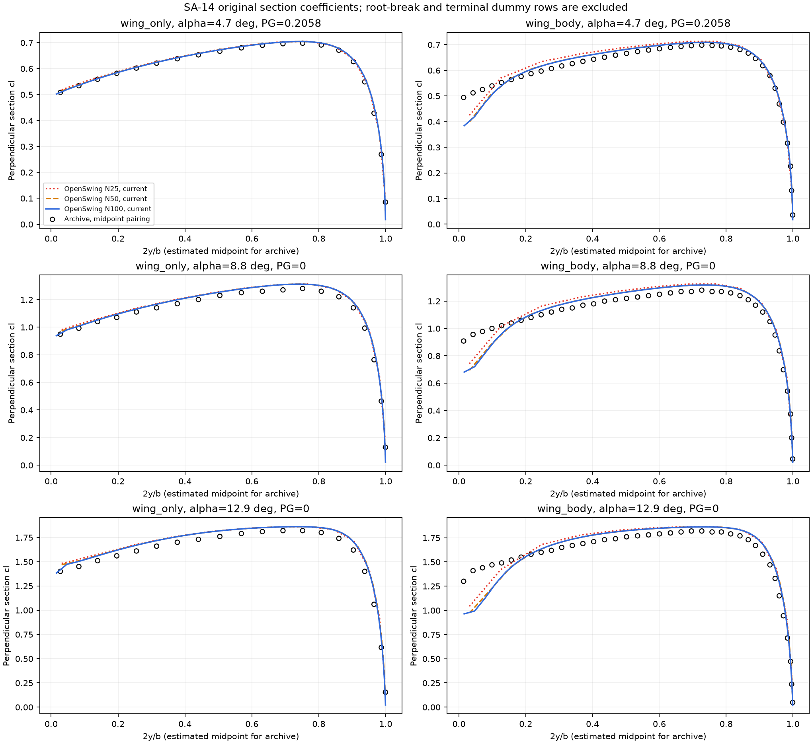

# SA-14 original load-export comparison

**Comparison evidence, not an experimental validation pass.** All six operating points and nine beam tables are retained from the two original text exports. Eighteen existing native solutions provide N25/50/100 comparisons without new solver runs.

The [ASWING manual](https://web.mit.edu/drela/Public/web/aswing/aswing_doc.txt) explains that t/y are node quantities, while chord and cl belong to the following interval midpoint. Their placement on the same printed row is a storage convention. The last derived values are dummy zeros. Doubled stations represent breaks; repeated tip coordinates can also result from limited print precision.

## Recovered sampling and plotting differences

The wing-only export has 42 wing rows: 40 material intervals, a root-break interval, and the final dummy row. The wing/body export has 80 wing rows: 78 material intervals, a root-break interval, and the final dummy row; its body table contains 20 rows. Each is repeated at 4.7°, 8.8° and 12.9°. Pairing chord/cl with interval midpoints restores exact printed left/right symmetry. It does not recover the unrounded mesh or Fourier settings.

| Input | Angle | Chord RMSE at midpoint [m] | Chord RMSE at preceding node [m] | Excess beyond print precision [m] |
| --- | ---: | ---: | ---: | ---: |
| wing_body | 4.7 | 0.00033843 | 0.00295401 | 0 |
| wing_body | 8.8 | 0.00033843 | 0.00295401 | 0 |
| wing_body | 12.9 | 0.00033843 | 0.00295401 | 0 |
| wing_only | 4.7 | 0.000284956 | 0.00571347 | 0 |
| wing_only | 8.8 | 0.000284956 | 0.00571347 | 0 |
| wing_only | 12.9 | 0.000284956 | 0.00571347 | 0 |

The MATLAB arrays retain preceding-node coordinates for copied midpoint values. In each wing-only array, the sample originally at y=0.0889 m is moved to y=0, while the actual root-side sample is omitted. The body-case arrays omit the root-side sample and retain a terminal dummy zero. All row mappings and edits are explicit in the JSON.

## Native comparison

PG follows the printed export: 0.2058 at 4.7° and zero at 8.8°/12.9°. The native speed-derived Mach falls within the printed PG precision. The archive and OpenSwing use different meshes; native values are interpolated at estimated archive midpoints, with out-of-range samples retained as unavailable. Errors use both mirrored halves and are not counts of independent measurements.

| Input | Angle | N | Compared / material intervals | Section-cl RMSE | CL difference | CD difference |
| --- | ---: | ---: | ---: | ---: | ---: | ---: |
| wing_body | 4.7 | 25 | 76 / 78 | 0.0270878 | 0.0198516 | -0.0011682 |
| wing_body | 4.7 | 50 | 76 / 78 | 0.0283202 | 0.012291 | -0.00155212 |
| wing_body | 4.7 | 100 | 78 / 78 | 0.0296719 | 0.0114625 | -0.00151788 |
| wing_body | 8.8 | 25 | 76 / 78 | 0.0668763 | 0.0458121 | -0.00274547 |
| wing_body | 8.8 | 50 | 76 / 78 | 0.0738354 | 0.0315501 | -0.00395779 |
| wing_body | 8.8 | 100 | 78 / 78 | 0.0752249 | 0.0300192 | -0.00387394 |
| wing_body | 12.9 | 25 | 76 / 78 | 0.110644 | 0.071323 | -0.00362158 |
| wing_body | 12.9 | 50 | 76 / 78 | 0.12889 | 0.0537307 | -0.00599406 |
| wing_body | 12.9 | 100 | 78 / 78 | 0.13019 | 0.0511037 | -0.00590162 |
| wing_only | 4.7 | 25 | 38 / 40 | 0.00726991 | 0.00334542 | 0.000142677 |
| wing_only | 4.7 | 50 | 38 / 40 | 0.00991583 | 0.00218859 | -0.000383379 |
| wing_only | 4.7 | 100 | 40 / 40 | 0.0162154 | 0.00177267 | -0.00037708 |
| wing_only | 8.8 | 25 | 38 / 40 | 0.0349642 | 0.0139503 | 0.000929095 |
| wing_only | 8.8 | 50 | 38 / 40 | 0.0380356 | 0.0116423 | -0.000889753 |
| wing_only | 8.8 | 100 | 40 / 40 | 0.040954 | 0.0105152 | -0.000868071 |
| wing_only | 12.9 | 25 | 38 / 40 | 0.0718749 | 0.0257553 | 0.00284657 |
| wing_only | 12.9 | 50 | 38 / 40 | 0.0748725 | 0.0224418 | -0.00110775 |
| wing_only | 12.9 | 100 | 40 / 40 | 0.0713915 | 0.0200627 | -0.00105547 |

The section-cl curves are not the primary experimental wind-axis load distribution. The archive does not provide the relative velocities and force vectors needed to convert perpendicular cl into that quantity. The [pilot](isae-sa14-pilot.md) uses native strip forces for the experimental comparison; the MATLAB cl/chord multiplier remains a separate diagnostic.

## Moment-reference limitation

The literal wing-only file sets its moment reference to x=18.5 m. Its native Cm differs greatly from the archived Cm. An independently shifted origin moment is much closer, but the archive does not state its reference location. This suggests a reference/setup conflict; it does not establish the historical setting. The input is unchanged and the shift is only a diagnostic.

| Wing-only angle | Archived Cm | Native Cm at source reference, N100 | Native origin Cm, diagnostic |
| ---: | ---: | ---: | ---: |
| 4.7 | -1.3084 | 12.1556 | -1.31572 |
| 8.8 | -2.4058 | 22.5692 | -2.44704 |
| 12.9 | -3.4595 | 32.5678 | -3.52494 |

The full [data and audit](isae-sa14-load-exports.json) retain global CL/CD/CDi/Cm, a separately labeled moment-origin diagnostic, printed precision, every original body row, missing samples and module/cache hashes. Archived initialization/discretization, section-polar provenance and experimental uncertainty remain unresolved. The later [incidence study](isae-sa14-incidence.md) compares explicit iw=4° reconstructions; original input/digitization provenance remains missing. The [swept force-velocity limit](swept-lifting-line-limit.md) still prevents a broad physical-validation claim.
