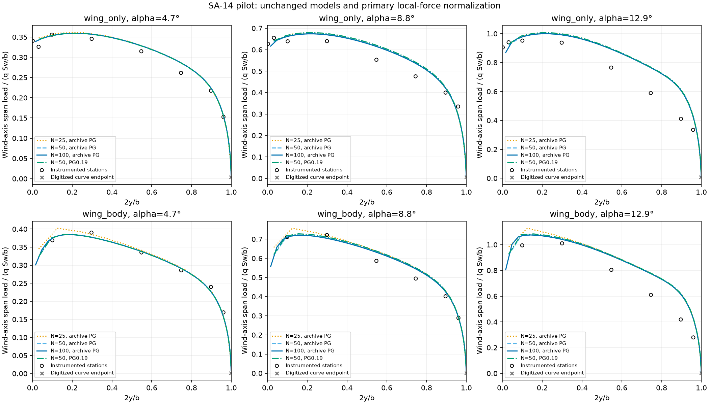

# SA-14 wing/body pilot

**The full family study remains unfinished.** All 50 native pilot states computed. These use the four original inputs without geometric edits or fitted parameters. [Source audit](isae-sa14-sources.md), [pilot results](isae-sa14-pilot.json), [comparison data](isae-sa14-pilot-comparison.json), and [independent body-field integration](isae-sa14-volume.json) preserve the evidence.

The subsequent [extended lift study](isae-sa14-polars.md) completes all 180 archived polar rows and 44 exact experimental global-lift points across 2,952 requests. It retains source convergence flags, physical-validity rejections and the remaining model limitations.

## Local measured loads

The later [original load-export audit](isae-sa14-load-exports.md) resolves the
staggered coordinate convention and maps manually edited plotting rows. Its
section-cl comparisons remain distinct from the experimental force comparisons
below; exact archived discretization remains unknown.

The subsequent [4° incidence study](isae-sa14-incidence.md) compares the other
24 source points using two equivalent, explicitly reconstructed coordinate
frames. It resolves the primary angle convention and the partly measured
η=0.15 station, while retaining missing-input provenance and experimental errors.

The primary ordinate is wind-axis force per span divided by q times mean geometric chord Sw/b. It is computed from strip forces. The archived MATLAB chord and area multipliers are retained separately. PG follows the distribution exports for this table: speed-derived Mach at 4.7°, zero at 8.8° and 12.9°. The plots also show a same-mesh primary-Mach 0.19 diagnostic.

| Input | Angle | Compared points | N100 local-load RMSE |
|---|---:|---:|---:|
| wing_only | 4.7° | 8 / 8 | 0.01254567 |
| wing_only | 8.8° | 8 / 8 | 0.03819342 |
| wing_only | 12.9° | 8 / 8 | 0.1117392 |
| wing_body | 4.7° | 6 / 6 | 0.009602036 |
| wing_body | 8.8° | 6 / 6 | 0.03003403 |
| wing_body | 12.9° | 6 / 6 | 0.1319908 |

The [primary-station audit](isae-sa14-measurements.json) distinguishes 42 instrumented-station points from six digitized tip-curve endpoints. This classification follows primary Figure4, whose outermost pressure station is 2y/b=0.96, and Figure7. All 48 source points remain unchanged. The JSON retains both instrumented-point and all-digitized-point errors; curve endpoints are marked separately in the plot.

Errors increase at the largest tested incidence. The source section polar is not supplied: its airfoil text file contains coordinates, while the literal models specify a linear slope and CLmax. These are comparisons, not a physical accuracy certificate.

## Body interference and convergence

The current model produces a nonzero wing-load increment when either supplied body is added. The table keeps total, full-wing and exposed-wing lift increments distinct, using the primary wing area for every coefficient.

| Added body, N100 | Angle | Delta total CL | Delta full-wing CL | Delta exposed-wing CL |
|---|---:|---:|---:|---:|
| wing_body | 4.7° | 0.01297395 | 0.009810032 | 0.01051043 |
| wing_body | 8.8° | 0.02587228 | 0.019047 | 0.01884609 |
| wing_body | 12.9° | 0.04029162 | 0.02996999 | 0.02674479 |
| infinite_body | 4.7° | 0.01636105 | 0.01636105 | 0.01528713 |
| infinite_body | 8.8° | 0.02530425 | 0.02530425 | 0.02359846 |
| infinite_body | 12.9° | 0.03075723 | 0.03075723 | 0.02640392 |

**Integrated lift is insufficient to establish convergence.** At 12.9° in the wing-only case, maximum local normal Mach grows from 0.186 to 0.298 to 0.571 at N25/50/100. The location approaches the wing tip. The sampled tip circulation falls while its local induced speed grows. This remains unresolved and requires finer-mesh/representation checks against the documented lifting-line formulation; no core or local-Mach guard has been changed.

The subsequent [swept-line field diagnosis](swept-lifting-line-limit.md) reproduces this mechanism with prescribed smooth circulation. Independent integration matches nine SA-14 force-point velocities within 1.26e-11 m/s and isolates the growing trailing-wake contribution. The refined force-velocity treatment and reference-ASWING behavior still need resolution.

Independent adaptive quadrature checks the source/doublet body velocity at six external wing locations, at zero and 8.8° incidence. At N100 the maximum component difference is 3.48e-7 m/s for the finite body and 1.04e-5 m/s for the long constant-radius body. The long-body field is explicitly nonzero at nonzero incidence. This verifies the implemented regularized field; it does not enforce the missing wake/body impermeability interaction or validate the complete circulation solution.

## Runtime checks

- wasm: 50 states, `NUMERICAL_REPLAY_PASS_DISPLAY_OUTCOMES_RECORDED`; [evidence](isae-sa14-wasm.json). Display failures are recorded separately.
- browser: 15 states, `PASS_EXPECTED_OUTCOMES`; [evidence](isae-sa14-browser.json). Display failures are recorded separately.

The standalone body-only file is 12 times larger than the coupled fuselage and has different reference values. Its native display fails on a tiny negative zero-radius endpoint; it is not silently resized or used as a replacement for the coupled input.

## Still needed

- The three 60-point polars and 44 measured total/exposed lift points are now compared in the [extended study](isae-sa14-polars.md); experimental validation remains incomplete.
- The [incidence study](isae-sa14-incidence.md) compares all 24 iw=4° points with explicit reconstructions; original input/digitization provenance and physical discrepancies remain unresolved.
- The [load-export audit](isae-sa14-load-exports.md) reconciles staggered coordinates and plotting edits; the original unrounded mesh and operating settings remain unresolved.
- Investigate tip-local-flow growth, circulation representation and higher-mesh behavior; add independent complete-flow checks.
- Resolve and release the zero-radius endpoint fix after the pinned validation runs and broader regression checks finish.
- Complete the experimental uncertainty and model-limit audit.

This pilot does not increase released family coverage or mark any broad ASWING requirement complete.
