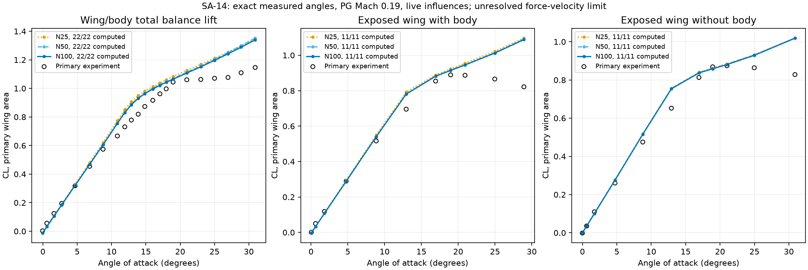
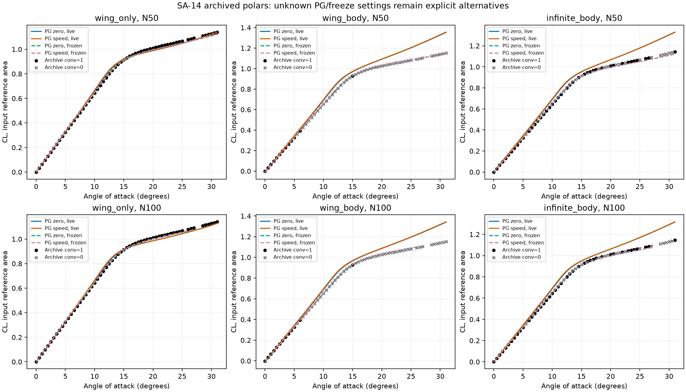

# SA-14 global lift comparisons

**The full family validation remains incomplete.** This study evaluates all 180 archived polar rows and all 44 digitized total/exposed-wing lift points at their exact angles. It preserves original inputs, archive convergence flags and unavailable OpenSwing states. [Source audit](isae-sa14-sources.md), [native results](isae-sa14-polars.json), [comparisons](isae-sa14-polars-comparison.json).

The 2,952 requests produced 2,904 computed states and 48 rejections. Three meshes, live/frozen influences, and explicit PG alternatives remain separate. These are finite-mesh comparisons, not a resolution of the [swept force-velocity limit](swept-lifting-line-limit.md).

## Experimental lift

The separate [original load-export audit](isae-sa14-load-exports.md) now preserves
and compares all original spanwise tables, with midpoint coordinates, dummy rows
and printed precision identified. It does not resolve the archive's exact mesh
or the remaining physical-validation limits listed below.

The table uses primary Mach 0.19, live influences and N100. All coefficients use the primary wing area. Total wing/body balance lift includes the body; the other two series use pressure-integrated exposed-wing lift outside 2|y|/b=0.1. Partial boundary strips use their exposed fraction. No source MATLAB area multiplier is substituted for these observables.

| Observable | Compared / source points | CL RMSE on available states | CL RMSE within ±13° |
|---|---:|---:|---:|
| Wing/body total balance lift | 22 / 22 | 0.0921702 | 0.0562373 (10/10) |
| Exposed wing with body | 11 / 11 | 0.0978923 | 0.0370205 (6/6) |
| Exposed wing without body | 11 / 11 | 0.0697556 | 0.0451659 (6/6) |

All 44 points have computed predictions in this selected setting. Across the full sweep, missing predictions remain null values and breaks in plotted curves; a counted RMSE does not certify an omitted range. The exposed-wing predictions keep increasing at the largest sampled angles, while the measured exposed-wing lift declines after its peak. The supplied section properties do not reproduce that behavior.

Between N50 and N100, the largest primary-Mach/live-influence CL changes within ±13° are 0.00265, 0.00112, 0.00111 for total wing/body lift, exposed wing/body lift and exposed wing-only lift respectively. Across the full measured range they are 0.01272, 0.00283, 0.00188. These are smaller than the experimental discrepancies, but do not establish a convergent force-point velocity.

## Archived ASWING curves

| Original input | Archive rows | Flagged converged | Flagged unconverged |
|---|---:|---:|---:|
| wing_body | 60 | 13 | 47 |
| infinite_body | 60 | 43 | 17 |
| wing_only | 60 | 60 | 0 |

All archive rows remain available. Main archive error metrics use only rows flagged converged; separate diagnostics retain the other rows. The scripts toggle PG mode without recording its starting state and do not record mesh, circulation mode count or frozen-influence setting. Zero-PG and speed-derived PG, with live and frozen influences, are hypotheses rather than a fitted choice of the closest curve.

## Runtime checks

- wasm: 78 cases, 72 matching solutions and 6 matching rejections. [Evidence](isae-sa14-polars-wasm.json).
- browser: 12 cases, 7 matching solutions and 5 matching rejections. [Evidence](isae-sa14-polars-browser.json).

Runtime agreement verifies the executed numerical path; it does not resolve the physical model or source uncertainties.

## Remaining work

- Resolve the swept bound-line force-velocity treatment and verify it against both independent physics and reference ASWING behavior.
- Recover or document the archive discretization and settings; compare original local-load exports independently of manually modified plotting arrays.
- The [incidence study](isae-sa14-incidence.md) now compares all 24 iw=4° points using explicit reconstructions and a documented Figure15/17 inference. Original digitization/input provenance and experimental discrepancies remain unresolved.
- Complete section-polar provenance, experimental uncertainty and higher-angle model-limit analysis.
- Release the isolated endpoint repair after its broader regression and the pinned SA-11 studies finish.

The released family coverage count and broad feature-completion claims are unchanged.
