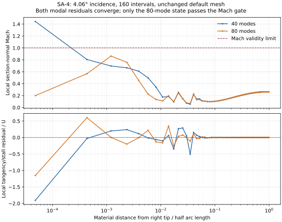

# SA-4: captured Fourier tip fields and remaining resolution problem

Updated 2026-10-29. A rejected SA-4 solution now has a complete retained
circulation and velocity field. Its extreme tip speed is reproduced by an
independent scalar Biot–Savart calculation. The strongest contribution is the
outer-tip trailing filament, only **4.581 micrometres** from the force receiver
in the plane perpendicular to the wake. This establishes the source of the
spike in this discrete state; it does not establish a corrected native mesh or
a physically valid solution.

## Two controlled captures

Both cold calls use the original SA-4 model, 160 default cosine intervals,
4.06° incidence, 89.4 m/s, zero influence PG Mach, current influences,
natural splines and unchanged stall parameters. Only the Fourier count differs.
The pair was chosen from the previously retained failed/passing diagnostic
states, without a new mode search. Passive tracing copies existing arrays
immediately before the Mach check. It does not invoke an extra residual,
influence evaluation or solver, and the original check executes normally.

| Quantity | 40 modes | 80 modes |
|---|---:|---:|
| Original outcome | Rejected by Mach check | Computed |
| Maximum projected residual | 4.574e-16 | 7.467e-14 |
| Maximum local residual | 1.90675 | 1.15336 |
| Maximum section-normal Mach | 1.44354 | 0.86319 |
| Location of right-side maximum, zero-based interval | 159 | 157 |
| Mach at outermost interval 159 | 1.44354 | 0.19979 |
| Gamma at interval 159, m²/s | 0.0149600 | 0.00264088 |
| Outer-tip filament contribution there, m/s magnitude | 519.299 | 91.6715 |

Both production circulation solves satisfy the unchanged projected `1e-8`
gate. A finite Fourier series constrains the weighted residuals of Eq. 201;
it does not force every local residual to vanish. Thus the 80-mode result
passing the Mach check does not establish local flow accuracy or convergence.
The earlier [320-interval study](isae-sa4-fourier-refinement-20261029.md)
already showed that these mode choices do not provide a converged remedy.

The figure retains every right-half interval. Its horizontal axis is material
distance from the tip, normalized by the half arc length. No interpolation
supplies additional physical samples; connecting lines only aid reading.

## What the mode decomposition shows

The two states have identical source and receiver geometry, wind and freestream
arrays. At interval 159, the 40-mode state has a bound contribution
`[-2.137, +13.245, +13.760] m/s` and a wake contribution
`[+10.049, −487.033, −141.576] m/s`. The outer-tip wake accounts for most
of the large lateral contribution. Its ray begins upstream of the receiver
by 77.44 micrometres along the wind direction; the perpendicular separation
is 4.581 micrometres. The local wind/span cross-product magnitude is 0.07424.

In the 80-mode solution, modes 41–80 oppose the first forty modes strongly
at the outer tip. Their respective lateral induced-velocity contributions
are `+634.774` and `−700.364 m/s`; summing all modes gives `−65.590 m/s`.
The coefficients of the first forty modes also change between solutions.
Consequently, simply truncating the 80-mode result would not reproduce the
independently solved 40-mode state.

The individual outer-tip filament contribution falls to 91.6715 m/s, but
the largest local speed moves two intervals inward. At interval 157, the
strongest wake contribution instead grows from 186.581 to 269.341 m/s.
These are individual vector magnitudes, not additive contributions to total
speed or Mach. They show why a single recovered solve cannot establish that
the tip discretization is resolved.

All **32 saved-field decomposition checks pass**: circulation decoding,
common geometry, component sums, modal sums and the two-state difference
identity. Their largest normalized error is `1.345e-12`, below `1e-10`.
No production kernel is imported by this decomposition and no new equilibrium
is computed from a truncated mode set.

An additional [endpoint-order analysis](../../artifacts/isae/sa4-rejected-fourier-field-20261029/endpoint-order/report.md)
finds that the current spline's chord vanishes linearly with material distance
from the tip. Independent natural-spline arithmetic on all 81 literal input
knots gives `c ≈ 0.428198 theta²` near the right tip. A finite sine series instead
has `Gamma ≈ theta sum(k A_k)` unless that endpoint sum vanishes. The measured
sums are 1.50043 and 0.139651 for the 40- and 80-mode states. Their formal
`Gamma/c` ratios therefore grow toward the endpoint.

This supplies a concrete resolution concern: the chord shrinks faster than
the leading circulation term in these finite series. It is not by itself a
proof of divergent induced speed, because vortex contributions can cancel.
The 80-mode outermost sample also has substantial higher-order terms; its
leading expansion alone underpredicts Gamma by 48%. No added endpoint
constraint or different basis is justified by this diagnostic.

## Fixed-circulation refinement

A subsequent [controlled refinement](../../artifacts/isae/sa4-fixed-fourier-refinement-20261029/combined-report.md)
holds each captured Fourier coefficient vector fixed while changing only the
spatial mesh. It evaluates nine declared force receivers and nine control
receivers on each grid, including the outermost three intervals on each side.
There are **eight prescribed fields and zero nonlinear solves**. These fields
are not new equilibria or eligible ISAE predictions; the table shows the right
outermost receiver, not necessarily the maximum across the wing.

| Intervals | K40 outer-tip normal Mach | K40 speed / intervals, m/s | K80 outer-tip normal Mach | K80 speed / intervals, m/s |
|---:|---:|---:|---:|---:|
| 160 | 1.44354 | 3.06942 | 0.19979 | 0.42482 |
| 320 | 2.92038 | 3.10482 | 0.25695 | 0.27318 |
| 640 | 5.91521 | 3.14440 | 0.49546 | 0.26338 |
| 1,280 | 11.91838 | 3.16778 | 1.03483 | 0.27505 |

The 40-mode tip speed grows approximately in proportion to interval count.
Even the fixed 80-mode field eventually crosses the unchanged local Mach
limit. Thus the captured spike is not just a different nonlinear root found
on a finer mesh: it grows when the coefficients are unchanged.

An independent [local derivation](../../artifacts/isae/sa4-fixed-fourier-refinement-20261029/derivation.md)
uses the midpoint horseshoes and receiver geometry in the
[technical description](https://web.mit.edu/drela/Public/web/aswing/asw_theory.pdf),
Eqs. 150–160. At the outermost cosine interval, chord and wake separation
scale as `1/N²`, while a finite sine series with nonzero endpoint sum supplies
circulation proportional to `1/N`. Summing the signed near-tip filaments
cancels the odd kernel term; the swept-line even term remains. The predicted
limits of normal speed divided by N are **3.19299 m/s** for K40 and
**0.297186 m/s** for K80. K40 is within 0.79% of its limit at N1280;
K80 is still 7.45% below its limit, consistent with its later asymptotic regime.
The derivation supplies no finite-N error bound.

This distinguishes a local velocity limit from an integrated-force limit.
The shrinking tip interval can still make its integrated lift and drag tend
to zero. Likewise, the Fourier residual weights suppress the endpoint
contribution, so a small projected residual need not guarantee a small local
residual. Neither observation proves that every default pointwise SA-4
failure has this cause, or establishes the historical native geometry.

The original N640/N1280 requests were rejected by the public 512-interval
input limit before influence construction; those four errors are retained.
A separate diagnostic worker allowed only the two declared higher counts.
Its four N160/N320 geometry/circulation controls match the original fields
exactly in all **56 comparisons**. Production count limits, geometry checks,
physical checks and algorithms remain unchanged. It then evaluated the four
previously unavailable fields, without repeating the original field calls.

The [independent scalar audit](../../artifacts/isae/sa4-fixed-fourier-refinement-20261029/independent-review.md)
retains **FAIL: 1,032/1,034 checks pass**. All full HV/CP velocity vectors and
normal-Mach comparisons pass their predeclared `1e-10` scaled gates; the largest
full-vector error is `8.752e-11`. Two bound-only sums at N1280 fail, with
scaled errors `1.104e-9` and `1.152e-10`. The adjacent bound segment has a
perpendicular distance squared of `1.038e-28 m²`, below the production
`1e-26` cutoff. The independent outside-segment expression retains its small
finite contribution. All coefficient-preservation, baseline replay and
coarse-grid identity checks pass. The two component failures remain recorded;
no tolerance was changed and no replay was repeated to obtain a pass.
Their maximum absolute component differences are `1.17e-7` and `1.23e-8 m/s`,
respectively, compared with tip normal speeds of about 4,055 and 352 m/s.

## Independent replay and its qualification

A scalar replay evaluates full force-point and control-point vectors for
all 160 intervals in both states, using the exact captured source coordinates
and circulation. All numerical comparisons pass their predeclared `1e-10`
gates; the maximum scaled field difference is `1.008e-14`. It also reconstructs
section cl, leakage, local residuals and their Fourier projection. In contrast
to the earlier SA-5 replay, full captured control-point vectors are available.

The replay nevertheless retains **exit 1** under its predeclared singularity
qualification: two root interactions per state have positive perpendicular
distance squared around `1.2e-32 m²`. The production kernel applies its
`1e-26` cutoff, while the independent outside-segment formula retains their
tiny contributions. Both receiver locations lie on extensions outside the
source segments, away from the tip spike. No numerical comparison failed.
The original qualified outcome is preserved; no gate was relaxed or field
replayed until it passed.

The [ASWING guide](https://web.mit.edu/drela/Public/web/aswing/aswing_doc.txt)
and steady Eq. 73 require local section-moment scaling independently of the
chosen influence Mach. They provide no supersonic continuation for that
formula. They also do not establish that native ASWING rejects the entire
result at the first local Mach violation. SA-4 has identically zero section
moment inputs. OpenSwing's blanket validity check therefore must not be
represented as authenticated native behavior; it remains unchanged here.

## Evidence and next implication

The [capture protocol and outcomes](../../artifacts/isae/sa4-rejected-fourier-field-20261029/report.md)
retain both complete states and the original exception. All 27 capture checks
pass; both worker processes were reaped without timeouts. An
[independent capture audit](../../artifacts/isae/sa4-rejected-fourier-field-20261029/independent-capture-review.md)
passes 1,131 saved-evidence checks. The
[independent replay](../../artifacts/isae/sa4-rejected-fourier-field-20261029/independent-replay/report.md)
retains all numerical comparisons and its root-cutoff qualification.
The [modal decomposition](../../artifacts/isae/sa4-modal-tip-decomposition-20261029/report.json)
retains every selected receiver, every modal vector and the five strongest
wake terms; its [independent review](../../artifacts/isae/sa4-modal-tip-decomposition-20261029/independent-review.md)
finds no material algebra or topology error. The separate
[Mach source review](../../artifacts/isae/sa4-mach-source-20261029/review.md)
pins the primary excerpts and literal zero-moment inputs.

For SA-1/SA-5, the parallel [quadrature source review](../../artifacts/isae/sa15-residual-quadrature-20261029/review.md)
confirms that Eq. 201 explicitly uses the implemented midpoint sine weights.
Their retained high-angle pointwise states bypass those weights entirely.
Changing to exact sine integrals would not address that shared deficit.

This work narrows SA-4 toward tip geometry and circulation resolution, without
changing a physical equation, core model, validity gate, mode default or
registered ISAE count. SA-1–SA-5 remain **1,190/1,288 default** and
**1,208/1,288 modified spacing** at the provisional 3% reference tolerance.
