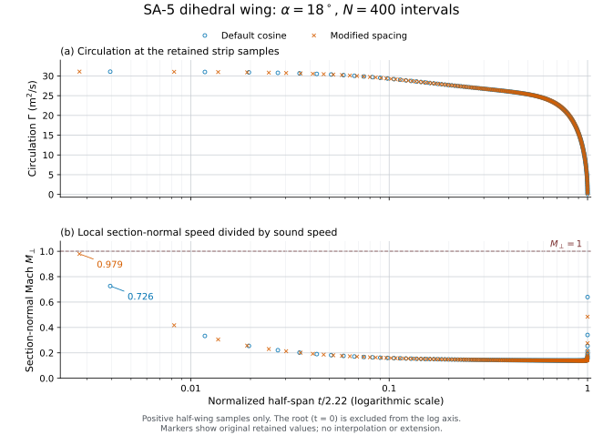

# SA-5: root loading and the modified-spacing improvement

At 18° incidence, changing mesh and transferring the retained circulation
reproduces **98.58–100.01% of the change in induced-velocity lift** across both
meshes, transfer directions and predeclared reconstructions. This narrows the
explanation for SA-5's higher near-field lift: it largely follows the discrete
mesh and force evaluation, while the circulation-based Trefftz lift scarcely
changes. It does not identify the historical ASWING corner treatment.

Registered results remain unchanged: default SA-5 **154/168**, separate modified
spacing **162/168** at 3%. All modified total-drag checks pass, but the two 18°
CDi comparisons remain **3.31–3.35% low**, and four zero-lift efficiency values
remain undefined. No production physics, mesh default, acceptance tolerance or
physical-validity gate changed in this investigation.

## Locating the near-field contribution

The literal mirrored SA-5 wing has `r(t)=(0,t,abs(t))`, unit chord, zero twist
and two straight 45° dihedral legs. The six retained modified-mesh fields at
2°, 14° and 18°, on 200 and 400 intervals, give the following decomposition:

| Incidence | Intervals | Trefftz CLi | Near-field circulation CL | Induced-velocity CL | Share within inner 10% of half-span |
|---:|---:|---:|---:|---:|---:|
| 2° | 200 | 0.086211615 | 0.087537471 | 0.001325856 | 72.79% |
| 2° | 400 | 0.086255062 | 0.087746750 | 0.001491688 | 75.78% |
| 14° | 200 | 0.613683527 | 0.675987377 | 0.062303850 | 72.34% |
| 14° | 400 | 0.613954001 | 0.684209494 | 0.070255493 | 75.14% |
| 18° | 200 | 0.732300842 | 0.817087329 | 0.084786487 | 72.24% |
| 18° | 400 | 0.732450245 | 0.828259654 | 0.095809408 | 74.93% |

Here induced-velocity CL is the lift projection of the Kutta–Joukowsky force
`rho * Gamma * (v_induced × span) * ds`. It is neither induced drag nor profile
lift. The freestream part equals Trefftz CLi to roundoff on these straight
legs; tangent versus segment integration does not explain this difference.
Total lift also includes the separate profile force, which contributes
**−0.003006036** at 18° and 400 intervals.

The [technical description](https://web.mit.edu/drela/Public/web/aswing/asw_theory.pdf),
§8.1, Eqs. 207–211, describes near-field and Trefftz lift as close; it does not
require exact equality. That wording alone does not validate the size or mesh
dependence of the present difference.

Bound vortices account for almost all the additional lift. At 18° and 400
intervals their contribution is **0.095443301**, versus **0.000366107** from
trailing vortices. The initial decomposition uses the model's coplanar bound
segments and wind-parallel wake. A separate standard-library scalar
Biot–Savart integral independently reproduces all **1,800 receiver velocities**
and six integrated bound-lift values: maximum scaled velocity error
**5.78e-14**, maximum absolute CL error **5.55e-17**. It imports no production
operator and performs no nonlinear solve.

The [localization report](../../artifacts/isae/sa5-load-localization-20261029/report.md)
and [independent replay](../../artifacts/isae/sa5-load-localization-20261029/bound-integral.json)
retain all sample contributions and source pins. The first replay attempt
encountered a Path-indexing typo in its final reporting check; its original
script, protocol and failure receipt are preserved. The corrected replay changes
no numerical calculation or gate.

## Separating mesh effects from solved circulation changes

A predeclared 12-call study at **18° only** contains two fresh default-grid
nonlinear solves, two prescribed same-grid modified replays and eight prescribed
cross-grid evaluations. Each mesh uses both linear and PCHIP reconstruction in
both transfer directions. Original physical settings and interval counts remain
fixed. Every process completed successfully and was reaped.

| Intervals | Reconstruction | Actual induced-velocity ΔCL | Default-to-modified mesh/transfer term | Remaining circulation term |
|---:|---|---:|---:|---:|
| 200 | Linear | 0.005371989 | 0.005295759 | 0.000076230 |
| 200 | PCHIP | 0.005371989 | 0.005315126 | 0.000056862 |
| 400 | Linear | 0.005366119 | 0.005334850 | 0.000031269 |
| 400 | PCHIP | 0.005366119 | 0.005343348 | 0.000022771 |

For example, the forward decomposition of a force functional `F` is exactly
`F(modified, Gamma_modified) - F(default, Gamma_default)` =
`[F(modified, transfer(Gamma_default)) - F(default, Gamma_default)]` +
`[F(modified, Gamma_modified) - F(modified, transfer(Gamma_default))]`.
The reverse decomposition yields the same qualitative attribution. The mesh
term includes source filaments, receivers, quadrature and reconstruction; it
does not isolate receiver location alone.

Fresh default integrated outputs reproduce the saved baseline within
**8.90e-16 scaled error**; modified same-grid full-field replays match exactly.
The eight transferred fields have normalized circulation residuals between
**0.05743 and 4.92433**, with the largest defects near the outer tips. They are
deliberately prescribed diagnostics, not converged replacement solutions.
Both reconstructions assume constant continuation to the root and zero
circulation at the original outer tips. Their agreement does not bound that
shared endpoint uncertainty. Profile-force and total-CD attribution are more
sensitive to reconstruction; the lift percentage above must not be applied to
drag or total CL.

The [cross-grid report](../../artifacts/isae/sa5-cross-grid-loading-20261029/report.md)
retains both decompositions for every force channel, raw fields, interpolation
inputs, Mach checks and process receipts. An independent standard-library
[review](../../artifacts/isae/sa5-cross-grid-loading-20261029/independent-review.md)
reproduces all 12 raw force decompositions, 80 forward/reverse channel identities
and eight circulation transfers, including an independent PCHIP reconstruction.
Its separate provenance audit passes all 647 checks.

## Why more refinement is not yet an accuracy claim

The earlier [sharp-corner analysis](../../artifacts/isae/sa5-dihedral-junction-20261028/corner-asymptotic.json)
shows that a continuous nonzero limiting root circulation would produce an
opposite-leg bound velocity proportional to `1/r`, and a logarithmic integrated
circulation-lift contribution. This is a conditional result: the finite grids
do not prove that limiting circulation, and profile loads require separate
analysis.

The modified spacing places the nearest samples about 30% closer to the root.
At 18° and 400 intervals, maximum section-normal Mach rises from **0.72619** on
the default mesh to **0.97923** on the modified mesh. All 12 evaluated fields
remain below the unchanged unity gate. Closer agreement with selected archived
forces therefore does not establish a converged solution under refinement.

The figure shows original positive-half samples without interpolation. Its
logarithmic horizontal axis excludes the root itself; the first samples lie
at different distances from that root. The [plot script and receipt](../../artifacts/isae/sa5-cross-grid-loading-20261029/figures/receipt.json)
retain the inputs and image provenance.

A parameter-free corner estimate using the nearest saved circulation predicts
the observed spacing shift in `CL−CLi` within **1.48–5.78%** across the six
states. This is an amplitude proxy, not a fitted correction or a validated
continuum limit; see the [retained calculation](../../artifacts/isae/sa5-load-localization-20261029/corner-spacing-proxy.md).

The evidence strengthens a common SA-2/SA-5 theme: near-field force recovery is
sensitive to mesh placement around vortex singularities. SA-1/SA-5's remaining
high-angle CDi deficits instead track slightly low circulation-based lift;
modified spacing does not remove them. SA-4 also has strong local vortex
velocities, but its dominant problematic contribution is from trailing wakes
near curved tips. These observations do not justify one universal mesh/core
change. The native discrete geometry and force conventions remain the next
source questions, alongside the unresolved high-angle loading difference.
