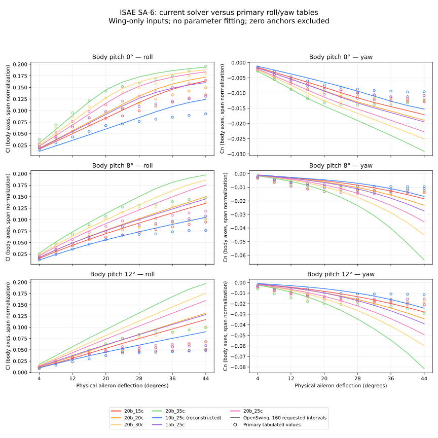

# ISAE SA-6: current roll/yaw comparison

**Experimental interpretation superseded:** the [separate-aileron comparison](isae-sa6-single-aileron.md)
reproduces the primary tables' arithmetic combination of separate up/down tests.
This report used simultaneous opposite deflections, a different nonlinear
calculation. It also retains three combined-yaw transcription errors explicitly
corrected in the new report. Its original numerical results remain unchanged.

The 2026-10-25 current-source rerun completes **504/504 cases, with no rejected
states**. Experimental discrepancies remain. The largest change from the
historical calculation is only 9.40e-14 in roll coefficient and 8.92e-15 in yaw
coefficient. Recent solver changes have therefore neither introduced nor
resolved these discrepancies.

This is the first comparison after the user redirected validation work from
the unidentified Daedalus operating point to ISAE. The original
[SA-6 study](isae-sa6.md), inputs and results are preserved.



## Conditions and measurement accounting

Seven physical control variants are evaluated at body pitches 0°, 8° and 12°,
physical aileron deflections 0°–44° in 4° increments, and 80/160 requested
intervals (84/164 actual strips). The models already contain 4° wing incidence.
Current aerodynamic influences, 20 m/s and zero PG Mach reproduce the declared
archived calculation settings. **The primary tables combine faired observations
at three speeds; they are not a single experiment at 20 m/s.**

The [primary source audit](isae-sa6-sources.json) establishes the body-axis
moments, control handedness and yaw conversion from tail-distance to span
normalization, 25/60. The 10-inch control variant uses the separately documented
±0.508 m boundary reconstruction: the original file labeled `10b` actually
defines 15-inch ailerons. Its literal file and historical results are unchanged.

The primary tables supply **231 nonzero-deflection locations**, each with roll
and yaw coefficients: **462 tabulated coefficient values**. The 21 added
zero-deflection symmetry anchors are not measurements. This report excludes
those anchors from experimental RMSE, while retaining the old anchor-inclusive
metrics for traceable comparison. For these virtually exact zero anchors, the
measured-only RMSE is sqrt(12/11), about 4.45%, above the old calculation solely
because the denominator is corrected.

## Current discrepancies

These are coefficient errors at the finer mesh. Each RMSE uses all eleven
nonzero primary deflections. Ranges cover the seven physical control variants;
no experimental acceptance threshold is inferred.

| Body pitch | Roll RMSE range | Yaw RMSE range | Largest absolute roll error | Largest absolute yaw error |
|---|---:|---:|---:|---:|
| 0° | 0.008573–0.018982 | 0.002286–0.007753 | 0.031300 | 0.017148 |
| 8° | 0.012487–0.028412 | 0.003101–0.022065 | 0.056894 | 0.051603 |
| 12° | 0.021145–0.055418 | 0.004067–0.023986 | 0.098151 | 0.052306 |

For example, the 35%-chord aileron at 12° body pitch and 44° deflection gives
roll coefficient **0.19715 versus 0.09900** in the primary table, and yaw
coefficient **−0.08147 versus −0.02917**. Those are about 99% excess roll and
179% excess yaw magnitude. These describe one large-deflection condition,
not the accuracy of the entire operating range.

The largest 80-to-160 mesh changes over the whole study are **0.0004869 in roll**
and **0.0001041 in yaw**, far smaller than the largest experimental errors.
Two meshes establish this sensitivity, not a rigorous continuum error bound.

All states pass the existing full-residual and independent strip-wrench checks.
Maximum residual is 6.51e-13 against 1e-8; maximum wrench-normalization error is
2.78e-17 against 2e-10. Zero-control lateral moments remain below 4.61e-16.
These verify the numerical calculation and symmetry, not the experimental model.

A separate [saved-data audit](isae-sa6-current-audit.json) passes 18,544 checks,
including reconstruction of the primary tables, all error statistics, mesh
differences, historical differences, CSV rows and input identities. It performs
no aircraft solves.

## Next physical work

The comparison prioritizes control effectiveness and stall/drag behavior over
another solver-speed change or simple mesh doubling. Establish the section
control inputs and their finite-deflection applicability from independent
section data, and quantify the omitted experimental fuselage before attributing
the discrepancy to any one cause. No stiffness, aerodynamic coefficient or
tolerance was adjusted to improve agreement.

SA-6 remains partial; suite coverage remains **17 partial / 24 pending /
0 fully validated**. AE-3 remains separately pending because both numerical
mesh convergence and experimental amplitude/incidence conventions are unresolved.

## Reproduction and data

```sh
OPENBLAS_NUM_THREADS=1 OMP_NUM_THREADS=1 MKL_NUM_THREADS=1 NUMEXPR_NUM_THREADS=1 \
  .venv/bin/python scripts/compare-isae-sa6-current.py
.venv/bin/python scripts/plot-isae-sa6-current.py
```

The runner preserves each completed state in a cache keyed by all current
kernel modules, helper scripts, seven literal inputs and source reports. It
checks those identities again before writing the final result. It performs no
source promotion or browser build. Historical files are read-only inputs.

[Machine-readable comparison](isae-sa6-current.json),
[all 504 rows as CSV](isae-sa6-current.csv),
[SVG figure](isae-sa6-current.svg), [PNG figure](isae-sa6-current.png).

The physical sources are [NACA TR-298, Tables V/VI](https://ntrs.nasa.gov/api/citations/19930091367/downloads/19930091367.pdf)
and [NACA TR-343, Tables V/VI and XIII/XIV](https://ntrs.nasa.gov/api/citations/19930091412/downloads/19930091412.pdf),
with models from the pinned [ISAE repository](https://github.com/rom1isae/ISAE_Aswing_Experimental_Validation/tree/f62943df20e9e4d7d9f50e070477b22426b5f865).
