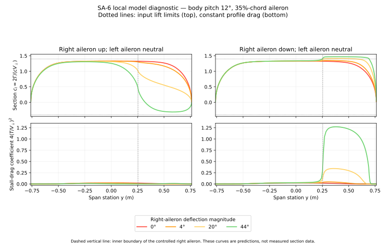

# ISAE SA-6: local stall and control diagnosis

The large downward-aileron yaw prediction is dominated by the documented
stall-drag term on the controlled wing region. The upward-aileron discrepancies
also involve circulation. A separate reconstruction of every strip's loads
passes, so this study identifies no force-law implementation correction.
**The experimental mismatch remains unresolved.**

This follows the [corrected separate-aileron comparison](isae-sa6-single-aileron.md).
It retains local fields for 21 existing conditions: the 35%-chord, 20-inch-span
aileron, body pitches 0°/8°/12°, neutral and right-aileron deflections ±4°/±20°/±44°,
160 requested intervals (164 actual strips). The same five global coefficients
are reproduced exactly. Inputs and production equations are unchanged.

## What produces the predicted yaw

The table separates neutral-subtracted yaw at 12° body pitch. Coefficients are
in body axes and normalized by wing span, matching the previous comparison.

| Right aileron | Circulation | Constant Cdp | Stall drag | Total predicted Cn | Measured Cn |
|---|---:|---:|---:|---:|---:|
| Up 20° | +0.00366405 | −0.00003451 | −0.00056857 | +0.00306097 | −0.00395833 |
| Down 20° | +0.00312444 | +0.00002945 | +0.01982433 | +0.02297822 | +0.01625000 |
| Up 44° | +0.02165264 | −0.00006011 | +0.00009652 | +0.02168905 | +0.01375000 |
| Down 44° | +0.00803815 | +0.00007113 | +0.09748261 | +0.10559190 | +0.04291667 |

The input Cdf is zero. At down 44°, the controlled right region supplies
0.09699664 of the 0.09748261 stall-drag yaw increment. The rest of the wing
supplies 0.00048597. Aerodynamic coupling to the uncontrolled regions is
retained, but is not the dominant source of this particular prediction.

Roll also disagrees. As downward deflection increases from 20° to 44°, measured
Cl weakens from −0.0101 to −0.0035; predicted Cl strengthens from −0.02750 to
−0.05045. At 44°, its contributions are −0.03967324 from circulation,
+0.00014624 from Cdp and −0.01092337 from stall drag. Upward 44° roll is
0.14655 versus measured 0.09550 and is predominantly circulatory. Reducing
the drag contribution alone would therefore leave material errors.

These are decompositions of the calculated forces, not experimentally observed
local force splits. They do not uniquely attribute the experimental error to
one missing physical effect.

## Local fields and the documented model



The diagnostic stall-drag coefficient is `4(T/Vperp)^2`, where T is the
velocity normal to the control-modified section at the tangency point and
Vperp is the perpendicular speed at the force point. It normalizes the
stall-pressure force by the local `0.5 rho Vperp² chord ds`.

On the controlled right region at down 20°, this coefficient has a
length-weighted mean of 0.214 and a maximum of 0.343. At down 44°, those become
0.963 and 1.272, compared with constant Cdp=0.01364. Local circulation-based cl
continues increasing against the fixed upper limit: its maximum is 1.414 at
20° and 1.470 at 44°, with supplied CLmax=1.4. The smooth stall law retains a
positive post-stall slope rather than reproducing a measured lift drop.

The [ASWING steady theory](https://web.mit.edu/drela/Public/web/aswing/asw_theory.pdf)
defines the four reconstructed force terms in equations 67 and 70 and the
stall leakage in equations 202–204. Tangency and force-point velocities are
distinct. The independent reader reconstructs the control-modified normal from
the physical section frame, material alpha and signed control derivative; it
then takes its dot product with the retained tangency-point velocity.
The leakage equation is checked separately, not substituted as the only
definition of tangency. Profile forces act at the beam axis; circulation also
retains the physical quarter-chord moment arm.

All 3,444 strip states pass the independent standard-library reconstruction.
Maximum normalized strip-force error is 5.21e-18; the maximum difference in
the five global coefficients is 6.67e-16. The retained solver residuals remain
below 8.64e-13 against the original 1e-8 limit. The full saved-data check passes
109,418 assertions, including source identities, cache rows, baseline parity,
regional sums and previous combined moments. **The captured induced velocities
are supplied inputs to this check**; it does not independently revalidate the
vortex operators or establish experimental agreement.

## Independent Clark-Y data

The [bounded primary-source review](isae-sa6-clark-y-sources.json) found useful
independent experiments but no directly matched two-dimensional section polar.
The original SA-6 tests used 40, 58.7 and 80 ft/s with a 10-inch chord; the
published tables combine these speeds. Standard-air Reynolds estimates are
approximately 213,000, 312,000 and 425,000. Those estimates are not reported
historical tunnel-state measurements.

The closest retrieved lift/drag source is
[NACA TR-554](https://ntrs.nasa.gov/citations/19930091629): sealed 10%, 20% and
30%-chord plain flaps on a 60-by-10-inch Clark-Y wing, aspect ratio 6, at reported
Reynolds number 609,000. Figures 13–15 describe the 30% flap through stall.
These are finite-wing measurements. They can support a separate full-span-flap
benchmark, but cannot be inserted as 35%-chord section coefficients in SA-6.
The review also traces reused curves and distinguishes pressure-derived local
normal forces from a complete two-dimensional lift/drag polar.

Deflection-dependent saturation and asymmetric drag merit investigation, but
the available evidence does not specify a unique replacement section law.
ISAE's proposed linear shift of CLmin/CLmax is explicitly unvalidated. It has
not been adopted, and no coefficient has been fitted to the integrated SA-6
moments. Further SA-6 equation changes need independent physical evidence.
The next coupled ISAE comparison is Pazy steady aeroelastic deflection, whose
incidence and speed data are available; its source/attachment reconciliation
is being prepared separately.

SA-6 remains partial. Suite coverage remains **17 partial / 24 pending /
0 fully validated**, and the full project goal remains active.

## Reproduction and retained evidence

```sh
OPENBLAS_NUM_THREADS=1 OMP_NUM_THREADS=1 MKL_NUM_THREADS=1 NUMEXPR_NUM_THREADS=1 \
  .venv/bin/python scripts/diagnose-isae-sa6-local.py
python3 scripts/check-isae-sa6-local.py
.venv/bin/python scripts/plot-isae-sa6-local.py
```

The capture uses the existing read-only aerodynamic field hook. The reader
uses only saved values and standard-library arithmetic; it imports no solver.
It requires the source-pinned local cache and baseline inputs, all retained
under the plan identity in the raw report. The original staged reader and its
portable copy produce byte-identical decomposition JSON and CSV.

The [diagnostic evidence package](isae-sa6-local-20261025-evidence.zip) retains
the captured results, exact kernel/input/cache files needed by the reader,
scripts, decomposition and source-review records. It can be extracted into a
separate directory and checked with `python3 scripts/check-isae-sa6-local.py`
without installing OpenSwing or rerunning an aircraft solve. Primary PDFs are
identified by their URLs and hashes in the source reviews; this archive is
scoped to replaying the diagnostic.

One initial diagnostic assertion incorrectly applied `abs()` to a list after
the first aerodynamic call. It was corrected to convert that output to an
array. The terminal failure is preserved in the execution record: total work
was **22 aerodynamic solves, 21 retained states and 42 additional captured-field
products**, not a failed physical solution or a second parameter study.

[Raw fields and complete results](isae-sa6-local.json),
[independent force decomposition](isae-sa6-local-decomposition.json),
[strip values CSV](isae-sa6-local-strips.csv),
[saved-data audit](isae-sa6-local-audit.json),
[force-law source review](isae-sa6-local-source-review.json),
[primary Clark-Y source review](isae-sa6-clark-y-sources.json),
[execution record](isae-sa6-local-execution.json),
[PNG plot](isae-sa6-local.png).
